# Identity: Low-Level Design

Implements [HLD](./hld.md) v0.10 (draft; v0.6 is the delegated D-3 amendment for DV-9, v0.7 the re-baseline of its platform citations and D-24's boot marker, v0.8 that re-baseline's plan-review revision, v0.9 the owner's answers of 2026-11-14: D-2 without an absolute session lifetime, everything else confirmed; v0.10 the plan review's suggestions, including refresh-token pruning). Decisions are cited as **D-n**, journeys as **J-n**, screens as **S-n** (HLD screens) from the HLD.

**Platform baseline (v0.7, revised in v0.8):** the platform LLD **v1.29 as built** (`docs/design/platform/lld.md`, built on `feat/platform`, merged into this branch at `a39c05a`, PR #1) **plus the docs-only v1.30 and v1.31** (A-509 to A-511, which identity's slices build), and the platform HLD v1.3. Every name, path and helper below was checked against the code under `apps/`, `packages/`, `infra/` and `tools/`. Citations:
- **P-F-n** is a platform LLD function; **P-§n** a platform LLD section; **P-HLD §n** and **P-D-n** a platform HLD section and decision; **P-TP-n** a platform test case; **P-A-n** a platform amendment.
- Identity's platform requests are **PA-n** (§1.1). PA-1 to PA-12 landed as P-A-1 to P-A-6, P-A-22 to P-A-26 and P-A-33; PA-13 and PA-15 landed as **P-A-509** and **P-A-510** (platform LLD v1.30), PA-16 as **P-A-511** (v1.31), PA-17 as **P-A-512** (v1.33, A-10), PA-18 as **P-A-513** (v1.34, A-25); PA-14 is a platform gap identity's S-1 closes without a platform LLD change.

This document doesn't restate the HLD's rationale.

## Changelog

| Version | Date | Change |
| ------- | ---- | ------ |
| 0.1     | 2026-10-07 | Initial draft |
| 0.2     | 2026-10-07 | Plan review round 1 (REVISE), against platform LLD v0.12. **P-1:** configuration names aligned with v0.12 (`api.googleSignIn?`, `api.recoveryCodeKeys`, `email?.smtpPassword?`, `SealContext.rowId`); citations moved from v0.9 and "PA being applied" to v0.12 and A-1 to A-6. **P-2:** the `budmon-local bootstrap-owner` wrapper (P-F-178, A-6) and the Android `GOOGLE_SERVER_CLIENT_ID` (P-F-265, A-3) are the platform's; F-47 and TP-2.6 removed, references added. **P-3:** new §1.1 with platform amendment requests PA-7 (presigned download file name), PA-8 (`OutboxDao.deleteAll`/`countAll`), PA-9 (rehearsal fake Google for sign-in), PA-10 (rehearsal email canary flows), PA-11 (module wiring points incl. the server router root). **P-4:** TOTP envelopes registered with P-F-115 (F-34) and a re-wrap test (TP-4.16). **P-5:** no `bigint({ mode: "number" })` (`integer` columns); the module is flat under `src/identity/` so A-11's and F-1's globs cover every router, service and repo; one schema file per table (platform HLD layout). **P-6:** F-30 applies `SMTP_URL`'s TLS rule exactly (TP-0.31). **P-7:** links are rendered outside `renderMessage`; every email kind's message IDs and value sources defined (§7.2). **P-8:** concurrent-refresh option (a): R3 re-issues while the current token is unpresented; e2e cases for each response order and the 60.001 s boundary. **P-9:** the web `device` cookie (path `/api/v1`) feeds `presentedDeviceToken` in every session-creating procedure; Android `clear()` keeps the device token. **P-10:** `clear()` never touches `outboxOwnerUserId`; unknown owner with pending entries → `AskDiscard`. **P-11:** unprefixed cookie names are set and accepted only when the request's `Host` is `localhost`/`127.0.0.1`; `Origin` isn't used for cookie naming (null origins don't matter). **P-12:** cancelling is refused once `scheduledFor ≤ now`, and erasure re-checks under a row lock. **P-13:** §5.7 public surface, `requireConfirmed(ctx, maxAgeSeconds = 600)`, privacy notice content and route (§8.3). **P-14:** DV-6 (no `identity.event-fanout` job), DV-7 (cookie spike browsers); aligned with the HLD: F-82's unknown-state redirect, the refresh limit per session, the `invite.user` limit enforced and tested, CSV names `<module>-<entity>`. **P-15:** `invitation-ended` published on ban, owner deletion and `--replace`; a second ban defined. Owner decision Q-1 (reset links open in the browser) recorded (LD-9, brief). |
| 0.3     | 2026-10-07 | Plan review round 1 suggestions. **S-1:** F-95 locks settings first and reads the inviter without a row lock (same order as F-41), so the two can't deadlock. **S-2:** `completeSignIn` re-checks closure and the ban list under the user row lock → `ACCOUNT_CLOSED`. **S-3:** F-118 treats `requestedBy = ban` as due regardless of `scheduledFor`. **S-4:** every F-125 method takes an optional `h: DbHandle` so `admin` can audit in the same transaction. **S-5:** public Google intents ignore any principal present (no error), stated in F-81/F-84. **S-6:** F-90 stores the canonical zone name. **S-7:** `known_devices_expires_idx`; `sessions_purge_idx` covers `absolute_expires_at`. **S-8:** F-72 lists `VALIDATION_FAILED`; F-97's ban re-check placed at step 3; `remaining` is `z.number().int().nullable()`. **S-9:** tests TP-3.30 (link race `23505`), TP-3.53 (loading and error states per screen), TP-5.8 (`PASSWORD_REQUIRED`), TP-6.8 (banned email on link). **S-10:** TP-M.1 and TP-M.4 extended. **S-11:** `invitation_cap_failed` is one job per recipient (`recipient: inviter \| owner`); the owner is told even without an inviter; retries resend only their own email. **S-12:** file plan adds the test-only emails route and the e2e fake Google. **S-13:** clearing both cookie names is unnecessary under DV-3 (different hosts, different cookie jars); recorded in F-27. **S-14:** brief brought up to date. **S-15:** F-95 records why the switch check precedes the ban and user checks. |
| 0.4     | 2026-10-07 | Aligned with platform LLD v0.13, where PA-7 to PA-11 landed as A-22 to A-26. §1.1 now records the landed names: `PresignGetOptions`; `OutboxDao.deleteAll`/`countAll`; `startFakeGoogle({ signInClientId, signInKeyPair })`, `FAKE_SIGNIN_KID`, `generateSignInKeyPair`, `fakeSignInCode`, `REHEARSAL_SIGNIN_CLIENT_ID`, `REHEARSAL_OWNER_EMAIL`; rehearsal sub-steps 7a/7b/7c; P-F-59 `appRouter`; `moduleRoutes`; P-F-78b `runGeneralStartHooks`; `BaseContainer.sealedColumns: SealedColumnRegistry`; `rewrapApiSecretsCommand(c)`. The `identity` container member is declared by identity's S-0 (A-26 c): built after `sealedColumns`, with `overrides` winning over its `authHook` and `erasureHandler`. F-34, the file plan, slices and TP-0.32, TP-1.36, TP-2.7, TP-4.16, TP-6.13, TP-10.5 and TP-3.48 updated. |
| 0.5     | 2026-10-07 | Plan review round 2 (REVISE). **P-1:** new platform request **PA-12** (§1.1): the rehearsal's sub-step 7c requests send `X-Budmon-Client: web/<n>`, so F-36's login-CSRF guard (unchanged) accepts cookie delivery; TP-6.13 updated. **P-2:** F-25 rules fixed. The current token is always unpresented, so R2's clause is annotated as always true. R3 now requires `C.parentId === T.parentId` (C is the unused sibling that discarded T), and R3b covers in-window tokens whose branch has advanced. TP-3.12, TP-3.15, TP-3.17 and TP-3.50 take R3; TP-3.16(b) takes R3b. **P-3:** file names unified with the file plan (`identityGrants.ts`, `identitySeed.ts`, `identityErrors.ts`). **HLD:** D-3 amended as HLD v0.6 for DV-9 (delegated; needs user confirmation). **Suggestions:** S-1 email subjects without bidi isolates; S-2 TP-3.53 lists HLD screens per slice; S-3 F-125 notes that the sweep picks up a dead-lettered ban erasure; S-4 brief item 8 mentions PA-12. |
| 0.6     | 2026-10-07 | Plan review round 3. **P-1:** TP-0.16 expects the subject without bidi isolates (the body keeps them). **PA-12 landed as platform A-33:** §1.1 and TP-6.13 say where `n` comes from (`GET /version.json`, checked against `meta/client-config`'s `web.minimumBuild`). **Suggestions:** S-1 HLD F-2 diagram branch updated (HLD stays v0.6); S-2 F-125's sweep note moved to the `banEmail` row; S-3 TP-3.50 spells out the Playwright ordering; S-4 index lists platform HLD v1.3 and LLD v0.13. |
| 0.7     | 2026-11-03 | **Re-baseline on the platform as built** (platform LLD v1.29 plus P-A-509 and P-A-510 = v1.30, amendments A-1 to A-510; code at `a39c05a`). Approval stands under the owner's standing delegation (2026-10-07); this is a re-baseline revision, not a redesign. **Moved within identity's design:** `getMe`/`me.get` from S-3 to S-1 (the web boot and Android need it once sign-up signs someone in); TP-1.31, TP-3.30, TP-3.31 and TP-6.32 no longer depend on later slices; `VALIDATION_FAILED` codes outside the platform's five show the generic message (P-F-213's fixed map); Android starts signed in offline (F-207); the authenticator intent catches `ActivityNotFoundException` (no manifest change). **Composition and wiring (§1.1, §2, F-34):** the real wiring points are `buildJobRegistry()` in `platform/queue/appRegistry.ts` (P-A-202), `buildHandlerMap(c)`, `tableGrants`, `seeders`, `PUBLIC_PROCEDURES`, `appRouter`, `contract`, `moduleRoutes`, `onGeneralStarted`; `createApiContainer`/`createWorkerContainer` take `identityOverrides`; subscribers of identity events are checked against the registry at start (as P-A-266); `createTestUser` gets its real body (P-A-234). **Config (§1):** `email.smtpTransport` (P-A-57) replaces F-30's own URL parsing; `ConfigError` exits 78; `GOOGLE_SIGNIN_*` origins are `https://` or `http://localhost:<port>` only. **Jobs (F-33):** `JobQueue.enqueue(h, def, …)`, `JobContext.attempt = retryCount + 1` (P-A-207), `identity.erasure-sweep` becomes `stately` (pg-boss 12.36's `singleton` limits only active jobs, P-A-273), TP-11.14 split. **Errors and wire (§5, §6):** `InstantWire` is always `.sss` (P-A-242, `toInstantWire`); `VALIDATION_FAILED` issues carry fixed messages; declared-error rules (P-A-166). **Observability:** identity's own instruments through new **F-6 `registerIdentityMetrics`** (P-F-41 `createMetrics`); `rate_limited_total` through `PlatformMetrics`. **Google (F-80, F-81):** PKCE from P-F-119 `createPkcePair` (identity's `pkcePair` removed). **CLI (F-46):** `runBootstrapOwnerCommand(args, env, io)` in `runCli`'s dispatch, usage before configuration, `cli_failed` logging, the send-only pg-boss started. **Assets (LD-5):** the common-password list is read from `join(serverRoot(), "src/identity/assets/…")` (P-F-25); the server image doesn't yet copy `src/*/assets/` as P-§2.3 says, so identity's S-0 adds it (PA-14, a platform gap with no LLD change). **Migrations (§3.3):** feature branches carry none (P-A-80, P-A-92, P-A-497); the baseline is `pnpm db:release-migration v0.1.0` on the release branch and needs **no hand edits** (P-A-412; the `identity_settings` insert is dropped). **Web (§4.14, §8.1):** message IDs follow `budmon/message-id` (`error.INVALID_CREDENTIALS` → `error.invalidCredentials`), the brand is `{appName}` (P-A-401), page titles via `setDocumentTitle` (P-A-464), focus and forms per P-A-399/P-A-460, `createInfiniteList` fetches only on `ensurePage` (P-A-338), new **F-174 `identityErrorMessage`**, `@tanstack/solid-form` and `@orpc/tanstack-query` added. **Android (§4.15):** OkHttp wiring in `AppModule`, the nav host in `MainActivity`, `@Named("apiBaseUrl") HttpUrl`, DataStore already excluded from backup (P-F-262); F-219 App Links deferred to the stage-1 gate (no stage-1 build exists, LD-11). **E2E (§10.1, PA-13 → P-A-509):** `e2e:serve` takes identity's environment and container overrides; test-only routes under `/api/v1/__test/`; per-test client IPs. **First visit (PA-15 → P-A-510, HLD D-24 v0.7):** a browser that never signed in skips the boot probe (F-152's `localStorage` marker), because the platform's favicon and smoke checks require a first load with no console error and the probe's two 401s would be logged; `HomePlaceholder` moves to a fixture route for the platform's navigation and title checks (new TP-1.38); TP-3.41 and TP-3.43 no longer need server-side clock or limit changes, TP-3.52 withdrawn (TP-3.13 covers the boundary). **Tests (§9, §10):** every slice lists its server, web and Android cases; new TP-0.33 to TP-0.39, TP-1.38, TP-3.54, TP-4.35, TP-5.13, TP-10.31; rehearsal cases run per P-A-497. Citations moved from v0.13 to v1.30; `P-§7.x` HLD citations relabelled `P-HLD §7.x`. |
| 0.8     | 2026-11-03 | Plan review of the v0.7 re-baseline (REVISE, 8 blocking findings, 19 suggestions). Status back to `in-review`; v0.6's approval is recorded as v0.6's only (P-6). **P-1:** new request PA-16 → platform **A-511** (platform LLD v1.31, docs only): the expectations of P-TP-2.13 (A-150 half), P-TP-2.29 (g), P-TP-4.22 (a), P-TP-6.12, P-TP-6.14, P-TP-8.16, P-TP-10.8 and the extras TP-2.49x and TP-4.32x once identity is wired, each applied in the identity slice that changes it (§1.1; the slices' "Platform cases" lines); TP-0.34 and S-0's acceptance 1 expect every platform case to pass as A-511 states it. **P-2:** the wiring grows slice by slice (§1.1's by-slice column; F-33's registration table; F-34's sealed columns S-4, `google` and F-88's route S-6, `erasureHandler` and the start hook S-11, the eager password-list load and PA-14's Dockerfile copy S-1). S-0 has no procedures (`identityRouter = {}`, `API_MINOR` unchanged) and no screen or graph change. F-152's store, F-153, F-154, the S-1 sign-in page shell and Android F-207 (with F-208's screen shell) move to S-1; F-150, F-151 and Android F-203 to S-3; F-204 grows by slice. TP-0.21 and TP-0.32 are extended by later slices, with S-0's exact expectations; TP-0.26 and TP-0.28 move to S-1, TP-0.27 to S-3; TP-0.29 keeps F-200 to F-202 and its refresh rows become **TP-3.55**; TP-0.39's preview becomes **TP-1.39**; TP-M.5 moves to S-8, TP-M.6 to S-3; TP-3.54's language switch moves into TP-7.30; the rehearsal cases TP-1.36, TP-2.7 and TP-6.13 move to the new **checkpoint R-1** after S-8 (§9, §10.1), and no rehearsal runs with identity before it. **P-3:** the fake Google token route is registered in an encapsulated Fastify plugin with its own form-urlencoded parser (§10.1); new **TP-6.34**. **P-4:** §10.1's mechanism table: `POST /api/v1/__test/sessions/unconfirm` for step-up; `page.route` for deletion blockers, Budmon full and `this_computer_only`; how e2e two-step users get their secret and which TOTP step to use; TP-4.31, TP-4.33, TP-5.11, TP-6.32, TP-8.30, TP-10.30 and TP-11.31 name theirs. **P-5:** F-152 is a store created in `main.tsx`, passed to `createAppRouter({ session })` (router context) and to `SessionProvider`, with `ready()`, an `unavailable` status for a failed boot probe (network, timeout, 5xx), `retry()`, and defined `signOut()` (a failed sign-out request keeps the user signed in, because the cookies are `HttpOnly`) and `sessionEnded()`; F-153's guard signatures and `safeNext`; §8.1's frame (one `Shell`, pathless route groups, the `<main>` width rule); TP-0.28 rewritten. **P-6:** front matter, the brief and the README index say `in-review`. **P-7:** F-207 defines the 401 path; TP-3.49 covers the offline start, the retry once back online, a timeout, an expired stored session and both 401 outcomes. **P-8:** F-15 `setUserCap` is an upsert; new **TP-0.40**. **Suggestions taken:** S-1 (a user per test; the seeded users signed in once per worker), S-2 (the `testRoutes` callback keeps the e2e files out of the production bundle; they're the software-engineer's), S-3's wording (platform A-509: the hook runs in F-222's step 1), S-4 (platform A-510's TP-11.15 and TP-11.16 details), S-5 (TP-0.33's contingency pre-written in §1.1), S-6, S-7, S-8 (`NonNullable<Config["api"]>["googleSignIn"]`), S-9 (the invitation-locale rule cites HLD assumption A-4), S-10 (F-201's DataStore isn't a Hilt binding), S-11 (the offline banner above both graphs), S-12, S-13, S-14 (an Android CI item in every slice with an Android part), S-16 (brief), S-17 (TP-1.38, TP-3.41), S-18 (the list is memoised per path), S-19 ("v1.29 as built plus the docs-only v1.30 and v1.31"). **Declined:** S-3's optional removal of A-509's `workerEnv` (kept: it costs nothing and a later module's worker may need a setting); S-15 in part (the App Links deferral is tracked in identity's HLD §12 and the brief, not added to the platform HLD's D-29 checklist, which the stage-1 design writes). |
| 0.9     | 2026-11-03 | Plan re-review of v0.8 (REVISE: P-1, P-3, P-4, P-6, P-8 resolved; TP-10.8's replay, decision 16b and both declines accepted; four new blocking items). Status `draft` until a re-review passes (README: `in-review` means "passed plan review"). **N-1:** `SessionProvider` (inside `I18nProvider`) owns the language switch with a `createEffect` on `store.me()?.locale` calling `useI18n().setLocale`; the store no longer calls `setLocale`; TP-0.28 (a) drops the spy and new rows (l) and (m) test the provider in a fake i18n context. **N-2:** members whose code belongs to later slices are absent until those slices add them: `IdentityDeps.google` and the Google overrides (S-6), `IdentityModule.invitations` (S-8), `usersReader` and `directory` (S-9), identity's export participant in `defaultPorts()` (S-10), `owner` (S-12) (F-34's slice list, the type blocks, F-22, §1.1, and the S-8, S-9, S-10 and S-12 function lines). **N-3:** F-207 retries while `SignedIn(null)`: when connectivity returns, on app foreground (`LifecycleEventEffect(ON_START)`), on **Try again**, and on a backoff timer while online and in the foreground (15 s doubling to a 5-minute cap); `SignedIn` carries `lastError`; screens that read `me` show `offline_nothing_loaded` only when offline, otherwise the platform's message for the error with **Try again** (`SessionNotLoaded`, §8.2); TP-3.49 rewritten (rows a to l). **N-4:** during the boot probe `sessionEnded` doesn't navigate; it sets `endedDuringBoot`, and F-153's redirect adds `reason=ended`, so a stale marker lands on `/sign-in?reason=ended&next=…` with one navigation; TP-3.40 split into the no-marker and stale-marker paths; §8.1's Boot and Session-ended rows. **Optional items taken:** O-1 (the store's `navigate(href)`, `router.navigate({ href })`); O-2 (the TP-0.33 contingency replaces the header in `onSend`); O-3 (TOTP rule cited to F-60/F-62; at most three steps per window, the e2e helper waits for the next step); O-4 (`requireSignedOut`'s unreachable `/invite` exception and TP-0.28's row dropped); O-5 (`main.tsx`'s late binding, with a code sketch); O-6 (S-1 acceptance 4: QA checks the asset inside the built image); O-7 (the `AppModule.kt` file-plan row split S-0/S-3). |
| 0.10    | 2026-11-03 | Plan re-review of v0.9: **APPROVE** (N-1 to N-4 resolved, nothing blocking). Status `in-review` (passed plan review; approval pending, plan review Q-1 is with the owner). The reviewer's optional items, all taken: **O-8:** every web session probe (`boot()`, `retry()`, `markSignedIn()`) is one `fetchQuery` with `retry: false`, overriding the query client's default retries, so HLD S-1's "≤ 1 request + 1 refresh" holds and **Try again** is the retry; TP-0.28 (d) asserts exactly one request per probe. **O-9:** `SessionNotLoaded` maps `Network`, `Timeout` and `Unavailable` to `error_unavailable` (the platform maps a timed-out read to `error_generic_read`; here a timeout means the laptop can't be reached), other errors through P-F-253; F-207 names F-204's wrapper `getMe()`; TP-3.49 (j) covers the timeout and `INTERNAL` texts. **O-10:** TP-3.49 rows (d) to (h) (every row where the backoff timer runs) use a MockK `AuthRepository` with scripted delays on virtual time instead of MockWebServer; (h)'s first retry is held in flight for 5 s. **O-11:** TP-3.40 (b) notes that the marker check relies on the client-side redirect (`addInitScript` runs again on every document load). **O-12:** §10.1 cites `verifyTotp`'s callers as F-62 and F-64 (enable). |
| 0.11    | 2026-11-14 | **The owner's answers** (2026-11-14) to every item flagged "needs user confirmation"; follows HLD v0.9. **One change, HLD D-2: no absolute session lifetime.** Sessions end only after `REFRESH_IDLE_TTL` (30 days) without a refresh; access tokens stay at 15 minutes. The absolute limit is removed, not made optional: `sessions.absolute_expires_at` and `SESSION_ABSOLUTE_TTL` are dropped (§3.1, F-1); `sessions_purge_idx` is on `(revoked_at, idle_expires_at)` (§3.1 index table); F-11's `SessionRow`, `listLive` and `purgeEnded` drop the absolute expiry; F-23 sets `idleExpiresAt = now + REFRESH_IDLE_TTL`; F-24 step 4 and F-25 steps 3 and 5 drop the absolute checks and cap. Tests: TP-0.11 asserts no absolute expiry; TP-3.8 is now "a session created 100 days ago and still in use refreshes to `now + 30 d`" (replacing the cap case); TP-3.9 drops "absolute passed" and makes the idle variant the inclusive boundary (`idleExpiresAt = now` refused, `now + 1 ms` refreshes); S-3's acceptance criterion 2 updated. **Confirmed as recommended** (flags removed): LD-9 (reset links open in the phone's browser), DV-9 (two tabs renewing at once stay signed in), LD-11 / F-219 (App Links deferred to the stage-1 gate), F-207 (Android stays signed in when it starts offline, with the unavailable message and retries as designed), the boot marker (HLD D-24, F-152), PA-4 (platform A-4, with the owner's guidance on single-use tokens in URLs) and PA-2 (platform A-2). Plan review Q-1 is answered: the owner reviewed the brief's items 8b, 11 and 12 directly and accepted them (§11). Platform LLD v1.32 records the A-2/A-4 confirmations and FU-1's deferral, docs only; nothing identity uses changes, so the baseline stays v1.29 as built plus v1.30 and v1.31. Status `in-review`; the plan reviewer checks the D-2 change next. |
| 0.12    | 2026-11-14 | Plan review of v0.11 (REVISE); follows HLD v0.10. Status `draft` until a re-review passes. **P-1:** F-11 `findRefreshByHashForUpdate` is spelled out: the token's `session_id` is read without a lock, then the session row is locked `FOR UPDATE`, then only the presented token is re-read by ID; F-25 reads `C` by `current_refresh_id`. The family is never selected as a whole. **P-2:** TP-3.8 rebuilt on a fixed clock with refreshes at t0 + 29, 58 and 87 days and a last one at t0 + 100 days (expected `idleExpiresAt = t0 + 130 d`, `accessExpiresAt = t0 + 100 d + 15 min`; the new access token authenticates, the old one doesn't; T1 `rotated` and still stored, since no purge runs). **P-4:** status `draft`; HLD v0.9 passed plan review, and HLD v0.10 carries the review's suggestions. **S-1:** new constant `REFRESH_PRUNE_AGE` (90 days), F-11 `pruneRefreshTokens`, and F-130 step `refresh_tokens` (before `sessions`) deleting superseded tokens issued before `now − REFRESH_PRUNE_AGE`, never a session's current token or its parent; indexes `session_refresh_tokens_session_issued_idx` `(session_id, issued_at)` (replaces `session_refresh_tokens_session_idx`) and a partial `session_refresh_tokens_prune_idx` `(issued_at) WHERE superseded_at IS NOT NULL` for the hourly scan; a pruned token is unknown, so F-25 refuses it without revocation. New TP-3.56; TP-3.25 gains the 90-day boundary. **S-2:** TP-3.56 also covers a live session created 125 days ago surviving the purge with its unpruned tokens, and R4 on an 89-day-old token of that session. **S-3:** TP-0.11 drops "the row has no absolute expiry"; TP-0.7 asserts `sessions` has exactly §3.1's columns. **S-4:** `sessions_purge_idx` replaced by a partial `sessions_revoked_idx` `(revoked_at) WHERE revoked_at IS NOT NULL` and `sessions_idle_expiry_idx` `(idle_expires_at)`, so both branches of `purgeEnded` use an index. **S-6:** DV-1 notes that HLD D-2 now says constants. **S-7:** the brief states the storage cost. **S-10:** S-3's scenarios gain "Idle expiry boundary; no absolute lifetime". **Re-review of v0.12 (REVISE), fixed in place:** **P-1:** TP-3.8 ends with a refresh with T5 at t0 + 100 d + 1 min, after which the t0 + 100 d access token (still unexpired) gets `null` and the newest gets the principal, so the rotation's hash replacement is tested. **S-1:** F-11's prune bullets say the parent exclusion is load-bearing (R2 keeps the same parent, which can be older than 90 days) and why no concurrent rotation can make a prune-eligible token the parent. **S-2:** TP-3.56 (d) calls `pruneRefreshTokens(now − REFRESH_PRUNE_AGE, 5000)` and adds a 101-day-old grandparent, which is deleted. **S-3:** TP-3.25 says how its 90-day tokens are built and checks the order through the `identity_purged` log lines. **S-4:** TP-0.7 lists `sessions`' 16 columns (14 plus `created_at`, `updated_at`) and asserts `absolute_expires_at` is absent. **S-5:** `findRefreshByHashForUpdate` step 2 returns `null` when the session is gone. **S-7:** the family index is a plain `session_refresh_tokens_session_idx` `(session_id)` again; no query reads `issued_at` per family. **S-11:** DV-1 is marked resolved in HLD v0.10. |
| 0.13    | 2026-11-14 | **Implementation-time amendments A-1 to A-6** (S-0, questions from the test-architect; planner decisions; approval stands). A-1 `EmailSendError`'s constructor (F-30, TP-0.17); A-2 the clock and rounding for the refresh cookie's `Max-Age` (F-27, TP-0.14); A-3 the files that export the shared types (§4.0); A-4 repos export module-level functions (§4.0); A-5 the dev seeder's exact rows (§3.3, F-37, TP-0.23); A-6 F-32's log calls (F-32, TP-0.17). |
| 0.14    | 2026-11-14 | **Implementation-time amendments A-7 to A-9** (S-0 Android, questions from the test-architect writing TP-0.29; planner decisions; approval stands). A-7 `TokenCipher`'s injectable key provider and `TokenCipherException` (F-200); A-8 `StoredSession`, `TokenStore`'s accessors, what's encrypted, and who resets on an unreadable value (F-201); A-9 `AuthInterceptor`'s constructor and exact attach rule, including the same-origin check (F-202). TP-0.29 rewritten. |
| 0.15    | 2026-11-14 | **Implementation-time amendments A-10 to A-14** (S-0, points from the software-engineer on PR #2; planner decisions; approval stands). A-10 the platform cases identity's schema breaks, answered by platform A-512 (§1.1 PA-17, TP-0.34); A-11 the server email IDs `email.invitation.introNoInviter` and `email.<kind>.event` adopted, `email.two_step_failed.event` removed, `authenticator_replaced`'s event text aligned with HLD J-21 (§7.2, F-32); A-12 `Promise<number>` for F-14 `purge`, F-17 `expireDue`/`purge`, F-18 `purgeExpired`; A-13 `findUnusedCode`'s `opts: { lock: boolean }` (F-10); A-14 F-171's messages grow by slice (F-171). |
| 0.16    | 2026-11-14 | **Implementation-time amendments A-15 to A-18** (S-0 code review at 081d9ad; planner decisions; approval stands). A-15 identity timestamps at millisecond precision so keyset cursors are exact (§3.1, TP-0.7, new TP-0.41); A-16 the caller supplies `{email}` for `ALREADY_A_USER`/`INVITATION_PENDING`, and a message missing a value falls back to the platform's (F-174, F-220, TP-0.38, new TP-0.43); A-17 F-20 passes `eventId`, the time rule for email dates, and §7.2's per-kind table rewritten as the exact source for F-32 (F-20, F-32, F-33, TP-0.22, new TP-0.42); A-18 `TokenCipher` also wraps `IOException` and `ProviderException` (F-200, TP-0.29 (f)). |
| 0.17    | 2026-11-15 | **Implementation-time amendments A-19, A-20** (S-0, test-architect; planner decisions; approval stands). A-19 F-39 retries a failed dummy hash on the next call and never answers an unknown email fast (F-39, TP-0.6); A-20 an email date whose stored zone `Intl` rejects is shown in UTC with the zone name, logged as `email_time_zone_invalid` (§7.2, TP-0.42 (d)). |
| 0.18    | 2026-11-15 | **Implementation-time amendment A-21** (S-0, test-architect; planner decision; approval stands). Corrects A-20: ECMA-402 forbids `timeZoneName` with `dateStyle`/`timeStyle`, so the D+T fallback for a rejected zone uses component options with `timeZoneName: "short"` (en: "Nov 2, 2026, 10:00 AM UTC"); the D fallback is unchanged (§7.2, TP-0.42 (d)). |
| 0.19    | 2026-11-15 | **Implementation-time amendment A-22** (S-0, code review of `b634ee6`; planner decision; approval stands). The formatting locale for email dates: unsupported → `en` silently; structurally invalid (`RangeError`) → `en` with `warn("email_locale_invalid", { reason: kind })` once per email, and the email still sends; catalog text unchanged (§7.2, TP-0.42 (e), (f)). |
| 0.20    | 2026-11-15 | **Implementation-time amendments A-23 to A-25** from the owner's UX guide (`docs/design/ux-guidelines.md` v0.1, UX-D1 to UX-D14); follows HLD v0.11. A-23 the product name "Where did I tap?": screen strings name-free, emails and tab titles name it, one constant per app, internal identifiers left for the rename pass (§7.2, §8.1 to §8.3, F-1, F-31; **email wording needs user confirmation**); A-24 the Appearance setting `users.theme` (S-7); A-25 the visual layer as platform amendment PA-18 → P-A-513, built in the new slice S-0b before S-1, and S-1's visual rules (TP-0b.1 to TP-0b.10, TP-1.40). Approval stands. |
| 0.21    | 2026-11-15 | **Implementation-time amendment A-26**, the owner's answer to A-23: the brand is **wDit** (`APP_NAME` on web, server and Android); screens stay name-free; emails return to their pre-A-23 wording with `{appName}`; tab title "{page} – wDit"; authenticator issuer "wDit"; From `wDit <…>`; the wordmark and favicon follow the guide's brand section, pending its update. The Android Arabic fallback (A-25) is confirmed by the owner. Follows HLD v0.12. Approval stands. |
| 0.22    | 2026-11-15 | **Implementation-time amendment A-27** (S-0b, test-architect; planner decision; approval stands): the contracts behind TP-0b.1, TP-0b.6 and TP-0b.9 are platform A-514 to A-516 (platform LLD v1.36); those three cases are rewritten against them. |
| 0.23    | 2026-11-15 | **Implementation-time amendment A-28** (S-0b; planner decision; approval stands): the error page's busy state, answered by platform A-519 (platform LLD v1.38). |
| 0.24    | 2026-11-15 | **Implementation-time amendments A-29 to A-33** (S-0b code review and guide v0.2; approval stands). A-29 the password toggle's name follows its text (owner decision; P-A-520); A-30 `appName` isolated in both email bodies, `unwrapBrand` removed (F-31, TP-0.16); A-31 Android components and the `PlatformUi.kt` migration in S-1 (P-A-524, new TP-1.41); A-32 `Button`'s `ref`/`data-*` and a base link style (P-A-521, P-A-522, new TP-0b.11); A-33 the wDit wordmark and the "D" icon (owner decisions; P-A-523; TP-0b.6, TP-0b.10). Fix in place: TP-0b.6's leftover "the toggle keeps focus and sets `aria-pressed`" removed, matching A-29. |
| 0.25    | 2026-11-15 | **Implementation-time amendment A-34** (S-0b, test-architect; planner decision; approval stands): Android's system bars take the mode's `canvas` (platform A-525, v1.40); new TP-0b.12. |
| 0.26    | 2026-11-15 | **Implementation-time amendments A-35, A-36** (QA of S-0b; planner decisions; approval stands): font preloads (platform A-526) and a component gallery fixture (platform A-527), both in S-1; new TP-1.42, TP-1.43. |
| 0.27    | 2026-11-15 | **Implementation-time amendments A-37 to A-43** (S-1 test-architect and engineer questions; planner decisions; approval stands): Android shapes for F-204, F-207, `SessionNotLoaded`, F-211, F-212 (A-37); direct calls in `AuthRepository` (A-38); `navigation-compose` from S-1 (A-39); F-205 and `kick()` confirmed in S-3, also after an accept (A-40); `recent: true` shows "ready" (A-41); primary counts per S-1 screen (A-42); a malformed invitation fragment is "incomplete" (A-43). Stale text fixed in place: TP-1.30 (the A-23 welcome and the wDit title), TP-1.37 (the intro is the `<h1>`), F-155's slice note. TP-1.32, TP-1.34, TP-1.40, TP-1.41 and TP-3.49 (setup, row j) updated. |
| 0.28    | 2026-11-15 | **Implementation-time amendment A-44** (S-1; planner decision; approval stands): the first-run home's icon is `wallet`; identity's icon list gets slices; P-TP-11.26's exact list gains it (platform A-529). |
| 0.29    | 2026-11-15 | **Implementation-time amendments A-45 to A-48** (S-1 code review G-1 to G-3, N-4; approval stands): texts for an invitation with no inviter (A-45; wording confirmed by the owner, 2026-11-15); a Google accept before S-6 gets `SIGNUP_TICKET_INVALID`, and `GOOGLE_UNAVAILABLE` leaves accept's contract (A-46); the privacy link on both S-1 start screens and Android's set-up sentence (A-47); Android link-screen and picker strings (A-48). New TP-1.44 to TP-1.47. |
| 0.30    | 2026-11-15 | **Implementation-time amendment A-49** (S-1 test-architect; planner decision; approval stands): the S-1 Android screen and route signatures, stateless screens with fake-able callbacks; TP-1.47 rewritten against them. |
| 0.31    | 2026-11-15 | **Implementation-time amendments A-50, A-51** (S-1 second code review N-1, N-2; approval stands; no S-1 code change): S-6 moves the Google ticket lookup into F-41's transaction after the invitation checks (A-50, TP-6.35); a specific control-character message for names, built in S-7 (A-51, wording needs the owner's confirmation; TP-7.34, TP-7.35). |
| 0.32    | 2026-11-15 | **Implementation-time amendments A-52 to A-59** (S-1 QA; planner decisions; approval stands): `hashchange` on `/invite` (A-52); UTC as an explicit zone and `defaultTimeZone` (A-53); long text wraps (A-54); focus on step changes (A-55); the set-up privacy link in a new tab, and the stored token dropped after a problem (A-56); a signed-in visitor goes home until S-3 (A-57); the inviter's name and origin in the invitation errors, so the HLD's "Ask {inviter}" holds (A-58); QA carry-overs (A-59). TP-1.30 and TP-1.32 extended; new TP-1.48 to TP-1.55. |
| 0.33    | 2026-11-15 | A-58 pinned for F-40 step 4 (test-architect): an invitation the preview itself expires also returns `inviterName` and `origin`; TP-1.55 gains the just-due case. Approval stands. |
| 0.34    | 2026-11-15 | **Implementation-time amendments A-60 to A-65** (S-1 code review round 3; planner decisions; approval stands): `origin` in Android's `InviteState.Problem` and `InviteProblemScreen` (A-60); `external` mirrored, in S-1 (A-61); `incomplete` drops the stored token (A-62); no leading space in `setup.privacyNewTab` (A-63); stale preview responses ignored (A-64); a fragment without `t` changes nothing (A-65). F-159's first-preview sentence corrected for A-58. TP-1.32, TP-1.47, TP-1.55 extended; new TP-1.56, TP-1.57. |
| 0.35    | 2026-11-15 | S-1 code review round 4 (tests only; approval stands): TP-1.41 names the window-draw pixel capture (`pixelsOf`, `createAndroidComposeRule<ComponentActivity>()`) instead of `captureToImage()`, same coordinates and tolerance; A-64's two untested rules get TP-1.58 (a `hashchange` during an accept) and TP-1.59 (a stale `signUpOptions` response). Platform A-531 records the `testKitTest` split. |
| 0.36    | 2026-11-16 | **Implementation-time amendment A-66** (S-2 code review; planner decision; approval stands): F-45 also returns `invitationId`, which F-46 logs; TP-2.1 checks it. |
| 0.37    | 2026-11-16 | **Implementation-time amendment A-67** (S-2 code review round 2; planner decision; approval stands): F-45's missing-`api` guard; F-46 names P-A-532's `cliLogger`. |
| 0.38    | 2026-11-17 | **Implementation-time amendments A-68 to A-76** (S-3 test-architect questions; planner decisions; approval stands). Android: F-203 and `SessionEvents` shapes, a failed refresh keeps the session (A-68); a sign-in stored only after the outbox owner check, F-204/F-205 shapes, accept returns `PendingSignIn?` (A-69); `SignInViewModel` and screens, one-tap to S-6 (A-70); sign-out flow and an account button on the home (A-71). Server: TP-3.31 and a TP-3.26 case to S-4 (A-72); boundaries, counts, `me.confirm` paths, no event for zero revocations, the challenges purge rule (A-73). Web: signed-in visitors on `/invite` in S-3 and `signOut({ navigate: false })` (A-74); TP-3.53 and TP-3.46 defined, sign-in errors as `read` (A-75); header, client ID, `next` and cookie names (A-76). New TP-3.57, TP-4.36, TP-6.36; TP-1.31, TP-1.34, TP-1.54, TP-3.26, TP-3.31, TP-3.46, TP-3.48, TP-3.49, TP-3.53, TP-3.55 changed. |
| 0.39    | 2026-11-17 | **Implementation-time amendment A-77** (S-3 test-architect; planner decision; approval stands): six small cases pinned; TP-3.46, TP-3.48 (new case k) and TP-3.57 updated. |
| 0.40    | 2026-11-17 | **Implementation-time amendments A-78 to A-80** (S-3 engineer; planner decisions; approval stands): `BootScreen` until the router's first resolve; F-150 buffers request bodies for the replay and retries late 401s without a new refresh; `readonly` fields (platform A-533) and the S-4 gap in `me.confirm`. |
| 0.41    | 2026-11-17 | **Implementation-time amendments A-81 to A-84** (S-3 code review; planner decisions; approval stands): sign-out's 401 is refreshed and retried on web and Android, so an idle user's sign-out revokes the session (security, A-81); `sessionEnded` during the boot probe (A-82); `AccountMenu`'s file, `confirm.password`, concurrent `withConfirmation`, header width (A-83); TP-3.27 and TP-0.27 cases (A-84). New TP-3.58; TP-0.27, TP-0.28, TP-3.27, TP-3.55 extended. |
| 0.42    | 2026-11-17 | **Implementation-time amendments A-85 to A-87** (S-3 code review round 2; planner decisions; approval stands): `credentials-play-services-auth` and the manifest lint ignore (A-85); pending sign-ins released on leave, single-run dialog actions, catch-all errors (A-86); no `Ended` for a sign-out's failed refresh, and F-202 keeps an existing `Authorization` (A-87). Platform A-534 records the Android field parameters and removes the `onValueChange` filter. New TP-4.37 (A-83's waiting callers); TP-0.29, TP-3.55, TP-3.57 updated. |
| 0.43    | 2026-11-17 | **Implementation-time amendments A-88 to A-92** (S-3 QA; planner decisions; approval stands): non-modal account menu and a failing axe case (A-88); focus after revocations (A-89); A-74's "no token" clarified (A-90); HLD v0.13 doc correction of the closed-account text (A-91); the Android launch crash fixed by platform A-535 and the Android journeys re-run (A-92). New TP-3.59, TP-3.60. |
| 0.44    | 2026-11-17 | **Implementation-time amendment A-93** (S-3; planner decision; approval stands): menu focus after navigating items and outside clicks; the menu portalled inside the header; TP-3.59 and TP-3.60 refined. |
| 0.45    | 2026-11-17 | **Implementation-time amendment A-94** (S-3; planner decision; approval stands): the header wordmark on its own page focuses the `<h1>`; TP-3.59's outside-click target is `main`'s `<h1>`, plus two wordmark cases. |
| 0.46    | 2026-11-17 | **Implementation-time amendments A-95 to A-97** (S-3 code review round 3; planner decisions; approval stands): explicit-token requests tagged and never refreshed (A-95); links to the current page from the menu focus the `<h1>` (A-96); pending sign-ins dropped once stored (A-97). TP-3.55 (l) and a TP-3.59 case added. |
| 0.47    | 2026-11-17 | **Implementation-time amendment A-98** (S-3 QA; planner decision; approval stands): F-211 accepts `localhost`/`127.0.0.1` links in debug builds pointed at `10.0.2.2`; TP-1.34 cases. |
| 0.48    | 2026-11-18 | **Implementation-time amendment A-99** (S-4 test-architect gaps; approval stands): server rules (TP-4.4's literal, `verifyTwoStep`'s declared errors, `too_many_factors`, key grouping, F-68 confirm order and replay, `TWO_STEP_CHALLENGE_EXPIRED.reason`); web focus, end messages, section labels, regenerated codes, reload; Android S-4 signatures. Five texts proposed, pending the owner. New TP-4.38, TP-4.39; TP-3.57, TP-4.4, TP-4.5, TP-4.7, TP-4.13, TP-4.32, TP-4.35 updated. |
| 0.49    | 2026-11-20 | **The owner confirmed A-99's texts** (2026-11-20). **Implementation-time amendment A-100** (S-4 test-architect; approval stands): §6's challenge-expired data, the codes dialog's **Done**, step-up on the setup page's mount, labelled S-10 sections, the Android rate-limit hint, the coordinator's form, normalised values, busy rules, no nav seam, and F-214's S-4 entry point (confirmed by the owner 2026-11-20). New TP-4.40; TP-4.35, TP-4.39 extended. |
| 0.50    | 2026-11-20 | **Implementation-time amendment A-101** (closes the planner's gap from A-100; approval stands): Android's two-step **Turn off** (own dialog, direct `twoStepDisable`) and **Create new codes** (step-up, then `RecoveryCodesScreen` under `FLAG_SECURE`, acknowledge on **Done**) on `SecurityViewModel`; F-207 `onMeUpdated`; `me` refreshed on every visit to Sign-in & security. New TP-4.41, TP-4.42. No new texts. |
| 0.51    | 2026-11-20 | **Implementation-time amendment A-102** (S-4 build departures; approval stands): eleven departures accepted and recorded; **Start again** restored on the expired setup (web and Android) and dialog errors kept inside dialogs (web); `twostep.setup.copy` and `twostep.setup.startAgain` catalogued; platform A-538. TP-4.34 extended; new TP-4.43. |
| 0.52    | 2026-11-20 | **Implementation-time amendment A-103** (S-4 test-architect; approval stands): view-model state as Compose snapshot state (`SecurityViewModel.state` corrected); Android `Me`'s flat two-step fields; the recovery hint only for a rate-limited 6-digit code; `Operation.Read` in `TwoStepViewModel`; the banner gone after **Done**. TP-4.40 corrected; new TP-4.44. |
| 0.53    | 2026-11-20 | **Implementation-time amendment A-104** (S-4 code review; approval stands): two-step owner-dialog Cancel returns to sign-in; replace-mode wording; no dismissal while busy; web sign-in hint for codes only; F-67's `req`; "Scan this code" and Android's "Copied." used; platform A-540 for Kobalte imports. New TP-4.45, TP-4.46. No new texts. |
| 0.54    | 2026-11-20 | **Implementation-time amendment A-105** (S-4 test-architect; approval stands): `TwoStepSetupViewModel`'s rules stated in §8.2, a `Failed` step with **Try again**, and `TWO_STEP_NOT_ENABLED` → back to Sign-in & security on both platforms. New TP-4.47. |
| 0.55    | 2026-11-20 | **Implementation-time amendment A-106** (approval stands): the replacement hand-over to Sign-in & security recorded as built (`TwoStepSetupViewModel.replaced`, `SecurityViewModel.showReplaced()`). New TP-4.48. |

## Amendments

The rows below are identity's own amendments. Text that cites one says "(A-n)" next to a v0.13 or later change. Bare `A-n` citations written before v0.13 (for example F-24's "(A-1)", F-32's "A-2" and §1.1's table) are **platform** amendments, P-A-n.

| ID | Question (raised by) | Resolution | Sections changed | HLD change | Kind |
| -- | -------------------- | ---------- | ---------------- | ---------- | ---- |
| A-1 | F-30 gives `EmailSendError` no constructor; tests must build permanent and transient errors (test-architect, S-0) | `constructor(message: string, opts: { permanent: boolean })`; `name = "EmailSendError"`; `permanent = opts.permanent`. No `cause`: P-F-76 reports non-`BudmonError` failures with the error object, and a Nodemailer error can hold recipient addresses | F-30, TP-0.17 | none | planner decision |
| A-2 | F-27: which clock gives `now` for the refresh cookie's `Max-Age`, and how it's rounded (test-architect, S-0) | `now = ctx.container.clock.now()`; `Max-Age = max(0, floor((refreshExpiresAt − now) / 1 s))` | F-27, TP-0.14 | none | planner decision |
| A-3 | Which files export the shared types (test-architect, S-0) | `IdentityDeps`, `IdentityBase`, `IdentityOverrides`, `IdentityModule`: `identity/identityModule.ts`. `IssuedSession`, `SignInOutcome`, `ReqInfo`: `identity/sessionService.ts`. `ClientKind`: `platform/http/context.ts` (not re-exported by identity) | §4.0 | none | planner decision |
| A-4 | Repo module shape, F-8 to F-18 (test-architect, S-0) | Each repo file exports its functions at module level (`export async function insert(h, row)`), like `platform/fx/fxRepo.ts`; no exported object. Row types (`UserRow`, `SessionRow`, …) are exported from the same file | §4.0 | none | planner decision |
| A-5 | F-37: the seeded rows TP-0.23 asserts (test-architect, S-0) | Users and password credentials only, no `invitations` rows. Exact columns in §3.3. Owner: `is_product_owner` true, `invite_allowance` null, `invited_by_user_id` null. Member: `is_product_owner` false, `invite_allowance` 3, `invited_by_user_id` = the owner's ID. Both: `email_verified_at` = the seeder's `now`, password `budmon-dev-password-1` hashed by `deps.hasher`. When another product owner already exists, the owner row is skipped and that owner invites the member | §3.3, F-37, TP-0.23 | none | planner decision |
| A-6 | F-32's log calls: exact fields (test-architect, S-0) | Both on `ctx.logger` (the job's bound logger, P-F-76). Skip: `info("email_skipped", { reason: kind })`, nothing else. Permanent failure: `warn("email_failed", { reason: kind, errorCode: err.message })` (for example `smtp_EENVELOPE`). No log call of identity's own on a transient failure (P-F-76 logs `job_failed`) | F-32, TP-0.17 | none | planner decision |
| A-7 | F-200: `TokenCipher`'s constructor and test seam (Robolectric has no AndroidKeyStore); how a test corrupts a value (test-architect, S-0) | `@Singleton class TokenCipher internal constructor(key: () -> SecretKey)` with `@Inject constructor() : this(::keystoreKey)`; the provider is called per operation. `class TokenCipherException(cause: Throwable) : Exception(cause)` in the same file. `decrypt` throws it for any `GeneralSecurityException` (a tampered byte or another key gives `AEADBadTagException`) and for input under 28 bytes, so both corruption methods work. Encryption lets the provider choose the IV | F-200, TP-0.29 | none | planner decision |
| A-8 | F-201: `StoredSession`'s types, the accessors, how a test stores an unreadable value, who resets, email normalisation (test-architect, S-0) | Your proposed `StoredSession` (`java.time.Instant` expiries) and accessors, plus `saveDeviceToken(email, token)`. Encrypted: the session, the device-token entry, `lastEmail`, `outboxOwnerUserId`; `usedGoogleBefore` is plain. Two `TokenStore`s on one `Context` share the DataStore, so save with a K1 cipher and read with K2. Every decrypting accessor (`read`, `deviceTokenFor`, `lastEmail`, `outboxOwnerUserId`) itself catches the failure, calls `resetAll()` and returns `null`; afterwards all return `null`. Normalisation is F-3's: NFC, trim, `lowercase(Locale.ROOT)` | F-201, TP-0.29 | none | planner decision |
| A-9 | F-202: `AuthInterceptor`'s constructor, the path rule, expired tokens, an existing `Authorization` (test-architect, S-0) | Your proposed constructor and `runBlocking { tokenStore.read() }`. Attach only when the scheme, host and port equal `baseUrl`'s **and** the encoded path starts with `apiRoot(baseUrl).encodedPath` **and** not (it starts with `… + "auth/"` and isn't exactly `… + "auth/sign-out"`). An expired access token is still attached. When attaching, `header()` replaces an existing `Authorization`; otherwise the request is untouched | F-202, TP-0.29 | none | planner decision |
| A-10 | Platform cases A-511 didn't list break once identity's tables exist: TP-2.12, TP-2.53x, TP-2.55x, TP-2.16 (b) hard-code the four platform tables and three indexes; TP-2.14's `TRUNCATE exchange_rates, currencies` fails on `users.base_currency`'s FK (software-engineer, S-0, PR #2) | **Platform amendment P-A-512** (platform LLD v1.33) gives each case's expectation: platform objects asserted by name, whole-schema sets derived from the new helper `schemaTableNames()`, and `TRUNCATE … CASCADE` in TP-2.14. All parts land in S-0. TP-0.34's list of platform cases changed in S-0 now includes them | §1.1 (PA-17), TP-0.34 | none | planner decision |
| A-11 | Server email message IDs not named in §7.2: `email.invitation.introNoInviter` and `email.<kind>.event` (software-engineer, S-0) | **Both adopted.** `email.<kind>.event` is §7.2's own name for the event sentence: F-32 renders it with the recipient's locale and passes it as the `event` value of `email.<kind>.intro` ("{event} on {date}."), for that row's kinds other than `two_step_failed` (nine kinds). The English texts: `password_changed` "Your password was changed", `password_added` "A password was added to your account", `two_step_enabled` "Two-step verification was turned on", `two_step_disabled` "Two-step verification was turned off", `authenticator_replaced` "Your two-step verification app was changed", `recovery_codes_regenerated` "New recovery codes were created", `recovery_code_used` "A recovery code was used to sign in", `google_linked` "Google sign-in was connected to your account", `google_unlinked` "Google sign-in was disconnected from your account". `authenticator_replaced`'s text matches HLD J-21 ("two-step verification app", not "authenticator app"). **`email.two_step_failed.event` is removed**: that kind's intro is its own sentence with no `{event}`. For an invitation with no inviter, F-32 uses `subjectId = email.invitation.subjectNoInviter`, `introId = email.invitation.introNoInviter` ("You've been invited to Budmon as {email}."), and the shared `email.invitation.outro` and `email.invitation.button` | §7.2, F-32 | none | planner decision |
| A-12 | Return types of `expireDue` and `purge` (software-engineer, S-0) | **Confirmed:** `Promise<number>`, the number of rows affected, for F-14 `purge`, F-17 `expireDue` and `purge`, and F-18 `purgeExpired`, like the other repos' purge functions; F-130 sums them per step and stops a step's batch loop when a call returns fewer than its `limit` | F-14, F-17, F-18 | none | planner decision |
| A-13 | F-10 `findUnusedCode` takes `opts: { lock: boolean }` instead of `{ lock: true }`, for lint (software-engineer, S-0) | **Confirmed.** `opts: { lock: boolean }`: `true` selects `FOR UPDATE`, `false` reads without a lock. F-62 always passes `{ lock: true }` | F-10 | none | planner decision |
| A-14 | S-0's web catalog holds only identity's 19 error IDs (software-engineer, S-0) | **Confirmed; it matches the slice plan.** F-171 grows by slice: S-0 holds the `error.*` IDs for identity's error keys (F-174 needs them); each later slice adds, in its own pull request, the §8.1 IDs of the screens and components it builds, in both `identity/messages.ts` and `en.json`. P-F-9 checks only that every used ID exists, so an ID added before its screen isn't needed | F-171, S-0 | none | planner decision |
| A-15 | G-1 (S-0 code review): keyset paging compares `(created_at, id) < ($cursor, $id)`, but `created_at` has microseconds and F-8/F-13 read it as a JS `Date` (milliseconds), so the second of two rows created in one transaction is skipped on the next page (`listPage`, `listByInviter`, `listAll`) | **Identity stores every timestamp at millisecond precision:** `tstz = () => timestamp({ withTimezone: true, precision: 3 })` in `db/schema/identityColumns.ts` (all identity columns, so no column is a special case). Postgres rounds `now()` to milliseconds on insert, so the `Date` read back equals the stored value and the cursor is exact; rows created in one transaction tie on `created_at` and are ordered by `id`. Matches the wire's precision (P-A-242); the platform has no keyset-timestamp convention (its F-103 cursor carries whatever sort key the caller gives), and its own tables keep microseconds. No migration exists yet, so the change is free. **Lands in S-0** (the schema and the repos are S-0's). Code: `identityColumns.ts`; no repo change | §3.1, TP-0.7, TP-0.41 (new) | none | planner decision |
| A-16 | G-2 (S-0 code review): web `error.alreadyAUser`, `error.invitationPending` and Android `error_already_a_user`, `error_invitation_pending` take `{email}`, but the server sends no `data.email` for those keys, and `GOOGLE_ACCOUNT_MISMATCH`'s `data.email` is optional | **The caller supplies the email; the wording is unchanged** (HLD §4.9, so no user confirmation). F-174 gains `context?: { email?: string }` and F-220 `email: String? = null`; the invite form (S-8) and any later caller of `invitations.create` pass the address they submitted. The server doesn't echo it (it isn't needed, and keeps addresses out of error data). **When a value a message needs is missing** (no context, or `GOOGLE_ACCOUNT_MISMATCH` without `data.email`, which happens only for a `confirm` with no linked Google, a path the UI doesn't offer), F-174 and F-220 return the platform's generic message for the operation (P-F-203 / P-F-253), so no message renders with a missing value or a literal `%1$s`. **Lands in S-0** (F-174, F-220); S-8's form passes the email | F-174, F-220, TP-0.38, TP-0.43 (new) | none | planner decision |
| A-17 | G-3 (S-0 code review): §7.2 dates security emails by "the security event's `created_at`", but F-20 enqueues `refId` = the user ID, so the job can't find the event (the code takes the newest event of that kind among the last 50); and which kinds show a time. B-1 needs §7.2's per-kind table exact | **F-20 passes the event ID.** The `identity.email-send` payload gains `eventId: UuidSchema.optional()`; F-20 always sets it to the event it just inserted. F-32 loads that event for the nine security kinds, `two_step_failed` and `two_step_reset_by_owner`, and skips when it's absent, missing or another user's; the newest-of-kind lookup goes. **Times:** a moment something happened, and the deletion moment, show date and time (security events, `two_step_reset_by_owner`, `session_reuse_signed_out`, `deletion_scheduled`, `account_closed_owner`'s two dates); expiries (invitation, export) show the date only. This is what the code does today, and matches HLD §4.7 (deletion shows date and time). **§7.2's per-kind table is rewritten** as the single exact source: enqueuer and payload, rows loaded, skip rules, recipient and locale, subject, intro, outro, values, date format, link and button; F-32's own table is replaced by a pointer to it. Two skip rules are new, because the message needs the value: `deletion_scheduled` and `account_closed_owner` skip when `deletion_scheduled_for` is null (cancelled before the job ran). **Lands in S-0** (F-20, F-32, F-33). Code: `securityEventsService.ts` (payload), `identityJobs.ts` (schema), `securityEventsRepo.ts` (`findById`), `emailJobService.ts` (event by ID; the two null-date skips) | §7.2, F-16 (`findById`), F-20, F-32, F-33, TP-0.22, TP-0.42 (new) | none | planner decision |
| A-18 | N-3 (S-0 code review): `KeyStore.load(null)` can throw `IOException` and the Keystore `ProviderException`; neither is a `GeneralSecurityException`, so they escape `TokenCipherException` and A-8's reset rule (extends A-7) | **`TokenCipher` wraps them.** `encrypt` and `decrypt` wrap `GeneralSecurityException`, `java.io.IOException` and `java.security.ProviderException` from anywhere in the operation, `key()` included, in `TokenCipherException` (cause preserved). So a broken Keystore on read takes A-8's path: the store resets and the user signs in again. Writing accessors let the exception propagate, as before. Other exceptions still propagate. **Lands in S-0.** Code: `TokenCipher.kt` | F-200, TP-0.29 (f) | none | planner decision |
| A-19 | N-1 (test-architect, S-0): F-39's dummy PHC is "computed once at start-up" with "Errors: none"; what if computing it fails | **Retry on the next call; never answer fast.** The dummy is computed through the semaphore and cached as a promise; the start-up attempt's rejection is swallowed. On rejection the cache is dropped and that `verify(null, …)` rejects with the error; the next call recomputes. `verify(null, …)` never returns `false` without a full verification, so an unknown email stays indistinguishable from a wrong password: during an Argon2 failure both paths end in `INTERNAL`. Confirms the engineer's `21ddba8`. **Lands in S-0**; no code change | F-39, TP-0.6 | none | planner decision |
| A-20 | N-2 (test-architect, S-0): a stored `users.time_zone` that `Intl` rejects (bad data or an ICU difference; F-90 validates on write) | **UTC, said out loud, with a warning log.** That date is formatted in `UTC` with the recipient's locale, adding `timeZoneName: "short"` when it shows a time, so the reader sees "UTC". F-32 logs `warn("email_time_zone_invalid", { reason: kind })` once per email (no zone value) and sends. The engineer's `21ddba8` falls back to `en` and UTC without the zone name or log: **code change** in `emailJobService.ts` `formatDate` (keep the locale, add the zone name, report the fallback so F-32 logs once). **Lands in S-0** | §7.2 (formats), TP-0.42 (d) | none | planner decision |
| A-21 | Test-architect (S-0): A-20 adds `timeZoneName: "short"` to D+T, but ECMA-402 forbids `timeZoneName` with `dateStyle`/`timeStyle` (Node throws `TypeError` "Invalid option"), so the fallback can't be built and TP-0.42 (d) can't assert a string | **Correction to A-20: component options for the D+T fallback.** When the zone is rejected, D+T uses exactly `{ year: "numeric", month: "short", day: "numeric", hour: "numeric", minute: "2-digit", timeZone: "UTC", timeZoneName: "short" }` with the same locale (en: "Nov 2, 2026, 10:00 AM UTC", the look of `dateStyle: "medium"` + `timeStyle: "short"` plus the zone, no seconds). Not `timeStyle: "long"` (adds seconds) and not a literal " UTC" (not locale-aware). In other locales the date part may differ from `dateStyle: "medium"` (de "2. Nov. 2026, 10:00 UTC"); accepted, since only `en` ships and pseudo-locales format as `en`. **Unchanged from A-20:** the D fallback is exactly `{ dateStyle: "medium", timeZone: "UTC" }` (no zone name); a valid zone uses the normal D/D+T options; the log is exactly `ctx.logger.warn("email_time_zone_invalid", { reason: kind })`, once per email however many dates it has, with no other field. **Lands in S-0** (`emailJobService.ts` `formatDate`) | §7.2 (formats), TP-0.42 (d) | none | planner decision |
| A-22 | Code review of `b634ee6` (S-0): `formatDate` calls `Intl.DateTimeFormat.supportedLocalesOf(locale)`, which throws `RangeError` for a structurally invalid tag (`en-12`, admitted by `users_locale_format`), so that user's dated emails retry and dead-letter; the unsupported-locale → `en` fallback isn't specified either | **Bad stored data still sends, in `en` formatting (A-20's spirit).** The formatting locale is resolved once per email: pseudo-locale → `en`; unsupported (`supportedLocalesOf` returns `[]`) → `en`, no log (ICU builds may differ; nothing to fix in the data); structurally invalid (`RangeError`) → `en` and `warn("email_locale_invalid", { reason: kind })` once per email, without the tag. Only dates are affected: the catalog text keeps `renderMessage`'s handling (P-F-160). With a bad zone too, both fallbacks apply and both warnings are logged. `users_locale_format` isn't tightened (F-90 already writes only supported locales). **Lands in S-0.** Code: `emailJobService.ts` `formatDate` catches the `RangeError` from `supportedLocalesOf` and reports it like the zone fallback, so F-32 logs once | §7.2 (formats), TP-0.42 (e), (f) | none | planner decision |
| A-23 | The owner's UX guide (`docs/design/ux-guidelines.md` v0.1, decisions UX-D10, UX-D11, UX-D13 of 2026-11-15): the product is "Where did I tap?"; screens don't repeat the name; emails and the tab title use it (coordinator, before S-1) | **Identity's wording now; internal names in the rename pass.** (1) **The rule** (HLD §4.9): no screen string names the product; the tab title ("{page} – Where did I tap?") and emails do; in a sentence the name opens or ends it, never mid-sentence, where its "?" reads as a question. (2) **Rewritten:** every identity web message in §8.1 that named the product (sign-in title, invite-only note, the Google and closed-account errors, reset sent, the invitation title "You've been invited", "Welcome, {name}.", the cap and allowance texts, export intro, delete title; the privacy notice keeps `{appName}` only where it opens a sentence); identity's Android strings (§8.2), which now name nothing; every email in §7.2 (subjects end with the name, either as the sentence's end or after " – "; bodies are name-free except the invitation's). (3) **One constant per app, never a message:** web `APP_NAME` (platform, P-F-216, its value changed by P-A-513 (7)); server emails `APP_NAME` in F-1, which F-31 passes to every message as `appName` (a caller can't override it); Android identity strings need none; the authenticator issuer in F-60's `otpauthUri` is `APP_NAME` too (S-4). (4) **Left for the rename pass (guide §17):** code identifiers and everything a user doesn't read as the name: packages (`com.budmon.app`), class names (`BudmonError`), cookies (`budmon_*`), headers (`X-Budmon-Client`), storage keys (`budmon.session`, `budmon.theme`), database roles, CLI and infra names, the domain and email addresses, docs prose. (5) **Slices:** S-0b changes what S-0 built (§7.2's texts, F-1, F-31, the 19 `error.*` web messages, identity's Android strings); later slices build their strings as rewritten. **Needs user confirmation:** the email wording (subjects with " – Where did I tap?", the invitation's "…to Where did I tap? It's an app for keeping track of your money.", and the From display name `"Where did I tap?"`), because people outside the owner receive these; the screen wording follows the owner's own UX-D13 examples | §7.2, F-1, F-31, F-60, LD-12, §8.1, §8.2, §8.3, F-220, TP-0.16, TP-0.43, TP-3.54, TP-4.3 | HLD v0.11 §4.9 (name rule, rows rewritten), changelog | answered by the owner, 2026-11-15: superseded by A-26 (brand wDit) |
| A-24 | UX-D4, UX-D5: a System / Light / Dark setting, stored on the account with the other preferences and cached per device; signed-out screens use the device's last value; default System (coordinator) | **`users.theme`, edited on S-9, applied by the clients.** Column `theme text not null default 'system'`, check `users_theme`; `THEME_SETTINGS` in the contract; `Me.theme`; `ProfilePatch.theme` (enum; `validateProfile` needs no rule); F-90 publishes no `preferences-changed` for it; F-112 exports it. Web: F-163's **Appearance** radio group, saved with **Save changes**; F-152's effect calls P-A-513's `setThemeSetting(me.theme)` on every `me` load, which applies it and writes the device cache (`localStorage["budmon.theme"]`), read before first paint by P-A-513's `theme-boot.js`. Android: F-207 writes P-A-513's `ThemeSettingStore` (DataStore `ui_prefs`) on `SignedIn(me)`; `AppTheme` reads it; F-213's radio buttons. Sign-out never clears the cache. Resolution order and no-flash rule: the guide's §3.5. Sign-up doesn't ask. **Lands in S-7** (preferences); until then every device follows its cache, which is empty, so the system | §3.1, F-1, F-8, F-56, F-90, F-112, F-152, F-163, F-207, F-213, §8.1, S-7, TP-7.3, TP-7.32, TP-7.33 | HLD v0.11 D-17, §3.1, J-9, S-9, §4.5, §4.9 | planner decision (the owner's UX-D4, UX-D5) |
| A-25 | Make S-1's screens follow the guide (its §16 checklist): which parts are identity's and which the platform's (coordinator) | **The shared visual layer is the platform's (P-A-513, docs only), built by identity in a new foundation slice S-0b before S-1; S-1's screens only compose it.** Platform: token recipes, generator and contrast report; web styles and the no-flash theme script; fonts (web and Android); the shared web components (`Button`, `TextField`, `PasswordField`, `CodeField`, `ComboboxField`, `RadioGroupField`, `EmptyState`, `Skeleton`, `Wordmark`, `SignedOutColumn`); the platform's own components moved to tokens; the error and not-found pages (closes P-FU-1); Android `AppTheme`, `ThemeSettingStore`, window themes, components; the favicon and launcher icon; the visible name's value. Identity: S-1's screens use them as S-1's "Visual style" note says; values are referenced from the guide's sections, not copied, because its defaults may change in review. **S-0b** is a new slice (a foundation, like S-0) so the visual layer is reviewed apart from sign-up. **Flag:** on Android, Arabic text inside a Latin-locale screen (a payee name) falls back to the system's Arabic font, because Compose has no per-script fallback between bundled families; Arabic-locale screens use Noto Sans Arabic. The guide (§4.1) asks for Noto in both cases; accepted until the first Arabic catalogue (its Q-4); **confirmed by the owner, 2026-11-15** | §1.1 (PA-18), S-0b (new), S-1, TP-0b.1 to TP-0b.10, TP-1.40 | none | planner decision; the Android Arabic fallback confirmed by the owner, 2026-11-15 |
| A-26 | The owner's answer to A-23's email-wording question (2026-11-15): "The app should use wDit as its brand. Pronounced "dit". It will be only in a few places that we use the long form "where did I tap" including the domain name and some parts of the website. We can decide more later. But as a general style guide wDit is the better approach." (coordinator) | **The brand is `wDit`, written exactly so; it replaces "Where did I tap?" everywhere A-23 and P-A-513 used it.** (1) `APP_NAME` = "wDit" on web (P-A-513 (7)), server (F-1) and Android (`app_name`). Identity never uses the long form. (2) **Screens still don't name the product** (UX-D13, unchanged unless the guide changes it); A-23's name-free screen texts stand. A-23's "never mid-sentence" rule is dropped: it existed only because of the "?". The rule is now: screens don't name it; emails, the tab title and the privacy notice do, as `{appName}`. (3) **Emails:** the wording approved before A-23, with the name as `{appName}` ("wDit") where it said Budmon: "{inviter} invited you to wDit", "Reset your wDit password", "The wDit administrator turned off…". One pattern, the name where the sentence needs it, nothing appended. The privacy notice also returns to its pre-A-23 text with `{appName}`. (4) The tab title is "{page} – wDit"; the authenticator issuer is "wDit"; the From display name default is `wDit <no-reply@…>`. (5) **Wordmark and favicon** (superseded by A-33: the guide v0.2 decides them): the guide's UX-D11 and UX-D12 no longer fit and its brand section is being updated with the owner. S-0b's `Wordmark` renders `APP_NAME` (one accessible name, `dir="ltr"`) styled as the guide's §2 says when S-0b is built; if §2 isn't updated by then, the wordmark is plain `APP_NAME` text in `fg` and the favicon stays as it is, and the brand follow-up lands with the guide. **Pending the guide:** the wordmark's styling, the favicon and launcher icon, any use of the long form, and the pronunciation's role (none in identity). **Confirmed by the owner, 2026-11-15:** the email wording question is answered by this row; the Android Arabic fallback (A-25) is accepted for now | §7.2, F-1, F-31, F-60, LD-12, §8.1, §8.3, S-0b, S-1, TP-0.16, TP-3.54, TP-4.3, TP-0b.6, TP-0b.10 | HLD v0.12 §4.9 | planner decision on the owner's answer |
| A-27 | S-0b test-architect: the stale-output case of TP-0b.1, the shared web components' contracts for TP-0b.6, and the Android theme's shapes for TP-0b.9 | **Platform contracts, recorded as platform A-514 (`generate.ts --check --root <dir>`, exit 0/1/2, `stale: <root-relative path>`), A-515 (each component in `apps/web/src/ui/<Name>.tsx` with its props; `busy` isn't `disabled`; `aria-describedby` hint then error; the password toggle's constant name "Show password" with `aria-pressed` and visible Show/Hide; `CodeField`'s attributes; `EmptyState`'s `headingLevel`; three icons; the token-utilities rule) and A-516 (`ThemeSetting` with `wire`/`fromWire`, `ThemeSettingStore(DataStore<Preferences>)`, `AppTheme(setting, content)`, `Tokens.Teal.Light/Dark`).** **Lands in S-0b** | TP-0b.1, TP-0b.6, TP-0b.9 | none | planner decision |
| A-28 | S-0b: the restyled error page conflicts with platform TP-11.7 (no icon before a retry; `aria-busy` and `disabled` during it) (engineer and test-architect) | **Platform A-519 (v1.38):** the refresh icon is always there and spins only while busy; a busy `Button` stays enabled with `aria-busy`, ignoring repeat activations; TP-11.7 updated; the only exception to A-513 (5). **Lands in S-0b** | §1.1 (points to P-A-519) | none | planner decision |
| A-29 | G-3 (S-0b code review): the password toggle's fixed name "Show password" while its text says "Hide" (WCAG 2.5.3) | **Owner decision UX-D17 (2026-11-15; guide v0.3 §8.2, `8332554`): "Name follows text".** Web: "Show" / "Show password", then "Hide" / "Hide password"; no `aria-pressed` (platform A-520). Android: the toggle's `contentDescription` changes the same way, with no toggle role or state description; Android's password field isn't in S-0b, so it's built with A-524's `AppPasswordField` in S-1. **Lands in S-0b** (web) and **S-1** (Android). Code: `PasswordField.tsx`, the web catalog; S-1's `AppPasswordField` | TP-0b.6 (toggle), TP-1.41 | none | owner decision |
| A-30 | G-1 (S-0b code review): F-31 isolates values (P-F-160), so `appName` renders as `⁨wDit⁩`; TP-0.16x expected plain "wDit" in the HTML; `unwrapBrand` strips it from the HTML only, and would also unwrap a user value equal to "wDit" | **`appName` is isolated like every value, in the text and the HTML alike;** subjects strip every isolate, as before. The guide calls `{appName}` an isolated placeholder (§2.3), and one rule for all values leaves nothing to special-case. **Code:** remove `unwrapBrand` (`emailTemplates.ts`). **Tests:** TP-0.16 expects `⁨wDit⁩` in both bodies and "Ahmed invited you to wDit" with no isolates in the subject; the TP-0.16x case expecting plain "wDit" in the HTML is withdrawn. **Lands in S-0b** | F-31, TP-0.16 | none | planner decision |
| A-31 | G-2 (S-0b code review): no LLD row owns the Android `PlatformUi.kt` migration (guide §17), and Material 3 buttons stay pills under `AppShapes` | **Platform A-524, built in identity S-1:** `AppButton` (8 dp passed explicitly, 48 dp), `AppTextField`, `AppPasswordField` (UX-D17), `Wordmark()`, Lucide vector drawables, and `PlatformUi.kt` moved onto them. **Lands in S-1** (before its Android screens) | S-1, TP-1.41 (new) | none | planner decision |
| A-32 | N-1, N-4 (S-0b code review): `Button`'s `ref` and `data-fallback-retry`; links have no base style | **Platform A-521** (`ref` and `data-*` pass-through in A-515 (a)) and **A-522** (a base `a` rule in `app.css`: `accent-fg`, underline 1 px, offset 2 px, 2 px on hover; `Button href` overrides it). **Lands in S-0b** | TP-0b.11 (new) | none | planner decision |
| A-33 | The wordmark and icon are decided (guide v0.2, `ef9b1a5`; the owner's UX-D11, UX-D12, UX-D15, UX-D16 of 2026-11-15) | **Platform A-523** replaces A-26 (5)'s fallback: the "wDit" wordmark (Plex Sans 600, 20 px; "D" in `accent-fg`; accessible name the visible text; a home link when signed in, plain text when signed out; LTR) and the accent tile with a white "D" (web favicon with 22% corners; Android adaptive and monochrome). The long form isn't used. **Lands in S-0b** (web wordmark, favicon, Android launcher icon); the Android wordmark is A-31's (S-1) | S-1 (visual note), TP-0b.6, TP-0b.10 | none | owner decisions |
| A-34 | S-0b test-architect: no rule sets Android's status- and navigation-bar colours (guide §15 covers only the window background and bar icons) | **Platform A-525 (v1.40):** both bars take the resolved mode's `canvas`, in `values{,-night}/themes.xml` and in `MainActivity` for an overriding setting on API 26 to 34. The B-1 fix (`4f18d61`) already does this; no code change. **Lands in S-0b** | TP-0b.12 (new) | none | planner decision |
| A-35 | QA of S-0b: no font preload, so a cold cache on a slow link could show Plex swapping in | **Platform A-526:** `index.html` preloads Plex Sans 400 and 600 (`crossorigin`), nothing else. **Lands in S-1** | TP-1.42 (new) | none | planner decision |
| A-36 | QA of S-0b: no fixture renders the shared components, so axe, contrast and forced-colours can't be checked for them in a browser | **Platform A-527:** a fixtures-only gallery at `/__fixtures/components`, one section per A-515 component and state. Still worth it with S-1's screens, which cover only some variants, and none in forced colours. **Lands in S-1** | TP-1.43 (new) | none | planner decision |
| A-37 | S-1 test-architect: the Android rows give behaviour but not the constructors and types TP-3.49, TP-1.34 and TP-1.41 call (the gap A-7 to A-9 closed for S-0) | **Shapes recorded, adopting `aa4d56c` where it fits:** F-204 `AuthRepository`'s constructor, `ApiException` (message without `data`, so no email reaches a log or crash report), `Me`, the four S-1 wrappers; `acceptInvitation` also takes the preview's `email`, so the device token and last email are saved even when the follow-up `me.get` fails, and F-207's probe fills a missing `userId`. F-207: `SessionUiState`, `SignedOutReason { None, Ended }`, the `internal` constructor with a `CoroutineScope?` (no dispatcher parameter), `probing`, `onSignedIn`. Fakes: the real `TokenStore` with an in-memory key, a MockK `ConnectivityMonitor`, `Clock.fixed`. `SessionNotLoaded(isOnline, lastError, retrying, onRetry, modifier)`, whose **Try again** follows the busy rule (not disabled). F-211 `object InvitationLinkParser`, `ParseResult.Token(value)`. F-212 `InviteViewModel` with `backToJoin()`. TP-1.41's method: pixel sampling, P-A-528. | F-204, F-207, F-211, F-212, §8.2; TP-1.34, TP-1.41, TP-3.49 (setup and (j)) | none | planner decision |
| A-38 | S-1 engineer: `AuthRepository` calls OkHttp and kotlinx JSON directly, because the generated client's names couldn't be known | **Direct calls are the design.** P-A-344 tags every operation `Meta`, so the generator would put identity's procedures in `MetaApi` with inline model names, and its kotlinx-serialization output handles the discriminated unions (`method`, `SignInResult`) poorly. `AuthRepository` stays the only place identity's wire format lives: the shared `OkHttpClient` (platform interceptors and F-202), `apiRoot`, P-F-252's parser. MockWebServer cases (TP-1.34, TP-3.49) pin paths and bodies. The platform's `MetaApi` is unchanged. | §4.15 intro, F-204 | none | planner decision |
| A-39 | S-1 engineer: the signed-out screens use a hand-rolled route state instead of `navigation-compose`, to add no dependency | **Use `navigation-compose`, from S-1.** The file plan already adds it, and the graphs grow from S-3 (two-step, reset, then eight settings routes); building the hand-rolled state now means rewriting `MainActivity` later. Two `NavHost`s chosen by F-207's state; `invite` is one destination for join, set-up and problem; `InviteViewModel` is scoped to the signed-out graph; the invitation token is never in a route or saved state, so it can't reach navigation breadcrumbs or the saved-state bundle. QA checks the Back behaviour on the emulator (S-1 acceptance). | §8.2 Navigation, file plan | none | planner decision |
| A-40 | S-1 engineer: F-205's outbox owner check and `kick()` aren't in S-1 | **Confirmed: both are S-3's**, with sign-in, sign-out and the D-23 dialog. Before S-3 no module writes outbox entries and nobody can sign out, so an accept can't meet another user's entries. From S-3, `acceptInvitation` runs the same steps as a sign-in after its session is saved (F-205, then `OutboxRepository.kick()`), and the set-up screen shows the D-23 dialog when F-205 asks. | F-204, S-3 | none | planner decision |
| A-41 | S-1 test-architect: which text a preview answering `INVITATION_USED { recent: true }` shows | **`invite.problem.ready`** ("Your account is ready. Sign in to continue."), from a preview as from an accept. The recent window exists for D-10's safe retry, and after a lost response the retry is usually a reload, which starts with a preview. `recent: false` shows `invite.problem.used`. Both texts are approved; only the mapping is set. | F-159, F-212; TP-1.32 | none | planner decision |
| A-42 | S-1 test-architect: "exactly one primary per screen" can't hold on three S-1 screens | **At most one primary, with these counts in S-1:** sign-in shell 0 (S-3's form brings **Sign in**); join 0 (both choices secondary); set-up 1 (**Create account**); problem 1 (**Sign in**, HLD J-1's action, or **Try again** when the preview couldn't load); first-run home 0 until `accounts` adds **Add account**. Android follows the same counts: its join **Use a password** is secondary, its start screen's **I have an invitation link** secondary (S-3's **Sign in** becomes the primary), the invitation-link screen's **Open** primary with **Paste** secondary. | F-159, §8.2; TP-1.40 | none | planner decision |
| A-43 | S-1 test-architect: a malformed fragment such as `#t=bmi_short` | **Confirmed: `invite.problem.incomplete` with no preview request**, as HLD J-1's "Token missing or malformed". The web checks the token pattern before storing or sending it; an empty `#t=` counts as malformed. | F-159; TP-1.32 | none | planner decision |
| A-44 | S-1: `HomeFirstRun`'s empty state uses a new `wallet` icon that §8.1's icon list doesn't name, so P-TP-11.26's exact registry list fails | **Adopt `wallet`** (Lucide `wallet`, no mirror in RTL; Android `lucide_wallet`): the first-run home asks for an account, and a wallet says money without suggesting a bank. §8.1's list gains it as S-1's and drops `eye`/`eye-off`, which are the platform's. **P-A-529:** P-TP-11.26 stays an exact list; in S-1 it's the platform's eleven icons plus `wallet` (false), 12 in all. | §8.1 Icons, S-1 visual note; P-TP-11.26 | none | planner decision |
| A-45 | S-1 code review G-1: F-40 returns `inviterName: null` when the inviter was erased (and the e2e route's default has none), but the only texts are `invite.from` and `invite.full`, so web and Android show " invited a@x.test to join." | **Three texts for a missing inviter** (null or blank): join `invite.forEmail` "This invitation is for {email}." (Android `invite_for_email`); cap reached `invite.fullNoInviter` "There's no room for new people right now. The administrator has been told." (`invite_full_no_inviter`; with no inviter, only the owner is emailed, §7.2); expired or revoked `invite.problem.askAnyone` "Ask someone who already has an account to invite you again." (`invite_problem_ask_anyone`). `bootstrap` keeps `invite.fromOwner`. The wording is new and shown to people being invited, so the owner should confirm it; the recommended texts are built meanwhile. | F-159, F-212, §8.1, §8.2; TP-1.45, TP-1.47 | none | confirmed by the owner, 2026-11-15 (wording, as proposed) |
| A-46 | S-1 code review G-2: S-1 throws `GOOGLE_UNAVAILABLE` for `method.kind: "google"` and lists it in accept's contract errors, which §5's accept row doesn't have | **Follow F-41 step 5:** S-1 builds the ticket lookup, and since no `google_signup` challenge exists before S-6, a Google accept gets `SIGNUP_TICKET_INVALID`. `GOOGLE_UNAVAILABLE` leaves accept's contract errors (and `openapi.json`). Accept never needs Google's configuration: the ticket was issued by a Google flow that already checked it. | F-41, §5 accept row; TP-1.44 | none | planner decision |
| A-47 | S-1 code review G-3: §8.1 links `/privacy` from the sign-in screen and §8.3 from Android's sign-in and set-up screens, but neither S-1 start screen has the link and Android's set-up sentence isn't tappable | **The link ships in S-1, not S-3:** the notice must be reachable before anyone signs up, and the shells exist now. Web: an inline link `signin.privacy` "Privacy notice" below the invite-only note. Android: a tertiary **Privacy notice** button (`signin_privacy`) there, and the set-up sentence as one link; both open `<origin>/privacy` in a Custom Tab. The label is the notice's own title. | F-155, §8.1, §8.2, §8.3; TP-1.46, TP-1.47 | none | planner decision |
| A-48 | S-1 code review N-4: Android strings outside §8.2 (`invite_link_title`, `invite_link_field`, `invite_link_open`, `setup_search`, `home_loading`) | **Recorded, aligned with HLD S-17's wireframe:** `invite_link_title` "Open your invitation", `invite_link_field` "Invitation link", `invite_link_paste` "Paste", `setup_search` "Search" stay; `invite_link_open` "Open invitation" is replaced by `invite_link_continue` "Continue" (the HLD's primary); new `invite_link_instruction` "Paste the link from your invitation email." and `invite_link_back` "Back to sign in" from the same wireframe; `home_loading` is removed (unused: the loading screen shows only the wordmark). | §8.2; TP-1.47 | none | planner decision |
| A-49 | S-1 test-architect: TP-1.47 renders the Android screens, but the LLD gives no composable signatures | **Recorded in §8.2 (S-1 screen signatures), adopting the working tree's names where they fit:** stateless `SignInScreen`, `InvitationLinkScreen`, `InviteCheckingScreen`, `JoinScreen`, `SetUpAccountScreen` (with `SetUpFormState`), `InviteProblemScreen`, `HomeFirstRunScreen`, `SessionLoadingScreen`, `SessionNotLoaded`; state lives in two routes, `InvitationLinkRoute` (the text, the clipboard, the parser) and `InviteFlowRoute` (the ViewModel, Back, a lost token). Corrections to the working tree: the link screen's state and parsing move to its route; `InviteFlowScreen` becomes `InviteFlowRoute`; `ProblemScreen` and `SetUpAccountScreen` become public and stateless; `onOpenPrivacy` is `onPrivacy` everywhere; `InviteViewModel.hasToken` is recorded. | §8.2; TP-1.47 | none | planner decision |
| A-50 | S-1 code review (second round) N-1: `invitationService.ts` runs the Google ticket lookup before the invitation checks and outside F-41's transaction, then discards the row | **Accepted for S-1** (it gives A-46's outcome; no S-1 code change). **S-6 moves it**: step 5 runs inside the main transaction after the invitation, settings and cap checks, and locks and consumes the ticket. Until S-6, a Google accept on an expired or revoked invitation answers `SIGNUP_TICKET_INVALID`; no client sends one before S-6. Recorded in S-6's slice notes. | S-6 notes, F-41; TP-6.35 (new) | none | planner decision |
| A-51 | S-1 code review (second round) N-2: a `displayName` with a control character (`invalid_format`) shows the generic validation text; §8.1 has no message for it | **A specific message, built in S-7** (profile and preferences), not S-1: only a pasted name can carry a control character, the generic text is acceptable meanwhile, and S-7 owns the name rules on both screens. Web `profile.name.invalidCharacters`, Android `profile_name_invalid_characters`: "Remove the hidden characters from your name."; the client rule gains "no `\p{Cc}`" on set-up and profile, and the server's `invalid_format` on `displayName` maps to it. The wording is new and visible, so the owner should confirm it before S-7. | §8.1 validation table and catalog, S-7; TP-7.34, TP-7.35 (new) | none | **needs user confirmation** (wording, before S-7) |
| A-52 | S-1 QA Q-1: pasting `/invite#t=<valid>` into a tab already on `/invite` is a hash-only navigation; the page reads the fragment only on mount, so it stays on "incomplete" and the token stays in the address bar and history | **`hashchange` reruns the mount steps** (read and strip, A-43 check, store, preview) from any state; the listener lives while the page is mounted. **S-1 code fix.** | F-159; TP-1.48 | none | planner decision |
| A-53 | S-1 QA Q-2: a device in `UTC`/`Etc/UTC` gets no zone default, because Chrome's `Intl.supportedValuesOf("timeZone")` has no UTC entry | **UTC is an explicit option** ("UTC (GMT)"), added when the runtime omits it, and new `defaultTimeZone` maps the UTC aliases to it and other aliases to their canonical names. The server already accepts and canonicalises `UTC` (P-F-310); Android's list has it. **S-1 code fix (web).** The e2e `chromium` project runs in UTC, and `signUpThroughUi` never picks a zone, so as written its set-up should stop at "Choose a time zone.": QA and the test-architect should check whether those cases ran in `chromium` or only elsewhere. TP-1.30 now pins the UTC preselection. | F-172; TP-1.30, TP-1.49, TP-1.50 | none | planner decision |
| A-54 | S-1 QA Q-3: at 360 px, a 100-character email without break points widens join and set-up to 892 px (1679 px with a long inviter name) | **The no-overflow rule (TP-1.40) covers it:** user-supplied text on these screens (email, inviter, the set-up email line) gets `overflow-wrap: anywhere`. Android's `Text` already breaks long words. **S-1 code fix (web).** | F-159; TP-1.51 | none | planner decision |
| A-55 | S-1 QA Q-4: **Use a password** unmounts itself and focus falls to `BODY` | **Each state change focuses the new state's `<h1>`** (set-up's "Set up your account"), as page navigation does (P-F-216), so screen readers hear where they are. The first field isn't chosen, because it would skip the heading and the email line. **S-1 code fix (web).** | F-159; TP-1.52 | none | planner decision |
| A-56 | S-1 QA Q-5 (a), (b): set-up's privacy link navigates in the same tab and the typed values are lost on Back; the losing tab of a two-tab accept keeps the used token in `sessionStorage` | **(a)** The set-up link opens in a new tab with a hidden " (opens in a new tab)" (`setup.privacyNewTab`) and the `external` icon; keeping the form across a same-tab visit would mean storing the password. The sign-in page's link stays in the same tab (nothing to lose). **(b)** Any problem other than a failed load removes the stored token. **S-1 code fixes (web).** | F-159, §8.1; TP-1.32, TP-1.53 | none | planner decision |
| A-57 | S-1 QA Q-5 (c) and DG-2: Back after accept, or a signed-in user opening an old link, shows a problem screen with **Sign in** while signed in; the LLD didn't say what a signed-in visitor sees before S-3 | **Until S-3, a signed-in visitor goes home:** the page strips the fragment, drops the stored token, makes no preview, and replaces itself with `/`. S-3 keeps that for no token and for any problem, and adds `signedInAsOther` for a token that previews (with **Sign out and continue**). Android isn't affected: its signed-in graph has no invitation screens. **S-1 code fix (web).** | F-159; TP-1.54 | none | planner decision |
| A-58 | S-1 QA DG-1: the HLD's problem screen says "Ask {inviter} to send a new one.", but the first preview's errors carry no name, so on first load the hint is always A-45's "Ask someone who already has an account…" | **The server returns the name; the HLD stands.** `INVITATION_EXPIRED`, `_REVOKED` and `_USED` from F-40 (steps 4 and 5) and F-41 gain `data.inviterName` (display name or `null`) and `data.origin`. The token holder is the person the name was shown to anyway. Web and Android take the inviter from the error; `askAnyone` stays for an erased inviter; a `bootstrap` invitation shows no ask line; the ask line also shows for `used` (`recent: false`), as the HLD groups it, not for `ready`. **S-1 code fix (server, contract, web, Android).** No wording changes, so nothing for the owner. | F-40, F-41, §5, §6, F-159, F-212; TP-1.32, TP-1.55 | none | planner decision |
| A-59 | S-1 QA: checks QA couldn't run, and two practical findings | **Recorded in S-1's notes:** the Android screens on an emulator (with criterion 5) move to S-3's QA; the bootstrap CLI to S-2; real Mailpit delivery to R-1 (7b); a real cap failure is covered by TP-1.7 and TP-1.45 and seen with real data at R-1. `e2e:serve` on Windows needs a `pnpm.exe` shim on `PATH`; the test routes exist only in the e2e stack. **No change.** | S-1 notes | none | planner decision |
| A-60 | S-1 code review round 3 G-1: the engineer carried A-58's bootstrap rule as `Problem(…, askInviter: Boolean = true)` and an `askInviter` parameter after `modifier`, which F-212 and A-49 don't have | **`origin: String? = null` in `InviteState.Problem`, and the screen decides.** `InviteProblemScreen(problem, inviter, origin, onRetry, onSignIn, modifier)`: the ask line's rules (kind, bootstrap, inviter or anyone) live in one place, the screen; no boolean after `modifier`. `origin` comes from the error's `data.origin`, else the preview's. | F-212, §8.2 (A-49 list); TP-1.47, TP-1.55 | none | planner decision |
| A-61 | The test-architect listed `external` as mirrored in P-TP-11.26, but identity's icon list left its flag to its slice | **`external` is S-1's (set-up's privacy link, A-56), mirrored in RTL**, as the test has it. | §8.1 Icons; P-TP-11.26 | none | planner decision |
| A-62 | Round 3 N-1: the code also drops the stored token on `incomplete`; A-56 (b)'s list didn't include it | **`incomplete` drops it too**: the opened link wins (A-43), so a stored older token mustn't come back later. Only `failed` keeps it. | F-159; TP-1.32 | none | planner decision |
| A-63 | Round 3 N-2: §8.1 gave `setup.privacyNewTab` a leading space; the catalog has none and the component adds it | **No space in the catalog**; the component renders the space, so translators don't keep one. | §8.1 | none | planner decision |
| A-64 | Round 3 N-3: with a `hashchange` during a preview, the older response can land after the newer one | **A page-local sequence number:** each run of the mount steps takes the next one, and a preview or `signUpOptions` response for an older number is ignored. A `hashchange` during an accept strips the fragment and is otherwise ignored. | F-159; TP-1.57 | none | planner decision |
| A-65 | Round 3 B-1: the `hashchange` handler reruns for any fragment, but A-52 limits it to a `t` | **Confirmed: a fragment without `t` changes nothing** (no strip, no request, state and typed values kept). Code fix. | F-159, A-52; TP-1.56 | none | planner decision |
| A-66 | S-2 code review G-1: F-46 step 6 logs `entityId: invitationId`, but F-45's signature returns only `{ link, expiresAt }`; the code returns `invitationId` too | **F-45 returns `invitationId: string`**, the row it inserted. Looking it up again in the CLI (`findPendingBootstrap`) would add a query and could race a concurrent `--replace`, logging another invitation's ID. | F-45; TP-2.1 | none | planner decision |
| A-67 | S-2 code review round 2 N-2: F-45 throws a plain `Error("api configuration required")` when the `api` configuration is missing, which the LLD doesn't say | **Recorded as a guard:** before any work (no token, no ID, no transaction); a programming error that F-46 reports as `cli_failed`, exit 1. No test row. F-46 now names its logger, P-A-532's `cliLogger`. | F-45, F-46 | none | planner decision |
| A-68 | S-3 test-architect Q1, Q2: F-203's constructor, package, `Mutex`, refresh client, what's saved, non-401 failures, no session; `SessionEvents`'s shape | **Recorded (§8.2 S-3 signatures, F-203, F-207):** `TokenRefreshAuthenticator(tokenStore, @Named("refreshClient") client, @Named("apiBaseUrl") baseUrl, sessionEvents)` in `identity.net`, a `@Singleton` owning the `Mutex`; `AppModule` provides the refresh client (client header and traceparent only) and sets the authenticator on the main client. A 200 saves both tokens and expiries, keeping `userId`. **A non-401 refresh failure keeps the session and surfaces as that failure** (`RefreshFailedException`, an `IOException`, mapped by F-204), because a 401 would make F-207 sign the user out when the laptop is merely unreachable. No stored session → no refresh. `SessionEvents` is a singleton `SharedFlow<SessionEvent>` with `SessionEvent.Ended`; F-207 takes it before `scope` and gains `onSignedOut()`. | F-203, F-207, §8.2; TP-3.49 (setup, m), TP-3.55 (g to i) | none | planner decision |
| A-69 | S-3 Q3, Q4: F-204's sign-in, sign-out, two-step, `userId`, `kick()`, body, constructor and accept; F-205's shapes | **A sign-in is stored only after the outbox owner check.** Storing first would let the platform's periodic sync send the previous user's entries with the new user's tokens while the D-23 dialog waits. `signIn` and `acceptInvitation` return a `PendingSignIn` (tokens and `me`, read with the new access token while nothing is stored); F-205 `complete` commits and kicks on `Proceed`, or asks; `discardAndProceed` deletes, commits and kicks; `cancel` revokes the pending session. F-205 depends on F-204, not the reverse, so there's no cycle. `two_step_required` is returned for S-4 (no two-step user exists in S-3). Sign-out failure keeps the session, as on the web. Accept returns `PendingSignIn?` (replacing A-37's `Me?`); `null` and a declined dialog both show "Your account is ready. Sign in to continue." | F-204, F-205, F-212, §8.2; TP-3.48, TP-1.34 (setup) | none | planner decision |
| A-70 | S-3 Q5: F-208's view model and screen, error mapping, Credential Manager seam, one-tap | **Recorded (§8.2):** `SignInViewModel(repository, guard, tokenStore)` with `SignInFormState`; the stateless `SignInScreen` replaces A-49's S-1 shell signature; errors through F-220 with `Operation.Read`; the password save is a `savePassword` lambda from `MainActivity` (failures ignored). **One-tap moves to S-6** (TP-6.36), since it needs Google. New strings for the form, from §8.1's texts. | F-208, §8.2; TP-3.57, TP-6.36 | none | planner decision |
| A-71 | S-3 Q6: F-218's sign-out shape, unsynced count, **Sync now**, F-207's state | **Recorded:** `SignOutViewModel(repository, dao, outbox)` with `SignOutState`, `SignOutDialog`; unsynced = `countAll()` (any status); **Sync now** (online only) kicks and keeps the user signed in; then F-207 `onSignedOut()` → `SignedOut(None)`. **Entry point until S-8:** an account button on the first-run home's top bar (initials, content description "Account") with a menu holding **Sign out**, mirroring the web's account menu; S-8 adds **Settings**. | F-218, §8.2; TP-3.57, TP-3.49 (m) | none | planner decision |
| A-72 | S-3 Q-S1, Q-S2: TP-3.31 and TP-3.26's `auth.verifyTwoStep` case need S-4's procedure | **Moved to S-4:** TP-3.31 (TP-3.31x covers F-51 step 0 in S-3) and the new TP-4.36; TP-3.26 keeps `auth.signIn` and `auth.refresh`. | TP-3.26, TP-3.31, TP-4.36 | none | planner decision |
| A-73 | S-3 Q-S3 to Q-S6 and the challenges purge note | **(S3)** `two_step_pending`'s count is deleted rows plus cleared rows. **(S4)** `me.confirm` with no input: `required` on path `password` for the password factor, `code` for two-step. **(S5)** `revokeOtherSessions` records `session_revoked` only when it revoked at least one session. **(S6)** a known device expiring exactly at `now` is purged (`expires_at ≤ now`; valid only while `> now`); a session whose idle expiry is exactly `now` isn't listed (`> now`, as F-25). **Purge:** F-130's rule stands, `coalesce(consumed_at, expires_at) < before`; S-0's `challengesRepo.purge`, which uses `expires_at`, must change (code fix in S-3). | F-130, F-12, F-11, F-18, F-54, F-55, §6 | none | planner decision |
| A-74 | S-3 Q-W1, Q-W7: A-57's "signed-in visitor goes home" against `signedInAsOther`; the store after **Sign out and continue** | **In S-3:** no or malformed token → `/`; a token whose preview succeeds → `signedInAsOther`; a preview that couldn't load → its problem with **Try again**; any other problem → `/`. **Sign out and continue** calls F-152 `signOut({ navigate: false })` (new option): the store is `signed_out`, the marker removed, the cache cleared, and the page stays on `/invite` and previews again, showing join. | F-159, F-152; TP-1.31, TP-1.54 | none | planner decision |
| A-75 | S-3 Q-W2 to Q-W6: TP-3.53's S-16, S-10 and S-8 cases; sign-in's error operation; TP-3.46's probes | **S-16** moves to S-4 (nothing in S-3 asks for confirmation). **S-10:** one session (this device) and 20 (§3.3's maximum) instead of 0 and 60; with only this device, **Sign out of all other devices** isn't shown. **S-8** has no state case: it renders from the session's `me`. **Sign-in errors** use `operation: "read"` ("Something went wrong on our side. Try again in a moment."; a sign-in changes nothing the user must check). **TP-3.46** is defined: `dir`, the `<h1>`'s edge, action rows marked `data-button-row` (new attribute on identity's form and dialog button rows) with the first button rightmost, emails and codes LTR, no overflow. (A-77: S-10's **Sign out of all other devices** container has `data-button-row`; session rows don't; the `<h1>` check measures its text.) | TP-3.46, TP-3.53, F-155, F-164 | none | planner decision |
| A-76 | S-3 web assumptions | **Confirmed or corrected:** in S-3 the header's only button is the account menu trigger, whose accessible name is the new `menu.account` "Account" (it shows the initials); its entries are Kobalte menu items (`role="menuitem"`), **Settings** and **Sign out**. The e2e build sends `X-Budmon-Client: web/0`. TP-3.41's `next` is exactly `/settings/security` (where the 401 happens). **Cookies: corrected:** not "with or without" the prefix: on `localhost`, the e2e stack, only unprefixed names (`budmon_at`, `budmon_rt`, …) are set and accepted; `__Secure-` names only on other hosts (DV-3, F-4). | §8.1, F-162; TP-3.41 | none | planner decision |
| A-77 | S-3 test-architect's six open cases | **(1)** `data-button-row` is on S-10's container of **Sign out of all other devices**; a session row (text plus one **Sign out**) isn't an action row. **(2)** TP-3.46's `<h1>` edge is its text's (a `Range`), against the parent's right content edge. **(3)** An accept whose `me` fails gives `Problem(Used(recent = true))` with the preview's `inviterName` and `origin`. **(4)** Then nothing is stored: no session, device token or last email (only `abandonSignIn` runs). **(5)** `discardOtherUsersEntries` behaves as `Proceed`: `savePassword` once, `ownerDialog = null`, password cleared, `onSignedIn`. **(6)** A successful sign-out leaves `SignOutViewModel` in `Idle`, then calls `onSignedOut`. | TP-3.46, TP-3.48 (k), TP-3.57, §8.2 | none | planner decision |
| A-78 | S-3 engineer: `BootScreen` (header plus an empty `main aria-busy`) rendered by `main.tsx` until the router first resolves, for TP-3.40 (b) | **Recorded.** The guards await F-152's boot probe, so without it nothing renders during the probe; it is HLD §4.4's wordmark-only boot screen and §8.1's `aria-busy` `main`. It disappears on the first `onResolved`, so one `main#main` at a time; a fresh browser (no marker) resolves at once (D-24). | §8.1 Shell; TP-3.40 | none | planner decision |
| A-79 | S-3 engineer: `authedFetch` buffers the request body so it can replay it after a refresh (a cloned stream was sent chunked) | **Recorded in F-150:** the body is read once into an `ArrayBuffer` and each send rebuilds the `Request`. Bounded: every API body is oRPC JSON under the server's body limit; no S-3 request (or any planned identity one) streams. A late 401 from before a successful refresh retries without refreshing again. | F-150 | none | planner decision |
| A-80 | S-3 engineer: a `readonly` prop on `TextField`/`PasswordField`; and `me.confirm` with a two-step code throwing a plain `Error` until S-4 | **(a) Recorded as platform A-533** (the sign-in fields while **Sign in** is pending, HLD S-1). **(b) Accepted for S-3:** no user can turn two-step on before S-4, so the branch can't be reached; S-4 replaces it with F-62. | P-A-533; F-55 | none | planner decision |
| A-81 | S-3 code review G-1 (security): `auth.signOut` is authed and the access token lasts 15 minutes, while F-150 never refreshes `/api/v1/auth/` paths and F-152 takes `UNAUTHENTICATED` as success; so an idle user's sign-out revoked nothing and left the HttpOnly refresh cookie, and the session could be refreshed back for up to 30 days | **Option (a), on both clients:** F-150 (web) and F-203 (Android) refresh and retry a 401 from `auth/sign-out`, like any authed call; their other `auth/` exclusions stay. The retried sign-out revokes the session and F-27 clears the cookies. A sign-out that still gets `UNAUTHENTICATED` means the refresh failed, so the session is already dead and a local sign-out is correct; while `signOut` runs, F-152's `sessionEnded` doesn't navigate with `reason=ended`. **Option (b) not taken:** making `auth.signOut` revoke by refresh cookie would make it public, and Android's bearer sign-out with an expired token would then answer 200 without revoking. **No server change:** cookies are cleared on every sign-out that reaches the handler; a 401 one carries only cookies whose session is dead, and `auth.refresh` doesn't clear them on `REFRESH_INVALID`, because a stale response could then wipe a newer valid cookie another tab just received. Restores HLD J-10's intended behaviour; nothing visible changes. | F-150, F-152, F-203, F-204; TP-0.27, TP-0.28, TP-3.55 (j), TP-3.58 | none | planner decision |
| A-82 | S-3 code review G-2: `sessionEnded` during the boot probe removes every query except `["me"]` instead of `queryClient.clear()` | **Recorded:** clearing would cancel the in-flight probe, and its own 401 would never settle. | F-152; TP-0.28 | none | planner decision |
| A-83 | S-3 code review N-1, N-2, N-3, N-5 | **N-1:** `AccountMenu` stays in `identity/components/AccountMenu.tsx` (it's header chrome, beside `AppHeader`). **N-2:** `confirm.password` "Password" is recorded as the dialog's own label. **N-3:** `withConfirmation` calls made while the dialog is open wait for its outcome; success reruns each caller's `run()`, cancel resolves each `undefined`. **N-5:** `AppHeader`'s inner container follows `<main>`'s width (72 rem under `/settings`), as the UX guide's §5.2 says. | F-162, F-166, §8.1 | none | planner decision |
| A-84 | S-3 code review N-4 (for the test-architect) | **TP-3.27 extended:** a cookie-delivery sign-in too, and the scan also looks for every issued `bma_` and `bmr_` token. B-1 (A-79's late-401 rule) is a TP-0.27 case. | TP-3.27, TP-0.27 | none | planner decision |
| A-85 | S-3 code review round 2 G-1 (c), (d): no password provider before Android 14 without `credentials-play-services-auth`; the manifest's `tools:ignore="CredManMissingDal"` | **(c) Add `credentials-play-services-auth` now**, at `credentials`' version. The file plan already lists it, HLD J-3 step 2 and D-23 already decide that Android offers to save the password through Credential Manager, and Google sign-in (S-6) needs it anyway. It adds no data flow to Budmon: the save goes to the user's own password manager through the system sheet. No earlier decision changes. **(d) Recorded:** an install has no fixed domain for Digital Asset Links (each has its own tailnet name; App Links are stage 1, LD-11), so the lint check is ignored application-wide. | file plan; F-208 | none | planner decision |
| A-86 | S-3 code review round 2 N-2, and the engineer's double-tap and catch-all fixes | **A pending sign-in is always released:** F-205 `release(pending)` cancels it on the guard's own scope; view models call it from `onCleared()`; dismissing the owner dialog is **Cancel**. **Double taps:** the dialog actions run once (ignored while one is running; the chosen button busy). **Exceptions:** `submit` and the dialog actions catch everything but `CancellationException` (unknown ones as `ApiError.Unknown`), always resetting `busy`. | F-205, F-208, F-212; TP-3.57 | none | planner decision |
| A-87 | S-3 code review round 2 N-4 and the engineer's note on F-202 | **(N-4) Android matches the web:** a refresh failing with `REFRESH_INVALID` for an `auth/sign-out` request clears without emitting `Ended`, so **Sign out** never shows "Your session ended". **(F-202)** A request that already has `Authorization` passes unchanged (A-9 changed; TP-0.29 (e) updated): F-204's explicit-token calls must never be rewritten to the stored session, or a late abandon could sign out the session stored after it. Nothing else sets the header itself. | F-202, F-203; TP-0.29, TP-3.55 (k) | none | planner decision |
| A-88 | S-3 QA Q-S3-1: with the account menu open, axe reports `aria-hidden-focus` (the header hidden while the trigger stays focusable), `aria-required-children` (a focus-trap span inside `role=menu`), and the hidden-`main` rules | **A non-modal menu** (`modal={false}`): nothing is hidden and no focus trap is inserted; Escape, an outside click and choosing an item close it, focus back on the trigger. A menu of two links doesn't need a modal. New failing axe case TP-3.59. **S-3 code fix (web).** | F-162; TP-3.59 | none | planner decision |
| A-89 | S-3 QA Q-S3-2: after **Sign out of all other devices** (or a row's **Sign out**) the button unmounts and focus falls to `BODY` | **Focus targets:** the bulk action → the sessions `<h2>`; a row → the next row's **Sign out**, else the previous row's, else the `<h2>`, so someone revoking several sessions can continue. **S-3 code fix (web).** | F-164; TP-3.60 | none | planner decision |
| A-90 | S-3 QA Q-S3-3: a plain `/invite` revisit with a stored, still-resumable token shows `signedInAsOther`, which A-74's "no token → home" seemed to contradict | **Clarified:** "no token" means no `t` in the fragment and nothing in `sessionStorage` within its 30 minutes; a stored token is resumed like a fragment one, so `signedInAsOther` is correct. No code change. | F-159 (A-74) | none | planner decision |
| A-91 | S-3 QA Q-S3-4: HLD J-3 and J-14 say "This Budmon account has been closed."; the catalog says "This account has been closed." | **Doc correction, HLD v0.13:** both HLD lines now use the catalog's text, as A-23 and the owner's UX-D13 already require (screens don't name the product). No code change. | HLD J-3, J-14 | HLD v0.13 (doc correction) | planner decision |
| A-92 | S-3 QA: the Android app crashed at launch (no DSN), so no Android journey ran; QA's coverage gaps | **Platform A-535** turns off Sentry's manifest auto-init and adds TP-13.20 (merged manifest). The Android journeys, including S-1's carried-over checks (A-59: acceptance criterion 5's Back behaviour), are re-run by QA on an emulator after the fix; the axe-with-menu gap is TP-3.59. | S-3 acceptance; P-A-535 | none | planner decision |
| A-93 | S-3 test-architect on A-88, A-89; the engineer's portal fix | **(1)** A navigating menu item leaves focus to P-F-216's `<h1>`. **(2)** An outside click on a focusable element keeps focus there; on a non-focusable spot it returns to the trigger; TP-3.59 gains both cases. **(3)** TP-3.60's "never `BODY`" is checked after each step settles. **(Portal)** The menu's content mounts inside the `<header>`, so it sits in the banner landmark and axe's `region` passes. | F-162; TP-3.59, TP-3.60 | none | planner decision |
| A-94 | S-3 test-architect (TP-3.59 at `f97e17c`): A-93's case "click the wordmark → focus on that link" ends on `BODY`, even with the menu closed, because a click on `/`'s home link while on `/` changes no pathname, so P-F-216 doesn't move focus | **(a) The wordmark link on its own page focuses the `<h1>`:** clicked while on `/`, it prevents the navigation and focuses the page's `<h1>` (F-162's header), the result a navigation would give; elsewhere it navigates as usual. **(b) TP-3.59's focusable-outside case uses `main`'s `<h1>`** (focusable, `tabindex="-1"`, doesn't navigate); the wordmark gets its own two cases. Code fix (web) for (a) and for case 1 (the engineer's, already known). | F-162; TP-3.59 | none | planner decision |
| A-95 | S-3 code review round 3 N-1: F-203 still retries any 401 whose token differs from the stored one with the stored token, so an explicit-token call (an abandon's sign-out, `getMe(pendingToken)`) could run as another stored user | **Explicit-token requests are tagged and never refreshed or retried:** an OkHttp tag `ExplicitAuth` on F-204's own-token requests; F-203 returns `null` for them. Completes A-87's invariant. | F-203, F-204; TP-3.55 (l) | none | planner decision |
| A-96 | S-3 code review round 3 N-4: on `/settings`, the menu's **Settings** navigates to the same path, so focus falls to `BODY` | **A-94's rule covers menu items:** any header or account-menu link whose target is the current pathname closes the menu, prevents the navigation and focuses the page's `<h1>`. | F-162; TP-3.59 | none | planner decision |
| A-97 | S-3 code review round 3 N-2 (the engineer's fix) | **Recorded:** a view model drops its pending sign-in as soon as it has been stored (`Proceed`, or `discardAndProceed` returned), so `onCleared`'s `release` can't revoke it. (N-3, the menu portal's mount point taken from `AppHeader`'s own element through a ref, needs no rule beyond A-93.) | F-205, F-208 | none | planner decision |
| A-98 | S-3 QA: on an emulator against the local stack, a pasted link printed with host `localhost:4173` shows "This link is for a different server."; only `10.0.2.2:4173` works | **A debug-only host alias in F-211:** with a debug build whose base URL host is `10.0.2.2`, links on `localhost` or `127.0.0.1` (same scheme and port) count as the configured server. Release builds, and debug builds pointed elsewhere, stay strict. Code fix (Android). | F-211; TP-1.34 | none | planner decision |
| A-99 | S-4 test-architect's gaps (server 1 to 6, web W1 to W6, Android A1 to A6) | **Server:** (1) TP-4.4's literal was wrong (a 9 isn't base32); F-61 stands; the user-facing example `twostep.recovery.invalid` had the same 9. (2) `verifyTwoStep` declares `ACCOUNT_CLOSED` and `GOOGLE_ACCOUNT_IN_USE` (both reachable). (3) Two factors → `VALIDATION_FAILED` `too_many_factors`, path `[]`, "Give exactly one factor" (F-52, F-55, F-66, F-72). (4) Groups of 4 separated by single spaces. (5) F-68 confirm checks enabled, then pending, then limiters, then the code. (6) The pending code is checked with `lastUsedStep = null`, then `lastUsedStep` set to its step. **Web:** (W1) section IDs `twostep.status.on/off`, `twostep.turnOn` (HLD J-7's words; confirmed by the owner 2026-11-20). (W2) the dialog's code submit says "Confirm" (HLD J-15; confirmed by the owner 2026-11-20). (W3) the field wins, after P-F-216 announces the `<h1>`. (W4) `TWO_STEP_CHALLENGE_EXPIRED` gains `data.reason`. (W5) regenerated codes in a dialog on S-10, `newCodesDone` inline. (W6) a reload after enabling goes to S-10 (banner). **Android:** (A1, A2, A4, A5) §8.2's S-4 signatures; the challenge is handed to a graph-scoped `TwoStepViewModel`, never a route; expiry or 5 failures pop to sign-in with the message. (A3) MockK `AuthRepository` for view models, MockWebServer for bodies. (A5) **Open in authenticator app** (HLD J-7; confirmed by the owner 2026-11-20). (A6) snake case. | F-52, F-55, F-63, F-66, F-68, F-72, §5.2, §6, F-156, F-164 to F-166, F-204, F-209, F-215, F-216, §8.1, §8.2; TP-3.57, TP-4.4, TP-4.5, TP-4.7, TP-4.13, TP-4.32, TP-4.35, TP-4.38, TP-4.39 | none | planner decision; **wording confirmed by the owner 2026-11-20:** `twostep.status.on/off`, `twostep.turnOn`, `confirm.submit` on the code factor, `twostep_open_app`, and the corrected `twostep.recovery.invalid` example |
| A-100 | S-4 test-architect's further gaps; the owner's confirmation of A-99 (2026-11-20) | **A-99's five texts confirmed by the owner (2026-11-20)**; the regenerated-codes dialog stands. **(1)** §6's `TwoStepChallengeExpiredError` row now has `{ reason }`. **(2)** The codes dialog's **Done** acknowledges, then closes; a failure keeps it open. **(3)** The step-up for **Turn on** happens on the setup page's mount (`withConfirmation` around `twoStepSetup`), so a reload or a Google return lands in the same place; **Turn on** itself just navigates. **(4)** Each S-10 section is a labelled `<section>`. **(5)** Rate limit on a code: `formError` = the platform's text, plus `showRecoveryHint` for the second line. **(6)** The coordinator owns the sheet's form (`onValueChange`, `toggleRecovery`, `submit()`). **(7)** Wrong password or code → `form.error`; other errors → `form.formError`. **(8)** Values are sent normalised. **(9)** Busy, single-run and A-86's catch-all apply to `TwoStepViewModel`. **(10)** No navigation seam: the two halves plus QA. **(11)** F-214's S-4 entry: **Sign-in & security** in the home's account menu (confirmed by the owner 2026-11-20). | §6, F-164, F-165, F-214, §8.2; TP-4.35, TP-4.39, TP-4.40 | none | planner decision; the home menu item **Sign-in & security** (11) confirmed by the owner 2026-11-20 |
| A-101 | The planner's own gap from A-100 (the coordinator asked to close it): Android's **Turn off** and **Create new codes** on S-4's `SecurityScreen` had no owner or signatures | **`SecurityViewModel`** (scoped to `settings/security`) owns both. **Turn off:** its own `TurnOffTwoStepDialog`, not `ConfirmationCoordinator`, because `twoStepDisable` takes the code in the request and never asks for a step-up (F-66, HLD J-7); the dialog uses `twostep_off_confirm`, the code or recovery-code field and **Turn off**, with A-100's validation, normalisation, error and rate-limit rules. Success → snackbar `twostep_off_done` and a `me` refresh. **Create new codes:** through `ConfirmationCoordinator` (`regenerateRecoveryCodes` needs a step-up), then `RecoveryCodesScreen(newCodes = true)` in place of the section rather than a dialog, so `SecureWindow()` covers it (a Compose dialog has its own window); **Done** (once ticked) acknowledges and returns; back leaves the codes unacknowledged and the banner shows. **Refresh:** the route calls `getMe()` on every show (so a finished setup or replacement shows too) and passes the result to F-207's new `onMeUpdated`. Every text reuses an existing ID. | F-207, F-214, §8.2, S-4; TP-4.41, TP-4.42 | none | planner decision |
| A-102 | S-4 build (server 4396e75, web 9a74851 and a7f4b6f, Android 0d5cf32): the engineer's departures from v0.50 | **Accepted:** `twostep.setup.copy` "Copy", the catalog ID for F-165's existing **Copy** (1); `?next=` omitted when it's `/`, and `reason` validated as `^[a-z_]{1,32}$` with the two two-step reasons listed (3); `TwoStepForm`'s string result and extra props (4); `Operation.Mutation` for A-101's `Operation.Write`, which doesn't exist (6); `createNewCodes(onMeUpdated = {})` (7); the step-up sheet's client rules (8); the transitional `submit(password, code, recoveryCode)` overload, removed once the tests move (9); the platform field's `fieldModifier`, platform A-538 (10); `uiString`, `Heading`, `Page`, `isolated` made internal (11); the defaulted `onSecurity` and `onTwoStep`, in the order as built (12); `qrcode-generator` and ZXing were already in the file plan (13). **Code to change:** (2) the expired setup's button is **Start again** (`twostep.setup.startAgain`, Android `twostep_setup_start_again`), the HLD's approved wording, not `error.fallback.retry`; (5) the regenerated-codes dialog shows **Done**'s failure inside the dialog, not as a toast, and Turn off's dialog keeps non-code errors inside it. | §8.1, routes, F-155, F-156, F-164, F-165, F-215, F-216, §8.2; TP-4.34, TP-4.43; platform A-538 | none | planner decision |
| A-103 | S-4 test-architect (after 720405b): five questions | **(1)** Android view models expose Compose snapshot state (`mutableStateOf`, `private set`) as S-1 to S-3 do; A-101's `StateFlow<SecurityState>` was the outlier and is corrected; `TwoStepViewModel.form` and `TwoStepSetupViewModel.state` already read that way; `ConfirmationCoordinator` keeps its `StateFlow`s. The tests change, not the code. **(2)** Android's `Me` has F-204's flat `twoStepEnabled`, `recoveryCodesLeft`, `codesAcknowledged`; §8.2 and TP-4.40's `me.twoStep.*` corrected. **(3)** `showRecoveryHint` (and the web Turn off's extra line) only when the limited attempt was a 6-digit code. **(4)** `TwoStepViewModel`'s error texts, the catch-all included, use `Operation.Read`. **(5)** Yes: after a successful **Done** the section re-reads `me` and the banner is gone. All as built. | §8.2, F-164; TP-4.40, TP-4.44 | none | planner decision |
| A-104 | S-4 code review on 03b5ba8 (B-1, G-1, G-2, m-1, m-2, N-1, N-5, N-6) | **B-1:** Kobalte namespace imports, platform A-540 (identity's two files already switched in fe862b0). **G-1:** the outbox-owner dialog's **Cancel** during two-step sign-in returns to sign-in with no message (the challenge is already consumed; staying would only produce a false "timed out"): `keepOtherUsersEntries(onCancelled)`. **G-2:** replace mode on both platforms: heading `twostep.replace`, no step line, submit `twostep.verify`; success `twostep.replaced`; all approved texts. **m-1 and N-6:** a dialog or sheet with a request in flight can't be dismissed (Android step-up sheet, web step-up dialog, web Turn off and codes dialogs), as A-101 says for Android's Turn off. **m-2:** A-103 (3)'s code-only hint on the web sign-in page too. **N-1:** F-67 takes `req`. **N-5:** keep both strings and use them: `twostep.setup.scan` becomes the scan step's heading (HLD J-7 step 2) on web and Android; Android shows `twostep_copied` below Android 13, where the system shows no confirmation. | F-67, F-156, F-164 to F-166, F-209, F-215, F-216, §8.2; TP-4.45, TP-4.46; platform A-540 | none | planner decision |
| A-105 | S-4 test-architect: `TwoStepSetupViewModel`'s failed start, `TWO_STEP_NOT_ENABLED`, and rules stated only by analogy | **(1)** A start failing with anything but the two `…_ENABLED` keys shows a new `Failed` step: the error's text and **Try again** (`error_fallback_retry`), as the web's failed state; Expired stays for a timed-out setup only. **(2)** `TWO_STEP_NOT_ENABLED` → Done is right: in replace mode it means two-step was turned off elsewhere, and Sign-in & security refreshes and shows "Off"; no snackbar. The same now applies to the replace confirm, on both platforms. **(3)** Yes: §8.2 now states the view model's rules directly (code rule, clock hint, expiry, cancelled step-ups, finish failure, catch-all). No new texts. | §8.2, F-165, F-215; TP-4.47 | none | planner decision |
| A-106 | S-4 (coordinator, after 94212e1): how `TwoStepSetupRoute` tells Sign-in & security to show `twostep_replaced` wasn't in §8.2 | **Recorded as built:** `TwoStepSetupViewModel.replaced` (true only after a confirmed replacement) and `SecurityViewModel.showReplaced()` (sets `message` to `twostep_replaced`); `MainActivity` calls `showReplaced()` on the `settings/security` entry's view model in the setup route's `onDone`, before popping; `SecurityRoute` shows it as its snackbar. Both halves are unit-testable; the `MainActivity` glue is checked by QA on the emulator, as A-100 (10) does for the two-step pop. | §8.2; TP-4.48 | none | planner decision |

## 1. Deviations from the HLD, and decisions the HLD left open

**Deviations** (each needs the reviewer's acceptance):

| # | HLD says | LLD does | Why |
| - | -------- | -------- | --- |
| DV-1 | D-2 before HLD v0.10: lifetimes "are configuration with these defaults". **Resolved in HLD v0.10**, whose D-2 says fixed defaults (constants). | They're constants in `identity/constants.ts` (F-1), not environment variables. | A-3 defines no variables for them; adding some would be another platform amendment for values nobody plans to change at runtime. Changing one is a one-line, reviewed code change. |
| DV-2 | §3.1 lists identity's tables. | One more credential table, **`known_devices`** (§3.1), for the sign-in limiter scheme the HLD left to the LLD (LD-1). | Bounding password guessing per account without letting a stranger block the account's owner needs a per-device credential (OWASP "device cookies"). |
| DV-3 | §7.5: cookies are `__Secure-` prefixed, with unprefixed names on `localhost` as the fallback if the spike fails. | The fallback is taken unconditionally for `localhost` (F-4). Requests whose `Host` is `localhost[:port]` or `127.0.0.1[:port]` set and accept **only** unprefixed names (still `Secure`, `HttpOnly`, `SameSite=Strict`). Every other host sets and accepts **only** `__Secure-` names. The spike (TP-0.30) confirms that browsers store `Secure` cookies from `http://localhost`. | Browsers' handling of the `__Secure-` prefix on `http://localhost` varies by version. The prefix adds nothing on `localhost`, where the host is the laptop itself. Keying on `Host` (always present) rather than `Origin` (absent on same-origin `GET`s) makes the rule total. |
| DV-4 | §7.1: `budmon_capture` gets `SELECT` on `users` "(the column list in the LLD)". | Table-level `SELECT` on `users` (it can read `email` and `display_name` too). | P-F-16 grants are table-level by design (`TableGrant { app; capture; credential }` in `platform/db/grants.ts`). `users` holds no credential; capture already reads most financial data (P-D-19). A column-level grant mechanism would be a platform change for little gain. |
| DV-5 | §5.1 error list. | Adds `GOOGLE_OTHER_ACCOUNT_LINKED` 409, `PASSWORD_REUSED`, `PASSWORD_ALREADY_SET`, `TWO_STEP_ALREADY_ENABLED`, `TWO_STEP_NOT_ENABLED`, `TWO_STEP_SETUP_EXPIRED`, `EXPORT_NOT_READY`, `DELETION_ALREADY_PENDING`, `DELETION_IN_PROGRESS`, `OWNER_CANNOT_BE_DELETED`. | Cases the HLD's journeys imply but didn't key (J-17, D-7 rule 8, D-21's single owner, P-12's late cancel). |
| DV-6 | §5.5 lists an `identity.event-fanout` job that delivers `identity.*` events to module handlers. | No fan-out job. F-21 `publish` enqueues each subscriber's own job definition directly, in the publishing transaction (the pattern of P-D-15's `fx.rates-added`). | Same transactional guarantee with one hop less. A fan-out job would only re-enqueue the same jobs a moment later, and would add a failure point. |
| DV-7 | §7.5 / A-10: the spike checks Chrome, Edge and Firefox. | TP-0.30 runs on Playwright **Chromium** (the `chromium` project, every PR) and **Firefox** (the `firefox` project, which P-§10.1 runs on release candidates only; indicative in the build environment). **Edge** itself is confirmed by the owner (TP-M.6). | The build environment can't run Edge. Chromium covers Edge's cookie engine; the manual case removes the residual doubt. |
| DV-8 | Platform HLD layout `src/<module>/<module>Router.ts`, `<module>Service.ts`, `<module>Repo.ts` (one each). | Identity has several of each, all flat in `src/identity/` and named `*Router.ts`, `*Service.ts`, `*Repo.ts`, so P-F-1's and A-11's globs (`apps/server/src/*/*Router.ts`, `apps/server/src/*/*Service.ts`) cover every one. Errors and jobs are `identityErrors.ts` and `identityJobs.ts`. | The module is too large for one file of each kind, and staying flat keeps the layering lint effective without a platform amendment. |

| DV-9 | D-3 (v0.5): a discarded token within both 60-second windows "is answered with `REFRESH_INVALID` without revoking". | F-25 R3 **re-issues** in that case when the current token is still the discarded token's unused sibling, so a concurrent-refresh race never signs the user out. `REFRESH_INVALID` without revoking remains for the rare case where the current token has already been used (R3b). | The reviewer's option (a), taken under the owner's delegation (round-1 Q-2). Two tabs whose responses arrive in the wrong order would otherwise end the session. Detection of theft is unchanged, because the R3 windows require the discard to happen within 60 s of the token's issue. HLD D-3 was amended to match as HLD v0.6 (delegated; confirmed by the owner, 2026-11-14). |

**Decisions the HLD left to the LLD** (planner decisions):

- **LD-1: sign-in limiter scheme (D-18).** Password sign-in attempts are counted by four limiters (F-29):
  - per IP: 30 / 10 min;
  - per (email, IP): 10 / 15 min;
  - per email for attempts **without** a valid known-device token for that email's user: 30 / hour;
  - per (email, known device) for attempts **with** one: 10 / 15 min.

  A successful sign-in (any method) issues a known-device token: the `device` cookie on web, a stored value on Android. A stranger can exhaust only their own (email, IP) pair and the per-email unknown-device bucket. The account's owner keeps signing in from any device that has signed in before. On a brand-new device they can still use Google, a password reset (not limited by these buckets), or wait the hour. Online guessing is bounded to 720 attempts a day from unknown devices, plus nothing from known devices (an attacker has no device token).
- **LD-2: cookie names and the localhost spike (DV-3, DV-7).**
- **LD-3: the exact refresh-family algorithm** (D-3 as approved, with the reviewer's option (a) for concurrent refreshes): F-25, with both sides of both 60-second windows tested.
- **LD-4: libraries.**
  - Server: `jose` for Google ID-token verification with a remote JWKS; token exchange with `globalThis.fetch`, which goes through the undici dispatcher P-F-122 `installProxySupport` installs in every entry point; PKCE from P-F-119 `createPkcePair` (`platform/crypto/oauth.ts`; the platform's `buildGoogleAuthorizationUrl` is Gmail's, with `access_type=offline`, so F-80 builds its own sign-in URL); `nodemailer` for SMTP; `yazl` for ZIP. Hashing and HMACs through P-F-66 (`platform/security/hashing.ts`).
  - TOTP and base32 are implemented here (about 60 lines, RFC 6238 test vectors).
  - QR codes are rendered on the client: `qrcode-generator` (web), `com.google.zxing:core` (Android).
  - No user-agent library: a small parser (F-5).
- **LD-5: the common-password list.** SecLists `Passwords/Common-Credentials/100k-most-used-passwords-NCSC.txt` (MIT licence), committed gzipped as `apps/server/src/identity/assets/common-100k.txt.gz`. It's read from `join(serverRoot(), "src", "identity", "assets", "common-100k.txt.gz")` (P-F-25's module-asset rule, the same path in source and in the image) and loaded once per process into a `Set` of lower-cased NFC entries (memoised at module level, so the many containers a test run builds share one load). From S-1 (the first slice that checks passwords) the API container loads it while it's built, so a missing file stops the API at start-up instead of failing the first sign-up. The server image must carry the file: P-§2.3 says the runtime stage copies `src/*/assets/`, but `images/server/Dockerfile` doesn't yet (no module had assets), so identity's S-1 adds that copy (PA-14, §1.1). Platform cases that run the API bundle from a temporary server root copy the asset the same way (P-A-511, TP-2.13).
- **LD-6: export format details** (D-16): §7.4.
- **LD-7: metrics** use only labels already in P-F-41's `METRIC_LABELS` (`method`, `error_key`), so no platform amendment is needed. Success is recorded as `error_key="none"`. `BaseContainer.metrics` is `PlatformMetrics`, which exposes no `Metrics`, so identity registers its own instruments on the global meter through P-F-41 `createMetrics` (F-6), counting dropped labels into the platform's `telemetry_attributes_dropped_total{signal="metrics", drop_kind="unexpected"}` as the composition root does. Rate-limit refusals use the platform's `rate_limited_total{limiter}` (`PlatformMetrics.rateLimited`).
- **LD-8: token formats.** `<prefix>_<base64url(32 random bytes)>` (43 characters after the prefix). Prefixes:

  | Prefix | Token |
  | ------ | ----- |
  | `bma` | access |
  | `bmr` | refresh |
  | `bmc` | two-step challenge |
  | `bmg` | Google `state` |
  | `bmh` | hand-off |
  | `bmt` | sign-up ticket |
  | `bmi` | invitation |
  | `bmp` | password reset |
  | `bmd` | known device |

  Stored as `SHA-256(token string)`. Google nonces are bare base64url (Google echoes them unchanged); their SHA-256 is stored.
- **LD-9: reset links open in the browser for the MVP** (owner decision Q-1 (a), confirmed by the owner, 2026-11-14). Reset links open the web app in the phone's browser. From stage 1, Android App Links handle `/invite` only (D-23). Resetting a password is a web flow, after which the Android app signs in normally.
- **LD-10: locales.** The server accepts a `locale` only from `SUPPORTED_LOCALES` (`["en"]`). It also accepts `en-XA` and `ar-XB` when `APP_ENV` is `development` or `test`, so pseudo-locale testing works end to end. Direction comes from P-F-312 `directionOf`; the web formats pseudo-locales' dates and numbers as `en` (P-A-315).
- **LD-11: App Links are the stage-1 gate's** (D-23 says "from stage 1"; confirmed by the owner, 2026-11-14). The platform's Android build has only the `debug` and `release` build types, with no stage flavour (P-F-264), and stage 0 has no domain to verify. So this LLD builds no intent filter: F-219 is specified for the stage-1 LLD, and the MVP opens invitations through S-17's paste screen and the phone's browser.
- **LD-12: web wording rules** (the platform's lint and catalog rules, P-F-3b, P-A-401, P-A-464):
  - message IDs match `^[a-z][A-Za-z0-9_]*(\.[a-z][A-Za-z0-9_]*)+$`, so an error key becomes `error.<key in lower camel case>` (`INVALID_CREDENTIALS` → `error.invalidCredentials`, `ALREADY_A_USER` → `error.alreadyAUser`);
  - **the product name** (A-23; UX-D13): screens don't name it; where a message needs it (the tab title, the privacy notice) it's `{appName}`, which P-F-206's `t` adds from `APP_NAME`; server emails get `{appName}` from F-31; identity's Android strings don't name the product; it's written exactly `wDit` and never translated (HLD §4.9, A-26);
  - every page sets `document.title` with P-F-218 `setDocumentTitle(<its <h1> text>, t)` in a `createEffect`.
- **LD-13: the erasure sweep's queue policy is `stately`.** In pg-boss 12.36 `singleton` limits only *active* jobs per key, so two worker starts can leave two queued `startup` sweeps (the platform hit this with `platform.fx-gap-check`, P-A-273). `stately` allows one `created`, one `retry` and one `active` job per key. The sweep is idempotent, so a second run over time is harmless. Queue policies are fixed when a queue is first created (P-F-75 refuses a change), and identity is unreleased, so no queue-upgrade release is involved.
- **LD-14: the e2e stack.** P-F-222 `e2e:serve` takes identity's environment and container overrides through P-A-509 (§1.1, §10.1). Test-only HTTP routes live under `/api/v1/__test/` and exist only when `e2e:serve` passes them in `identityOverrides.testRoutes`; no environment variable turns them on, so a production or rehearsal container can't have them.

**Configuration this LLD consumes** (P-F-10 as built in `platform/config/schema.ts`, A-2, A-3, A-57), exactly as the platform defines it:

```ts
type KeyRing = Secret<{ current: string; keys: Map<string, Buffer> }>;
api.publicOrigin: URL;                                   // links printed by the bootstrap command (A-6)
api.googleSignIn?: { clientId: string; clientSecret: Secret<string>; androidClientIds: string[]; callbackOrigin: URL; appOrigins: URL[] };
                                                         // undefined when GOOGLE_SIGNIN_CLIENT_ID is unset (allowed in development and test only)
api.recoveryCodeKeys: KeyRing;
api.apiSecretsKeys: KeyRing;                             // P-F-114's key ring (TOTP envelopes)
email?: { smtpUrl: URL;
          smtpTransport: { security: "implicit_tls" | "starttls" | "none"; host: string; port: number; user?: string };  // P-A-57
          smtpPassword?: Secret<string>;                 // absent when SMTP_PASSWORD_FILE is unset or empty (no authentication)
          from: string; publicOrigin: URL };             // worker with role general only (A-2)
appEnv: "development" | "test" | "rehearsal" | "production";
```

- `email.publicOrigin` and `api.publicOrigin` come from the same `PUBLIC_ORIGIN` value (A-2; `site.env` on the laptop).
- `GOOGLE_SIGNIN_CALLBACK_ORIGIN` and each `GOOGLE_SIGNIN_APP_ORIGINS` entry must be an `https://` origin or exactly `http://localhost:<port>`. `http://127.0.0.1:<port>` is refused, which matters for the e2e stack (§10.1).
- `SMTP_URL` is fully validated by configuration (host required, port 1..65535, no path, query, fragment or password; plain SMTP only to `mailpit`, or to `localhost`/`127.0.0.1` outside `production` and `rehearsal`). F-30 uses the parsed `smtpTransport` and doesn't parse the URL again.
- An invalid value makes every entry point print `Configuration invalid:` with one `  - <VARIABLE>: <rule>` line per problem and exit **78** (P-F-11 `ConfigError`); values never appear.
- Where this LLD writes `googleSignIn`, it means `config.api.googleSignIn`; "Google not configured" means it's `undefined`.

### 1.1 Platform amendments and wiring points identity relies on (checked against platform LLD v1.30 and the code)

**Identity's requests, all landed** (final names as built; later platform amendments that touched them are folded in):

| Request | Landed as | Final names and behaviour identity uses | Identity's use |
| ------- | --------- | --------------------------------------- | -------------- |
| PA-1 | **A-1** | `Principal { userId; isOwner; sessionId }` (`platform/http/context.ts`); test fixtures build principals with `testPrincipal(overrides?)` (`apps/server/test/support/api.ts`, fixed UUIDv7s `TEST_USER_ID`, `TEST_SESSION_ID`). | F-24, every service. |
| PA-2 | **A-2** (+ A-57, A-82, A-99, A-487) | Mailpit in `budmon-main` (`--quiet`, logging driver `none`, inbox `127.0.0.1:8025`); worker-general's `SMTP_URL`, `SMTP_PASSWORD_FILE`, `EMAIL_FROM`, `PUBLIC_ORIGIN`, parsed into `Config["email"]` with `smtpTransport` (A-57). The laptop's password file is written empty for Mailpit and changed with `budmon-local secret set main/worker-general/SMTP_PASSWORD` (back to empty with `--empty`, A-487). The rehearsal checks Mailpit is quiet (step 8b). | F-30, F-32, §7.2. |
| PA-3 | **A-3** (+ A-430, A-508) | API `GOOGLE_SIGNIN_CLIENT_ID` (required in prod), `GOOGLE_SIGNIN_CLIENT_SECRET_FILE`, `GOOGLE_SIGNIN_ANDROID_CLIENT_IDS`, `GOOGLE_SIGNIN_CALLBACK_ORIGIN`, `GOOGLE_SIGNIN_APP_ORIGINS` → `config.api.googleSignIn`; `RECOVERY_CODE_HMAC_KEYS_FILE` → `config.api.recoveryCodeKeys`. P-F-191 generates `main/api/RECOVERY_CODE_HMAC_KEYS` and a `GOOGLE_SIGNIN_CLIENT_SECRET` placeholder; `install` prompts for the non-secret values (app origins default to `<PUBLIC_ORIGIN>,http://localhost:8080`, A-430). Android: `BuildConfig.GOOGLE_SERVER_CLIENT_ID` (P-F-265) from `budmon.googleServerClientId`, which stage-0 builds read from `%UserProfile%\.budmon\android.properties` (A-508); empty → Google hidden. | F-58, F-61, F-80, F-206. |
| PA-4 | **A-4** | `GET /api/v1/auth/google/callback?code&state` is the one stated exception to D-24 rule 4 (P-§5.3); F-37/F-38 and Caddy's log filter keep the bare path (P-TP-15.13). Confirmed by the owner, 2026-11-14 (platform LLD v1.32, with the owner's guidance on single-use tokens in URLs). | F-88. |
| PA-5 | **A-5** | Egress recorded for stage 1 (P-§7.8); in stage 0 `api` joins `egress` to reach Google. | §7.1. |
| PA-6 | **A-6** | F-93 lists `identity:bootstrap-owner --email <address> [--replace]` (kind `api`, stdout only, exits 0/1/64) as a row *outside* its machine-read table; identity's build adds the dispatch to `runCli` (F-46). `budmon-local bootstrap-owner` (P-F-178) runs it with `docker compose exec -T api node dist/main/cli.js …` and passes stdout, stderr and the exit code through; exit 25 when `api` isn't running (P-TP-15.29). | F-46, F-47. |
| PA-7 | **A-22** | `presignGet(bucket, key, ttlSeconds?, opts?: PresignGetOptions)`, `interface PresignGetOptions { downloadName?: string }`; the name must match `^[A-Za-z0-9._-]{1,100}$` (else `RangeError`, before any I/O). S3 sets `attachment; filename="<name>"`; the fs store's token carries `n`; the memory store's URL is `memory://<bucket>/<key>?exp=<epoch seconds>&n=<name>`. Only the API presigns (A-303). | F-110; TP-10.5 reads `n`. |
| PA-8 | **A-23** | `OutboxDao.deleteAll(): Int` and `countAll(): Int` across every status (P-F-254). | F-205. |
| PA-9 | **A-24** (+ A-441, A-442) | P-F-196 `startFakeGoogle({ tls, port, controlPort, canaries, signInClientId, signInKeyPair })`; `FAKE_SIGNIN_KID = "fake-signin-1"`; `generateSignInKeyPair()`; `fakeSignInCode(nonce)` = `"signin." + base64url(nonce)`; P-F-193 `REHEARSAL_SIGNIN_CLIENT_ID = "rehearsal-signin.apps.googleusercontent.com"`. The fake's ID token has `iss "https://accounts.google.com"`, `aud` = `azp` = the sign-in client id, `sub "canary-sub-7f3a"`, `email` = `canaries.email`, `email_verified true`, `nonce`. **Sub-step 7c `google-sign-in`** (P-F-195 step 7): requests go to Caddy with `Host: localhost:8080` and `Origin: http://localhost:8080` on every `POST` (the rehearsal's callback and app origin are both `http://localhost:8080`, so identity's unprefixed cookie names apply, F-4); `start` → the binding cookie jar; the callback `GET` with **no cookies** must answer `303` with `Location` ending `#h=bmh_…`; `complete` with the jar must answer `404 GOOGLE_ACCOUNT_UNKNOWN` with `data.email = canaries.email`. | F-80 to F-88; TP-6.13. |
| PA-10 | **A-25** | **Sub-step 7a** bootstraps `REHEARSAL_OWNER_EMAIL = "rehearsal-owner.7f3a@example.invalid"` and takes the token from the printed link's `#t=`. **Sub-step 7b `email-canary`**: (1) `invitations.accept` with a password and `tokenDelivery "body"` (every `^bm[a-z]_…{43}$` value in the response becomes a needle); (2) `invitations.create` for `canaries.email` with the owner's bearer token and an `Idempotency-Key`, expecting 201; (3) `auth.requestPasswordReset` for the owner; (4) polls Mailpit at `http://127.0.0.1:8025/api/v1/messages` for up to 60 s and needs a `bmi_` token in the invitation and a `bmp_` token in the reset email. **Skipping (all of 7a to 7c):** `skipped: identity not built` when the sub-step before was skipped, when the first request answers `404` with code `NOT_FOUND`, or (7a) when the CLI prints `Unknown command:`. Order 7a → 7b → 7c. | F-41, F-95, F-70, F-32; TP-1.36, TP-2.7. |
| PA-11 | **A-26** (+ A-202) | The wiring points in the next table. | F-34, §2. |
| PA-12 | **A-33** | Every 7c request sends `X-Budmon-Client: web/<n>`, `n` = `GET /version.json`'s `buildNumber`, checked against `GET /api/v1/meta/client-config`'s `web.minimumBuild` (`web_build_below_minimum`). 7a and 7b send no client header (kind `other`; body delivery). | F-36 step 2; TP-6.13. |

**Wiring points** (P-A-26 as built, plus P-A-202's job registry). Each is a platform file whose comment says "modules add theirs". **They grow slice by slice** (v0.8, review P-2): a slice adds only what it implements, because `startWorkers` throws `no handler for <name>` for a registered job without a handler, and `appRouter` must implement every contract key. The last column says which slice adds what:

| Wiring point | File (as built) | Identity's addition, by slice |
| ------------ | --------------- | ----------------------------- |
| Job registry (A-202) | `apps/server/src/platform/queue/appRegistry.ts`, `buildJobRegistry()` = `createJobRegistry([...platformJobDefinitions, …])` | `...identityJobDefinitions` (F-33): `identity.email-send` (S-0); `identity.purge` (S-3); `identity.export-build` (S-10); `identity.erasure-sweep`, `identity.erase-user` (S-11). Used by the API and worker containers, `migrate`'s queue sync and the test template (P-§10.1). |
| Handlers | `platform/queue/handlers.ts`, `buildHandlerMap(c)` | `...identityHandlers(c)` (F-33), always one handler per registered identity job, added in the same slice. |
| Table grants | `platform/db/grants.ts`, `tableGrants` | `...identityGrants` (F-7), all 15 tables (S-0). Every table needs a row, or the schema step fails with `table_without_grants`. |
| Seeders | `platform/db/seed.ts`, `seeders` | `identityDevSeeder` after `fxRatesSeeder` (F-37, S-0). |
| Schema | `apps/server/src/db/schema/index.ts`; `idempotencyRecords.ts` | Identity's 15 tables; the `user_id` FK (§3.2) (S-0). |
| Contract root | `packages/contract/src/index.ts`, `contract` | `export * from "./identity/index.js"` with the shared schemas and error map (S-0, no procedures). The keys `auth`, `me`, `invitations` arrive with their first procedures in S-1, `users` in S-9, `exports` in S-10, `deletion` in S-11; each slice adds its procedures (F-35). |
| API version | `packages/contract/src/common/version.ts` | `API_MINOR` 0 → 1 in the first slice that changes `openapi.json` (S-1), once per pull request (P-F-8 fails a PR whose `openapi.json` changed without a higher minor). |
| Router root | `platform/http/appRouter.ts`, `appRouter` | The keys of `identityRouter`, as the contract gets them (F-36); `identityRouter` is `{}` in S-0. |
| Public procedures | `platform/http/procedures.ts`, `PUBLIC_PROCEDURES` | §5.1's 14 entries, each in the slice that adds the procedure (S-1: `auth.signUpOptions`, `invitations.preview`, `invitations.accept`; S-3: `auth.methods`, `auth.signIn`, `auth.refresh`; S-4: `auth.verifyTwoStep`; S-5: the three reset procedures; S-6: the four Google ones). |
| Containers (A-26 c) | `platform/container.ts` | The `identity` member, `identityOverrides`, `authHook` and the subscriber check (S-0); the eager common-password load (S-1); the TOTP sealed columns (S-4); `google` and F-88's route (S-6); `identity.invitations` (S-8); `identity.usersReader` and `identity.directory` (S-9); identity's own export participant in `defaultPorts()` (S-10); `erasureHandler` and the start hook (S-11); `identity.owner` (S-12) (F-34's "what exists from which slice"). |
| Module routes, start hooks | `ApiContainer.moduleRoutes`, `WorkerContainer.onGeneralStarted` | F-88's route (S-6); e2e test routes only through `identityOverrides.testRoutes` (S-0); `onGeneralWorkerStarted` (S-11). Before those slices identity adds nothing, so the platform defaults hold. |
| Erasure handler | `WorkerContainer.erasureHandler` | Identity's (S-11); `null` before. |
| Sealed columns | `BaseContainer.sealedColumns` (P-F-115) | The two TOTP columns (S-4). |
| CLI | `apps/server/src/main/cli.ts`, `runCli` and `USAGE` | The `identity:bootstrap-owner` dispatch and usage line (F-46, S-2). |
| Test user (A-234) | `packages/test-support/src/testUser.ts`, `createTestUser(db)` | The real body (TP-0.34, test-architect, S-0). |
| E2E (A-509) | `apps/server/scripts/e2eModules.ts`, `e2eModules` | `identityE2e` (S-0; its Google settings and fake Google routes from S-6) (§10.1). |
| Server image (PA-14) | `images/server/Dockerfile` | The module-assets copy (LD-5, S-1). |
| Web entry | `apps/web/src/main.tsx` | The session store and `SessionProvider` (F-152, S-1); `createAuthedFetch` into `createApiClient`'s `fetch` (F-150, S-3). |
| Web router | `apps/web/src/router.tsx` (`createAppRouter`, `Shell`, `RootLayout`) | `createAppRouter({ session })`, the route groups and `Shell`'s header (§8.1, S-1); `HomeFirstRun` replaces `HomePlaceholder`, which moves to the fixture route `/__fixtures/home-placeholder` in `apps/web/src/fixtures/routes.tsx` (A-510, S-1). |
| Web icons | `apps/web/src/ui/icons/registry.ts` (`IconName`, `PATHS`) | Identity's icons, each in the slice whose screen first uses it (§8.1). P-F-3 allows icons only from here. |
| Android DI | `apps/android/app/src/main/java/com/budmon/app/core/di/AppModule.kt` (`okHttpClient`) | F-202 (S-0); F-203 and the refresh client (S-3) (§4.15). |
| Android nav host | `…/MainActivity.kt` | Identity's graphs, inside the existing `UpdateState.Required` check (§8.2, S-1). |

**Platform test cases identity's wiring changes** (P-A-511, review P-1): the platform suite doesn't pass unchanged once identity is wired. A-511 gives each affected case its expectation with a module present, from the identity slice that changes it: TP-2.29 (g) and TP-2.49x (S-0, seeders and grants), TP-6.12 (S-0, the FK: its rows use a `createTestUser` id), TP-4.22 (a) (S-0 for `authHook`, S-6 for `moduleRoutes`), TP-2.13's API half (S-1, the common-password asset copied into its temporary server root), TP-8.16 and TP-6.14's `sealedColumns` (S-4), TP-6.14's `onGeneralStarted`/`erasureHandler` and TP-10.8 (S-11: its first step then replays through identity's handler, exit 0, because `runCli` takes no container overrides; TP-10.7 keeps the no-handler case), plus the test-architect's extra TP-4.32x (S-1, the contract's procedures). The test-architect applies them in the slice named; S-0's acceptance criterion 1 and TP-0.34 then expect every platform case to pass **as A-511 states it**.

**Later platform amendments identity relies on** (not identity's requests; each changed a name or behaviour this LLD uses):

| Platform amendment | What identity relies on | Used in |
| ------------------ | ----------------------- | ------- |
| A-57 | `Config["email"].smtpTransport` | F-30 |
| A-123 | `procedureBases(contract)`, `requireAuth`, `requireOwner` (test contracts and routers) | F-36, TP-0.33 |
| A-148, A-165, A-173, A-175 | only `GET` inputs are coerced from query and path strings; bodies never; `HEAD` unsupported | §5 (`invitations.list`) |
| A-166, A-170, A-172 | a thrown `BudmonError` keeps its own message and `details` (F-52 rule 1); a declared `ORPCError` keeps data only when the procedure declares a data schema | F-35, §6 |
| A-202 | `buildJobRegistry()` | F-33 |
| A-207 | `JobContext.attempt = retryCount + 1`; the last attempt is `attempt === retryLimit + 1` | F-32, F-111 |
| A-209 | the API's send-only pg-boss is started by `main/api.ts`; a command that enqueues starts it itself | F-46 |
| A-234 | `createTestUser(db)` is the only source of user ids in platform tests | TP-0.34 |
| A-242 | `InstantWire` is exactly `YYYY-MM-DDTHH:MM:SS.sssZ`; `toInstantWire` (`@budmon/shared`) | F-27, F-36, §5 |
| A-266 | subscribers checked against the registry at container build (the pattern F-21 adopts) | F-21, F-34 |
| A-273 | `singleton` limits only active jobs; `stately` | F-33 (LD-13) |
| A-297 | a payload that fails its schema is dead-lettered without calling the handler | F-33 |
| A-303 | only the API presigns; the fs store's signing key exists in the development and test API | F-110, TP-10.30 |
| A-305 | erasure-log keys keep whole seconds; replay returns up to one extra second, handlers are idempotent | F-118 |
| A-319 | `renderMessage` and the web `t` isolate only simple `{arg}` values | F-31, §8.1 |
| A-338 to A-340 | `createInfiniteList` fetches nothing by itself; only `ensurePage` requests pages | F-167 |
| A-372, A-401 | the brand is `{appName}` in web messages | LD-12 |
| A-333, A-402 | focus moves to the `<h1>` only after a client-side `pathname` change | §8.1 |
| A-399, A-460 | `applyServerIssues` returns `{ summary, focus }`; longest-prefix path matching | §8.1 |
| A-404, A-415, A-461 | `createRateLimitGate().block()` falls back to 60 s and only extends | §8.1 |
| A-80, A-92, A-412, A-497 | no migration files on feature branches; the baseline is generated on the release branch and passes F-184 without hand edits | §3.3 |
| A-462, A-463 | toasts have tone icons, at most 3 visible, duplicates suppressed; banners in `AppBanners` | §8.1 |
| A-464 | `setDocumentTitle(page, t)` | LD-12 |
| A-474, A-482 | Android `@Named("apiBaseUrl") HttpUrl`, `apiRoot(baseUrl)`, `OutboxRepository.kick()` | F-204, F-211 |
| A-487 | `secret set main/worker-general/SMTP_PASSWORD --empty` | §7.2 |
| A-502 | Sentry receives error events only; its `route` tag holds HTTP route templates only | F-46, F-88 |

**Requests added in v0.7:**

| Request | Platform function | Exact change | Status |
| ------- | ----------------- | ------------ | ------ |
| PA-13 → **A-509** | P-F-222 `e2e:serve` | A module hook: a new, unbundled `apps/server/scripts/e2eModules.ts` exports `e2eModules: readonly E2eModule[]` (empty in the platform). Before reading configuration, `e2eServe.ts` calls each entry with `{ dir, file, webOrigin, apiOrigin }` and merges the returned `apiEnv`/`workerEnv` over its own environments (a key F-222 sets itself can't be overridden; identity's keys, such as `TRUSTED_PROXY` and `GOOGLE_SIGNIN_*`, aren't among them), spreads `apiOverrides`/`workerOverrides` into `createApiContainer`/`createWorkerContainer` (the seeding container gets the worker overrides), and runs each `afterSeed(worker)` after `runSeeders`. The exact text is platform LLD v1.30's A-509. | Landed (platform LLD v1.30, docs only); built in identity's S-0 (§10.1 `identityE2e`). |
| PA-15 → **A-510** | P-TP-11.15, P-TP-11.33 (and the rule P-TP-11.31 and P-TP-16.19 S5 rely on) | When a module replaces `HomePlaceholder` at `/`, `HomePlaceholder` stays reachable in fixture builds at `/__fixtures/home-placeholder` (added by that slice, identity's S-1), and TP-11.15 and TP-11.33 open it wherever they loaded `/` or expected the placeholder; TP-11.15's **Go to home** step expects focus on the `<h1>` of whatever page `/` shows (after redirects). TP-11.31 and TP-16.19 S5 keep `/`, and a module that takes `/` must make a signed-out first visit render one `main#main h1` with no failing request and no console error (identity: F-152's boot marker, HLD D-24 v0.7). The exact text is platform LLD v1.30's A-510. | Landed (platform LLD v1.30, docs only); built in identity's S-1 (TP-1.38). |
| PA-16 → **A-511** (v0.8) | P-TP-2.13, P-TP-2.29 (g), P-TP-2.49x, P-TP-4.22 (a), P-TP-6.12, P-TP-6.14, P-TP-8.16, P-TP-10.8 (and the extra TP-4.32x) | Each case's expectation once a module is wired, as summarised above. The exact text is platform LLD v1.31's A-511. | Landed (platform LLD v1.31, docs only); the test-architect applies each part in the identity slice it names. |
| PA-17 → **A-512** (identity A-10) | P-TP-2.12, P-TP-2.14, P-TP-2.16 (b), the extras P-TP-2.53x and P-TP-2.55x | Platform objects asserted by name; whole-schema sets derived from the test helper `schemaTableNames()`; TP-2.14 truncates with `CASCADE`. The exact text is platform LLD v1.33's A-512. | Landed (docs only); applied in S-0. |
| PA-18 → **A-513** (identity A-25) | P-§8 (web and Android UI), P-F-206, P-F-209, P-F-212 to P-F-214, P-F-216, the FU-1 follow-up of P-A-502 | The owner's UX guide (`docs/design/ux-guidelines.md`) made into platform pieces: the token recipes, generator and contrast report; web styles, fonts, the no-flash theme script and `ui/theme.ts`; shared web components in `apps/web/src/ui/` (`Button`, `TextField`, `PasswordField`, `CodeField`, `ComboboxField`, `RadioGroupField`, `EmptyState`, `Skeleton`, `Wordmark`, `SignedOutColumn`); the platform's components restyled, and the error and not-found pages (closes FU-1); Android `AppTheme`, `ThemeSettingStore`, fonts and window themes; the favicon and launcher icon; the visible name's value. The exact text is platform LLD v1.34's A-513. | Landed (docs only); built in identity's S-0b. |
| PA-14 (a platform gap; no platform LLD change) | P-§2.3 (`images/server/Dockerfile`), P-F-25 | The server image's build stage copies every file under `apps/server/src/<module>/assets/` into `/out/src/<module>/assets/` (same relative paths, e.g. `cd apps/server && find src -path 'src/*/assets/*' -type f -exec cp --parents {} /out/ \;`), so `/app/src/identity/assets/common-100k.txt.gz` exists at `join(serverRoot(), "src/identity/assets/…")`. P-§2.3 and P-F-25 already state this; the built Dockerfile copies only `package.json`, `node_modules`, `dist` and `drizzle`, because no module had assets yet. | Built in identity's S-1 by the engineer (with the API's eager load, F-34); TP-0.35 and the rehearsal's 7b (which accepts with a password) prove it. |

**Contingency, pre-written (review S-5):** if TP-0.33 shows that oRPC's `ResponseHeadersPlugin` merges several `Set-Cookie` values into one header, the planner raises this platform amendment before S-1: *P-F-55 step 8's `onSend` hook (`platform/http/server.ts`) calls `reply.removeHeader("set-cookie")` and then `reply.header("set-cookie", request.budmon.resHeaders.getSetCookie())` when that list isn't empty, so whatever the plugin merged inside `handler.handle()` (which runs before `onSend`) is replaced by one header per cookie; TP-0.33 is the test.* (Wording corrected in v0.9, review O-2.) Identity's code doesn't change: F-27 keeps appending to `ctx.resHeaders`.

## 2. File plan

Server paths are under `apps/server/src/` (written `identity/…` for `apps/server/src/identity/…`). Contract paths are under `packages/contract/src/`, web paths under `apps/web/src/`, and Android paths under `apps/android/app/src/main/java/com/budmon/app/` (written `…/identity/…`). Every server file of the module sits directly in `identity/` (DV-8).

| File | Create / modify | Responsibility |
| ---- | --------------- | -------------- |
| `db/schema/identityColumns.ts`, `db/schema/{users,passwordCredentials,googleIdentities,twoStepCredentials,recoveryCodes,sessions,sessionRefreshTokens,knownDevices,authChallenges,passwordResets,invitations,emailBans,identitySettings,securityEvents,dataExports}.ts` | Create | One table per file, `<name>Table` (platform HLD layout; §3.1). |
| `db/schema/index.ts` | Modify | Register identity's tables. |
| `db/schema/idempotencyRecords.ts` | Modify | Add the `user_id` FK to `users` (`cascade`) (§3.2). |
| `identity/identityGrants.ts` | Create | `identityGrants` (F-7). |
| `platform/db/grants.ts` | Modify (A-26 f) | `tableGrants` spreads `identityGrants` (P-F-16). |
| `identity/constants.ts`, `identity/tokens.ts`, `identity/emailAddress.ts`, `identity/cookies.ts`, `identity/deviceLabel.ts` | Create | F-1 to F-5. |
| `identity/passwordPolicy.ts`, `identity/passwordHasher.ts`, `identity/assets/common-100k.txt.gz` | Create | F-38, F-39, LD-5 (the asset reaches the image through PA-14's Dockerfile copy). |
| `identity/totp.ts`, `identity/base32.ts`, `identity/recoveryCodes.ts` | Create | F-60, F-61. |
| `identity/{usersRepo,credentialsRepo,twoStepRepo,sessionsRepo,challengesRepo,invitationsRepo,resetsRepo,bansRepo,settingsRepo,securityEventsRepo,exportsRepo,knownDevicesRepo}.ts` | Create | F-8 to F-18. |
| `identity/securityEventsService.ts`, `identity/eventsService.ts`, `identity/ports.ts` | Create | F-20 to F-22. |
| `identity/sessionService.ts` | Create | F-23, F-25, F-26, F-53, F-54. |
| `identity/authHook.ts`, `identity/deliver.ts`, `identity/requireConfirmed.ts`, `identity/limits.ts` | Create | F-24, F-27 to F-29. |
| `identity/emailSender.ts`, `identity/emailTemplates.ts`, `identity/emailJobService.ts` | Create | F-30 to F-32. |
| `identity/identityJobs.ts`, `identity/identityModule.ts`, `identity/identityErrors.ts`, `identity/index.ts` | Create | F-33, F-34, §6, §5.7. |
| `identity/{authRouter,meRouter,invitationsRouter,usersRouter,exportsRouter,deletionRouter,identityRouter,googleCallbackRouter}.ts` | Create | F-36, F-88. |
| `identity/{signInService,twoStepService,stepUpService,passwordService,googleService,profileService,invitationService,directoryService,usersReaderService,exportService,deletionService,ownerService,bootstrapService,knownDevicesService,purgeService}.ts` | Create | F-40 to F-130. |
| `identity/googleOidc.ts` | Create | F-80. |
| `identity/exportZip.ts`, `identity/identityExportSection.ts` | Create | F-112, F-113. |
| `identity/identitySeed.ts`, `identity/bootstrapOwnerCli.ts` | Create | F-37, F-46. |
| `identity/identityMetrics.ts` | Create | F-6. |
| `identity/e2eTestRoutes.ts`, `identity/e2eFakeGoogle.ts`, `identity/e2eSupport.ts` | Create (software-engineer's: application code under `src/`, though only the e2e stack runs it) | Test-only and never bundled: only `apps/server/scripts/e2eModules.ts` imports `e2eSupport.ts`, which imports the other two, and P-F-24 bundles only what `src/main/*.ts` reaches. F-34 never imports them: the routes reach the container as a callback in `identityOverrides.testRoutes` (review S-2). `e2eTestRoutes.ts` registers `/api/v1/__test/*` (§10.1); `e2eFakeGoogle.ts` is the e2e fake Google (S-6); `e2eSupport.ts` exports `identityE2e: E2eModule` (P-A-509). |
| `platform/queue/appRegistry.ts` | Modify (A-202) | `buildJobRegistry()` adds `...identityJobDefinitions` (F-33). |
| `platform/queue/handlers.ts` | Modify (A-26 f) | `buildHandlerMap(c)` adds `...identityHandlers(c)` (F-33). |
| `platform/db/seed.ts` | Modify (A-26 f) | `seeders` gains `identityDevSeeder` after `fxRatesSeeder` (F-37). |
| `platform/http/appRouter.ts` | Modify (A-26 a, P-F-59) | Add `auth`, `me`, `invitations`, `users`, `exports`, `deletion` from `identityRouter`. |
| `platform/container.ts` | Modify (A-26 b to e) | Declares `identity: IdentityModule` on `ApiContainer` and `WorkerContainer` and the `identityOverrides` override (F-34); builds the module after `sealedColumns`; `authHook` and `erasureHandler` from it unless overridden; appends its routes to `moduleRoutes` and its hook to `onGeneralStarted`; checks its event subscribers against the registry (F-21). |
| `platform/http/procedures.ts` | Modify | Add identity's public procedures to `PUBLIC_PROCEDURES` (§5.1). |
| `main/cli.ts` | Modify (A-6, **S-2**) | `runCli` dispatches `identity:bootstrap-owner` to F-46; `USAGE` gains `  identity:bootstrap-owner --email <address> [--replace]`. |
| `i18n/messages/en.json` (server) | Modify | Email strings (§7.2). |
| `packages/contract/src/identity/{schemas,errors,authContract,meContract,invitationsContract,usersContract,exportsContract,deletionContract,index}.ts` | Create | F-35. |
| `packages/contract/src/index.ts` | Modify | Add the `auth`, `me`, `invitations`, `users`, `exports`, `deletion` keys to `contract` and `export * from "./identity/index.js"` (P-F-346). |
| `packages/contract/src/common/version.ts` | Modify | `API_MINOR` 0 → 1 (P-F-8), once per pull request that changes `openapi.json`. |
| `packages/contract/openapi.json` | Regenerate | `pnpm contract:openapi` (P-F-347). |
| `apps/server/scripts/e2eModules.ts` | Create (A-509, S-0) | The platform's module list (A-509's text), with `identityE2e` as its first entry (§10.1). |
| `apps/server/scripts/e2eServe.ts` | Modify (A-509) | The module hook (P-F-222 as amended); no identity code in it. |
| `images/server/Dockerfile` | Modify (PA-14, S-1) | Copy `apps/server/src/*/assets/` into the image (LD-5, §1.1). |
| `packages/test-support/src/testUser.ts` | Modify (A-234; test-architect's file) | `createTestUser(db)` inserts a real `users` row (TP-0.34). |
| `apps/web/src/identity/**` | Create | Web screens and session handling (§8.1, F-150 to F-174), including `identity/messages.ts` (the `defineMessages` descriptors, F-171). |
| `apps/web/src/main.tsx`, `apps/web/src/router.tsx` | Modify (**S-1**; the authed `fetch` **S-3**) | S-1: `main.tsx` creates the session store (F-152), passes it to `createAppRouter({ session })` and to `<SessionProvider store={session}>` (inside `QueryClientProvider`, around `RouterProvider`) and calls `session.boot()`; `router.tsx` gets `createRootRouteWithContext<{ session: SessionStore }>()`, the two pathless route groups with F-153's guards, identity's routes, `Shell`'s new header and `<main>` width rule (§8.1's frame; `Shell` stays the one frame), and `HomeFirstRun` at `/` (F-152 to F-155, F-170; P-F-200, P-F-216). S-3: `createApiClient({ buildNumber, onClientUpdateRequired, fetch: createAuthedFetch(…) })` (F-150, P-F-201). `api/client.ts` is unchanged: its `fetch` option already exists. |
| `apps/web/src/fixtures/routes.tsx` | Modify (A-510, **S-1**) | Add `/__fixtures/home-placeholder` rendering the platform's `HomePlaceholder` (fixture builds only, P-A-332). |
| `apps/web/src/ui/icons/registry.ts` | Modify | Identity's icons in `IconName` and `PATHS` (§8.1): `eye`, `eye-off`, `copy`, `download`, `user`, `sign-out`, `mail`, `shield`, `trash`, `google` (no mirror), `external` (mirror). |
| `apps/web/src/i18n/messages/en.json` | Modify | Identity's message IDs (§8.1). P-F-9 (`pnpm lint:catalogs`) fails while an ID used in `apps/web/src/**` is missing. |
| `apps/web/package.json` | Modify | `@tanstack/solid-form` 1.33.x and `@orpc/tanstack-query` 1.15.4 (both pinned by P-§2.4, not installed yet), `qrcode-generator` (MIT, latest 1.x). |
| `apps/server/package.json` | Modify | `jose` 6.x, `nodemailer` 7.x (+ `@types/nodemailer` as a dev dependency), `yazl` 3.x (+ types). They're runtime `dependencies`, so P-F-24 keeps them external and `pnpm deploy --prod` installs them in the image. Exact versions pinned in the lockfile when S-0 is built. |
| `apps/android/app/src/main/java/com/budmon/app/identity/**` | Create | Android auth, screens and storage (§8.2, F-200 to F-218, F-220). Google's server client ID comes from P-F-265's `BuildConfig.GOOGLE_SERVER_CLIENT_ID` (empty → Google hidden). |
| `…/core/di/AppModule.kt` | Modify (**S-0**: F-202; **S-3**: F-203 and the refresh client) | S-0: `okHttpClient` adds `AuthInterceptor` (F-202) after `IdempotencyKeyInterceptor`. S-3: `.authenticator(TokenRefreshAuthenticator)` (F-203) and a second binding `@Named("refreshClient") OkHttpClient` with only `ClientHeaderInterceptor` and `TraceparentInterceptor`, for F-203's own refresh call. |
| `…/MainActivity.kt` | Modify (S-1) | The nav host (F-207, §8.2): inside the existing `UpdateState.Required` branch nothing changes; otherwise `SessionUiState` selects the signed-out or signed-in graph, and `LifecycleEventEffect` calls F-207's `onForeground()`/`onBackground()` on `ON_START`/`ON_STOP`. The platform's `OfflineBanner` stays above both graphs (signed-out screens need it too, review S-11); `SyncIndicator` and `UpdateCard` move into the signed-in graph's home. |
| `apps/android/app/src/main/res/values/strings.xml` | Modify | Identity's strings. |
| Platform A-513's files (tokens, styles, fonts, `apps/web/src/ui/*`, `public/theme-boot.js`, `public/favicon.svg`, `index.html`, `app/brand.ts`; Android `ui/theme/*`, `res/font`, `res/values*/themes.xml`, launcher icon) | Create / Modify (**S-0b**) | As P-A-513 lists (A-25); identity builds them in S-0b, like A-509 to A-511. |
| `apps/android/gradle/libs.versions.toml`, `app/build.gradle.kts` | Modify | `androidx.credentials:credentials` and `credentials-play-services-auth` (latest stable), `com.google.android.libraries.identity.googleid:googleid` (latest stable), `com.google.zxing:core` 3.5.x, `androidx.navigation:navigation-compose` and `androidx.hilt:hilt-navigation-compose` (latest stable; both added in S-1, A-39). **S-3 (A-85):** `androidx.credentials:credentials` 1.5.0 **and** `androidx.credentials:credentials-play-services-auth` at the same version, so the password-save offer works on Android 8 to 13 (without it no provider exists before Android 14 and the save always fails silently); `AndroidManifest.xml` gets `tools:ignore="CredManMissingDal"` on `<application>`, because there's no fixed domain for a Digital Asset Links file (each install has its own tailnet name; App Links wait for stage 1, LD-11). `androidx.datastore:datastore-preferences` (1.1.7) and `androidx.browser` (Custom Tabs) are already there. |
| `apps/server/test/**`, `apps/web/test/**`, `apps/web/e2e/**`, `apps/android/app/src/test/**` | Create | Test-architect's (§10). |

Not identity's (the platform's, already specified and built): `budmon-local bootstrap-owner` (P-F-178, A-6, P-TP-15.29), the `GOOGLE_SERVER_CLIENT_ID` build field (P-F-265, A-3, P-TP-13.17), Mailpit and the SMTP configuration (A-2), the Android backup exclusions (P-F-262 already excludes `datastore/`, which holds F-201's file), and the rehearsal's sub-steps 7a to 7c (P-F-195).

**Not built in this LLD:** the Android App Links intent filter (F-219, LD-11).

## 3. Database

### 3.1 Table definitions

Drizzle, `casing: "snake_case"`, schema `public`, **one file per table** in `apps/server/src/db/schema/` (`users.ts` → `usersTable`, `passwordCredentials.ts` → `passwordCredentialsTable`, … as listed in §2), each registered in `index.ts`. They're shown together below; `tstz` and `audit` live in `db/schema/identityColumns.ts`. `bytea` is the platform's custom type (`db/schema/types.ts`). Every `timestamp` is `timestamp({ withTimezone: true, precision: 3 })` (abbreviated `tstz()` below): identity stores instants at millisecond precision, the wire's precision (P-A-242), so a `Date` read back equals the stored value and keyset cursors are exact (A-15). Every table has `createdAt: tstz().notNull().defaultNow()` and `updatedAt: tstz().notNull().defaultNow()` (abbreviated `...audit`). Repos set `updated_at = now()` on every update.

```ts
import { currenciesTable } from "./currencies.js";
const tstz = () => timestamp({ withTimezone: true, precision: 3 });   // A-15

// ── users ─────────────────────────────────────────────────────────────
export const usersTable = pgTable("users", {
  id: uuid().primaryKey(),                               // UUIDv7 from the IdGenerator
  email: text().notNull(),                               // normalised (F-3)
  emailVerifiedAt: tstz(),
  displayName: text().notNull(),
  locale: text().notNull(),
  timeZone: text().notNull(),
  theme: text().notNull().default("system"),             // 'system' | 'light' | 'dark' (A-24; added in S-7)
  baseCurrency: char({ length: 3 }).notNull()
    .references(() => currenciesTable.code, { onDelete: "restrict", onUpdate: "restrict" }),
  status: text().notNull().default("active"),
  deletionRequestedAt: tstz(),
  deletionScheduledFor: tstz(),
  deletionRequestedBy: text(),
  isProductOwner: boolean().notNull().default(false),
  inviteAllowance: integer().default(3),                 // null = unlimited
  invitedByUserId: uuid().references((): AnyPgColumn => usersTable.id, { onDelete: "set null" }),
  lastActiveAt: tstz(),
  ...audit,
}, (t) => [
  uniqueIndex("users_email_key").on(t.email),
  uniqueIndex("users_single_owner").on(t.isProductOwner).where(sql`${t.isProductOwner}`),
  index("users_deletion_due_idx").on(t.deletionScheduledFor).where(sql`${t.status} = 'pending_deletion'`),
  index("users_created_id_idx").on(t.createdAt, t.id),
  check("users_email_format", sql`${t.email} = lower(btrim(${t.email})) AND char_length(${t.email}) BETWEEN 3 AND 254 AND ${t.email} ~ '^[^@[:space:]]+@[^@[:space:]]+\\.[^@[:space:]]+$'`),
  check("users_display_name_len", sql`char_length(${t.displayName}) BETWEEN 1 AND 80`),
  check("users_theme", sql`${t.theme} IN ('system', 'light', 'dark')`),
  check("users_locale_format", sql`${t.locale} ~ '^[A-Za-z]{2,3}(-[A-Za-z0-9]{2,8})*$'`),
  check("users_status", sql`${t.status} IN ('active', 'pending_deletion')`),
  check("users_deletion_by", sql`${t.deletionRequestedBy} IS NULL OR ${t.deletionRequestedBy} IN ('self', 'owner', 'ban')`),
  check("users_deletion_consistent", sql`(${t.status} = 'active' AND ${t.deletionRequestedAt} IS NULL AND ${t.deletionScheduledFor} IS NULL AND ${t.deletionRequestedBy} IS NULL)
     OR (${t.status} = 'pending_deletion' AND ${t.deletionRequestedAt} IS NOT NULL AND ${t.deletionScheduledFor} IS NOT NULL AND ${t.deletionRequestedBy} IS NOT NULL)`),
  check("users_allowance_nonneg", sql`${t.inviteAllowance} IS NULL OR ${t.inviteAllowance} >= 0`),
]);

// ── credentials ★ ─────────────────────────────────────────────────────
export const passwordCredentialsTable = pgTable("password_credentials", {
  userId: uuid().primaryKey().references(() => usersTable.id, { onDelete: "cascade" }),
  passwordHash: text().notNull(),
  ...audit,
}, (t) => [check("password_credentials_phc", sql`${t.passwordHash} LIKE '$argon2id$%'`)]);

export const googleIdentitiesTable = pgTable("google_identities", {
  id: uuid().primaryKey(),
  userId: uuid().notNull().references(() => usersTable.id, { onDelete: "cascade" }),
  googleSub: text().notNull(),
  emailAtLink: text().notNull(),                         // normalised
  linkedAt: tstz().notNull(),
  lastUsedAt: tstz(),
  ...audit,
}, (t) => [
  uniqueIndex("google_identities_user_key").on(t.userId),
  uniqueIndex("google_identities_sub_key").on(t.googleSub),
  check("google_identities_sub_len", sql`char_length(${t.googleSub}) BETWEEN 1 AND 255`),
]);

export const twoStepCredentialsTable = pgTable("two_step_credentials", {
  userId: uuid().primaryKey().references(() => usersTable.id, { onDelete: "cascade" }),
  state: text().notNull(),                               // 'pending' | 'enabled'
  secretEnvelope: bytea(),                               // enabled secret (null while first setup is pending)
  pendingSecretEnvelope: bytea(),                        // setup or replacement in progress
  pendingExpiresAt: tstz(),
  lastUsedStep: integer(),                               // TOTP step counter (Unix time / 30); fits int4 until the year 4011
  enabledAt: tstz(),
  codesAcknowledged: boolean().notNull().default(false),
  ...audit,
}, (t) => [
  check("two_step_state", sql`${t.state} IN ('pending', 'enabled')`),
  check("two_step_pending_shape", sql`(${t.state} = 'pending' AND ${t.secretEnvelope} IS NULL AND ${t.pendingSecretEnvelope} IS NOT NULL AND ${t.pendingExpiresAt} IS NOT NULL)
     OR (${t.state} = 'enabled' AND ${t.secretEnvelope} IS NOT NULL AND ${t.enabledAt} IS NOT NULL
         AND ((${t.pendingSecretEnvelope} IS NULL) = (${t.pendingExpiresAt} IS NULL)))`),
]);

export const recoveryCodesTable = pgTable("recovery_codes", {
  id: uuid().primaryKey(),
  userId: uuid().notNull().references(() => usersTable.id, { onDelete: "cascade" }),
  keyId: text().notNull(),
  codeHmac: bytea().notNull(),
  usedAt: tstz(),
  ...audit,
}, (t) => [
  uniqueIndex("recovery_codes_lookup_key").on(t.userId, t.keyId, t.codeHmac),
  check("recovery_codes_hmac_len", sql`octet_length(${t.codeHmac}) = 32`),
]);

// ── sessions ★ ────────────────────────────────────────────────────────
export const sessionsTable = pgTable("sessions", {
  id: uuid().primaryKey(),
  userId: uuid().notNull().references(() => usersTable.id, { onDelete: "cascade" }),
  delivery: text().notNull(),                            // 'cookie' | 'bearer'
  clientKind: text().notNull(),                          // 'web' | 'android' | 'other'
  deviceLabel: text().notNull(),
  authMethod: text().notNull(),                          // 'password' | 'google' | 'reset' | 'sign_up'
  accessTokenHash: bytea().notNull(),
  accessExpiresAt: tstz().notNull(),
  currentRefreshId: uuid().notNull(),                    // session_refresh_tokens.id; no FK (circular), checked by F-11
  idleExpiresAt: tstz().notNull(),                       // no absolute expiry (HLD D-2)
  confirmedAt: tstz(),
  lastUsedAt: tstz().notNull(),
  revokedAt: tstz(),
  revokeReason: text(),
  ...audit,
}, (t) => [
  uniqueIndex("sessions_access_hash_key").on(t.accessTokenHash),
  index("sessions_user_live_idx").on(t.userId, t.lastUsedAt).where(sql`${t.revokedAt} IS NULL`),
  index("sessions_revoked_idx").on(t.revokedAt).where(sql`${t.revokedAt} IS NOT NULL`),
  index("sessions_idle_expiry_idx").on(t.idleExpiresAt),
  check("sessions_delivery", sql`${t.delivery} IN ('cookie', 'bearer')`),
  check("sessions_client_kind", sql`${t.clientKind} IN ('web', 'android', 'other')`),
  check("sessions_auth_method", sql`${t.authMethod} IN ('password', 'google', 'reset', 'sign_up')`),
  check("sessions_device_label_len", sql`char_length(${t.deviceLabel}) BETWEEN 1 AND 80`),
  check("sessions_revoke_reason", sql`(${t.revokedAt} IS NULL AND ${t.revokeReason} IS NULL) OR (${t.revokedAt} IS NOT NULL AND ${t.revokeReason} IN
     ('sign_out', 'revoked_by_user', 'other_devices', 'limit', 'reuse_detected', 'password_reset', 'password_changed', 'two_step_enabled', 'deletion', 'owner_deletion', 'ban', 'two_step_reset_by_owner'))`),
  check("sessions_hash_len", sql`octet_length(${t.accessTokenHash}) = 32`),
]);

export const sessionRefreshTokensTable = pgTable("session_refresh_tokens", {
  id: uuid().primaryKey(),
  sessionId: uuid().notNull().references(() => sessionsTable.id, { onDelete: "cascade" }),
  parentId: uuid(),                                      // the token it was issued from; null for the first; same session
  tokenHash: bytea().notNull(),
  generation: integer().notNull(),                       // informational
  issuedAt: tstz().notNull(),
  firstPresentedAt: tstz(),
  supersededAt: tstz(),
  supersededReason: text(),                              // 'rotated' | 'discarded'
  ...audit,
}, (t) => [
  uniqueIndex("session_refresh_tokens_hash_key").on(t.tokenHash),
  index("session_refresh_tokens_session_idx").on(t.sessionId),
  index("session_refresh_tokens_prune_idx").on(t.issuedAt).where(sql`${t.supersededAt} IS NOT NULL`),
  check("srt_superseded_shape", sql`(${t.supersededAt} IS NULL AND ${t.supersededReason} IS NULL) OR (${t.supersededAt} IS NOT NULL AND ${t.supersededReason} IN ('rotated', 'discarded'))`),
  check("srt_hash_len", sql`octet_length(${t.tokenHash}) = 32`),
  check("srt_generation_pos", sql`${t.generation} >= 1`),
]);

export const knownDevicesTable = pgTable("known_devices", {
  id: uuid().primaryKey(),
  userId: uuid().notNull().references(() => usersTable.id, { onDelete: "cascade" }),
  tokenHash: bytea().notNull(),
  lastUsedAt: tstz().notNull(),
  expiresAt: tstz().notNull(),
  ...audit,
}, (t) => [
  uniqueIndex("known_devices_hash_key").on(t.tokenHash),
  index("known_devices_user_idx").on(t.userId, t.lastUsedAt),
  index("known_devices_expires_idx").on(t.expiresAt),
  check("known_devices_hash_len", sql`octet_length(${t.tokenHash}) = 32`),
]);

// ── short-lived state ★ ───────────────────────────────────────────────
export const authChallengesTable = pgTable("auth_challenges", {
  id: uuid().primaryKey(),
  kind: text().notNull(),                                // 'two_step' | 'google_web' | 'google_nonce' | 'google_signup'
  tokenHash: bytea().notNull(),
  secondaryHash: bytea(),                                // google_web: hand-off token hash after the callback
  bindingHash: bytea(),                                  // google_web: binding cookie hash
  userId: uuid().references(() => usersTable.id, { onDelete: "cascade" }),
  sessionId: uuid().references(() => sessionsTable.id, { onDelete: "cascade" }),
  invitationId: uuid().references(() => invitationsTable.id, { onDelete: "cascade" }),
  data: jsonb().$type<ChallengeData>().notNull().default({}),
  attempts: smallint().notNull().default(0),
  expiresAt: tstz().notNull(),
  consumedAt: tstz(),
  ...audit,
}, (t) => [
  uniqueIndex("auth_challenges_token_key").on(t.tokenHash),
  uniqueIndex("auth_challenges_secondary_key").on(t.secondaryHash).where(sql`${t.secondaryHash} IS NOT NULL`),
  index("auth_challenges_expires_idx").on(t.expiresAt),
  check("auth_challenges_kind", sql`${t.kind} IN ('two_step', 'google_web', 'google_nonce', 'google_signup')`),
  check("auth_challenges_attempts", sql`${t.attempts} BETWEEN 0 AND 5`),
]);

export const passwordResetsTable = pgTable("password_resets", {
  id: uuid().primaryKey(),
  userId: uuid().notNull().references(() => usersTable.id, { onDelete: "cascade" }),
  tokenHash: bytea(),                                    // null until the email job issues the token
  expiresAt: tstz().notNull(),
  failedCodes: smallint().notNull().default(0),
  usedAt: tstz(),
  invalidatedAt: tstz(),
  ...audit,
}, (t) => [
  uniqueIndex("password_resets_token_key").on(t.tokenHash).where(sql`${t.tokenHash} IS NOT NULL`),
  index("password_resets_user_idx").on(t.userId),
  check("password_resets_failed_codes", sql`${t.failedCodes} BETWEEN 0 AND 5`),
]);

// ── invitations ★ (token) ─────────────────────────────────────────────
export const invitationsTable = pgTable("invitations", {
  id: uuid().primaryKey(),
  email: text().notNull(),                               // normalised
  inviterUserId: uuid().references(() => usersTable.id, { onDelete: "set null" }),
  origin: text().notNull(),                              // 'direct' | 'account_share' | 'bootstrap'
  status: text().notNull().default("pending"),           // 'pending' | 'accepted' | 'revoked' | 'expired'
  tokenHash: bytea(),
  tokenIssuedAt: tstz(),
  expiresAt: tstz().notNull(),
  sendCount: integer().notNull().default(0),
  lastSentAt: tstz(),
  sendFailedAt: tstz(),
  acceptedUserId: uuid().references(() => usersTable.id, { onDelete: "cascade" }),
  acceptedAt: tstz(),
  revokedAt: tstz(),
  revokedByUserId: uuid().references(() => usersTable.id, { onDelete: "set null" }),
  endedAt: tstz(),                                       // when it became accepted, revoked or expired
  ...audit,
}, (t) => [
  uniqueIndex("invitations_pending_email_key").on(t.email).where(sql`${t.status} = 'pending'`),
  uniqueIndex("invitations_token_key").on(t.tokenHash).where(sql`${t.tokenHash} IS NOT NULL`),
  uniqueIndex("invitations_pending_bootstrap_key").on(t.origin).where(sql`${t.status} = 'pending' AND ${t.origin} = 'bootstrap'`),
  index("invitations_inviter_idx").on(t.inviterUserId, t.createdAt, t.id),
  index("invitations_created_idx").on(t.createdAt, t.id),
  index("invitations_pending_expiry_idx").on(t.expiresAt).where(sql`${t.status} = 'pending'`),
  index("invitations_ended_idx").on(t.endedAt).where(sql`${t.status} IN ('revoked', 'expired')`),
  check("invitations_origin", sql`${t.origin} IN ('direct', 'account_share', 'bootstrap')`),
  check("invitations_status", sql`${t.status} IN ('pending', 'accepted', 'revoked', 'expired')`),
  check("invitations_bootstrap_no_inviter", sql`${t.origin} <> 'bootstrap' OR ${t.inviterUserId} IS NULL`),
  check("invitations_ended_shape", sql`(${t.status} = 'pending') = (${t.endedAt} IS NULL)`),
]);

// ── enforcement data ──────────────────────────────────────────────────
export const emailBansTable = pgTable("email_bans", {
  email: text().primaryKey(),                            // normalised
  bannedAt: tstz().notNull(),
  bannedByUserId: uuid().references(() => usersTable.id, { onDelete: "set null" }),
  ...audit,
}, (t) => [check("email_bans_normalised", sql`${t.email} = lower(btrim(${t.email}))`)]);

export const identitySettingsTable = pgTable("identity_settings", {
  id: smallint().primaryKey(),
  userCap: integer().notNull().default(90),
  ...audit,
}, (t) => [
  check("identity_settings_singleton", sql`${t.id} = 1`),
  check("identity_settings_cap", sql`${t.userCap} >= 1`),
]);

export const securityEventsTable = pgTable("security_events", {
  id: uuid().primaryKey(),
  userId: uuid().notNull().references(() => usersTable.id, { onDelete: "cascade" }),
  kind: text().notNull(),
  sessionId: uuid(),                                     // no FK: survives the session's purge
  clientKind: text(),
  ...audit,
}, (t) => [
  index("security_events_user_idx").on(t.userId, t.createdAt),
  index("security_events_created_idx").on(t.createdAt),
  check("security_events_kind", sql`${t.kind} IN (${sql.raw(SECURITY_EVENT_KINDS.map((k) => `'${k}'`).join(", "))})`),
]);

export const dataExportsTable = pgTable("data_exports", {
  id: uuid().primaryKey(),
  userId: uuid().notNull().references(() => usersTable.id, { onDelete: "cascade" }),
  status: text().notNull(),                              // 'queued' | 'running' | 'ready' | 'failed' | 'expired'
  objectKey: text(),
  byteSize: integer(),                                   // ≤ EXPORT_MAX_BYTES (200 MiB) < 2^31
  requestedAt: tstz().notNull(),
  startedAt: tstz(),
  completedAt: tstz(),
  expiresAt: tstz(),
  failureKey: text(),
  ...audit,
}, (t) => [
  index("data_exports_user_idx").on(t.userId, t.requestedAt),
  uniqueIndex("data_exports_one_active_key").on(t.userId).where(sql`${t.status} IN ('queued', 'running')`),
  check("data_exports_status", sql`${t.status} IN ('queued', 'running', 'ready', 'failed', 'expired')`),
  check("data_exports_ready_shape", sql`${t.status} <> 'ready' OR (${t.objectKey} IS NOT NULL AND ${t.expiresAt} IS NOT NULL AND ${t.byteSize} IS NOT NULL)`),
  check("data_exports_failure_key", sql`${t.failureKey} IS NULL OR ${t.failureKey} IN ('build_failed', 'too_large', 'erased')`),
]);
```

`ChallengeData` (TypeScript type, `identity/challengesRepo.ts`):

```ts
export type ChallengeIntent = "sign_in" | "sign_up" | "link" | "confirm";
export interface GoogleClaims { sub: string; email: string; emailVerified: boolean; name: string | null; iat: number }
export interface PendingGoogleLink { sub: string; email: string }       // email normalised
export type ChallengeData =
  | { kind: "two_step"; delivery: "cookie" | "bearer"; method: "password" | "google"; pendingLink: PendingGoogleLink | null;
      clientKind: ClientKind; deviceLabel: string }
  | { kind: "google_web"; intent: ChallengeIntent; appOrigin: string; returnTo: string; codeVerifier: string; nonce: string;
      claims: GoogleClaims | null }
  | { kind: "google_nonce"; intent: ChallengeIntent }
  | { kind: "google_signup"; claims: GoogleClaims };
```

`SECURITY_EVENT_KINDS` (`identity/constants.ts`, F-1): `sign_in_succeeded`, `sign_in_failed`, `sign_up`, `two_step_failed_sign_in`, `two_step_enabled`, `two_step_disabled`, `two_step_reset_by_owner`, `authenticator_replaced`, `recovery_codes_regenerated`, `recovery_code_used`, `password_changed`, `password_added`, `password_reset`, `google_linked_auto`, `google_linked`, `google_unlinked`, `session_revoked`, `refresh_reuse_detected`, `deletion_requested`, `deletion_cancelled`, `deletion_by_owner`, `deletion_cancelled_by_owner`, `banned`, `export_requested`.

**Query → index map** (P-HLD §7.6 "indexes per query"):

| Query | Index |
| ----- | ----- |
| User by email (sign-in, invitations, lookup, bans) | `users_email_key`, `email_bans` PK |
| Session by access hash (every request, F-24) | `sessions_access_hash_key` |
| Refresh token by hash (F-25) | `session_refresh_tokens_hash_key` |
| A session's tokens (the `cascade` delete from `sessions`) | `session_refresh_tokens_session_idx` |
| Live sessions of a user (list, LRU limit, revoke all) | `sessions_user_live_idx` |
| Challenge by token / hand-off hash | `auth_challenges_token_key`, `auth_challenges_secondary_key` |
| Pending invitation by email; token lookup; pending bootstrap | `invitations_pending_email_key`, `invitations_token_key`, `invitations_pending_bootstrap_key` |
| My invitations (keyset by `created_at desc, id desc`) | `invitations_inviter_idx` |
| Owner's invitation list, user list | `invitations_created_idx`, `users_created_id_idx` |
| Cap count (pending, unexpired) | `invitations_pending_expiry_idx` |
| Due deletions (sweep) | `users_deletion_due_idx` |
| Purge scans | `auth_challenges_expires_idx`, `sessions_revoked_idx` and `sessions_idle_expiry_idx` (the two branches of `purgeEnded`), `session_refresh_tokens_prune_idx` (refresh pruning), `known_devices_expires_idx`, `invitations_ended_idx`, `security_events_created_idx` |
| Recovery-code check | `recovery_codes_lookup_key` |
| Exports of a user; one active export | `data_exports_user_idx`, `data_exports_one_active_key` |
| Known device by hash; per user | `known_devices_hash_key`, `known_devices_user_idx` |

### 3.2 Changes to existing tables

- `idempotency_records.user_id` gains `.references(() => usersTable.id, { onDelete: "cascade" })` (P-§3.1 note).
- **Grants** (F-7, merged into P-F-16's `tableGrants`):

  | Table | `budmon_app` | `budmon_capture` | `credential` |
  | ----- | ------------ | ---------------- | ------------ |
  | `users` | SELECT, INSERT, UPDATE, DELETE | SELECT (DV-4) | false |
  | `password_credentials`, `google_identities`, `two_step_credentials`, `recovery_codes`, `sessions`, `session_refresh_tokens`, `known_devices`, `auth_challenges`, `password_resets`, `invitations` | SELECT, INSERT, UPDATE, DELETE | none | **true** |
  | `email_bans`, `identity_settings`, `security_events`, `data_exports` | SELECT, INSERT, UPDATE, DELETE | none | false |

  `credential: true` makes P-F-16 refuse any future capture grant (`credential_table_granted_to_capture`).

### 3.3 Migration and seed data

- **Development and test:** the schema step's push mode (P-F-17, P-F-19) creates the tables from `db/schema/index.ts`. Push needs an empty database (`PushTargetNotEmptyError`), so a developer whose database predates identity runs `pnpm db:reset` once (which also recreates the queues, whose policies P-F-75 won't change in place). The test template (`budmon_template`, P-§10.1) gets identity's tables and queues automatically, because the global setup pushes the whole schema and syncs `buildJobRegistry()`'s queues. The `identity_settings` row is created on demand by F-15 (`INSERT … ON CONFLICT DO NOTHING` before every read), so no environment needs a seed for it, and `resetBetweenTests` truncating it is harmless.
- **No migration files on identity's branch** (P-A-80, P-A-92, P-F-6): `apps/server/drizzle/` keeps only `.gitkeep` on feature branches, and CI's `migrations` job fails a feature branch that adds a migration file. Identity's tables reach deployed databases in the **baseline release migration**, generated on the `release/v0.1.0` branch with `pnpm db:release-migration v0.1.0` (P-F-180, which writes `apps/server/drizzle/0000_v0.1.0.sql` and its journal).
- **Release migration notes** (identity's part of the first release; the platform's baseline note, `ALTER TABLE "rate_limit_counters" SET UNLOGGED;`, still applies):

  | Release | Note |
  | ------- | ---- |
  | Baseline (`v0.1.0`) | Creates every table in §3.1 and the `idempotency_records` FK. **No hand edits:** partial indexes and checks are expressed in Drizzle, and F-184 doesn't flag constraints or unique indexes on tables created earlier in the same file (P-A-412), so check (iii) passes on the generated SQL. (v0.6's `INSERT INTO identity_settings …` is dropped: F-15 creates the row on first use.) No data to preserve. The upgrade test is skipped for the baseline (P-F-183). |

- **Before the first release, the rehearsal runs on a throwaway migration** (P-A-497): the `rehearsal-doctored` job generates `0000_v0.0.0.sql` with `pnpm db:release-migration v0.0.0` in its CI workspace before building the images, and never commits it. QA does the same locally to run the plain rehearsal at checkpoint R-1 (TP-1.36, TP-2.7, TP-6.13; §9) and then deletes the generated files (`apps/server/drizzle/0000_v0.0.0.sql` and `apps/server/drizzle/meta/`).
- **Seed data (development only):** seeder `identity.dev-owner` (F-37). It creates two `users` rows and their `password_credentials` rows, nothing else (no `invitations`, sessions, security events or jobs) (A-5):

  | Column | `owner@budmon.local` | `member@budmon.local` |
  | ------ | -------------------- | --------------------- |
  | `id` | `deps.ids.next()` | `deps.ids.next()` |
  | `display_name` | `Dev Owner` | `Dev Member` |
  | `locale`, `time_zone`, `base_currency` | `en`, `Africa/Cairo`, `EGP` | the same |
  | `email_verified_at` | the seeder's `now` (`deps.clock.now()`, captured once per run) | the same |
  | `status` | `active` | `active` |
  | `is_product_owner` | `true` | `false` |
  | `invite_allowance` | `null` (unlimited, as a bootstrap owner) | `DEFAULT_INVITE_ALLOWANCE` (3) |
  | `invited_by_user_id` | `null` | the owner's ID |
  | `last_active_at` | `null` | `null` |
  | password | `budmon-dev-password-1`, hashed by `deps.hasher.hash` (F-39, argon2id) | the same |
  | two-step | none | none |

  Each user is idempotent by email: an existing email is skipped. The member's inviter is the user F-8 `findOwner` returns after the owner step. If a product owner with another email already exists, the seeder skips `owner@budmon.local` (there can't be a second owner) and that owner invites the member. Each user and its credential are inserted in one transaction (P-F-13). Production never runs seeders (P-F-23). `pnpm db:reset`, `pnpm db:seed` and P-F-222's e2e stack run it (through `runSeeders` on a worker container).

## 4. Function catalog

### 4.0 Conventions

- P-§4.0 applies: **[inj]** marks injectable dependencies; `Temporal`, `Clock`, `IdGenerator` (`next()`), `toInstantWire`, `isUuid`, `isValidTimeZone` and `fixedClock` come from `@budmon/shared` (P-F-310, P-F-311); "throws" means an exception.
- Every service function takes an `IdentityDeps` object (built by F-34) as its first parameter:
  ```ts
  export interface IdentityDeps {
    config: Config; database: Database; clock: Clock; ids: IdGenerator; logger: Logger; reporter: ErrorReporter;
    platformMetrics: PlatformMetrics; metrics: IdentityMetrics /* F-6 */; registry: JobRegistry; queue: JobQueue;
    rateLimiter: RateLimiter | null /* API only */; apiSecrets: ApiSecretsCipher | null /* API only */; cursors: CursorCodec | null /* API only */;
    objectStore: ObjectStore | null; erasureLog: ErasureLog | null /* worker-general only */;
    events: IdentityEvents; ports: IdentityPorts; hasher: PasswordHasher; sender: EmailSender | null /* worker-general only */;
    google: GoogleOidc | null /* S-6 (F-34's slice list); API, when googleSignIn is set */; commonPasswords: () => ReadonlySet<string> /* memoised LD-5 loader */ }
  ```
  Each member is [inj] through F-34's `IdentityOverrides` or the container's own overrides. A service that needs a member its process doesn't have (for example `rateLimiter` in a worker) is a programming error and throws `Error("identity: <member> unavailable")`. Services that need a transaction call P-F-13 `withTransaction(deps.database, …, { tracker })`; when called from a router, `tracker` is `ctx.commitTracker`.
- Repos take a `DbHandle` and never open transactions (P-HLD §7.3). Every repo function listed as "locks" uses `SELECT … FOR UPDATE`.
- **Repo shape (A-4):** each repo file (F-8 to F-18) exports its functions at module level (`export async function insert(h: DbHandle, …)`), like `platform/fx/fxRepo.ts`, and its row types (`UserRow`, `SessionRow`, …) beside them. There's no exported repo object; callers use `import * as usersRepo from "./usersRepo.js"`.
- **Where the shared types live (A-3):** `IdentityDeps` (below), `IdentityBase`, `IdentityOverrides` and `IdentityModule` are exported from `identity/identityModule.ts`; `ReqInfo`, `IssuedSession` and `SignInOutcome` (below) from `identity/sessionService.ts`. Services import them with `import type`. `ClientKind` is the platform's (`platform/http/context.ts`); identity doesn't re-export it.
- **Platform lint rules apply** (P-F-1): routers (`identity/*Router.ts`) import no `drizzle-orm`, `pg`, `db/` or `*Repo.js`; services (`identity/*Service.ts`) import no `drizzle-orm`, `pg` or `db/client.js`; no `Number(…)` or unary `+` conversions (use `Number.parseInt` with a reason); `pino` only through `Logger`.
- **Log and metric fields** are P-F-30's closed set: identity logs only `userId`, `entityId`, `jobId`, `reason`, `outcome`, `step`, `count`, `errorCode`, `errorClass`, `method` and `limiter`, and its `token`-kind values are code constants (event names, `EmailKind`, `SecurityEventKind`, step names), never user data (P-A-116). A field outside the set is dropped and counted.
- `now` below is `deps.clock.now()` (a `Temporal.Instant`) captured once per service call. Instants leave the server only through `toInstantWire` (exactly three fraction digits, P-A-242).
- Identity's errors are `BudmonError` subclasses (§6). "Throws `KEY`" names the error by key.
- **Request facts** that services need are passed as a `ReqInfo` built by the router from `RequestContext`:
  ```ts
  export interface ReqInfo { ip: string; clientKind: ClientKind; userAgent: string | null; origin: string | null; host: string | undefined;
    cookies: Readonly<Record<string, string>>; deviceModel: string | null; presentedDeviceToken: string | null; tracker: CommitTracker; requestId: string }
  ```
  `ip` is `ctx.ip` (Fastify's `request.ip`, which honours `TRUSTED_PROXY`); `origin` is the `Origin` header, or `null`; `host` is the `Host` header (`ctx.headers` has lower-cased names). `cookies` come from F-4 `parseCookies(ctx.headers.cookie)` (the auth hook receives `@fastify/cookie`'s parse instead, P-F-54; for base64url tokens the two agree). `requestId` is `ctx.requestId`. `presentedDeviceToken` is built by F-36: the body's `deviceToken` for `tokenDelivery: "body"`, else `readCookie("device", cookies, host)` (P-9). Services read it only from `req`; the per-input `presentedDeviceToken` fields below are filled from it.
- **Session results** are domain objects; routers turn them into wire output and cookies through F-27.
  ```ts
  export interface IssuedSession { sessionId: string; userId: string; accessToken: string; refreshToken: string;
    accessExpiresAt: Temporal.Instant; refreshExpiresAt: Temporal.Instant; delivery: "cookie" | "bearer"; deviceToken: string | null }
  export type SignInOutcome =
    | { status: "signed_in"; session: IssuedSession; recoveryCodesLeft: number | null }
    | { status: "two_step_required"; challengeToken: string; expiresAt: Temporal.Instant; delivery: "cookie" | "bearer" };
  ```

### 4.1 Foundations (S-0)

#### F-1: constants
- **File:** `identity/constants.ts` · **Layer:** domain
- **Signature:** exported `const`s:

  | Name | Value |
  | ---- | ----- |
  | `ACCESS_TTL` | 15 min |
  | `REFRESH_IDLE_TTL` | 30 days |
  | `REFRESH_RACE_WINDOW` | 60 s |
  | `REFRESH_PRUNE_AGE` | 90 days |
  | `MAX_LIVE_SESSIONS` | 20 |
  | `TWO_STEP_CHALLENGE_TTL` | 5 min |
  | `TWO_STEP_MAX_ATTEMPTS` | 5 |
  | `CONFIRM_VALIDITY` | 10 min |
  | `GOOGLE_FLOW_TTL` | 10 min |
  | `HANDOFF_TTL` | 2 min (from the callback) |
  | `SIGNUP_TICKET_TTL` | 30 min |
  | `GOOGLE_CONFIRM_MAX_AGE` | 5 min |
  | `RESET_TTL` | 30 min |
  | `RESET_MAX_OUTSTANDING` | 3 |
  | `RESET_MAX_FAILED_CODES` | 5 |
  | `INVITATION_TTL` | 7 × 24 h |
  | `INVITATION_RESENDS_PER_DAY` | 3 |
  | `DEFAULT_INVITE_ALLOWANCE` | 3 |
  | `DEFAULT_USER_CAP` | 90 |
  | `TOTP_SETUP_TTL` | 15 min |
  | `RECOVERY_CODE_COUNT` | 10 |
  | `DELETION_GRACE` | 7 × 24 h |
  | `EXPORT_TTL` | 7 days |
  | `EXPORTS_PER_DAY` | 3 |
  | `EXPORT_MAX_BYTES` | 200 MiB |
  | `KNOWN_DEVICE_TTL` | 365 days |
  | `MAX_KNOWN_DEVICES` | 20 |
  | `SECURITY_EVENT_RETENTION` | 90 days |
  | `ENDED_SESSION_RETENTION` | 30 days |
  | `ENDED_INVITATION_RETENTION` | 90 days |
  | `EXPORT_ROW_RETENTION` | 30 days after expiry or failure |
  | `RECENT_ACCEPT_WINDOW` | 10 min |
  | `ARGON2_MAX_CONCURRENCY` | 4 |
  | `SUPPORTED_LOCALES` | `["en"]` |
  | `APP_NAME` | `"wDit"` (the brand in server emails, written exactly so, never translated; A-23, A-26. The rename pass may move it to a shared platform constant) |
  | `THEME_SETTINGS` | `["system", "light", "dark"] as const` (A-24, S-7). Defined in the contract's identity schemas (`packages/contract/src/identity/`), which `MeSchema` and `ProfilePatch` use; F-1 re-exports it |
  | `PSEUDO_LOCALES` | `["en-XA", "ar-XB"]` |
  | `SECURITY_EVENT_KINDS` | §3.1 list |

  All durations are `Temporal.Duration` values.

#### F-2: tokens
- **File:** `identity/tokens.ts` · **Layer:** domain
- **Signatures:**
  ```ts
  export type TokenKind = "access" | "refresh" | "challenge" | "state" | "handoff" | "ticket" | "invitation" | "reset" | "device";
  export const TOKEN_PREFIX: Readonly<Record<TokenKind, string>>; // access "bma", refresh "bmr", challenge "bmc", state "bmg", handoff "bmh",
                                                                    // ticket "bmt", invitation "bmi", reset "bmp", device "bmd"
  export function generateToken(kind: TokenKind, randomBytes?: (n: number) => Buffer /* [inj] */): string;
  export function parseToken(kind: TokenKind, value: unknown): string | null;
  export function hashToken(token: string): Buffer;            // SHA-256 of the UTF-8 string, 32 bytes
  export function generateNonce(randomBytes?: (n: number) => Buffer): string; // base64url(32 bytes), 43 chars, no prefix
  ```
- **Behaviour:**
  - `generateToken` returns `TOKEN_PREFIX[kind] + "_" + base64url(randomBytes(32))` without padding (47 characters in total).
  - `parseToken` returns `value` when it's a string matching `^<prefix>_[A-Za-z0-9_-]{43}$`, else `null`. It never throws.
  - `hashToken` uses P-F-66 `sha256`.
- **Errors:** none.

#### F-3: email addresses
- **File:** `identity/emailAddress.ts` · **Layer:** domain
- **Signatures:** `export function normaliseEmail(raw: string): string`, `export function isValidEmail(normalised: string): boolean`, `export function localPart(normalised: string): string`
- **Behaviour:**
  - `normaliseEmail` applies NFC, trims, and lower-cases the whole address.
  - `isValidEmail` is true when the address is 3 to 254 characters, matches `^[^@\s]+@[^@\s]+\.[^@\s]+$`, and has no control characters. It's the same rule as the `users_email_format` check.
  - `localPart` is the text before the last `@`.
- **Errors:** none.

#### F-4: cookies
- **File:** `identity/cookies.ts` · **Layer:** http helper
- **Signatures:**
  ```ts
  export type CookieName = "access" | "refresh" | "challenge" | "binding" | "device";
  export const COOKIE_SPEC: Readonly<Record<CookieName, { base: string; path: string }>>;
  // access    { base: "budmon_at",  path: "/api/v1" }
  // refresh   { base: "budmon_rt",  path: "/api/v1/auth/refresh" }
  // challenge { base: "budmon_2fa", path: "/api/v1/auth" }
  // binding   { base: "budmon_gb",  path: "/api/v1" }
  // device    { base: "budmon_dv",  path: "/api/v1" }
  export function isLocalhostHost(host: string | undefined): boolean;      // ^(localhost|127\.0\.0\.1)(:\d{1,5})?$, case-insensitive
  export function cookieNameFor(name: CookieName, host: string | undefined): string;
  export function setCookie(name: CookieName, value: string, maxAge: Temporal.Duration, host: string | undefined): string;
  export function clearCookie(name: CookieName, host: string | undefined): string;
  export function readCookie(name: CookieName, cookies: Readonly<Record<string, string>>, host: string | undefined): string | null;
  export function parseCookies(header: string | undefined): Record<string, string>;
  ```
- **Behaviour** (`host` is the request's `Host` header; `Origin` is never used for cookie naming, so a missing `Origin` changes nothing):
  - `cookieNameFor` returns `base` when `isLocalhostHost(host)`, otherwise `"__Secure-" + base`. A missing `host` counts as not localhost (DV-3).
  - `setCookie` returns a `Set-Cookie` value: `<name>=<value>; Path=<path>; Max-Age=<seconds>; HttpOnly; Secure; SameSite=Strict`, with the name from `cookieNameFor`. There's never a `Domain` attribute.
  - `clearCookie` returns the same with an empty value and `Max-Age=0`.
  - `readCookie` reads **only** the name `cookieNameFor(name, host)` gives. An unprefixed cookie sent to a non-localhost host, or a prefixed one sent to localhost, is ignored (returns `null`).
  - `parseCookies` splits on `;`, trims, splits each pair at the first `=`, and keeps the first occurrence of each name. Malformed pairs are skipped and values aren't URL-decoded (tokens are base64url).
- **Errors:** none.

#### F-5: device labels
- **File:** `identity/deviceLabel.ts` · **Layer:** domain
- **Signature:** `export function deviceLabelFor(clientKind: ClientKind, userAgent: string | null, deviceModel: string | null): string`
- **Behaviour:**
  - **Android:** `"Android · " + model`, where `model` is `deviceModel` trimmed, with control characters removed, cut to 60 characters. It falls back to `"Android"` when empty.
  - **Web:** `"<browser> on <os>"`, matched on `userAgent` in this order:
    - Browsers: `Edg/` → Edge, `OPR/` → Opera, `SamsungBrowser/` → Samsung Internet, `Firefox/` → Firefox, `Chrome/` → Chrome, `Safari/` → Safari, otherwise "A browser".
    - OSes: `Windows` → Windows, `Android` → Android, `iPhone|iPad` → iOS, `CrOS` → ChromeOS, `Mac OS X` → macOS, `Linux` → Linux, otherwise "an unknown system".
  - **`other`:** "Another app".
  - The result is never longer than 80 characters, and the raw user agent is never stored.
- **Errors:** none.

#### F-6: `registerIdentityMetrics`
- **File:** `identity/identityMetrics.ts` · **Layer:** observability
- **Signatures:**
  ```ts
  type Counter = { add(n: number, labels: Record<string, string>): void };
  export interface IdentityMetrics { signIns: Counter; refreshes: Counter; refreshReuse: Counter; twoStep: Counter; emails: Counter; exports: Counter; erasures: Counter }
  export function registerIdentityMetrics(m: Metrics /* P-F-41 */): IdentityMetrics;
  ```
- **Behaviour:** registers, through P-F-41 `m.counter(name, { description, labels })`:

  | Handle | Metric | Labels |
  | ------ | ------ | ------ |
  | `signIns` | `auth_sign_in_total` | `method` (`password`, `google`, `sign_up`), `error_key` |
  | `refreshes` | `auth_refresh_total` | `error_key` |
  | `refreshReuse` | `auth_refresh_reuse_total` | (none) |
  | `twoStep` | `auth_two_step_total` | `method` (`totp`, `recovery`), `error_key` |
  | `emails` | `identity_emails_total` | `error_key` |
  | `exports` | `identity_exports_total` | `error_key` |
  | `erasures` | `identity_erasures_total` | `error_key` |

  Every label is in `METRIC_LABELS`. Success is `error_key="none"`. F-34 builds `m` as `createMetrics(metrics.getMeter("budmon"), (n) => base.metrics.telemetryAttributesDropped.add(n, { signal: "metrics", drop_kind: "unexpected" }))` (`metrics` from `@opentelemetry/api`), as the platform's composition root builds its own; `IdentityOverrides.metrics` replaces it in tests.
- **Errors:** P-F-41's registration errors (a programming error, caught by TP-0.36).

#### F-7: `identityGrants`
- **File:** `identity/identityGrants.ts`
- **Signature:** `export const identityGrants: Readonly<Record<string, TableGrant>>` (P-F-16's `TableGrant { app: readonly Privilege[]; capture: readonly Privilege[]; credential: boolean }`, keyed by SQL table name), with the rows in §3.2. `platform/db/grants.ts`'s `tableGrants` spreads it.

#### F-8: `usersRepo`
- **File:** `identity/usersRepo.ts` · **Layer:** repo
- **Signatures:**
  ```ts
  export interface UserRow { id: string; email: string; emailVerifiedAt: Date | null; displayName: string; locale: string; timeZone: string;
    baseCurrency: string; status: "active" | "pending_deletion"; deletionRequestedAt: Date | null; deletionScheduledFor: Date | null;
    deletionRequestedBy: "self" | "owner" | "ban" | null; isProductOwner: boolean; inviteAllowance: number | null;
    invitedByUserId: string | null; lastActiveAt: Date | null; createdAt: Date }
  insert(h: DbHandle, row: Omit<UserRow, "createdAt" | "lastActiveAt">): Promise<void>;
  findById(h: DbHandle, id: string, opts?: { lock?: boolean }): Promise<UserRow | null>;
  findByEmail(h: DbHandle, email: string, opts?: { lock?: boolean }): Promise<UserRow | null>;
  updateProfile(h: DbHandle, id: string, patch: Partial<Pick<UserRow, "displayName" | "locale" | "timeZone" | "baseCurrency" | "theme">>): Promise<void>;   // theme from S-7 (A-24)
  setDeletion(h: DbHandle, id: string, d: { requestedAt: Date; scheduledFor: Date; requestedBy: "self" | "owner" | "ban" } | null): Promise<void>; // null → status active, fields cleared
  setInviteAllowance(h: DbHandle, id: string, allowance: number | null): Promise<boolean>;
  setOwner(h: DbHandle, id: string): Promise<void>;
  touchLastActive(h: DbHandle, id: string, at: Date): Promise<void>; // only if last_active_at is null or < date_trunc('hour', at)
  countAll(h: DbHandle): Promise<number>;
  findOwner(h: DbHandle): Promise<UserRow | null>;
  dueForErasure(h: DbHandle, now: Date, limit: number): Promise<string[]>;
  listPage(h: DbHandle, q: { after: { createdAt: Date; id: string } | null; limit: number; status?: "active" | "pending_deletion" }): Promise<UserRow[]>; // created_at desc, id desc
  displayNames(h: DbHandle, ids: readonly string[]): Promise<Map<string, string>>;
  deleteById(h: DbHandle, id: string): Promise<boolean>;
  ```
- **Behaviour:** plain Drizzle queries.
  - `findByEmail` expects a normalised email.
  - `dueForErasure` returns IDs with `status = 'pending_deletion' AND deletion_scheduled_for <= now`, ordered by `deletion_scheduled_for`.
  - `setDeletion(null)` sets `status = 'active'` and clears the three fields in one statement.
  - Unique violations propagate as the driver error (code `23505`, constraint name).

#### F-9: `credentialsRepo`
- **File:** `identity/credentialsRepo.ts` · **Layer:** repo
- **Signatures:** `getPasswordHash(h, userId): Promise<{ hash: string; updatedAt: Date } | null>`, `upsertPassword(h, userId, hash): Promise<void>`, `findGoogleBySub(h, sub): Promise<{ id; userId; googleSub; emailAtLink } | null>`, `findGoogleByUser(h, userId): Promise<{ id; googleSub; emailAtLink } | null>`, `insertGoogle(h, row: { id; userId; googleSub; emailAtLink; linkedAt: Date }): Promise<void>`, `deleteGoogleByUser(h, userId): Promise<boolean>`, `touchGoogle(h, id, at: Date): Promise<void>`.

#### F-10: `twoStepRepo`
- **File:** `identity/twoStepRepo.ts` · **Layer:** repo
- **Signatures:**
  ```ts
  export interface TwoStepRow { userId: string; state: "pending" | "enabled"; secretEnvelope: Buffer | null; pendingSecretEnvelope: Buffer | null;
    pendingExpiresAt: Date | null; lastUsedStep: number | null; enabledAt: Date | null; codesAcknowledged: boolean }
  get(h, userId, opts?: { lock?: boolean }): Promise<TwoStepRow | null>;
  upsertPending(h, userId, envelope: Buffer, expiresAt: Date): Promise<void>;     // new row (state pending) or, when enabled, sets pending_* only
  enable(h, userId, at: Date): Promise<void>;           // pending row: secret = pending, pending cleared, state enabled, codes_acknowledged false
  swapPending(h, userId): Promise<void>;                // enabled row: secret = pending, pending cleared, last_used_step null
  clearPending(h, userId): Promise<void>;
  setLastUsedStep(h, userId, step: number): Promise<void>;
  setCodesAcknowledged(h, userId, v: boolean): Promise<void>;
  remove(h, userId): Promise<void>;                     // also deletes recovery codes
  replaceRecoveryCodes(h, userId, codes: readonly { id: string; keyId: string; hmac: Buffer }[]): Promise<void>; // delete all, insert
  findUnusedCode(h, userId, candidates: readonly { keyId: string; hmac: Buffer }[], opts: { lock: boolean }): Promise<{ id: string } | null>;
  markCodeUsed(h, codeId, at: Date): Promise<void>;
  countUnusedCodes(h, userId): Promise<number>;
  ```

#### F-11: `sessionsRepo`
- **File:** `identity/sessionsRepo.ts` · **Layer:** repo
- **Signatures:**
  ```ts
  export interface SessionRow { id: string; userId: string; delivery: "cookie" | "bearer"; clientKind: ClientKind; deviceLabel: string;
    authMethod: "password" | "google" | "reset" | "sign_up"; accessExpiresAt: Date; currentRefreshId: string; idleExpiresAt: Date;
    confirmedAt: Date | null; lastUsedAt: Date; revokedAt: Date | null; revokeReason: string | null; createdAt: Date }
  export interface RefreshRow { id: string; sessionId: string; parentId: string | null; generation: number; issuedAt: Date;
    firstPresentedAt: Date | null; supersededAt: Date | null; supersededReason: "rotated" | "discarded" | null }
  insertSession(h, s: Omit<SessionRow, "revokedAt" | "revokeReason" | "createdAt" | "confirmedAt"> & { accessTokenHash: Buffer; confirmedAt: Date }): Promise<void>;
  insertRefresh(h, r: { id; sessionId; parentId: string | null; generation: number; tokenHash: Buffer; issuedAt: Date }): Promise<void>;
  findAuthByAccessHash(h, hash: Buffer): Promise<(SessionRow & { user: { status: string; deletionRequestedBy: string | null; isProductOwner: boolean } }) | null>;
  findRefreshByHashForUpdate(h, hash: Buffer): Promise<{ token: RefreshRow; session: SessionRow } | null>; // locks the session row only; see below
  findRefreshById(h, id: string): Promise<RefreshRow | null>;
  markRefresh(h, id, patch: { firstPresentedAt?: Date; supersededAt?: Date; supersededReason?: "rotated" | "discarded" }): Promise<void>;
  rotate(h, sessionId, s: { accessTokenHash: Buffer; accessExpiresAt: Date; currentRefreshId: string; idleExpiresAt: Date; lastUsedAt: Date }): Promise<void>;
  findById(h, id: string, opts?: { lock?: boolean }): Promise<SessionRow | null>;
  listLive(h, userId: string, now: Date): Promise<SessionRow[]>;   // not revoked, idle_expires_at > now (one at exactly now isn't live, as F-25, A-73); last_used_at desc
  revoke(h, sessionId: string, reason: string, at: Date): Promise<boolean>;                      // only if not yet revoked
  revokeAllForUser(h, userId: string, reason: string, at: Date, exceptSessionId?: string): Promise<number>;
  setConfirmed(h, sessionId: string, at: Date): Promise<void>;
  purgeEnded(h, before: Date, limit: number): Promise<number>;      // revoked_at < before, or idle_expires_at < before
  pruneRefreshTokens(h, before: Date, limit: number): Promise<number>; // superseded, issued_at < before; never current or its parent
  ```
- **`findRefreshByHashForUpdate`** runs three statements in the caller's transaction:
  1. `SELECT session_id FROM session_refresh_tokens WHERE token_hash = $1`, with no lock. No row → `null`.
  2. `SELECT … FROM sessions WHERE id = $2 FOR UPDATE`. This serialises every refresh of the session. No row (the session was purged, and its tokens cascaded away, while the call waited) → `null`.
  3. After the lock, `SELECT … FROM session_refresh_tokens WHERE id = <the token's id>` re-reads only the presented token, so under `READ COMMITTED` it sees a rotation that committed while this call waited. No row (pruned meanwhile) → `null`.

  F-25 then reads `C` with `findRefreshById(session.currentRefreshId)`. No function selects a session's family as a whole; it can grow for the session's life.
- **`pruneRefreshTokens`** deletes, in one statement and at most `limit` rows, the `session_refresh_tokens` rows with `superseded_at IS NOT NULL AND issued_at < before`, joined to their session, excluding `sessions.current_refresh_id` and that token's `parent_id`. It returns the count. It takes no session lock:
  - **the parent exclusion is load-bearing.** A live session's current token is always younger than `REFRESH_IDLE_TTL`, but its parent can be any age: R2 issues each new token from the same parent `P`, so a client that keeps presenting `P` within 30 days (a thief, a clock-skewed device, a `clientKind: other` client) keeps an old `P` as the current token's parent, and deleting it would turn R2 into `REFRESH_INVALID` (TP-3.56 (d));
  - **no lock is needed:** no concurrent rotation can make a prune-eligible token the parent. R1 makes the current token (younger than 30 days) the parent; R3 makes a token discarded within 60 s of its issue the parent; R2 keeps the existing parent, which is already excluded;
  - a concurrent refresh that presents a token being pruned finds no row and gets `REFRESH_INVALID` without revocation, or finds it and applies F-25's rules; both are correct.

#### F-12: `challengesRepo`
- **File:** `identity/challengesRepo.ts` · **Layer:** repo
- **Signatures:** `insert(h, c: { id; kind; tokenHash: Buffer; bindingHash?: Buffer | null; userId?: string | null; sessionId?: string | null; invitationId?: string | null; data: ChallengeData; expiresAt: Date }): Promise<void>`, `findByTokenHashForUpdate(h, kind, hash): Promise<ChallengeRow | null>`, `findBySecondaryHashForUpdate(h, kind, hash): Promise<ChallengeRow | null>`; `purge` deletes rows with `coalesce(consumed_at, expires_at) < before` (A-73), `setCallbackResult(h, id, r: { secondaryHash: Buffer; claims: GoogleClaims; expiresAt: Date }): Promise<void>`, `incrementAttempts(h, id): Promise<number>`, `consume(h, id, at: Date): Promise<boolean>` (`UPDATE … WHERE id = $1 AND consumed_at IS NULL`), `purge(h, before: Date, limit): Promise<number>`.
- `ChallengeRow` = the table's columns as TypeScript properties.

#### F-13: `invitationsRepo`
- **File:** `identity/invitationsRepo.ts` · **Layer:** repo
- **Signatures:**
  ```ts
  export interface InvitationRow { id: string; email: string; inviterUserId: string | null; origin: "direct" | "account_share" | "bootstrap";
    status: "pending" | "accepted" | "revoked" | "expired"; tokenIssuedAt: Date | null; expiresAt: Date; sendCount: number;
    lastSentAt: Date | null; sendFailedAt: Date | null; acceptedUserId: string | null; acceptedAt: Date | null;
    revokedAt: Date | null; revokedByUserId: string | null; endedAt: Date | null; createdAt: Date }
  insert(h, r: Pick<InvitationRow, "id" | "email" | "inviterUserId" | "origin" | "expiresAt"> & { tokenHash?: Buffer | null; tokenIssuedAt?: Date | null }): Promise<void>;
  findById(h, id, opts?: { lock?: boolean }): Promise<InvitationRow | null>;
  findByTokenHash(h, hash, opts?: { lock?: boolean }): Promise<InvitationRow | null>;
  findPendingByEmail(h, email, opts?: { lock?: boolean }): Promise<InvitationRow | null>;
  findPendingBootstrap(h, opts?: { lock?: boolean }): Promise<InvitationRow | null>;
  expireIfDue(h, id, now: Date): Promise<boolean>;                 // pending ∧ expires_at ≤ now → expired, ended_at = now
  expireDueForEmail(h, email, now: Date): Promise<string[]>;      // same, for a pending row of that email; returns expired IDs
  expireAllDue(h, now: Date, limit: number): Promise<string[]>;
  setToken(h, id, hash: Buffer, issuedAt: Date, newExpiresAt: Date | null): Promise<void>;
  markSent(h, id, at: Date): Promise<void>;                       // send_count + 1, last_sent_at, send_failed_at null
  markSendFailed(h, id, at: Date): Promise<void>;
  markAccepted(h, id, userId, at: Date): Promise<void>;
  revoke(h, id, byUserId: string | null, at: Date): Promise<boolean>; // only pending
  revokePendingByInviter(h, inviterId, at: Date): Promise<string[]>;
  revokePendingForEmail(h, email, byUserId: string | null, at: Date): Promise<string[]>;
  countForAllowance(h, inviterId, now: Date): Promise<number>;     // (pending ∧ expires_at > now) + accepted
  countPendingLive(h, now: Date): Promise<number>;                 // pending ∧ expires_at > now
  listByInviter(h, inviterId, q: { after: { createdAt: Date; id: string } | null; limit: number }): Promise<InvitationRow[]>;
  listAll(h, q: { after; limit; status?: InvitationRow["status"]; inviterUserId?: string }): Promise<(InvitationRow & { inviterDisplayName: string | null })[]>;
  purgeEnded(h, before: Date, limit): Promise<number>;
  ```

#### F-14: `resetsRepo`
- **File:** `identity/resetsRepo.ts` · **Layer:** repo
- **Signatures:** `insert(h, { id, userId, expiresAt })`, `findById(h, id)`, `findByTokenHashForUpdate(h, hash)`, `setToken(h, id, hash: Buffer)`, `countOutstanding(h, userId, now): Promise<number>` (unused, not invalidated, unexpired), `incrementFailedCodes(h, id): Promise<number>`, `invalidate(h, id, at)`, `markUsed(h, id, at)`, `invalidateOthers(h, userId, exceptId: string | null, at): Promise<number>`, `purge(h, before, limit): Promise<number>` (A-12).

#### F-15: `bansRepo` and `settingsRepo`
- **Files:** `identity/bansRepo.ts`, `identity/settingsRepo.ts` · **Layer:** repo
- **Signatures:** `isBanned(h, email): Promise<boolean>`, `insertBan(h, { email, bannedAt, bannedByUserId }): Promise<boolean>` (`ON CONFLICT DO NOTHING`), `deleteBan(h, email): Promise<boolean>`; `getForUpdate(h): Promise<{ userCap: number }>`, `get(h): Promise<{ userCap: number }>`, `setUserCap(h, cap: number): Promise<void>`.
- **Behaviour:** `getForUpdate` and `get` first run `INSERT INTO identity_settings (id, user_cap) VALUES (1, 90) ON CONFLICT (id) DO NOTHING`, then `SELECT user_cap FROM identity_settings WHERE id = 1` (with `FOR UPDATE` for `getForUpdate`). **`setUserCap` is an upsert** (v0.8, review P-8): `INSERT INTO identity_settings (id, user_cap) VALUES (1, $1) ON CONFLICT (id) DO UPDATE SET user_cap = EXCLUDED.user_cap, updated_at = now()`, so it works on a database where nothing has created the row yet (the e2e stack's `afterSeed`, §10.1). Callers that need the lock (F-125 `setUserCap`) call `getForUpdate` first; the upsert itself takes the row lock either way (TP-0.40).

#### F-16: `securityEventsRepo`
- **Signatures:** `insert(h, { id, userId, kind, sessionId, clientKind }): Promise<void>`, `listForUser(h, userId, limit): Promise<{ kind; createdAt; clientKind }[]>`, `findById(h, id: string): Promise<{ id: string; userId: string; kind: SecurityEventKind; createdAt: Date } | null>` (F-32, A-17), `purge(h, before, limit): Promise<number>`.

#### F-17: `exportsRepo`
- **Signatures:** `insertQueued(h, { id, userId, requestedAt })`, `findById(h, id, opts?)`, `listRecent(h, userId, limit)`, `countSince(h, userId, since): Promise<number>`, `markRunning(h, id, at): Promise<boolean>` (only from `queued`), `markReady(h, id, { objectKey, byteSize, completedAt, expiresAt })`, `markFailed(h, id, failureKey, at)`, `failActiveForUser(h, userId, failureKey, at): Promise<number>`, `expireDue(h, now, limit): Promise<number>` (A-12), `purge(h, before, limit): Promise<number>` (A-12).

#### F-18: `knownDevicesRepo`
- **Signatures:** `insert(h, { id, userId, tokenHash, lastUsedAt, expiresAt })`, `findValid(h, hash, now): Promise<{ id; userId } | null>`, `touch(h, id, at)`, `trimForUser(h, userId, keep: number): Promise<number>` (deletes all but the `keep` most recently used), `purgeExpired(h, now, limit): Promise<number>` (A-12) deletes rows with `expires_at ≤ now`, and `findValid` returns only rows with `expires_at > now`, so a device expiring exactly at `now` is gone (A-73).

#### F-20: `recordSecurityEvent`
- **File:** `identity/securityEventsService.ts` · **Layer:** service
- **Signature:** `export async function recordSecurityEvent(deps: IdentityDeps, h: DbHandle, e: { userId: string; kind: SecurityEventKind; sessionId?: string | null; clientKind?: ClientKind | null; email?: EmailKind | null; refId?: string }): Promise<void>`
- **Behaviour:**
  - Inserts the event.
  - When `email` is given, `deps.queue.enqueue(h, identityJobs.emailSend, { kind: email, refId: refId ?? userId, eventId: <the inserted event's id> })` (P-F-73, F-33) on `h`, so the email commits with the change.
  - Logs `info("security_event", { userId, reason: kind })`.
- **Errors:** propagates database errors and P-F-73's (`job not registered`, `JobPayloadInvalidError`, `UnsafeJobPayloadError`).
- **Calls:** F-16, P-F-73 [inj], P-F-31.

#### F-21: identity events
- **File:** `identity/eventsService.ts` · **Layer:** service
- **Signatures:**
  ```ts
  export type IdentityEventName = "identity.user-created" | "identity.preferences-changed" | "identity.deletion-requested"
    | "identity.deletion-cancelled" | "identity.invitation-ended";
  export interface IdentityEventPayloads {
    "identity.user-created": { userId: string; invitationId: string };
    "identity.preferences-changed": { userId: string; fields: ("baseCurrency" | "timeZone" | "locale")[] };
    "identity.deletion-requested": { userId: string; requestedBy: "self" | "owner" | "ban" };
    "identity.deletion-cancelled": { userId: string };
    "identity.invitation-ended": { invitationId: string; reason: "expired" | "revoked" };
  }
  export interface IdentityEvents {
    subscribe<E extends IdentityEventName>(event: E, def: JobDefinition<IdentityEventPayloads[E]>): void;
    publish<E extends IdentityEventName>(h: DbHandle, event: E, payload: IdentityEventPayloads[E]): Promise<void>;
    subscribers(): readonly JobDefinition<unknown>[];   // every subscribed definition, for F-34's check
  }
  export function createIdentityEvents(queue: JobQueue /* [inj] */): IdentityEvents;
  ```
- **Behaviour:**
  - `subscribe` is called by other modules at composition time. Each subscriber definition must be in `buildJobRegistry()` (the subscribing module adds it there in its own slice); F-34 checks that `registry.get(def.name) === def` for every one when the container is built (the pattern of P-A-266), so a missing registration fails at start instead of at the first publish.
  - `publish` calls `queue.enqueue(h, def, payload)` once for each subscribed definition, in `h`'s transaction (P-F-73). With no subscribers it does nothing.
- **Errors:** `subscribe` after the first `publish` throws `Error("subscribe after publish")`. A payload failing the subscriber's schema propagates P-F-73's `JobPayloadInvalidError`.

#### F-22: ports (registries)
- **File:** `identity/ports.ts` · **Layer:** domain (interfaces and defaults)
- **Signatures:**
  ```ts
  export interface DeletionBlocker { kind: "sole_admin_shared_account"; id: string; name: string; memberCount: number }
  export interface DeletionPrecheck { module: string; blockers(h: DbHandle, userId: string): Promise<readonly DeletionBlocker[]> }
  export interface ErasureParticipant { module: string; order: number;
    erase(h: DbHandle, userId: string, ctx: { requestedBy: "self" | "owner" | "ban" | null; replay: boolean }): Promise<void> }
  export interface ExportSection { name: string /* "<module>.<entity>" */; columns: readonly string[];
    rows: readonly (readonly (string | number | boolean | null)[])[] }
  export interface ExportParticipant { module: string; order: number; collect(h: DbHandle, userId: string): Promise<readonly ExportSection[]> }
  export interface InvitePolicy { canSendInvitations(h: DbHandle, userId: string): Promise<boolean> }
  export interface InvitationContextProvider { contextLine(h: DbHandle, invitationId: string, locale: string): Promise<string | null> }
  export interface IdentityPorts { deletionPrechecks: DeletionPrecheck[]; erasureParticipants: ErasureParticipant[];
    exportParticipants: ExportParticipant[]; invitePolicy: InvitePolicy; invitationContext: InvitationContextProvider }
  export function defaultPorts(): IdentityPorts;   // empty lists, policy allowing everyone, context returning null
  ```
- **Behaviour:** `defaultPorts().exportParticipants` is `[]` until S-10, which adds identity's own participant (F-112) to it (review N-2). Lists are sorted by `order` at composition (F-34). Duplicate `module` names throw `TypeError` there.

#### F-23: session creation
- **File:** `identity/sessionService.ts` · **Layer:** service
- **Signature:** `export async function createSession(deps: IdentityDeps, h: DbHandle, input: { userId: string; delivery: "cookie" | "bearer"; clientKind: ClientKind; deviceLabel: string; authMethod: SessionRow["authMethod"]; presentedDeviceToken: string | null }): Promise<IssuedSession>`
- **Behaviour** (inside the caller's transaction):
  1. Generates the access and refresh tokens and a new session ID and refresh ID.
     - `accessExpiresAt = now + ACCESS_TTL`
     - `idleExpiresAt = now + REFRESH_IDLE_TTL` (there's no absolute expiry, HLD D-2)
  2. Inserts the session (`confirmedAt = now`, `lastUsedAt = now`) and the refresh row (`generation 1`, `parentId null`).
  3. Live sessions above `MAX_LIVE_SESSIONS` for the user: revokes the least recently used ones with reason `limit` until 20 remain, including the new one.
  4. Known device: if `presentedDeviceToken` is valid (F-57 `checkKnownDevice`) for this user, touches it and returns `deviceToken: null`; otherwise issues a new one (F-57) and returns it.
  5. F-8 `touchLastActive`.
- **Errors:** database errors propagate.
- **Calls:** F-2, F-11, F-57, F-8, `deps.ids` [inj], `deps.clock` [inj].

#### F-24: `createAuthHook`
- **File:** `identity/authHook.ts` · **Layer:** http (P-F-54 implementation)
- **Signature:** `export function createAuthHook(deps: Pick<IdentityDeps, "database" | "clock">): AuthHook` (P-F-54's interface, `platform/http/context.ts`)
- **Behaviour** of `authenticate({ headers, cookies })`. P-F-55 calls it in its `onRequest` hook for every route under `/api/v1/` (module routes included) with lower-cased `headers` and `@fastify/cookie`'s parsed `cookies`. It returns `Principal { userId, isOwner, sessionId }` (A-1) or `null` and never throws for bad input; a database error propagates and P-F-55 answers `INTERNAL`:
  1. If `authorization` matches `^Bearer (bma_[A-Za-z0-9_-]{43})$`, that token is used with `requiredDelivery = "bearer"`.
  2. Otherwise, if F-4 `readCookie("access", cookies, headers.host)` returns a token **and** P-F-56 `parseClientHeader(headers["x-budmon-client"]).kind === "web"`, that token is used with `requiredDelivery = "cookie"`. A cookie without the web client header → `null` (CSRF, HLD §7.1).
  3. Otherwise → `null`.
  4. F-11 `findAuthByAccessHash(hashToken(token))`. The result is `null` unless all of these hold:
     - the row exists;
     - `delivery === requiredDelivery`;
     - `revokedAt` is null;
     - `accessExpiresAt > now` and `idleExpiresAt > now`;
     - the user's status is `active`, or `pending_deletion` with `deletionRequestedBy = "self"`.
  5. No writes.
- **Calls:** F-2, F-4, F-11, P-F-56.

#### F-25: `refreshSession`
- **File:** `identity/sessionService.ts` · **Layer:** service
- **Signature:** `export async function refreshSession(deps: IdentityDeps, input: { refreshToken: string | null; channel: "cookie" | "bearer"; req: ReqInfo }): Promise<IssuedSession>`
- **Behaviour** (LD-3; one transaction, `READ COMMITTED`):
  1. `parseToken("refresh", refreshToken)` null → throws `REFRESH_INVALID`.
  2. Rate limit `refresh.ip` (F-29).
  3. F-11 `findRefreshByHashForUpdate`. Throws `REFRESH_INVALID` without other effects when:
     - nothing is found;
     - the session is revoked;
     - `idleExpiresAt ≤ now`;
     - `session.delivery !== channel`.

     Then hit `refresh.session` (subject: the session ID; F-29).
  4. Let `T` be the presented token (as re-read under the session lock) and `C = findRefreshById(session.currentRefreshId)`; nothing else of the family is read. Exactly one rule applies, checked in this order:

     | Rule | Condition | Effect |
     | ---- | --------- | ------ |
     | R1 current | `T.id === C.id` | Mark `T` `firstPresentedAt = now`, `supersededAt = now`, `supersededReason = "rotated"`; issue `N` (parent `T`). |
     | R2 benign predecessor | `T.id === C.parentId` (the current token is never presented, since presenting it triggers R1, so the HLD's "current never presented" clause always holds and isn't checked) | Mark `C` `supersededAt = now`, `supersededReason = "discarded"`; issue `N` (parent `T`). |
     | R3 race re-issue | `T.firstPresentedAt` is null **and** `T.supersededReason === "discarded"` **and** `T.supersededAt − T.issuedAt ≤ REFRESH_RACE_WINDOW` **and** `now − T.supersededAt ≤ REFRESH_RACE_WINDOW` **and** `C.parentId === T.parentId` (C is the unused sibling that discarded T) | The concurrent-refresh race (option (a)): mark `C` `discarded` (`supersededAt = now`); mark `T` `firstPresentedAt = now`, `supersededReason = "rotated"`; issue `N` (parent `T`). The session lives on; **no** revocation, event or email. |
     | R3b race, branch advanced | R3's first four conditions hold, but `C.parentId !== T.parentId` (the sibling was presented and its branch moved on) | Throws `REFRESH_INVALID`; **nothing revoked**, no event, no email (the other branch already carries on). |
     | R4 reuse | anything else: a token presented before and superseded, or a discarded token outside R3's windows | F-26 `revokeSessionTx(…, "reuse_detected")`; F-20 event `refresh_reuse_detected` with email `session_reuse_signed_out` (refId = session ID); metric; then throws `REFRESH_INVALID` **after** the transaction commits, so the revocation persists. |

     - The boundaries are inclusive: exactly 60 s is inside a window; 60.001 s is outside.
     - `generation` is `parent.generation + 1`.
     - **R3 can't take over a branch that moved on:** it only replaces C while C is T's unused sibling, which R3b enforces.
     - **Why R3 can't be abused:** a thief who redeems the predecessor `P` while the device holds an unused `C` takes R2, which discards `C`. When the device presents `C`, `C` was discarded long after its issue, unless the theft happened within 60 s of the legitimate rotation. So R3 doesn't apply, R4 revokes, and the user is emailed. The one undetected case is a redemption within 60 s of the legitimate rotation (HLD §9, accepted).
  5. Issuing `N` (R1, R2, R3): new access token; F-11 `insertRefresh` and `rotate` with `idleExpiresAt = now + REFRESH_IDLE_TTL` (never capped by the session's age), `accessExpiresAt = now + ACCESS_TTL`, `lastUsedAt = now`. The previous access token hash is replaced, so the old access token stops working immediately (D-3).
  6. F-8 `touchLastActive`.
  7. Returns `IssuedSession` with `deviceToken: null` and `delivery = session.delivery`.
  - Metric `auth_refresh_total{error_key}` (`none` for R1, R2 and R3, `REFRESH_INVALID` otherwise); `auth_refresh_reuse_total` for R4.
- **Errors:** `REFRESH_INVALID` (401); `RATE_LIMITED`.
- **Calls:** F-2, F-11, F-26, F-20, F-29, F-8, P-F-13.

#### F-26: session revocation
- **File:** `identity/sessionService.ts`
- **Signatures:** `export async function revokeSessionTx(deps, h: DbHandle, sessionId: string, reason: RevokeReason, at: Temporal.Instant): Promise<boolean>`, `export async function revokeAllSessionsTx(deps, h, userId: string, reason: RevokeReason, at: Temporal.Instant, exceptSessionId?: string): Promise<number>`
- **Behaviour:** wrappers over F-11 `revoke`/`revokeAllForUser`. They return what the repo returns. The caller records events and emails.

#### F-27: `deliverSession` and `clearSessionCookies`
- **File:** `identity/deliver.ts` · **Layer:** router helper
- **Signatures:**
  ```ts
  export interface SessionTokensWire { accessToken: string; refreshToken: string; accessExpiresAt: string; refreshExpiresAt: string; deviceToken: string | null }
  export function deliverSession(ctx: RequestContext, s: IssuedSession): SessionTokensWire | null;
  export function deliverChallenge(ctx: RequestContext, token: string, expiresAt: Temporal.Instant, delivery: "cookie" | "bearer"): string | null;
  export function clearSessionCookies(ctx: RequestContext): void;
  ```
- **Behaviour:**
  - **`deliverSession`:**
    - `cookie` delivery (cookie names from `ctx.headers.host`): `ctx.resHeaders.append("set-cookie", …)` (oRPC's `ResponseHeadersPlugin` merges `resHeaders`, the same `Headers` object as `ctx.responseHeaders`, into the reply) for `access` (max age `ACCESS_TTL`) and `refresh` (max age = `max(0, floor((refreshExpiresAt − now) / 1 s))`, with `now = ctx.container.clock.now()`, A-2). When `deviceToken` isn't null it also sets `device` (max age `KNOWN_DEVICE_TTL`). It clears `challenge`. Returns `null`. Each cookie is its own `Set-Cookie` header (TP-0.33).
    - `bearer` delivery: returns the tokens with instants through `toInstantWire`.
  - **`deliverChallenge`:** for `cookie`, sets `challenge` (max age `TWO_STEP_CHALLENGE_TTL`) and returns `null`; for `bearer`, returns the token.
  - **`clearSessionCookies`:** clears `access`, `refresh` and `challenge` under the one name valid for the request's host, never `device`. (S-13) Clearing the other name too isn't needed: `localhost` and the tailnet name are different hosts with separate cookie jars, and each host only ever receives the name F-4 assigns to it.

#### F-28: step-up helpers
- **File:** `identity/requireConfirmed.ts` · **Layer:** service helper
- **Signatures:**
  ```ts
  export async function requireConfirmedTx(deps: IdentityDeps, h: DbHandle, principal: Principal, maxAgeSeconds?: number): Promise<void>;
  export async function requireConfirmed(ctx: RequestContext & { principal: Principal }, maxAgeSeconds = 600): Promise<void>;   // the HLD §5.2 helper other modules use
  export async function confirmationFactor(deps, h, userId): Promise<"two_step" | "password" | "google">;
  ```
- **Behaviour:**
  - `requireConfirmedTx` reads the session (F-11 `findById`). It passes when `confirmedAt ≥ now − maxAgeSeconds` (default `CONFIRM_VALIDITY`, 600 s; exactly the limit is still valid). Otherwise it throws `CONFIRMATION_REQUIRED` with `data.factor`. `maxAgeSeconds` must be an integer 1..600 (else `RangeError`): other modules may demand a fresher step-up, never a staler one.
  - `requireConfirmed(ctx, maxAgeSeconds)` runs `requireConfirmedTx` with `ctx.container.identity.deps` on a pool handle (no transaction). Identity's own services call `requireConfirmedTx` inside their transactions; where this catalog says "`requireConfirmed`", it means that.
  - `confirmationFactor` returns, in order: `two_step` if two-step is enabled; `password` if a password exists; `google` otherwise.
- **Errors:** `CONFIRMATION_REQUIRED` (403, `{ factor }`). A session that doesn't exist throws `UNAUTHENTICATED` (unreachable after F-24).
- **Calls:** F-10, F-9, F-11.

#### F-29: limits
- **File:** `identity/limits.ts` · **Layer:** service helper
- **Signatures:** `export const IDENTITY_LIMITS: Readonly<Record<IdentityLimiter, RateLimitSpec>>` (P-F-63's `{ limiter; limit; windowSeconds }`), `export async function hitLimits(deps: Pick<IdentityDeps, "rateLimiter" | "platformMetrics">, rules: readonly { limiter: IdentityLimiter; subject: string }[]): Promise<void>`
- **Limits** (`limiter`: limit / window):

  | Limiter | Limit | Subject |
  | ------- | ----- | ------- |
  | `signin.ip` | 30 / 600 s | IP |
  | `signin.email-ip` | 10 / 900 s | email + "\|" + IP |
  | `signin.email-unknown-device` | 30 / 3600 s | email |
  | `signin.email-device` | 10 / 900 s | email + "\|" + known-device ID |
  | `twostep.ip` | 30 / 600 s | IP |
  | `twostep.totp-user` | 10 / 900 s | user ID |
  | `twostep.totp-user-day` | 30 / 86400 s | user ID |
  | `refresh.ip` | 120 / 600 s | IP |
  | `refresh.session` | 30 / 600 s | session ID (hit after the lookup in F-25 step 3, HLD D-18) |
  | `google.ip` | 60 / 600 s | IP |
  | `reset.ip` | 10 / 3600 s | IP |
  | `reset.email` | 3 / 3600 s | email |
  | `token.ip` | 30 / 600 s | IP |
  | `confirm.ip` | 30 / 600 s | IP |
  | `confirm.user` | 10 / 900 s | user ID |
  | `invite.user` | 20 / 86400 s | user ID |
  | `invite.resend` | 3 / 86400 s | invitation ID |
  | `lookup.user` | 30 / 3600 s | user ID |
- **Behaviour:** `hitLimits` calls P-F-63 `deps.rateLimiter.hit(IDENTITY_LIMITS[limiter], subject)` for each rule in order (each hit commits on its own, so a rolled-back request still counts). The first rule not allowed throws `RateLimitedError(retryAfterSeconds)` (`platform/errors/platformErrors.ts`) and increments `deps.platformMetrics.rateLimited.add(1, { limiter })`; the remaining rules aren't hit. Subjects are HMAC'd by the platform, never stored raw. Every limiter name matches P-F-30's `token` rule, which P-F-63 requires. The platform's coarse limit (300 requests a minute per IP, P-F-65) applies on top.
- **Errors:** `RATE_LIMITED`.

#### F-30: email sender
- **File:** `identity/emailSender.ts` · **Layer:** integration
- **Signatures:**
  ```ts
  export interface OutgoingEmail { to: string; subject: string; text: string; html: string }
  export class EmailSendError extends Error {   // name = "EmailSendError" (A-1)
    readonly permanent: boolean;
    constructor(message: string, opts: { permanent: boolean }); // no `cause` (A-1)
  }
  export interface EmailSender { send(m: OutgoingEmail): Promise<void> }
  export interface MemoryEmailSender extends EmailSender { readonly sent: readonly OutgoingEmail[]; failNext(e: EmailSendError): void; clear(): void }
  export function createSmtpEmailSender(cfg: NonNullable<Config["email"]>, appEnv: AppEnv, deps?: { createTransport?: typeof nodemailer.createTransport /* [inj] */ }): EmailSender;
  export function createMemoryEmailSender(): MemoryEmailSender; // tests and the e2e stack
  ```
- **Behaviour:**
  - The transport follows the configuration's parsed `cfg.smtpTransport` (P-A-57); F-30 doesn't parse `smtpUrl` again:

    | `smtpTransport.security` | Transport options |
    | ------------------------ | ----------------- |
    | `implicit_tls` | `secure: true` |
    | `starttls` | `secure: false`, `requireTLS: true` (the send fails if the server doesn't offer STARTTLS) |
    | `none` | `secure: false`, `ignoreTLS: true` (plain SMTP) |

    `host` and `port` are `smtpTransport.host` and `.port` (configuration already applied the defaults 465 and 587).
  - **Defence in depth** (configuration already refuses these): `security: "none"` is accepted only when `host` is `mailpit`, or `localhost`/`127.0.0.1` with `appEnv` `development` or `test`; otherwise construction throws `EmailSendError(permanent: true)` with message `smtp_plaintext_refused`.
  - Auth: `user` = `smtpTransport.user` (already URL-decoded by configuration); `pass` = `smtpPassword.reveal()` when `smtpPassword` is present, else no auth.
  - Timeouts: `connectionTimeout: 10000`, `greetingTimeout: 10000`, `socketTimeout: 15000`. `logger: false`, `debug: false`. Outbound SMTP isn't proxied (P-F-122 covers HTTP clients only).
  - `send` calls `sendMail({ from: cfg.from, to, subject, text, html })`.
  - Nodemailer errors with `responseCode ≥ 500` → `EmailSendError(permanent: true)`; any other error → `permanent: false`. The message is `"smtp_" + (code ?? "error")` (a `token`-safe code such as `smtp_EAUTH`) and never contains addresses. The Nodemailer error isn't attached as `cause` (it can hold addresses, and P-F-76 reports the thrown error, A-1).
  - The memory sender records every message in `sent` (in order); `failNext(e)` makes the next `send` throw `e`; `clear()` empties `sent`.
- **Errors:** `EmailSendError`.

#### F-31: email templates
- **File:** `identity/emailTemplates.ts` · **Layer:** domain
- **Signatures:**
  ```ts
  export type EmailKind = "invitation" | "password_reset" | "password_set" | "password_changed" | "password_added" | "two_step_enabled"
    | "two_step_disabled" | "two_step_reset_by_owner" | "authenticator_replaced" | "recovery_codes_regenerated" | "recovery_code_used"
    | "two_step_failed" | "google_linked" | "google_unlinked" | "session_reuse_signed_out" | "export_ready" | "deletion_scheduled"
    | "deletion_cancelled" | "account_closed_owner" | "account_closed_ban" | "account_deleted" | "invitation_cap_failed";
  export interface EmailContent { subjectId: string; introId: string; outroId?: string; values: Record<string, string | number>;
    link?: { url: string; buttonId: string } }
  export function renderEmail(c: EmailContent, locale: string): { subject: string; text: string; html: string };
  ```
- **Behaviour:**
  - Every message is rendered with `values` plus `appName: APP_NAME` (F-1; set last, so a caller can't override it; A-23). `appName` is a simple value like any other, so P-F-160 isolates it: the text and HTML bodies carry `⁨wDit⁩` exactly as they carry `⁨Ahmed⁩`, and the subject strips all isolates as before. Nothing unwraps it (A-30).
  - `subject = stripIsolates(renderMessage(locale, subjectId, values))`, where `stripIsolates` removes U+2066 to U+2069 (S-1: mail clients show them as stray characters in subject lines), `intro = renderMessage(locale, introId, values)`, `outro` likewise (P-F-160). The values are bidi-isolated by P-F-160, which is right for names, emails and dates inside sentences.
  - **The link never goes through `renderMessage`** (P-7): its URL is inserted verbatim.
  - `text` = `intro` + `"

"` + `link.url` (when present) + `"

"` + `outro` (when present).
  - `html` = `<!doctype html><html lang="<locale>" dir="<directionOf(locale)>"><body>` + the intro's paragraphs (split on blank lines, HTML-escaped, each in `<p>`) + `<p><a href="<url, attribute-escaped>">` + escaped `renderMessage(locale, buttonId)` + `</a></p>` + the outro's paragraphs + `</body></html>`.
  - No images and no external URLs.
  - `account_closed` is two kinds (`account_closed_owner`, `account_closed_ban`), so the variant is chosen by the caller, not inside a message.
- **Errors:** an unknown message ID propagates P-F-160's error (a programming error).

#### F-32: `handleEmailSend`
- **File:** `identity/emailJobService.ts` · **Layer:** job handler (worker-general)
- **Signature:** `export async function handleEmailSend(deps: IdentityDeps, payload: { kind: EmailKind; refId: string; eventId?: string; recipient?: "inviter" | "owner" }, ctx: JobContext): Promise<void>` (P-F-76's `JobContext`). It needs `deps.sender` (worker-general only; F-34).
- **Behaviour.** For each kind, what it loads, when it skips, the recipient, the token, the link and the content are exactly §7.2's per-kind table (A-17); dates use that table's formats. `account_closed_ban` and `account_deleted` are never jobs: F-118 sends them itself, before deleting the user row. A retry resends only its own email (one job per `invitation_cap_failed` recipient).

  1. On a skip, it completes and logs `ctx.logger.info("email_skipped", { reason: kind })`, with exactly that field (A-6).
  2. Otherwise it builds the `EmailContent` exactly as §7.2's table says for the kind (message IDs, values, link), renders it (F-31), and calls `sender.send`. Then, for `invitation`, F-13 `markSent`.
  3. On `EmailSendError(permanent)`: for `invitation`, F-13 `markSendFailed`. It logs `ctx.logger.warn("email_failed", { reason: kind, errorCode: err.message })` (for example `smtp_EENVELOPE`; exactly those two fields, A-6), increments `identity_emails_total{error_key: "EMAIL_PERMANENT"}` and completes (no retry).
  4. On a transient error (no log call of its own; P-F-76 logs `job_failed`): on the last attempt (`ctx.attempt === identityJobs.emailSend.retryLimit + 1`, P-A-207) it calls `markSendFailed` for invitations. It always rethrows (P-F-76 retries, then dead-letters to `dead-letter.general`).
  5. On success: `identity_emails_total{error_key: "none"}`.
  - A retry after a send that actually succeeded issues a new token (HLD §5.4, accepted).
- **Errors:** rethrows transient `EmailSendError` and database errors.
- **Calls:** F-2, F-8, F-9, F-13, F-14, F-16 (the event by `eventId`, A-17), F-17, F-11, F-30 [inj], F-31.

#### F-33: job definitions
- **File:** `identity/identityJobs.ts`
- **Signature:** `export const identityJobs = { emailSend, exportBuild, erasureSweep, eraseUser, purge }` (each from P-F-70 `defineJob`, role `general`), `export const identityJobDefinitions: readonly JobDefinition<unknown>[]` (`buildJobRegistry()` spreads it, P-A-202). **It grows by slice** (review P-2): a definition joins `identityJobDefinitions` only in the slice that adds its handler, because `startWorkers` throws `no handler for <name>` for a registered job without one (P-F-78) and `migrate`'s queue sync creates a queue for every registered definition.

  | Name | Payload (zod) | Policy | Retry | Expire | Cron | Registered from |
  | ---- | ------------- | ------ | ----- | ------ | ---- | --------------- |
  | `identity.email-send` | `{ kind: z.enum(EMAIL_KINDS), refId: UuidSchema, eventId: UuidSchema.optional(), recipient: z.enum(["inviter", "owner"]).optional() }` (`eventId` set by F-20 only, A-17; `recipient` only for `invitation_cap_failed`) | `standard` | `retryLimit 5`, `retryDelaySeconds 60`, `retryBackoff true` | 900 s (default) | — | S-0 (handler F-32) |
  | `identity.purge` | `{}` | `singleton` | limit 2 | default | `5 * * * *` | S-3 (F-130) |
  | `identity.export-build` | `{ exportId: UuidSchema }` | `standard` | limit 3, delay 60 s, backoff | `expireInSeconds 1800` | — | S-10 (F-111) |
  | `identity.erasure-sweep` | `{}` | **`stately`** (LD-13) | limit 2 | default | `*/15 * * * *` | S-11 (F-119) |
  | `identity.erase-user` | `{ userId: UuidSchema, replay: z.boolean() }` | `stately` (`singletonKey` = user ID) | limit 10, delay 60 s, backoff | default | — | S-11 (F-118) |

  Every `identityJobs` member is defined from S-0 (the constants are plain data), but only the registered ones are enqueued; enqueuing an unregistered definition throws P-F-73's `job not registered`, which no slice does before registering it. `export function identityHandlers(c: WorkerContainer): [string, JobHandler][]` returns exactly one entry per member of `identityJobDefinitions`, mapping each name to a handler that calls F-32, F-130, F-111, F-119 or F-118 (with the payload's `replay`) with `c.identity.deps` (plus the `JobContext` for F-32 and F-111). `buildHandlerMap(c)` spreads it.
- **Platform behaviour these rely on:** P-F-78 schedules the cron jobs in UTC; P-F-76 discards a handler's return value, gives the handler `ctx.logger` (bound to `jobId`, `jobName`, `attempt`) and `ctx.attempt = retryCount + 1`, so a handler's last attempt is `ctx.attempt === def.retryLimit + 1` (P-A-207); a payload that fails its schema is dead-lettered without calling the handler (P-A-297); every payload passes P-F-72 (`kind` values and UUIDs match `^[A-Za-z0-9_.:+-]{1,64}$`). The queues are created by the schema step's sync (P-F-75) with these policies; a later policy change needs a queue-upgrade release, which is why the sweep's policy is fixed now (LD-13).
- **Errors:** P-F-70's `TypeError` for a bad name or cron (a programming error, TP-0.21).

#### F-34: `createIdentityModule`
- **File:** `identity/identityModule.ts` · **Layer:** composition
- **Signatures:**
  ```ts
  export type IdentityBase = Pick<BaseContainer, "config" | "logger" | "clock" | "ids" | "database" | "metrics" | "reporter" | "registry" | "queue" | "sealedColumns">
    & { rateLimiter?: RateLimiter; apiSecrets?: ApiSecretsCipher; cursors?: CursorCodec; objectStore?: ObjectStore | null; erasureLog?: ErasureLog | null };
  export interface IdentityOverrides {
    ports?: Partial<IdentityPorts>; sender?: EmailSender; hasher?: PasswordHasher; google?: GoogleOidc | null /* S-6 */; metrics?: IdentityMetrics;
    googleEndpoints?: { authorization: URL; token: URL; jwks: URL };   // S-6; used when `google` isn't given (the e2e stack, §10.1)
    commonPasswords?: ReadonlySet<string>;
    testRoutes?: (app: FastifyInstance, deps: IdentityDeps) => void;   // e2e only: supplied by identity/e2eSupport.ts (§10.1, review S-2); F-34 never imports the e2e files
  }
  export interface IdentityModule { deps: IdentityDeps; authHook: AuthHook; events: IdentityEvents; ports: IdentityPorts;
    usersReader: UsersReader /* S-9 */; directory: UserDirectory /* S-9 */; invitations: { inviteForAccountShare: typeof inviteForAccountShare } /* S-8 */;
    owner: OwnerServices /* S-12 */; erasureHandler: ErasureHandler | null /* null before S-11 */; routes: readonly ((app: FastifyInstance) => void)[];
    onGeneralWorkerStarted: (() => Promise<void>) | null /* null before S-11 */ }
  export function createIdentityModule(base: IdentityBase, overrides?: IdentityOverrides): IdentityModule;
  ```
- **Behaviour:**
  - **What exists from which slice** (review P-2 and N-2; §1.1's table). The types above grow with the slices: a member whose type or builder belongs to a later slice is **absent** (not optional) from `IdentityDeps`, `IdentityOverrides` and `IdentityModule` until that slice adds it, so each slice compiles with its own code only. S-0 builds everything below except:
    - the eager common-password load (S-1);
    - the sealed-column registration (S-4);
    - `IdentityDeps.google`, `IdentityOverrides.google` and `googleEndpoints`, and F-88's route (S-6, with F-80's `GoogleOidc`); before S-6, `routes` holds only the test-route callback, when given;
    - `IdentityModule.invitations` (`inviteForAccountShare`, F-99; S-8);
    - `IdentityModule.usersReader` (F-106) and `directory` (F-105) (S-9);
    - identity's own export participant in `defaultPorts()` (F-112; S-10, F-22);
    - `erasureHandler` and `onGeneralWorkerStarted` (S-11; these two members exist from S-0 with the value `null`, because their types are the platform's, so the containers keep the platform defaults `null` and `[]`);
    - `IdentityModule.owner` (F-125; S-12).
    No other module uses `container.identity` before those slices, so nothing reads a member before it exists.
  - Builds `IdentityDeps` (§4.0): the platform members from `base` (`platformMetrics = base.metrics`); `metrics = overrides.metrics ?? registerIdentityMetrics(createMetrics(…))` (F-6); `hasher = overrides.hasher ?? createPasswordHasher()` (F-39); `sender = overrides.sender ?? (config.email ? createSmtpEmailSender(config.email, config.appEnv) : null)` (F-30); `google = overrides.google !== undefined ? overrides.google : (config.api?.googleSignIn ? createGoogleOidc(config.api.googleSignIn, overrides.googleEndpoints ? { endpoints: overrides.googleEndpoints } : undefined) : null)` (F-80); `commonPasswords` = a memoised `loadCommonPasswords()` (F-38), or `overrides.commonPasswords`.
  - Builds `createAuthHook` (F-24), `createIdentityEvents(queue)` (F-21), the ports (`defaultPorts()` merged with `overrides.ports`, then sorted by `order`), and, from their slices, `invitations` (S-8), the reader and directory (S-9) and the owner services (S-12).
  - `erasureHandler = (userId) => eraseUser(deps, userId, { replay: true }).then(() => undefined)` (P-F-146's `ErasureHandler`; F-118) (S-11).
  - `routes`: F-88's `(app) => registerGoogleCallbackRoute(app, deps)` (S-6); when `overrides.testRoutes` is set, also `(app) => overrides.testRoutes(app, deps)` (§10.1). The callback comes from `e2eSupport.ts`, so the production bundle holds none of the e2e code.
  - `onGeneralWorkerStarted` (S-11) enqueues `identity.erasure-sweep` once with `singletonKey "startup"` (autocommit on `deps.database.handle`), for cron runs missed while the laptop was off (HLD §5.5), and only when `base.registry.get("identity.erasure-sweep")` is that definition (as P-F-78 does for the FX gap check, P-A-203), so a worker built with a test registry enqueues nothing. With the `stately` policy a second start while one is queued enqueues nothing (P-F-73 returns `null`).
  - **Sealed columns (P-4; S-4):** registers with `base.sealedColumns` (P-F-115's `SealedColumnRegistry`):
    - `{ table: "two_step_credentials", idColumn: "user_id", column: "secret_envelope", purpose: "totp", provider: "api" }`
    - `{ table: "two_step_credentials", idColumn: "user_id", column: "pending_secret_envelope", purpose: "totp", provider: "api" }`

    P-F-117 `rewrapApiSecretsCommand(c)` (`platform/crypto/rewrap.ts`; `secrets:rewrap-api` builds `createApiContainer(config, { logger })`, which builds this module) then re-wraps TOTP secrets with `c.sealedColumns.all()` when the `api-secrets` key rotates. The `SealContext` it uses (`{ table, rowId: user_id, purpose: "totp" }`) is the one F-62/F-63/F-68 use (TP-4.16).
  - **Platform wiring (A-26 c, in `platform/container.ts`; identity's S-0):**
    - `ApiContainer` and `WorkerContainer` gain `identity: IdentityModule`. `createApiContainer(config, overrides?: ApiContainerOverrides)` and `createWorkerContainer(config, overrides?: WorkerContainerOverrides)` take `export type ApiContainerOverrides = Partial<Omit<ApiContainer, "identity">> & { identityOverrides?: IdentityOverrides }` (and the worker's likewise). Platform callers and tests that pass `Partial<ApiContainer>`-shaped objects keep compiling.
    - The module is built **after** the platform members and `sealedColumns` (P-F-96 step 3), from those members (the API passes `rateLimiter`, `apiSecrets`, `cursors` and `objectStore`; worker-general passes `objectStore` and `erasureLog`).
    - `ApiContainer.authHook = overrides.authHook ?? identity.authHook`; `WorkerContainer.erasureHandler = overrides.erasureHandler !== undefined ? overrides.erasureHandler : identity.erasureHandler` (`null` before S-11). Test overrides always win.
    - `ApiContainer.moduleRoutes = [...(overrides.moduleRoutes ?? []), ...identity.routes]`; `WorkerContainer.onGeneralStarted = [...(overrides.onGeneralStarted ?? []), ...(identity.onGeneralWorkerStarted ? [identity.onGeneralWorkerStarted] : [])]`. P-F-55 step 4b registers the routes; P-F-78b runs the hook after `startWorkers` (a failure is logged as `worker_start_hook_failed` with `step "onGeneralStarted:<index>"` and reported with `route "worker:onGeneralStarted"`, and the cron run catches up).
    - From S-1, the API container calls `identity.deps.commonPasswords()` once while it's built (LD-5: a missing asset stops the API with `startup_failed` and exit 1). The load is memoised at module level in `passwordPolicy.ts`, so every container in one process shares it.
    - **Subscriber check (F-21):** `export function assertIdentitySubscribersRegistered(c: { identity: IdentityModule; registry: JobRegistry }): void` (`identity/identityModule.ts`) checks, for every `c.identity.events.subscribers()` definition, that `c.registry.get(def.name) === def`, else throws `TypeError("identity subscriber not registered: <name>")`. Both container builders call it last, after every module's wiring (where other modules subscribe), alongside P-A-266's FX check.
    - Other modules register ports and event subscriptions on `container.identity` before the server or workers start.
  - Without `config.email` (the API, the `api`-kind commands `secrets:rewrap-api` and `identity:bootstrap-owner`, and a capture-only worker), `deps.sender` is `null`; only F-32 and F-118 use it, and both run only in worker-general (the `erasure:replay` command builds a general worker container, but replay sends no email).
- **Errors:** duplicate port `module` names throw `TypeError`; the subscriber check's `TypeError`; F-30's `smtp_plaintext_refused`; a missing common-password file (`ENOENT`) when the API container is built.

#### F-35: identity contract
- **Files:** `packages/contract/src/identity/*.ts` · **Layer:** contract
- **S-0's contract** (review P-2): `packages/contract/src/identity/` holds `schemas.ts` (§5.1's shared schemas) and `errors.ts` (`IDENTITY_ERRORS`, §6) and **no procedures**; `contract` gains no key, so `openapi.json` doesn't change in S-0. Each later slice adds its procedures to the group files (`authContract`, `meContract`, …) and the group key to `contract` when the group's first procedure arrives (F-36).
- **Behaviour:** the procedures, schemas and errors in §5, built from P-F-342's `base` (which carries `PLATFORM_ERRORS`) and P-F-343's `createRoute`, with `InstantWire`, `UuidSchema`, `CursorSchema`, `listInput` and `listOutput` from `@budmon/contract` (P-F-340, P-F-344). No `.transform()`. Every input with an email, password, code or token is a `POST` body. Each procedure declares, with `.errors({...})`, every identity error it can throw, with the `data` schema of §6 (so OpenAPI and the clients know them; F-52 rule 1 sends a thrown `BudmonError`'s own message and `details` either way, P-A-166). Exports `authContract`, `meContract`, `invitationsContract`, `usersContract`, `exportsContract` and `deletionContract`, plus the wire types and `IDENTITY_ERRORS` (the error map).
- **Contract rules it must pass** (P-F-348, TP-0.25): R1 no untyped body schema; R2 bounded `int64`; R3 no `type: number` (every count is `z.number().int()`); R4 `GET` operations take no body and only cursor, integer, boolean, UUID, enum or date query parameters (`invitations.list` uses `listInput({})`), and non-`GET` path parameters are UUID strings (`/invitations/{id}/resend`); R5 creates have `Idempotency-Key` and return `CreatedResult`; R6 unique operation IDs.

#### F-36: identity router
- **Files:** `identity/*Router.ts` · **Layer:** router
- **Signature:** `export const identityRouter = { auth: authRouter, me: meRouter, invitations: invitationsRouter, users: usersRouter, exports: exportsRouter, deletion: deletionRouter }` once every slice is built. It **grows with the contract** (review P-2): in S-0 it's `{}`; each slice adds the procedures it implements and, with a group's first procedure, the group's key (`auth`, `me`, `invitations` in S-1; `users` in S-9; `exports` in S-10; `deletion` in S-11), in the contract and here together, so `appRouter` always implements exactly the contract. Each handler is built from P-F-53's `publicProcedure` or `authedProcedure` (`platform/http/procedures.ts`), as §5 states; `appRouter` (P-F-59) spreads the six keys, so a contract key without an implementation fails type-checking. Handlers reach identity through `ctx.container.identity.deps`.
- **Behaviour:** for each procedure:
  1. Build `ReqInfo` from the context: `ip`, `clientKind`, `userAgent`, `origin = headers.origin ?? null`, `host = headers.host`, `cookies = parseCookies(headers.cookie)`, `deviceModel` from the body (≤ 100 characters), and `presentedDeviceToken`:
     - for `tokenDelivery: "body"`, the body's `deviceToken`;
     - for `tokenDelivery: "cookie"`, F-4 `readCookie("device", cookies, host)`. The `device` cookie's path is `/api/v1`, so it reaches every session-creating procedure (`auth.signIn`, `auth.verifyTwoStep`, `auth.googleComplete`, `auth.resetPassword`, `invitations.accept`) (P-9).
  2. For public cookie-setting procedures with `tokenDelivery: "cookie"`, require `ctx.clientKind === "web"`, else throw `FORBIDDEN` (login CSRF, HLD §7.1). P-F-62 already refuses bodies that aren't JSON.
  3. Call the service named in §5 and convert the domain result to wire output: instants through `toInstantWire`; tokens and cookies through F-27. Creates (`invitations.create`, `exports.request`) go through P-F-102 `runIdempotentCreate(ctx, "<procedure path>", input, (tx) => …)`, which reads `Idempotency-Key`, opens the transaction, sets `Idempotent-Replayed: true` on a replay and returns `{ id, createdAt }` on the wire.
  - Routers contain no business rules. P-F-56's client-version check runs before every identity procedure; P-F-62 has already refused malformed or non-JSON bodies.

#### F-37: development seeder
- **File:** `identity/identitySeed.ts`
- **Signature:** `export const identityDevSeeder: Seeder` (P-F-23's `{ name: string; run(c: WorkerContainer): Promise<void> }`), named `identity.dev-owner`, appended to `seeders` in `platform/db/seed.ts`.
- **Behaviour:** §3.3's table exactly (A-5), through `c.identity.deps` and identity's repos (F-8 `findByEmail`, `findOwner`, `insert`; F-9 `upsertPassword`), each user in its own `withTransaction(c.identity.deps.database, …)`. Hashes with F-39 (`deps.hasher`) and is idempotent: it skips any user whose email exists, and skips the owner when another product owner exists.

#### F-38: `checkPassword`
- **File:** `identity/passwordPolicy.ts` · **Layer:** domain
- **Signatures:** `export type PasswordProblem = "too_short" | "too_long" | "common" | "contains_email"`, `export function checkPassword(password: string, email: string, common: ReadonlySet<string>): PasswordProblem | null`, `export function loadCommonPasswords(gzPath?: string): ReadonlySet<string>`
- **Behaviour:**
  - `p = password.normalize("NFC")`, and `n` = its length in code points (`[...p].length`). Rules apply in this order:
    1. `n < 12` → `too_short`.
    2. `n > 128` → `too_long`.
    3. `p.toLowerCase()` is in `common` → `common`.
    4. `localPart(email).length ≥ 4` and `p.toLowerCase()` contains it → `contains_email`.
    5. Otherwise `null`.
  - `loadCommonPasswords(gzPath = join(serverRoot(), "src", "identity", "assets", "common-100k.txt.gz"))` (P-F-25) gunzips the file (`node:zlib` `gunzipSync`), then splits, trims, lower-cases and NFC-normalises each line, skipping empty ones. The result is memoised at module level per `gzPath` (review S-18), so a test process that builds hundreds of containers loads it once; tests that only need a few entries pass `identityOverrides.commonPasswords` instead.
- **Errors:** none.

#### F-39: `PasswordHasher`
- **File:** `identity/passwordHasher.ts` · **Layer:** service
- **Signatures:** `export interface PasswordHasher { hash(p: string): Promise<string>; verify(phc: string | null, p: string): Promise<boolean>; needsRehash(phc: string): boolean }`, `export function createPasswordHasher(deps?: { hashSecret?: typeof hashSecret; verifySecret?: typeof verifySecret /* [inj] */; maxConcurrency?: number }): PasswordHasher`
- **Behaviour:**
  - `hash` and `verify` call P-F-66 on the NFC-normalised password, through a semaphore of `ARGON2_MAX_CONCURRENCY` (4); extra callers wait.
  - `verify(null, p)` verifies against a **dummy** PHC string and returns `false`, so an unknown user costs one full verification (HLD §7.5). The dummy is `hashSecret("dummy-" + 16 random bytes in hex)`, run through the semaphore and cached as a promise. `createPasswordHasher` starts computing it at once and swallows that first rejection (no unhandled rejection).
  - **When computing the dummy fails** (A-19): the cached promise is dropped, so the next `verify(null, …)` computes it again; the call that saw the failure rejects with the same error. It never returns `false` without a full verification, because a fast `false` would tell an unknown email from a wrong password. A hashing failure is systemic (the same Argon2 binding verifies real passwords), so known and unknown emails both end in `INTERNAL` while it lasts.
  - `needsRehash` is true when the PHC parameters (`m`, `t`, `p`) differ from P-F-66's (`m=19456,t=2,p=1`).
- **Errors:** `verifySecret` returns `false` on malformed input. `hash`, and `verify(null, …)` while the dummy can't be computed, reject with P-F-66's error, unchanged (A-19).

### 4.2 Sign-up from an invitation (S-1)

#### F-40: `previewInvitation`
- **File:** `identity/invitationService.ts` · **Layer:** service
- **Signature:** `export async function previewInvitation(deps: IdentityDeps, input: { token: string }, req: ReqInfo): Promise<{ invitationId: string; email: string; inviterName: string | null; expiresAt: Temporal.Instant; origin: "direct" | "account_share" | "bootstrap" }>`
- **Behaviour:**
  1. Limit `token.ip`.
  2. `parseToken("invitation", token)` null → `INVITATION_INVALID`.
  3. In one transaction: F-13 `findByTokenHash(lock)`; none → `INVITATION_INVALID`.
  4. F-13 `expireIfDue`; if it expired the row, publish `identity.invitation-ended { reason: "expired" }` (F-21), commit, then throw `INVITATION_EXPIRED { expiredAt, inviterName, origin }` (A-58: the same two fields as step 5's table, from the row).
  5. By status:

     | Status | Result |
     | ------ | ------ |
     | `expired` | `INVITATION_EXPIRED { expiredAt: expires_at, inviterName, origin }` |
     | `revoked` | `INVITATION_REVOKED { inviterName, origin }` |
     | `accepted` | `INVITATION_USED { recent: acceptedAt ≥ now − RECENT_ACCEPT_WINDOW, inviterName, origin }` |

     `inviterName` and `origin` (A-58) are step 7's values for the row: the inviter's display name or `null`, and the invitation's origin. F-41 adds the same two fields when it throws these errors; F-97's `INVITATION_EXPIRED` keeps `{ expiredAt }`.

  6. The email is banned → `INVITATION_INVALID` (no reason given, J-1).
  7. Returns the preview. `inviterName` is the inviter's display name, or `null` (bootstrap or erased inviter).
- **Errors:** `INVITATION_INVALID`, `INVITATION_EXPIRED`, `INVITATION_REVOKED`, `INVITATION_USED`, `RATE_LIMITED`.

#### F-41: `acceptInvitation`
- **File:** `identity/invitationService.ts` · **Layer:** service
- **Signature:**
  ```ts
  export async function acceptInvitation(deps: IdentityDeps, input: { token: string; displayName: string; locale: string; timeZone: string; baseCurrency: string;
    method: { kind: "password"; password: string } | { kind: "google"; ticket: string }; delivery: "cookie" | "bearer"; presentedDeviceToken: string | null }, req: ReqInfo): Promise<IssuedSession>
  ```
- **Behaviour:**
  1. Limit `token.ip`. Parse the token (`INVITATION_INVALID`).
  2. Validate the profile (F-90 `validateProfile`). Errors are `VALIDATION_FAILED` issues on `displayName`, `locale`, `timeZone` or `baseCurrency`.
  3. **Password method:** `checkPassword(password, invitedEmail, common)`, after reading the invitation's email in step 4. A problem → `PASSWORD_TOO_WEAK { reason }`. Hash with F-39 **outside** the main transaction: read the invitation's email in a short read (no lock), check the password, hash, then open the main transaction.
  4. **Main transaction:**
     1. Lock the invitation by token hash; apply F-40's checks 3 to 6 (same errors). An expiry flip commits in its own transaction before throwing.
     2. Lock settings (F-15 `getForUpdate`).
     3. A user with that email exists (any status) → `INVITATION_USED { recent: false }`.
     4. **Cap:** `countAll(users) + 1 > userCap` → roll back. Then, in a **separate** transaction, enqueue one `email-send { kind: "invitation_cap_failed", refId: invitationId, recipient }` per recipient as F-32 defines (the owner is told even when the inviter is gone). Then throw `USER_CAP_REACHED`.
     5. **Google method** (S-1 builds this lookup and its `SIGNUP_TICKET_INVALID`, so before S-6, which first issues `google_signup` challenges, every Google accept ends here; the remaining checks and step 6's Google identity come with S-6; A-46): F-12 `findByTokenHashForUpdate("google_signup", hashToken(ticket))`. It must exist, be unconsumed and unexpired, and have `invitationId` equal to this invitation; otherwise → `SIGNUP_TICKET_INVALID`. The claims' email is banned → `GOOGLE_ACCOUNT_NOT_ALLOWED`. F-9 `findGoogleBySub(claims.sub)` exists → `GOOGLE_ACCOUNT_IN_USE`.
     6. Insert the user:
        - new UUIDv7, `email` = the invited email, `emailVerifiedAt = now`;
        - `inviteAllowance` = `null` for a `bootstrap` invitation, else `DEFAULT_INVITE_ALLOWANCE`;
        - `invitedByUserId` = the inviter;
        - for `bootstrap`, F-8 `setOwner` (the partial unique index guards a second owner: a `23505` on `users_single_owner` → `INVITATION_REVOKED`).
     7. Credential: the password hash (F-9 `upsertPassword`), or the Google identity (F-9 `insertGoogle`, `emailAtLink = normaliseEmail(claims.email)`) plus consuming the ticket.
     8. F-13 `markAccepted`.
     9. F-23 `createSession(authMethod "sign_up")`.
     10. F-20 event `sign_up`.
     11. F-21 publish `identity.user-created`.
  5. Returns the session. Metric `auth_sign_in_total{method: "sign_up", error_key}`.
- **Errors:** `INVITATION_INVALID`, `INVITATION_EXPIRED`, `INVITATION_REVOKED`, `INVITATION_USED`, `USER_CAP_REACHED`, `PASSWORD_TOO_WEAK`, `SIGNUP_TICKET_INVALID`, `GOOGLE_ACCOUNT_NOT_ALLOWED`, `GOOGLE_ACCOUNT_IN_USE`, `VALIDATION_FAILED`, `RATE_LIMITED`.
- **Calls:** F-2, F-3, F-8, F-9, F-12, F-13, F-15, F-20, F-21, F-23, F-38, F-39 [inj], F-90.

### 4.3 Owner bootstrap (S-2)

#### F-45: `bootstrapOwner`
- **File:** `identity/bootstrapService.ts` · **Layer:** service
- **Signature:** `export async function bootstrapOwner(deps: IdentityDeps, input: { email: string; replace: boolean }): Promise<{ link: string; expiresAt: Temporal.Instant; invitationId: string }>` (A-66: `invitationId` is the inserted invitation's ID, for F-46's log)
- **Behaviour** (one transaction):
  1. Normalise and validate the email; invalid → `BootstrapError("invalid_email")`.
  2. F-8 `findOwner` exists → `BootstrapError("owner_exists")`.
  3. A user with that email exists → `BootstrapError("email_in_use")`.
  4. F-13 `findPendingBootstrap(lock)`:
     - if it exists and hasn't expired: without `replace` → `BootstrapError("pending_exists", expiresAt)`; with `replace` → `revoke(id, null, now)` and publish `identity.invitation-ended { reason: "revoked" }` (P-15);
     - if it exists and has expired → `expireIfDue`, publishing `invitation-ended { reason: "expired" }`.
  5. A pending invitation for that email from someone else is revoked (`revokePendingForEmail`), publishing `invitation-ended { reason: "revoked" }` for each.
  6. Inserts an invitation: `origin "bootstrap"`, `inviterUserId null`, token from `generateToken("invitation")` stored as its hash with `tokenIssuedAt = now`, `expiresAt = now + INVITATION_TTL`.
  7. Returns `link = <api.publicOrigin>/invite#t=<token>`, its `expiresAt` and the new row's `invitationId` (A-66).
  - **No email job** (D-21).
- **Errors:** `BootstrapError` (a plain `Error` subclass with `code: "invalid_email" | "owner_exists" | "email_in_use" | "pending_exists"` and `expiresAt?`). **Guard (A-67):** when `deps.config.api` is missing, F-45 throws a plain `Error("api configuration required")` before any work (no token, no ID, no transaction); it's a programming error, which F-46 reports as `cli_failed` (exit 1).

#### F-46: CLI command `identity:bootstrap-owner`
- **Files:** handler `identity/bootstrapOwnerCli.ts`; dispatch in `main/cli.ts` (A-6): `runCli` routes `argv[0] === "identity:bootstrap-owner"` to it with `argv.slice(1)`, and `USAGE` gains the line `  identity:bootstrap-owner --email <address> [--replace]`.
- **Signature:** `export async function runBootstrapOwnerCommand(args: readonly string[], env: Readonly<Record<string, string | undefined>>, io: { stdout(line: string): void; stderr(line: string): void }, deps?: { createContainer?: typeof createApiContainer /* [inj] */ }): Promise<number>`
- **Behaviour** (P-F-93's command rules; `runCli` has already called P-F-122 `installProxySupport(env)`):
  1. **Arguments first, before any configuration is read:** exactly `--email <value>` once and optionally `--replace` once, in any order. Anything else (missing `--email`, a missing value, an unknown or repeated argument) prints `Usage: identity:bootstrap-owner --email <address> [--replace]` on stderr and exits **64**.
  2. Config kind **`api`**: `loadConfigOrReport("api", env, readFileSync, io.stderr)` (`platform/config/startup.ts`); `null` → exit **78** (`EXIT_CONFIG`; P-F-11's `Configuration invalid:` lines are already on stderr).
  3. `createApiContainer(config, { logger })` with the CLI's stderr logger, P-A-532's `cliLogger(config)` (P-A-109), then `await container.boss.start()`, because F-45 may publish `identity.invitation-ended` and the API's send-only pg-boss is otherwise started only by `main/api.ts` (P-A-209).
  4. F-45 with `container.identity.deps`.
  5. **Success:** writes to **stdout only**, as three `io.stdout` lines:
     ```
     Owner invitation created. Open this link within 7 days (expires <ISO date>):
     <link>
     If this link may have been seen or copied by someone else, run the command again with --replace.
     ```
     then exits 0. `<ISO date>` is `toInstantWire(expiresAt)`.
  6. Logs `info("bootstrap_owner_created", { entityId: invitationId })` to stderr through the logger. The link and token never go through the logger, `ErrorReporter` or telemetry.
  7. **Refusals** (`BootstrapError`) print one line to stderr and exit 1:

     | Code | Message |
     | ---- | ------- |
     | `owner_exists` | "An owner already exists." |
     | `pending_exists` | "An owner invitation is already waiting (expires <ISO date>). Run again with --replace to cancel it and create a new link." |
     | `email_in_use` | "That email already belongs to a user." |
     | `invalid_email` | "Enter a valid email address." |

  8. **Any other error:** `logger.error("cli_failed", describeFailure(err))` (P-F-26) and exit 1.
  9. `finally`: `container.close()` (stops the pg-boss instance and the pool).
- **Exit codes:** 0, 1, 64, 78. `budmon-local bootstrap-owner` passes them through (P-F-178, which adds its own 25 and 30).
- **Calls:** F-45, P-F-11, P-F-26, P-F-96.

#### F-47: (platform) `budmon-local bootstrap-owner`
Not identity's: the laptop wrapper is P-F-178's `bootstrap-owner` subcommand (A-6, platform S-15, P-TP-15.29). It refuses with exit 25 when the stack isn't running and runs F-46 through `docker compose exec -T api node dist/main/cli.js identity:bootstrap-owner …`. In development the dev seeder already creates an owner (§3.3). To try the command there, use a database without one (`pnpm db:reset --no-seed`) and run it from the repository root, where `.env`'s relative `*_FILE` paths resolve (P-A-73): `apps/server/node_modules/.bin/tsx --env-file=.env apps/server/src/main/cli.ts identity:bootstrap-owner --email …`. There's no `cli` package script, and adding one is a platform change nobody needs.

### 4.4 Sign-in, sessions and step-up (S-3)

#### F-50: `signInWithPassword`
- **File:** `identity/signInService.ts` · **Layer:** service
- **Signature:** `export async function signInWithPassword(deps: IdentityDeps, input: { email: string; password: string; delivery: "cookie" | "bearer"; presentedDeviceToken: string | null }, req: ReqInfo): Promise<SignInOutcome>`
- **Behaviour:**
  1. `email = normaliseEmail(input.email)`.
  2. Hit `signin.ip`.
  3. F-57 `checkKnownDevice(presentedDeviceToken)` (a read): valid for the user with this email → hit `signin.email-device`; otherwise → hit `signin.email-ip`, then `signin.email-unknown-device` (LD-1).
  4. Read the user by email, with their password hash.
  5. `ok = hasher.verify(hash ?? null, password)`. A missing user or missing password is verified against the dummy, so the time is the same.
  6. `!ok` → if the user exists, record `sign_in_failed` (no email) in its own transaction. Metric. Throw `INVALID_CREDENTIALS`.
  7. The user is `pending_deletion` with `requestedBy ≠ self`, or the email is banned → `ACCOUNT_CLOSED`. This check runs **after** a correct password, so a wrong password never reveals closure.
  8. `hasher.needsRehash(hash)` → re-hash and F-9 `upsertPassword` inside the F-51 transaction.
  9. → F-51 with `method "password"`.
- **Errors:** `INVALID_CREDENTIALS`, `ACCOUNT_CLOSED`, `RATE_LIMITED`.
- **Calls:** F-3, F-8, F-9, F-29, F-39 [inj], F-51, F-57, F-20.

#### F-51: `finishFirstFactor`
- **File:** `identity/signInService.ts` · **Layer:** service
- **Signature:** `export async function finishFirstFactor(deps: IdentityDeps, input: { user: UserRow; method: "password" | "google"; pendingLink: PendingGoogleLink | null; delivery: "cookie" | "bearer"; presentedDeviceToken: string | null; rehash?: string }, req: ReqInfo): Promise<SignInOutcome>`
- **Behaviour** (one transaction):
  - **Two-step enabled** (F-10 `state = enabled`): insert an `auth_challenges` row:
    - `kind "two_step"`, a `bmc` token, `userId`;
    - `data { delivery, method, pendingLink, clientKind, deviceLabel }`;
    - `expiresAt = now + TWO_STEP_CHALLENGE_TTL`.

    Apply `rehash` if given. Returns `two_step_required`. The pending Google link is **not** committed (D-7 rule 2).
  - **Otherwise:** call F-52's commit step `completeSignIn(h, { user, method, pendingLink, delivery, deviceToken, req })`:
    0. Re-read the user `FOR UPDATE`. The user is gone, or `pending_deletion` with `requestedBy ≠ self`, or the email is now banned → `ACCOUNT_CLOSED`, and no session is issued (S-2). This covers a ban or owner deletion landing between the first and second factor.
    1. If `pendingLink`: F-9 `insertGoogle`, then F-20 `google_linked_auto` with email `google_linked`.
    2. Apply `rehash`.
    3. F-23 `createSession(authMethod = method)`.
    4. F-20 `sign_in_succeeded`.
    5. Returns `signed_in` with `recoveryCodesLeft: null`.
  - Metric `auth_sign_in_total{method, error_key: "none"}` once signed in.
- **Errors:** `ACCOUNT_CLOSED` (step 0). A `23505` on `google_identities_sub_key` or `_user_key` while committing a pending link → `GOOGLE_ACCOUNT_IN_USE` (a race).

#### F-52: `verifyTwoStepAtSignIn` and `completeSignIn`
- **File:** `identity/signInService.ts` · **Layer:** service
- **Signature:** `export async function verifyTwoStepAtSignIn(deps: IdentityDeps, input: { challengeToken: string | null; code: string | null; recoveryCode: string | null; delivery: "cookie" | "bearer"; presentedDeviceToken: string | null }, req: ReqInfo): Promise<Extract<SignInOutcome, { status: "signed_in" }>>`
- **Behaviour:**
  1. Exactly one of `code` and `recoveryCode` must be set: neither → `VALIDATION_FAILED` `required` (path `code`); both → `VALIDATION_FAILED` `too_many_factors` (path `[]`, A-99).
  2. `parseToken("challenge", challengeToken)` null → `TWO_STEP_CHALLENGE_EXPIRED`.
  3. **Transaction A:**
     1. Lock the challenge (`kind two_step`). It must exist, be unconsumed, have `expiresAt > now` and `attempts < 5`, and its `data.delivery` must equal `input.delivery`; otherwise → `TWO_STEP_CHALLENGE_EXPIRED`.
     2. F-62 `checkSecondFactor(h, userId, { code, recoveryCode }, req)`. That applies the limits, including the TOTP-only per-user limiter, and the replay rule.
     3. **Wrong factor:** `attempts = incrementAttempts`.
        - At 5: consume the challenge; F-20 `two_step_failed_sign_in` with email `two_step_failed`; commit; throw `TWO_STEP_CHALLENGE_EXPIRED { reason: "too_many_attempts" }` (every other `TWO_STEP_CHALLENGE_EXPIRED` here carries `reason: "expired"`, A-99).
        - Below 5: commit; throw `TWO_STEP_CODE_INVALID { attemptsLeft: 5 − attempts }`.
     4. **Right factor:** consume the challenge, then `completeSignIn` (F-51 steps) with `data.method` and `data.pendingLink`. When a recovery code was used: F-20 `recovery_code_used` with email `recovery_code_used`, and `recoveryCodesLeft = countUnusedCodes`.
  4. Returns `signed_in`.
- **Errors:** `TWO_STEP_CHALLENGE_EXPIRED`, `TWO_STEP_CODE_INVALID`, `RATE_LIMITED`, `VALIDATION_FAILED`, `GOOGLE_ACCOUNT_IN_USE` (race).
- **Calls:** F-12, F-62, F-51, F-20, F-10.

#### F-53: `signOut`
- **File:** `identity/sessionService.ts`
- **Signature:** `export async function signOut(deps, principal: Principal): Promise<void>`
- **Behaviour:** F-26 revokes `principal.sessionId` with reason `sign_out`. The router then calls F-27 `clearSessionCookies`. It's idempotent.

#### F-54: session management
- **File:** `identity/sessionService.ts`
- **Signatures:** `export async function listSessions(deps, principal): Promise<readonly { id: string; deviceLabel: string; clientKind: ClientKind; createdAt: Temporal.Instant; lastUsedAt: Temporal.Instant; current: boolean }[]>`, `export async function revokeOwnSession(deps, principal, sessionId: string): Promise<void>`, `export async function revokeOtherSessions(deps, principal): Promise<{ revoked: number }>`
- **Behaviour:**
  - `listSessions`: F-11 `listLive`, with the current session first and then by `lastUsedAt` descending.
  - `revokeOwnSession`:
    - the target doesn't exist, belongs to another user, or is already revoked → `NOT_FOUND`;
    - the target is the current session → `CONFLICT { reason: "current_session" }` (sign-out is used for that);
    - otherwise it's revoked with `revoked_by_user`, and F-20 records `session_revoked`.
  - `revokeOtherSessions`: `revokeAllForUser(…, "other_devices", except current)`, then F-20 `session_revoked` (one event) **only when the count is above 0** (A-73). Returns the count.
- **Errors:** `NOT_FOUND`, `CONFLICT`.

#### F-55: `confirmIdentity` (`me.confirm`)
- **File:** `identity/stepUpService.ts`
- **Signature:** `export async function confirmIdentity(deps, principal: Principal, input: { password: string | null; code: string | null; recoveryCode: string | null }, req: ReqInfo): Promise<{ confirmedUntil: Temporal.Instant }>`
- **Behaviour:**
  1. `factor = confirmationFactor(user)`. Exactly one input is allowed:
     - `factor = "two_step"`: `code` or `recoveryCode`, through F-62 (all its limits). A password given instead → `VALIDATION_FAILED` (path `password`, code `factor_not_accepted`).
     - `factor = "password"`: hit `confirm.ip` and `confirm.user`; `hasher.verify`. Wrong → `INVALID_CREDENTIALS`.
     - **No input** (A-73): `VALIDATION_FAILED` code `required`, path `password` for the password factor and `code` for two-step, before any limiter.
     - **More than one input** (A-99): `VALIDATION_FAILED` `too_many_factors` (path `[]`), before any limiter.
     - `factor = "google"`: anything → `VALIDATION_FAILED` (path `password`, code `factor_not_accepted`); Google step-up goes through F-81/F-85.
  2. Success: F-11 `setConfirmed(sessionId, now)`. Returns `now + CONFIRM_VALIDITY`.
- **Errors:** `INVALID_CREDENTIALS`, `TWO_STEP_CODE_INVALID`, `VALIDATION_FAILED`, `RATE_LIMITED`.

#### F-56: `getMe`
- **File:** `identity/profileService.ts`
- **Signature:** `export async function getMe(deps, principal): Promise<Me>`, where
  ```ts
  export interface Me { id: string; email: string; displayName: string; locale: string; timeZone: string; baseCurrency: string; theme: "system" | "light" | "dark" /* S-7, A-24 */;
    status: "active" | "pending_deletion"; deletionScheduledFor: Temporal.Instant | null; isOwner: boolean;
    hasPassword: boolean; passwordUpdatedAt: Temporal.Instant | null; google: { email: string } | null;
    twoStep: { enabled: boolean; recoveryCodesLeft: number; codesAcknowledged: boolean };
    confirmedUntil: Temporal.Instant | null; sessionId: string }
  ```
- **Behaviour:** reads the user, credentials, two-step row and session (no writes). `confirmedUntil = confirmedAt + CONFIRM_VALIDITY` when that's in the future, else `null`.

#### F-57: known devices
- **File:** `identity/knownDevicesService.ts`
- **Signatures:** `export async function checkKnownDevice(deps, h, token: string | null, email: string): Promise<{ id: string; userId: string } | null>`, `export async function issueKnownDevice(deps, h, userId: string): Promise<string>`
- **Behaviour:**
  - `checkKnownDevice` parses the token as `device`. It returns the F-18 `findValid` row when its user's email equals `email`, else `null`.
  - `issueKnownDevice` generates a `bmd` token, inserts the row (expires in `KNOWN_DEVICE_TTL`), trims the user's devices to `MAX_KNOWN_DEVICES`, and returns the token.

#### F-58: `authMethods`
- **File:** `identity/signInService.ts`
- **Signature:** `export function authMethods(googleSignIn: NonNullable<Config["api"]>["googleSignIn"], origin: string | null): { password: true; google: "available" | "this_computer_only" | "unavailable" }`
- **Behaviour:** pure.
  - `unavailable` when `googleSignIn` is `undefined`, or `origin` isn't in `appOrigins` (compared as serialised origins).
  - Otherwise `this_computer_only` when `callbackOrigin` matches `^http://localhost(:\d+)?$` and `origin !== callbackOrigin`.
  - Otherwise `available`.

#### F-59: `signUpOptions`
- **File:** `identity/signInService.ts`
- **Signature:** `export async function signUpOptions(deps): Promise<{ currencies: { code: string; minorUnits: number }[]; locales: string[] }>`
- **Behaviour:** reads active `currencies` (ordered by code), and returns the locales `validateProfile` accepts (F-90). It's cached in memory for 10 minutes. Public, because sign-up happens before there's a user.

#### F-130: `runIdentityPurge`
- **File:** `identity/purgeService.ts` · **Layer:** job handler
- **Signature:** `export async function runIdentityPurge(deps: IdentityDeps): Promise<Record<string, number>>`
- **Behaviour:** each step runs in its own transaction, in batches of 5000 until fewer rows are affected. Logs `info("identity_purged", { step, count })` per step.

  | Step | Action |
  | ---- | ------ |
  | `invitations_expired` | F-13 `expireAllDue`, and `identity.invitation-ended { reason: "expired" }` per ID, in the same transaction. |
  | `challenges` | F-12 `purge(before = now − 1 h)`, on `coalesce(consumed_at, expires_at) < before` (F-12's own rule, A-73). |
  | `resets` | F-14 `purge(now − 24 h)`, on `coalesce(used_at, invalidated_at, expires_at) < before`. |
  | `refresh_tokens` | F-11 `pruneRefreshTokens(now − REFRESH_PRUNE_AGE)`. Runs before `sessions`. |
  | `sessions` | F-11 `purgeEnded(now − ENDED_SESSION_RETENTION)`; refresh families cascade. |
  | `invitations_ended` | F-13 `purgeEnded(now − ENDED_INVITATION_RETENTION)`, on `revoked`/`expired` with `ended_at < before`. |
  | `security_events` | F-16 `purge(now − SECURITY_EVENT_RETENTION)`. |
  | `exports` | F-17 `expireDue(now)` (ready ∧ `expires_at ≤ now` → `expired`), then `purge(now − EXPORT_ROW_RETENTION)`, on `expired`/`failed` with `coalesce(expires_at, completed_at) < before`. |
  | `two_step_pending` | Deletes `pending` rows with `pending_expires_at < now`, and clears the pending columns of enabled rows whose `pending_expires_at < now`. Its count is the deleted rows **plus** the cleared rows (A-73). |
  | `known_devices` | F-18 `purgeExpired(now)`. |

### 4.5 Two-step verification (S-4)

#### F-60: TOTP and base32
- **Files:** `identity/base32.ts`, `identity/totp.ts` · **Layer:** domain
- **Signatures:**
  ```ts
  export function base32Encode(b: Uint8Array): string;                 // RFC 4648 alphabet, no padding, upper case
  export function base32Decode(s: string): Uint8Array;                 // ignores spaces, case-insensitive; throws RangeError on invalid characters
  export function generateTotpSecret(randomBytes?: (n: number) => Buffer): Buffer;   // 20 bytes
  export function totpAt(secret: Uint8Array, step: number): string;    // HOTP(secret, step), SHA-1, dynamic truncation, 6 digits, zero-padded
  export function stepOf(epochSeconds: number): number;                // floor(epochSeconds / 30)
  export function verifyTotp(secret: Uint8Array, code: string, nowEpochSeconds: number, lastUsedStep: number | null): number | null;
  export function otpauthUri(p: { secret: Uint8Array; accountEmail: string; issuer: string }): string;   // issuer = F-1 APP_NAME (A-23)
  ```
- **Behaviour:**
  - `verifyTotp`:
    - `code` must match `^\d{6}$` after removing spaces, else `null`.
    - For `step` in `[s − 1, s, s + 1]` (with `s = stepOf(now)`), skipping `step ≤ lastUsedStep`, it compares `totpAt(secret, step)` with the code in constant time (P-F-66). It returns the first matching step, else `null`.
  - `otpauthUri` = `otpauth://totp/<encodeURIComponent(issuer)>:<encodeURIComponent(email)>?secret=<base32>&issuer=<encodeURIComponent(issuer)>&algorithm=SHA1&digits=6&period=30`, with `issuer` = `APP_NAME`, so authenticator apps show "wDit" (A-23, A-26).
- **Errors:** `base32Decode` throws `RangeError`.

#### F-61: recovery codes
- **File:** `identity/recoveryCodes.ts` · **Layer:** domain
- **Signatures:** `export function generateRecoveryCodes(n: number, randomBytes?): string[]`, `export function formatRecoveryCode(raw12: string): string`, `export function normaliseRecoveryCode(input: string): string | null`, `export function recoveryCodeHmacs(normalised: string, keys: { current: string; keys: ReadonlyMap<string, Buffer> }): { keyId: string; hmac: Buffer }[]`, `export function currentKeyHmac(normalised: string, keys): { keyId: string; hmac: Buffer }`
- **Behaviour:**
  - `generateRecoveryCodes` returns `n` distinct strings of 12 base32 characters from 60 random bits each (8 bytes drawn; the top 4 bits are discarded). They're formatted `XXXX-XXXX-XXXX`.
  - `normaliseRecoveryCode` upper-cases, removes `-` and whitespace, and requires `^[A-Z2-7]{12}$`; else `null`.
  - `recoveryCodeHmacs` computes one HMAC-SHA-256 per key in the ring (P-F-66 `hmacSha256`).
- **Errors:** none.

#### F-62: `checkSecondFactor`
- **File:** `identity/twoStepService.ts` · **Layer:** service
- **Signature:** `export async function checkSecondFactor(deps, h: DbHandle, userId: string, f: { code: string | null; recoveryCode: string | null }, req: ReqInfo): Promise<{ ok: true; method: "totp" | "recovery" } | { ok: false; method: "totp" | "recovery" }>`
- **Behaviour** (in the caller's transaction):
  1. Hit `twostep.ip` (always).
  2. **`code`:** hit `twostep.totp-user`, then `twostep.totp-user-day`. Lock the two-step row (must be `enabled`), unseal the secret (P-F-114, `SealContext { table: "two_step_credentials", rowId: userId, purpose: "totp" }`, the same context for both envelope columns so F-68's swap moves bytes unchanged), and run `verifyTotp(…, lastUsedStep)`. A match → F-10 `setLastUsedStep(step)` → `ok`.
  3. **`recoveryCode`:** **no per-user limiter** (D-8). Normalise it (null → `ok: false`), compute `recoveryCodeHmacs`, and F-10 `findUnusedCode(lock)`. A hit → `markCodeUsed(now)` → `ok`.
  4. Metric `auth_two_step_total{method, error_key: "none" | "TWO_STEP_CODE_INVALID"}`.
- **Errors:** `RATE_LIMITED` (limiters). Unseal errors propagate (`INTERNAL`).
- **Calls:** F-10, F-60, F-61, F-29, P-F-114 [inj].

#### F-63: `twoStepSetup`
- **File:** `identity/twoStepService.ts`
- **Signature:** `export async function twoStepSetup(deps, principal): Promise<{ secret: string; otpauthUri: string; expiresAt: Temporal.Instant }>`
- **Behaviour:** `requireConfirmed`. Two-step already `enabled` → `TWO_STEP_ALREADY_ENABLED`. Otherwise generates a secret, seals it (purpose `totp`), and F-10 `upsertPending` with `expiresAt = now + TOTP_SETUP_TTL`, replacing any earlier pending secret. Returns the base32 secret grouped in 4s **separated by single spaces** (`"JBSW Y3DP EHPK 3PXP …"`; the URI carries it ungrouped; A-99), the URI, and the expiry.
- **Errors:** `CONFIRMATION_REQUIRED`, `TWO_STEP_ALREADY_ENABLED`.

#### F-64: `twoStepEnable`
- **Signature:** `export async function twoStepEnable(deps, principal, input: { code: string }, req: ReqInfo): Promise<{ recoveryCodes: string[] }>`
- **Behaviour** (one transaction):
  1. Lock the row. It must be `pending` and unexpired; missing, expired or `enabled` → `TWO_STEP_SETUP_EXPIRED` (or `TWO_STEP_ALREADY_ENABLED` for enabled).
  2. Hit `twostep.ip` and the TOTP per-user limiters. Unseal `pending`. `verifyTotp(…, null)`; no match → `TWO_STEP_CODE_INVALID`.
  3. F-10 `enable`, then `setLastUsedStep`.
  4. Generate `RECOVERY_CODE_COUNT` codes and F-10 `replaceRecoveryCodes` (`currentKeyHmac`).
  5. Revoke every **other** session (`two_step_enabled`, D-3).
  6. F-20 `two_step_enabled` with email.
  7. Returns the formatted codes. This is the only time they leave the server.
- **Errors:** `CONFIRMATION_REQUIRED` (step-up must still be valid), `TWO_STEP_SETUP_EXPIRED`, `TWO_STEP_ALREADY_ENABLED`, `TWO_STEP_CODE_INVALID`, `RATE_LIMITED`.

#### F-65: `acknowledgeRecoveryCodes`
- **Signature:** `export async function acknowledgeRecoveryCodes(deps, principal): Promise<void>`
- **Behaviour:** F-10 `setCodesAcknowledged(true)`. Without two-step enabled → `TWO_STEP_NOT_ENABLED`.

#### F-66: `twoStepDisable`
- **Signature:** `export async function twoStepDisable(deps, principal, input: { code: string | null; recoveryCode: string | null }, req: ReqInfo): Promise<void>`
- **Behaviour:**
  1. Exactly one factor must be given (none → `required`, path `code`; both → `too_many_factors`, path `[]`; A-99). It isn't `enabled` → `TWO_STEP_NOT_ENABLED`.
  2. F-62. Wrong → `TWO_STEP_CODE_INVALID`.
  3. F-10 `remove`, then F-20 `two_step_disabled` with email. No sessions are revoked.
- **Errors:** `TWO_STEP_NOT_ENABLED`, `TWO_STEP_CODE_INVALID`, `VALIDATION_FAILED`, `RATE_LIMITED`.

#### F-67: `regenerateRecoveryCodes`
- **Signature:** `export async function regenerateRecoveryCodes(deps, principal, req: ReqInfo): Promise<{ recoveryCodes: string[] }>` (A-104: `req` gives `requireConfirmed` the client kind and F-20's event its request details; `meRouter` passes the procedure's `ReqInfo`)
- **Behaviour:** `requireConfirmed`; for a two-step user that means a TOTP or recovery code via F-55. Not enabled → `TWO_STEP_NOT_ENABLED`. Then new codes (F-10 `replaceRecoveryCodes`), `codesAcknowledged = false`, and F-20 `recovery_codes_regenerated` with email.

#### F-68: authenticator replacement
- **Signatures:** `export async function twoStepReplaceStart(deps, principal): Promise<{ secret: string; otpauthUri: string; expiresAt: Temporal.Instant }>`, `export async function twoStepReplaceConfirm(deps, principal, input: { code: string }, req: ReqInfo): Promise<void>`
- **Behaviour:**
  - **Start:** `requireConfirmed`. Must be `enabled`. Seals a new secret into `pending_secret_envelope` with a 15-minute expiry.
  - **Confirm** (order fixed by A-99): (1) lock the two-step row; missing or not `enabled` → `TWO_STEP_NOT_ENABLED`; (2) pending secret missing or expired → `TWO_STEP_SETUP_EXPIRED`; (3) hit `twostep.ip` and the TOTP limiters; (4) `verifyTotp` against the **pending** secret with `lastUsedStep = null` (the old secret's replay history doesn't apply to a new secret); wrong → `TWO_STEP_CODE_INVALID`. Then F-10 `swapPending`, `setLastUsedStep(<the matched step>)` (so the confirming code can't be replayed at sign-in), and F-20 `authenticator_replaced` with email. Recovery codes are unchanged; no sessions are revoked.
- **Errors:** `CONFIRMATION_REQUIRED`, `TWO_STEP_NOT_ENABLED`, `TWO_STEP_SETUP_EXPIRED`, `TWO_STEP_CODE_INVALID`, `RATE_LIMITED`.

### 4.6 Passwords (S-5)

#### F-70: `requestPasswordReset`
- **File:** `identity/passwordService.ts`
- **Signature:** `export async function requestPasswordReset(deps, input: { email: string }, req: ReqInfo): Promise<void>`
- **Behaviour:**
  1. Normalise the email. Hit `reset.ip`, then `reset.email`. An invalid format still returns normally (no `VALIDATION_FAILED` beyond the contract's string schema), so the response is the same.
  2. In one transaction: the user exists, is `active` or self-`pending_deletion`, the email isn't banned, and `countOutstanding < RESET_MAX_OUTSTANDING` → insert the reset row (`expiresAt = now + RESET_TTL`) and enqueue `email-send { kind: password_set when the user has no password, else password_reset; refId: resetId }`.
  3. Otherwise nothing.
  4. Always returns `void`. The timing difference is accepted (HLD §7.5).
- **Errors:** `RATE_LIMITED` only.

#### F-71: `previewReset`
- **Signature:** `export async function previewReset(deps, input: { token: string }, req: ReqInfo): Promise<{ twoStepRequired: boolean; kind: "reset" | "set" }>`
- **Behaviour:** limit `token.ip`. Token parse failure, or the row isn't found, used, invalidated or expired, or the user is closed → `RESET_LINK_INVALID`. `kind` is `set` when the user has no password.
- **Errors:** `RESET_LINK_INVALID`, `RATE_LIMITED`.

#### F-72: `resetPassword`
- **Signature:** `export async function resetPassword(deps, input: { token: string; newPassword: string; code: string | null; recoveryCode: string | null; delivery: "cookie" | "bearer"; presentedDeviceToken: string | null }, req: ReqInfo): Promise<IssuedSession>`
- **Behaviour:**
  1. Limit `token.ip`; parse the token (`RESET_LINK_INVALID`).
  2. Read the row and user; check the password policy (`PASSWORD_TOO_WEAK`) and hash it, outside the transaction.
  3. **Transaction:** lock the row; validity as in F-71.
     - **Two-step enabled:** exactly one of `code` and `recoveryCode` is required, else `VALIDATION_FAILED` (path `code`, code `required`) without counting a failure. F-62 runs; wrong → `failedCodes = incrementFailedCodes`. At 5: invalidate, commit, throw `RESET_LINK_INVALID { reason: "too_many_codes" }`. Below 5: commit, throw `TWO_STEP_CODE_INVALID { attemptsLeft: 5 − failedCodes }`.
     - **Success:**
       1. F-9 `upsertPassword`.
       2. Mark this reset used, and `invalidateOthers(userId, thisId)`.
       3. `revokeAllSessionsTx(…, "password_reset")`.
       4. F-23 `createSession(authMethod "reset")`.
       5. F-20 `password_reset` with email `password_changed` (or `password_added` when there was none).
- **Errors:** `RESET_LINK_INVALID`, `PASSWORD_TOO_WEAK`, `TWO_STEP_CODE_INVALID`, `VALIDATION_FAILED` (both or neither factor), `RATE_LIMITED`.

#### F-73: `changePassword`
- **Signature:** `export async function changePassword(deps, principal, input: { newPassword: string; signOutOthers: boolean }): Promise<{ revokedOthers: number }>`
- **Behaviour:**
  1. `requireConfirmed`. No password yet → `PASSWORD_REQUIRED`.
  2. Policy check (`PASSWORD_TOO_WEAK`). `hasher.verify(currentHash, newPassword)` true → `PASSWORD_REUSED`.
  3. Hash; `upsertPassword`; invalidate all outstanding reset links.
  4. If `signOutOthers`: revoke the others (`password_changed`).
  5. F-20 `password_changed` with email.
- **Errors:** `CONFIRMATION_REQUIRED`, `PASSWORD_REQUIRED`, `PASSWORD_TOO_WEAK`, `PASSWORD_REUSED`.

#### F-74: `addPassword`
- **Signature:** `export async function addPassword(deps, principal, input: { newPassword: string }): Promise<void>`
- **Behaviour:** `requireConfirmed`. A password exists → `PASSWORD_ALREADY_SET`. Policy check; hash; `upsertPassword`; F-20 `password_added` with email. No sessions are revoked.
- **Errors:** `CONFIRMATION_REQUIRED`, `PASSWORD_ALREADY_SET`, `PASSWORD_TOO_WEAK`.

### 4.7 Google Sign-In (S-6)

#### F-80: `GoogleOidc`
- **File:** `identity/googleOidc.ts` · **Layer:** integration
- **Signatures:**
  ```ts
  export interface GoogleOidc {
    authorizationUrl(p: { state: string; nonce: string; codeChallenge: string; prompt: "select_account"; loginHint?: string }): URL;
    exchangeCode(code: string, codeVerifier: string): Promise<{ idToken: string }>;
    verifyIdToken(idToken: string, expect: { audience: string; authorizedParties: readonly string[] }): Promise<GoogleClaims & { nonce: string | null }>;
  }
  export class GoogleError extends Error { readonly reason: "invalid_grant" | "rejected" | "invalid_token" | "unavailable" }
  export function createGoogleOidc(cfg: NonNullable<NonNullable<Config["api"]>["googleSignIn"]>, deps?: { fetch?: typeof fetch; jwks?: JWTVerifyGetKey; clock?: Clock;
    endpoints?: { authorization: URL; token: URL; jwks: URL } /* [inj]: tests and the e2e server point these at a fake Google */ }): GoogleOidc;
  ```
  PKCE pairs come from P-F-119 `createPkcePair(randomBytes?)` (`platform/crypto/oauth.ts`): `{ verifier: Secret<string>; challenge: string; method: "S256" }`, a 43-character base64url verifier and `challenge = base64url(sha256(verifier))`. (v0.6's own `pkcePair` is dropped.)
- **Behaviour:**
  - **`authorizationUrl`:** `endpoints.authorization` (default `https://accounts.google.com/o/oauth2/v2/auth`) with `client_id`, `redirect_uri = <callbackOrigin>/api/v1/auth/google/callback`, `response_type=code`, `scope=openid email profile`, `state`, `nonce`, `code_challenge`, `code_challenge_method=S256`, `prompt`, and `login_hint` when given. No `access_type` or `include_granted_scopes` (sign-in keeps no Google tokens; that's why P-F-119's Gmail URL builder isn't used).
  - **`exchangeCode`:**
    - Request: `POST` to `endpoints.token` (default `https://oauth2.googleapis.com/token`) through `deps.fetch ?? globalThis.fetch` (P-F-122's dispatcher), form-encoded `grant_type=authorization_code&code&code_verifier&client_id&client_secret&redirect_uri` (`client_id` in the form, which the rehearsal's fake Google branches on, P-F-196), with `AbortSignal.timeout(10000)` and `redirect: "manual"`.
    - 200 with `id_token` → returns it.
    - 400 `invalid_grant` → `GoogleError("invalid_grant")`.
    - Other 4xx → `"rejected"`.
    - 5xx, network or timeout → `"unavailable"`.
    - The response body is never logged.
  - **`verifyIdToken`:** `jose.jwtVerify(idToken, jwks, { issuer: ["https://accounts.google.com", "accounts.google.com"], audience, clockTolerance: 60 })`.
    - `jwks` defaults to `createRemoteJWKSet(endpoints.jwks, { timeoutDuration: 10000, cooldownDuration: 30000 })` (default `https://www.googleapis.com/oauth2/v3/certs`), which caches keys.
    - `azp` must be in `authorizedParties`.
    - `sub` and `email` must be non-empty strings.
    - Returns `{ sub, email, emailVerified: email_verified === true, name: string or null, iat, nonce }`.
    - Any verification failure → `GoogleError("invalid_token")`; a JWKS fetch failure → `"unavailable"`.
- **Errors:** `GoogleError`.

#### F-81: `startGoogleWebFlow`
- **File:** `identity/googleService.ts` · **Layer:** service
- **Signature:** `export async function startGoogleWebFlow(deps, input: { intent: ChallengeIntent; invitationToken: string | null; returnTo: string }, req: ReqInfo, principal: Principal | null): Promise<{ authorizationUrl: string; bindingCookie: string }>`
- **Behaviour:**
  1. `config.api.googleSignIn` undefined → `GOOGLE_UNAVAILABLE`.
  2. Hit `google.ip`.
  3. `req.origin` must be in `appOrigins`; else → `GOOGLE_SIGNIN_FAILED`.
  4. `returnTo` must match `^/[A-Za-z0-9/_-]{0,200}$` and not start with `//`; else `VALIDATION_FAILED` (path `returnTo`, code `invalid_return_to`). (The contract's `ReturnTo` regex already refuses most bad values with `invalid_format`; `//x` passes the regex and is refused here.)
  5. **Intents:**

     | Intent | Requirements |
     | ------ | ------------ |
     | `sign_in` | Any principal present (F-24 also runs on public procedures) is ignored: a successful flow creates a new session and leaves the old one alone. No error (S-5). |
     | `sign_up` | F-40's checks on `invitationToken` (same errors); the challenge's `invitationId` = that invitation. |
     | `link` | `principal` is required (the `me.*` procedure); `requireConfirmed`. |
     | `confirm` | `principal` is required. `login_hint` = the linked Google email. The user has no linked Google → `GOOGLE_ACCOUNT_MISMATCH`. |

  6. Generates a `bmg` state, a nonce, a PKCE pair (P-F-119 `createPkcePair()`) and a binding value (`generateNonce()`).
  7. Inserts `auth_challenges`:
     - `kind google_web`, `tokenHash = hashToken(state)`, `bindingHash = sha256(binding)`;
     - `userId` and `sessionId` from `principal` (null for public intents);
     - `data { intent, appOrigin: req.origin, returnTo, codeVerifier: pkce.verifier.reveal(), nonce, claims: null }`;
     - `expiresAt = now + GOOGLE_FLOW_TTL`.
  8. Returns the URL and `bindingCookie = setCookie("binding", binding, GOOGLE_FLOW_TTL, req.host)`; the router appends the cookie.
- **Errors:** `GOOGLE_UNAVAILABLE`, `GOOGLE_SIGNIN_FAILED`, `GOOGLE_ACCOUNT_MISMATCH`, `CONFIRMATION_REQUIRED`, `INVITATION_*`, `VALIDATION_FAILED`, `RATE_LIMITED`.

#### F-82: `handleGoogleCallback`
- **File:** `identity/googleService.ts` · **Layer:** service (used by F-88)
- **Signature:** `export async function handleGoogleCallback(deps, q: { code: string | null; state: string | null; error: string | null }, req: { ip: string }): Promise<{ location: string }>`
- **Behaviour:** it never throws to the route; every path returns a redirect `location`.
  1. Hit `google.ip`. Over the limit → `/sign-in?error=rate_limited` (relative, so on the callback origin).
  2. `state` must parse as `state` and an unconsumed, unexpired `google_web` challenge must exist (lock); else → `/sign-in?error=google_failed` (relative; HLD §5.1: an unknown or consumed `state` has no known app origin).
  3. Let `O = data.appOrigin`.
  4. `error` present (for example `access_denied`) → consume → `O/auth/google#e=cancelled`.
  5. Missing `code` → consume → `#e=failed`.
  6. F-80 `exchangeCode`, then `verifyIdToken({ audience: clientId, authorizedParties: [clientId] })`; the nonce must equal `data.nonce`.
     - `GoogleError("unavailable")` → consume → `#e=unavailable`.
     - Any other error → consume → `#e=failed`.
  7. On success:
     - generate a `bmh` hand-off token;
     - F-12 `setCallbackResult(secondaryHash = hashToken(handoff), claims, expiresAt = now + HANDOFF_TTL)`;
     - the challenge stays unconsumed;
     - return `O/auth/google#h=<handoff>`.
  - Logs `info("google_callback", { outcome })` with `outcome ∈ { ok, cancelled, failed, unavailable }`. It never logs the code, state or claims.
- **Calls:** F-12, F-80 [inj], F-29.

#### F-83: `completeGoogleWebFlow`
- **File:** `identity/googleService.ts`
- **Signature:** `export async function completeGoogleWebFlow(deps, input: { handoff: string; delivery: "cookie"; presentedDeviceToken: string | null /* = req.presentedDeviceToken */ }, req: ReqInfo, principal: Principal | null): Promise<GoogleOutcome>`, where
  ```ts
  export type GoogleOutcome =
    | (SignInOutcome & { returnTo: string })
    | { status: "sign_up"; signUpTicket: string; googleEmail: string; suggestedName: string | null; returnTo: string }
    | { status: "linked"; returnTo: string }
    | { status: "confirmed"; confirmedUntil: Temporal.Instant; returnTo: string };
  ```
- **Behaviour:**
  1. Hit `google.ip`. Parse the hand-off (`GOOGLE_SIGNIN_FAILED`).
  2. In one transaction: lock by `secondaryHash`. Each of these fails with `GOOGLE_SIGNIN_FAILED`:
     - the challenge is missing, consumed, or past `expiresAt`;
     - `sha256(readCookie("binding", req.cookies, req.host)) ≠ bindingHash`;
     - the intent doesn't match the procedure: public allows `sign_in`/`sign_up`, `me.googleComplete` allows `link`/`confirm`;
     - for `link`/`confirm`, `principal.sessionId ≠ challenge.sessionId`.
  3. Consume the challenge, then call F-86 with the claims, intent, invitation ID, delivery and `returnTo`.
  4. The router clears the binding cookie in every outcome, errors included.
- **Errors:** `GOOGLE_SIGNIN_FAILED` plus F-86's.

#### F-84: `issueGoogleNonce`
- **Signature:** `export async function issueGoogleNonce(deps, input: { intent: ChallengeIntent }, req: ReqInfo, principal: Principal | null): Promise<{ nonce: string; expiresAt: Temporal.Instant }>`
- **Behaviour:**
  1. Google not configured, or no Android client IDs → `GOOGLE_UNAVAILABLE`. Hit `google.ip`.
  2. Intent and principal rules as in F-81. For `sign_up`, the invitation is checked at completion, not here.
  3. Inserts `kind google_nonce`, `tokenHash = sha256(nonce)`, `userId`/`sessionId` from the principal, `data { intent }`, and `expiresAt = now + GOOGLE_FLOW_TTL`.

#### F-85: `completeGoogleAndroid`
- **Signature:** `export async function completeGoogleAndroid(deps, input: { idToken: string; invitationToken: string | null; delivery: "bearer"; presentedDeviceToken: string | null }, req: ReqInfo, principal: Principal | null): Promise<GoogleOutcome>`
- **Behaviour:**
  1. Hit `google.ip`.
  2. F-80 `verifyIdToken({ audience: clientId, authorizedParties: androidClientIds })`.
  3. Lock the `google_nonce` challenge by `sha256(claims.nonce)`. It must exist and be unconsumed and unexpired.
  4. Public calls require the challenge's `userId` to be null and its intent `sign_in` or `sign_up`. `me.googleAndroid` requires `sessionId = principal.sessionId`.
  5. Consume, then F-86 with the challenge's intent. For `sign_up`, `invitationToken` must pass F-40's checks; that invitation's ID is used.
- **Errors:** `GOOGLE_SIGNIN_FAILED` (verification failed, or the nonce is unknown, used or mismatched), `GOOGLE_UNAVAILABLE`, plus F-86's.

#### F-86: `resolveGoogleIdentity`
- **Signature:** `export async function resolveGoogleIdentity(deps, h: DbHandle, input: { claims: GoogleClaims; intent: ChallengeIntent; invitationId: string | null; principal: Principal | null; delivery: "cookie" | "bearer"; presentedDeviceToken: string | null; returnTo: string }, req: ReqInfo): Promise<GoogleOutcome>`
- **Behaviour,** with `email = normaliseEmail(claims.email)`:
  - **Every intent:** the email is banned → `GOOGLE_ACCOUNT_NOT_ALLOWED`.
  - **`sign_in`**, in this order:
    1. F-9 `findGoogleBySub` → user `U`. `U` closed (pending deletion not by `self`) → `ACCOUNT_CLOSED`. F-9 `touchGoogle`, then F-51 (`method "google"`, `pendingLink null`).
    2. Not linked and `!claims.emailVerified` → `GOOGLE_EMAIL_UNVERIFIED`, whether or not a user matches (D-7 rule 3).
    3. Not linked and verified: `U = findByEmail(email)`.
       - none → `GOOGLE_ACCOUNT_UNKNOWN { email }`;
       - `U` closed → `ACCOUNT_CLOSED`;
       - `U` already has a Google identity → `GOOGLE_OTHER_ACCOUNT_LINKED`;
       - otherwise F-51 with `pendingLink { sub, email }`, committed only when sign-in completes (D-7 rule 2).
  - **`sign_up`:**
    1. F-13 `findById(invitationId, lock)` must still be `pending` and unexpired (else F-40's errors).
    2. `findGoogleBySub` exists → `GOOGLE_ACCOUNT_IN_USE`.
    3. Insert a `google_signup` challenge: `bmt` token, `invitationId`, `data { claims }`, `expiresAt = now + SIGNUP_TICKET_TTL`.
    4. Returns `{ status: "sign_up", signUpTicket, googleEmail: email, suggestedName: claims.name }`.
  - **`link`:**
    1. `findGoogleBySub` → the same user → `{ status: "linked" }` (no-op). Another user → `GOOGLE_ACCOUNT_IN_USE`.
    2. The user already has a different Google identity → `GOOGLE_OTHER_ACCOUNT_LINKED`.
    3. `insertGoogle`, then F-20 `google_linked` with email.
  - **`confirm`:**
    1. The user's linked `googleSub ≠ claims.sub` → `GOOGLE_ACCOUNT_MISMATCH { email: linked emailAtLink }`.
    2. `now − claims.iat > GOOGLE_CONFIRM_MAX_AGE` → `GOOGLE_SIGNIN_FAILED`.
    3. F-11 `setConfirmed(principal.sessionId, now)` → `{ status: "confirmed", confirmedUntil }`.
  - Metric `auth_sign_in_total{method: "google", error_key}` for `sign_in`.
- **Errors:** as listed.

#### F-87: `disconnectGoogle`
- **Signature:** `export async function disconnectGoogle(deps, principal): Promise<void>`
- **Behaviour:** `requireConfirmed`. No linked Google → `NOT_FOUND`. No password → `PASSWORD_REQUIRED`. Otherwise F-9 `deleteGoogleByUser`, then F-20 `google_unlinked` with email. No sessions are revoked.

#### F-88: `registerGoogleCallbackRoute`
- **File:** `identity/googleCallbackRouter.ts` · **Layer:** http (non-contract)
- **Signature:** `export function registerGoogleCallbackRoute(app: FastifyInstance, deps: IdentityDeps): void`
- **Behaviour:**
  - `GET /api/v1/auth/google/callback`, registered through `IdentityModule.routes` → `ApiContainer.moduleRoutes` (P-F-55 step 4b), so it's a plain Fastify route, outside oRPC and OpenAPI. P-F-55's security headers, coarse rate limit, `onRequest` context (the auth hook runs and is ignored), request log and response headers apply; P-F-52 and P-F-56 don't.
  - Reads the `code`, `state` and `error` query parameters (strings ≤ 2048 characters; anything else is treated as missing).
  - Calls F-82 and replies `303` with `Location: <location>`, `Cache-Control: no-store` and `Referrer-Policy: no-referrer`, and an empty body. It never sets cookies.
  - When Google isn't configured: `303` to `/sign-in?error=unavailable` (relative).
  - P-F-38's request log records the route template `/api/v1/auth/google/callback` (it passes P-F-30's `route` rule), never the query string; spans keep the template too (P-A-176, P-A-186). The handler reports nothing to Sentry (every path returns a redirect).

### 4.8 Profile and preferences (S-7)

#### F-90: `updateProfile` and `validateProfile`
- **File:** `identity/profileService.ts`
- **Signatures:** `export async function validateProfile(deps, h, p: Partial<{ displayName: string; locale: string; timeZone: string; baseCurrency: string }>): Promise<{ value: typeof p; issues: Issue[] }>` (`Issue` is P-F-51's `{ path; code; message }`; each `message` is the fixed text in §6's issue table), `export async function updateProfile(deps, principal, patch: Partial<{ displayName: string; locale: string; timeZone: string; baseCurrency: string; theme: ThemeSetting }>): Promise<Me>` (`theme` from S-7, A-24; `ThemeSetting` = `(typeof THEME_SETTINGS)[number]`; the contract's enum already refuses other values, so `validateProfile` has no rule for it)
- **Behaviour:**
  - **`validateProfile`:**

    | Field | Rule | Issue code |
    | ----- | ---- | ---------- |
    | `displayName` | NFC, trimmed; 1 to 80 characters; no `\p{Cc}` | `too_small`, `too_big` or `invalid_format` |
    | `locale` | In `SUPPORTED_LOCALES` (plus `PSEUDO_LOCALES` when `APP_ENV` is `development` or `test`) | `unsupported_locale` |
    | `timeZone` | P-F-310 `isValidTimeZone(zone)` (`Intl.DateTimeFormat` accepts it; not `"Etc/Unknown"` or an offset such as `+02:00`); the value stored is the canonical name `new Intl.DateTimeFormat("en", { timeZone }).resolvedOptions().timeZone` (for example `"Asia/Calcutta"` → `"Asia/Kolkata"` where the runtime canonicalises) (S-6) | `invalid_time_zone` |
    | `baseCurrency` | Exists in `currencies` with `is_active` | `unknown_currency` |

  - **`updateProfile`:**
    1. An empty patch → `VALIDATION_FAILED` (path `[]`, code `empty_patch`).
    2. Validate (issues → `VALIDATION_FAILED`).
    3. In one transaction: F-8 `updateProfile`, only for fields whose value changed.
    4. When any of `baseCurrency`, `timeZone` or `locale` changed, publish `identity.preferences-changed { fields }`. A `theme` change alone publishes nothing, and `fields` never lists `theme` (A-24).
    5. Returns `getMe`.
    - Stored transaction dates never change (no other table is touched).
- **Errors:** `VALIDATION_FAILED`.

### 4.9 Invitations (S-8)

#### F-95: `createInvitation`
- **File:** `identity/invitationService.ts`
- **Signature:** `export async function createInvitation(deps, h: DbHandle, input: { inviterId: string; email: string; origin: "direct" | "account_share" }): Promise<{ id: string; createdAt: Temporal.Instant }>`
- **Behaviour** (inside the caller's transaction). Checks run in this exact order and the first failure throws:
  0. Hit `invite.user` (20 a day per inviter, HLD D-18; F-29), before any other check, also for owners and for F-99. Over the limit → `RATE_LIMITED`.
  1. `email = normaliseEmail`; `!isValidEmail` → `VALIDATION_FAILED` (path `email`, code `invalid_email`).
  2. F-15 `getForUpdate` (lock settings). **Lock order** (S-1): settings first, then nothing on `users`. The inviter is read without a row lock, so the order matches F-41, which holds settings and then takes the `KEY SHARE` lock on the inviter through the `invited_by_user_id` FK; the two can't deadlock.
  3. Read the inviter (F-8, no lock). Missing, or `pending_deletion` → `INVITATIONS_DISABLED`.
  4. The inviter isn't the owner and `ports.invitePolicy.canSendInvitations` is false → `INVITATIONS_DISABLED`. (S-15) The switch is checked before the ban and existing-user checks, although the HLD lists it after them. An inviter who isn't allowed to invite then learns nothing about whether an address is banned or already a user, and the cheaper check runs first. The order of the remaining checks is the HLD's.
  5. F-13 `expireDueForEmail(email, now)`; publish `invitation-ended` for each.
  6. Banned → `EMAIL_NOT_INVITABLE`. A user with that email: `pending_deletion` → `EMAIL_NOT_INVITABLE`; `active` → `ALREADY_A_USER`.
  7. F-13 `findPendingByEmail` → `INVITATION_PENDING { ownInvitationId: row.inviterUserId === inviterId ? row.id : null }`.
  8. Allowance: the inviter's `inviteAllowance` isn't null and `countForAllowance(inviterId, now) ≥ allowance` → `INVITE_ALLOWANCE_EXHAUSTED`.
  9. Cap: `countAll(users) + countPendingLive(now) + 1 > userCap` → `USER_CAP_REACHED`.
  10. Insert (`expiresAt = now + INVITATION_TTL`), then enqueue `email-send { kind: "invitation", refId }`.
  11. Returns `{ id, createdAt: now }`.

#### F-96: listing and allowance
- **Signatures:** `export async function listMyInvitations(deps, principal, q: { cursor: string | null; limit: number }): Promise<{ items: InvitationItem[]; nextCursor: string | null }>`, `export async function invitationAllowance(deps, principal): Promise<{ enabled: boolean; remaining: number | null; userCapReached: boolean }>`, with `InvitationItem = { id; email; status; expiresAt; createdAt; acceptedAt; sendState: "sending" | "sent" | "failed" }`
- **Behaviour:**
  - **`listMyInvitations`:** first (in its own transaction) expires due pending rows of this inviter and publishes their events. Then keyset pages by `created_at desc, id desc`: `deps.cursors.decode(cursor, filterHash({ inviter: userId }))` (P-F-103, P-F-104; a bad, expired or foreign cursor is `VALIDATION_FAILED` `invalid_cursor`), fetch `limit + 1` rows, and P-F-105 `paginate(rows, limit, (r) => ({ sortKey: [toInstantWire(r.createdAt)], id: r.id }), filterHash(…), deps.cursors)`. `limit` is 1..100, default 50 (P-F-344). `sendState`:
    - `failed` if `sendFailedAt` isn't null and is later than `lastSentAt` (or `lastSentAt` is null);
    - `sent` if `lastSentAt` isn't null;
    - `sending` otherwise.
  - **`invitationAllowance`:**
    - `enabled = (owner ∨ invitePolicy) ∧ status active`;
    - `remaining = null` when unlimited, else `max(0, allowance − countForAllowance)`;
    - `userCapReached = users + pendingLive ≥ cap`.

#### F-97: `resendInvitation`
- **Signature:** `export async function resendInvitation(deps, principal, invitationId: string): Promise<{ expiresAt: Temporal.Instant }>`
- **Behaviour:**
  1. Lock the invitation. Missing, or the inviter isn't the caller → `NOT_FOUND`.
  2. `expireIfDue` (publish if it flips) → then: `expired` → `INVITATION_EXPIRED`; not `pending` → `CONFLICT { reason: "not_pending" }`.
  3. The email is banned → revoke the invitation (publish `invitation-ended { revoked }`), commit, then throw `EMAIL_NOT_INVITABLE`.
  4. Hit `invite.resend` (subject: invitation ID) → `RESEND_LIMIT_REACHED` when over (the router maps the limiter's error to this key).
  5. Set `expiresAt = now + INVITATION_TTL` and `send_failed_at = null`; enqueue `email-send { invitation }`, whose handler issues the new token (the old one is replaced). Returns the new expiry.

#### F-98: `revokeInvitation`
- **Signature:** `export async function revokeInvitation(deps, principal, invitationId: string): Promise<void>`
- **Behaviour:** lock it. Missing or not the caller's → `NOT_FOUND`. Not `pending` (after `expireIfDue`) → `CONFLICT { reason: "not_pending" }`. Otherwise F-13 `revoke(id, callerId, now)`, then publish `invitation-ended { reason: "revoked" }`.

#### F-99: `inviteForAccountShare`
- **Signature:** `export async function inviteForAccountShare(deps, h: DbHandle, input: { inviterId: string; email: string }): Promise<{ invitationId: string; created: boolean }>`
- **Behaviour** (inside `accounts`' transaction):
  1. Normalise. `expireDueForEmail`.
  2. A pending invitation exists for that email (any inviter) → `{ invitationId: existing.id, created: false }`. No allowance charged and no email (HLD §5.2).
  3. Otherwise F-95 with `origin "account_share"` → `{ invitationId: id, created: true }`.
  - `accounts` supplies the context line through `InvitationContextProvider` at send time (F-32).
- **Errors:** F-95's (except `INVITATION_PENDING`, which can't occur).

### 4.10 Finding a user (S-9)

#### F-105: `UserDirectory.findByExactEmail`
- **File:** `identity/directoryService.ts`
- **Signature:** `export interface UserDirectory { findByExactEmail(h: DbHandle, email: string, requesterId: string): Promise<{ kind: "user"; userId: string; displayName: string } | { kind: "unavailable" } | { kind: "none" }> }; export function createUserDirectory(deps): UserDirectory`; procedure handler `export async function lookupByEmail(deps, principal, input: { email: string }): Promise<same>`
- **Behaviour:**
  - `lookupByEmail` hits `lookup.user`, then calls `findByExactEmail`.
  - `findByExactEmail`:
    - an invalid email → `{ kind: "none" }`;
    - banned → `unavailable`;
    - a user: `pending_deletion` → `unavailable`; `active` → `user`;
    - otherwise `none`.
    - The requester's own email → `{ kind: "user" }` with their own ID; `accounts` decides what to do with it.
    - No partial matching (IDN-BR-2).
- **Errors:** `RATE_LIMITED` (procedure only).

#### F-106: `UsersReader`
- **File:** `identity/usersReaderService.ts`
- **Signature:** `export interface UsersReader { getProfile(h, userId): Promise<{ id; email; displayName; locale; timeZone; baseCurrency; status } | null>; getDisplayNames(h, ids: readonly string[]): Promise<Map<string, string | null>>; isActive(h, userId): Promise<boolean> }; export function createUsersReader(): UsersReader`
- **Behaviour:**
  - `getDisplayNames` returns `null` for IDs with no user ("Deleted user" is a client string). It accepts up to 500 IDs; more → `RangeError`.
  - `isActive` is true only for `status = 'active'`.
  - It works with a `budmon_capture` handle (reads `users` only).

### 4.11 Data export (S-10)

#### F-110: export procedures
- **File:** `identity/exportService.ts`
- **Signatures:** `export async function requestExport(deps, principal, tx: DbHandle): Promise<CreatedResult>` (P-F-100's `{ id; createdAt: Temporal.Instant }`; the router calls it as `runIdempotentCreate(ctx, "exports.request", input, (tx) => requestExport(deps, principal, tx))`, P-F-102), `export async function listExports(deps, principal): Promise<ExportItem[]>`, `export async function exportDownloadUrl(deps, principal, exportId: string): Promise<{ url: string; expiresAt: Temporal.Instant }>`
- **Behaviour:**
  - **`requestExport`:**
    1. `requireConfirmed`.
    2. A `queued`/`running` export → `EXPORT_IN_PROGRESS`.
    3. `countSince(now − 24 h) ≥ EXPORTS_PER_DAY` → `EXPORT_LIMIT_REACHED`.
    4. Insert `queued`; enqueue `identity.export-build`; F-20 `export_requested` (no email).
    5. A unique violation on `data_exports_one_active_key` (a race) → `EXPORT_IN_PROGRESS`.
  - **`listExports`:** the 10 most recent rows (`requested_at desc`) as `{ id, status, requestedAt, completedAt, expiresAt, byteSize, failureKey }`.
  - **`exportDownloadUrl`:**
    1. The row is missing or another user's → `NOT_FOUND`.
    2. `status ≠ ready` or `expiresAt ≤ now` → `EXPORT_NOT_READY`.
    3. P-F-140 `deps.objectStore.presignGet("exports", objectKey, 900, { downloadName: "budmon-export-" + <completedAt as YYYY-MM-DD in the user's zone> + ".zip" })` (A-22). Runs in the API, the only process that presigns (P-A-303); `expiresAt = now + 900 s`.
- **Errors:** `CONFIRMATION_REQUIRED`, `EXPORT_IN_PROGRESS`, `EXPORT_LIMIT_REACHED`, `NOT_FOUND`, `EXPORT_NOT_READY`.

#### F-111: `buildExport` (job handler)
- **Signature:** `export async function buildExport(deps: IdentityDeps, payload: { exportId: string }, ctx: JobContext): Promise<void>`
- **Behaviour:**
  1. `markRunning`; if the row wasn't `queued`, complete (an idempotent no-op).
  2. Check the user still exists (else `markFailed("erased")` and complete).
  3. For each `ExportParticipant` in order, `collect` (each in its own read-only transaction).
  4. F-113 builds the ZIP. Over `EXPORT_MAX_BYTES` → `markFailed("too_large")`, complete.
  5. Before `put`, re-check that the user still exists and the row is `running`; otherwise abort without writing.
  6. P-F-140 `deps.objectStore.put("exports", "users/<userId>/exports/<exportId>.zip", buf, "application/zip")` (the key matches P-F-140's `exports` rule; an `ObjectStoreError` propagates and the job retries).
  7. `markReady({ byteSize, completedAt: now, expiresAt: now + EXPORT_TTL })`; enqueue `email-send { export_ready }`.
  - Any thrown error on the last attempt (`ctx.attempt === 4`, i.e. `retryLimit + 1`, P-A-207) → `markFailed("build_failed")`, then rethrow.
  - Metric `identity_exports_total{error_key}`.

#### F-112: identity's export section
- **File:** `identity/identityExportSection.ts`
- **Signature:** `export const identityExportParticipant: ExportParticipant` (`module "identity"`, `order 0`)
- **Behaviour:** returns these sections. No hashes, secrets, tokens, codes or IP addresses appear in any of them.

  | Section | Columns |
  | ------- | ------- |
  | `identity.profile` (1 row) | `email`, `display_name`, `locale`, `time_zone`, `base_currency`, `theme` (from S-7, A-24), `created_at`, `status` |
  | `identity.sign_in_methods` (1 row) | `has_password`, `password_updated_at`, `google_email`, `two_step_enabled` |
  | `identity.invitations_sent` | `email`, `status`, `created_at`, `expires_at`, `accepted_at` |
  | `identity.sessions` (live and ended ones still stored) | `device_label`, `client_kind`, `created_at`, `last_used_at`, `revoked_at` |
  | `identity.security_events` | `kind`, `created_at`, `client_kind` |
  | `identity.exports` | `requested_at`, `status` |

#### F-113: `writeExportZip`
- **File:** `identity/exportZip.ts`
- **Signature:** `export async function writeExportZip(sections: readonly ExportSection[], meta: { userId: string; generatedAt: Temporal.Instant; release: string }): Promise<Buffer>`
- **Behaviour:** builds the archive with `yazl` (deflate) into a `Buffer`. Format: §7.4.
- **Errors:** a duplicate section name → `TypeError`.

### 4.12 Account deletion (S-11)

#### F-115: `deletionPrecheck`
- **File:** `identity/deletionService.ts`
- **Signature:** `export async function deletionPrecheck(deps, principal): Promise<{ blockers: DeletionBlocker[]; isOwner: boolean }>`
- **Behaviour:** concatenates every `DeletionPrecheck`'s blockers, sorted by `name`.

#### F-116: `requestDeletion`
- **Signature:** `export async function requestDeletion(deps, principal): Promise<{ deletionScheduledFor: Temporal.Instant }>`
- **Behaviour:**
  1. `requireConfirmed`.
  2. The owner → `OWNER_CANNOT_BE_DELETED`.
  3. Already `pending_deletion` → `DELETION_ALREADY_PENDING`.
  4. Blockers present → `SOLE_ADMIN_HANDOVER_REQUIRED { accounts: blockers }`.
  5. One transaction (the user row locked):
     1. F-8 `setDeletion({ requestedAt: now, scheduledFor: now + DELETION_GRACE, requestedBy: "self" })`.
     2. `revokeAllSessionsTx(…, "deletion")`, the current session included.
     3. `revokePendingByInviter`, publishing `invitation-ended` for each.
     4. F-20 `deletion_requested` with email `deletion_scheduled`.
     5. Publish `identity.deletion-requested { requestedBy: "self" }`.
  6. The router clears the session cookies.
- **Errors:** `CONFIRMATION_REQUIRED`, `OWNER_CANNOT_BE_DELETED`, `DELETION_ALREADY_PENDING`, `SOLE_ADMIN_HANDOVER_REQUIRED`.

#### F-117: `cancelDeletion`
- **Signature:** `export async function cancelDeletion(deps, principal): Promise<void>`
- **Behaviour** (one transaction; the user row locked `FOR UPDATE`, the same lock F-118 takes):
  1. The user isn't `pending_deletion` with `requestedBy = self` → `DELETION_NOT_PENDING`.
  2. `deletionScheduledFor ≤ now` → `DELETION_IN_PROGRESS` (P-12): once the grace period has ended, erasure may already be running, and cancelling is refused even if the sweep hasn't picked the user up yet.
  3. Otherwise `setDeletion(null)`, F-20 `deletion_cancelled` with email, and publish `identity.deletion-cancelled`.
- **Errors:** `DELETION_NOT_PENDING`, `DELETION_IN_PROGRESS`.

#### F-118: `eraseUser`
- **Signature:** `export async function eraseUser(deps: IdentityDeps, userId: string, opts: { replay: boolean }): Promise<"erased" | "skipped" | "absent">`
- **Behaviour:**
  1. In a short transaction, read the user `FOR UPDATE` (the lock F-117 and F-125's cancel take).
     - Absent: delete the export prefix (P-F-140 `deletePrefix("exports", "users/<id>/")`) and return `absent`.
     - Not replay, and not (`pending_deletion` ∧ (`requestedBy = ban` ∨ `scheduledFor ≤ now`)) → `skipped` (cancelled before it was due). A ban is always due, whatever the clocks of the API and the worker say (S-3).
     - Because cancels are refused once `scheduledFor ≤ now` (F-117, F-125), a user that passes this check can't be reactivated during the remaining steps.
  2. Not replay: P-F-146 `erasureLog.append({ userId, erasedAt: now })`. A failure propagates (retry; nothing deleted).
  3. For each `ErasureParticipant` in order: `withTransaction(erase(h, userId, { requestedBy: user.deletionRequestedBy, replay }))`.
  4. F-17 `failActiveForUser(userId, "erased")`.
  5. `deletePrefix("exports", "users/<userId>/")`.
  6. Not replay: send the final email synchronously with `sender.send` under a 10-second `Promise.race` timeout. The kind is `account_closed_ban` when `requestedBy = "ban"`, else `account_deleted` (§7.2). It's rendered in the user's locale. Any failure → `warn("final_email_failed")`, the metric, and continue.
  7. F-8 `deleteById` (cascade).
  8. Returns `erased`. Metric `identity_erasures_total{error_key}`.
  - The job handler (`identity.erase-user`) calls it with the payload's `replay`.
- **Errors:** propagates participant, erasure-log and database errors (pg-boss retries; the stately policy prevents parallel runs for one user).

#### F-119: `runErasureSweep`
- **Signature:** `export async function runErasureSweep(deps): Promise<number>`
- **Behaviour:** F-8 `dueForErasure(now, 100)`. For each ID, enqueues `identity.erase-user { userId, replay: false }` with `singletonKey = userId`. Returns the count.

### 4.13 Owner services for `admin` (S-12)

#### F-125: `OwnerServices`
- **File:** `identity/ownerService.ts`
- **Signature:**
  ```ts
  export interface OwnerServices {
    listUsers(owner: Principal, h: DbHandle | undefined, q: { cursor: string | null; limit: number; status?: "active" | "pending_deletion" }): Promise<{ items: OwnerUserItem[]; nextCursor: string | null }>;
    listInvitations(owner: Principal, h: DbHandle | undefined, q: { cursor: string | null; limit: number; status?: InvitationRow["status"]; inviterUserId?: string }): Promise<{ items: OwnerInvitationItem[]; nextCursor: string | null }>;
    revokeInvitation(owner: Principal, h: DbHandle | undefined, invitationId: string): Promise<void>;
    setUserCap(owner: Principal, h: DbHandle | undefined, cap: number): Promise<void>;
    setInviteAllowance(owner: Principal, h: DbHandle | undefined, userId: string, allowance: number | null): Promise<void>;
    requestDeletionByOwner(owner: Principal, h: DbHandle | undefined, userId: string): Promise<{ deletionScheduledFor: Temporal.Instant }>;
    cancelDeletionByOwner(owner: Principal, h: DbHandle | undefined, userId: string): Promise<void>;
    banEmail(owner: Principal, h: DbHandle | undefined, email: string): Promise<{ userId: string | null; alreadyBanned: boolean }>;
    liftBan(owner: Principal, h: DbHandle | undefined, email: string): Promise<void>;
    resetTwoStepByOwner(owner: Principal, h: DbHandle | undefined, userId: string): Promise<void>;
  }
  export function createOwnerServices(deps: IdentityDeps): OwnerServices;
  ```
- **Behaviour:** the list methods use `deps.cursors` (P-F-103), so `OwnerServices` is used from the API (where `admin`'s procedures run). Every method first checks `owner.isOwner`, else `FORBIDDEN`. `admin`'s `ownerProcedure` already guarantees it; this is defence in depth. With `h` given (it must be in a transaction, else `Error("owner service requires a transaction")`), the method runs inside the caller's transaction, so `admin` can write its audit record atomically (S-4). With `h` undefined, it opens its own. Each method's work is one transaction:

  | Method | Effects | Errors |
  | ------ | ------- | ------ |
  | `listUsers` | Keyset `created_at desc, id desc`. Items: `id`, `email`, `displayName`, `status`, `deletionScheduledFor`, `deletionRequestedBy`, `createdAt`, `lastActiveAt`, `invitedByUserId`, `invitedByName`, `inviteAllowance`, `twoStepEnabled`, `hasPassword`, `googleLinked`, `isOwner`. | `VALIDATION_FAILED` (cursor) |
  | `listInvitations` | Expires due rows first (and publishes their events). Items: `id`, `email`, `status`, `origin`, `inviterUserId`, `inviterName`, `createdAt`, `expiresAt`, `acceptedAt`, `revokedAt`, `sendState`. | `VALIDATION_FAILED` |
  | `revokeInvitation` | Any pending invitation → `revoked` by the owner; publish `invitation-ended`. | `NOT_FOUND`; `CONFLICT { reason: "not_pending" }` |
  | `setUserCap` | `cap` is an integer 1..100000; settings locked; updated. | `VALIDATION_FAILED` |
  | `setInviteAllowance` | `allowance` is null or 0..100000. | `NOT_FOUND`, `VALIDATION_FAILED` |
  | `requestDeletionByOwner` | Target is the owner → `CONFLICT { reason: "owner" }`; already pending → `DELETION_ALREADY_PENDING`. Otherwise: `setDeletion({ scheduledFor: now + DELETION_GRACE, requestedBy: "owner" })`; revoke all sessions (`owner_deletion`); revoke the user's pending invitations and publish `invitation-ended { reason: "revoked" }` for each (P-15); event `deletion_by_owner` with email `account_closed_owner`; publish `deletion-requested { requestedBy: "owner" }`. | `NOT_FOUND`, `CONFLICT`, `DELETION_ALREADY_PENDING` |
  | `cancelDeletionByOwner` | Locks the user row. `requestedBy = ban` → `CONFLICT { reason: "ban" }`. `deletionScheduledFor ≤ now` → `DELETION_IN_PROGRESS` (P-12). Otherwise (`requestedBy ∈ {self, owner}`): `setDeletion(null)`; event `deletion_cancelled_by_owner` with email `deletion_cancelled`; publish `deletion-cancelled`. | `NOT_FOUND`, `DELETION_NOT_PENDING`, `DELETION_IN_PROGRESS`, `CONFLICT` |
  | `banEmail` | Normalised email; the owner's own email → `CONFLICT { reason: "owner" }`. Then, in order: (1) insert the ban (`ON CONFLICT DO NOTHING`; `alreadyBanned` = whether it existed); (2) revoke pending invitations **to** that email, publishing `invitation-ended { reason: "revoked" }` for each; (3) if a user has the email **and** isn't already `pending_deletion` with `requestedBy = ban`: `setDeletion({ requestedAt: now, scheduledFor: now, requestedBy: "ban" })` (overriding any earlier self or owner deletion); revoke all sessions (`ban`); revoke their pending invitations, publishing `invitation-ended` for each; event `banned` (no email: the final `account_closed_ban` email comes from F-118); publish `deletion-requested { requestedBy: "ban" }`; enqueue `identity.erase-user { userId, replay: false }` (`singletonKey` = user ID). **A second ban** of the same email changes nothing beyond step 2 and returns `{ userId: <user ID or null>, alreadyBanned: true }`; it never enqueues a second erasure. Returns `{ userId: string \| null, alreadyBanned: boolean }`. If that erase job dead-letters, the 15-minute sweep (F-119) still picks the user up, because `scheduledFor = now` makes them due. | `VALIDATION_FAILED`, `CONFLICT` |
  | `liftBan` | Delete the ban row. | `NOT_FOUND` |
  | `resetTwoStepByOwner` | Not enabled → `CONFLICT { reason: "two_step_off" }`. F-10 `remove`; revoke all sessions (`two_step_reset_by_owner`); event `two_step_reset_by_owner` with email (D-25). | `NOT_FOUND`, `CONFLICT` |

### 4.14 Web (S-0 to S-11)

All web functions are under `apps/web/src/identity/`; §8.1 gives screens, states and strings. Every page component follows the platform's page rules: one `<h1 tabindex="-1">` (P-F-216 focuses it after a client-side `pathname` change and announces its text), `createEffect(() => setDocumentTitle(<the h1's translated text>, t))` (P-F-218, LD-12), messages only through `t` with descriptors from `identity/messages.ts` (F-171), icons only through P-F-215 `Icon`, logical Tailwind utilities only (P-F-2), and errors through F-174.

| ID | Name (file) | Signature | Behaviour |
| -- | ----------- | --------- | --------- |
| F-150 | `createAuthedFetch` (`session/authedFetch.ts`) (**S-3**) | `(inner: typeof fetch, opts: { refresh: () => Promise<boolean>; onSessionEnded: () => void; locks?: LockManager }) => typeof fetch` | Passed to P-F-201 `createApiClient` as `fetch`, so it receives F-201's `(request, init)` with `credentials: "same-origin"` and the 15 s timeout signal. Clones the request before sending. If the response is 401 and its JSON envelope (`{ defined, code, status, message, data? }`, P-§5.1) has `code` `UNAUTHENTICATED`, and the URL path doesn't start with `/api/v1/auth/` **unless it is `/api/v1/auth/sign-out`** (A-81: an idle user's sign-out answers 401 once the 15-minute access token has expired; it must refresh and retry, so the server revokes the session and clears the cookies): runs `refresh()` inside `navigator.locks.request("budmon-refresh", …)` (single-flight across tabs). On `true` it retries the clone once with the same `init` and returns that response; on `false` it calls `onSessionEnded()` and returns the original 401. **Replay and late 401s (A-79):** before sending, a `Request` with a body is read once into an `ArrayBuffer` and rebuilt for each send (same method, headers, credentials, cache, redirect and signal), because a re-sent cloned stream goes out chunked. All API request bodies are oRPC JSON, bounded by the server's body limit (P-F-62), so buffering is bounded; a request whose body must stream must not use this fetch (none does). A refresh counter makes a 401 for a request sent before a refresh that has since succeeded retry at once without another refresh; concurrent 401s share one in-flight refresh. |
| F-151 | `refreshWebSession` (`session/refresh.ts`) (**S-3**) | `(client: ApiClient) => Promise<boolean>` | Calls `auth.refresh({ tokenDelivery: "cookie" })` through a second `createApiClient({ buildNumber, onClientUpdateRequired })` without F-150 (so `X-Budmon-Client: web/<n>` is sent, which F-36's login-CSRF guard needs), and returns `true` on 200. `REFRESH_INVALID` or 401 → `false`. Network errors and timeouts (P-F-202 `network`, `timeout`) → throws (the caller shows the platform's offline or error state). |
| F-152 | `createSessionStore`, `SessionProvider`, `useSession` (`session/sessionStore.ts`, `session/SessionProvider.tsx`) (**S-1**; `signOut` and `sessionEnded` **S-3**) | **Theme (S-7, A-24):** `SessionProvider` also has `createEffect(() => { const t = store.me()?.theme; if (t) setThemeSetting(t) })` (P-A-513's `apps/web/src/ui/theme.ts`), so the account's value is applied and cached on every `me` load and after **Save changes**; sign-out leaves the cache as it is. Until S-7 `Me` has no `theme` and the device follows its cache (empty: the system). the store's types are in the block below this table | **Wiring (review P-5, O-1, O-5):** `main.tsx` creates one store and passes it to `createAppRouter({ session })` (router context, so guards reach it) and to `<SessionProvider store={session}>` (so components reach it through `useSession()`). The store, the router and (from S-3) the API client's authed `fetch` refer to each other, so `main.tsx` binds them late, in this order (the block below the table): `let session!: SessionStore; let router!: Awaited<ReturnType<typeof createAppRouter>>;` → (S-3) `api = createApiClient({ buildNumber, onClientUpdateRequired, fetch: createAuthedFetch(window.fetch.bind(window), { refresh: () => refreshWebSession(refreshClient), onSessionEnded: () => session.sessionEnded(location.pathname) }) })`, where `refreshClient = createApiClient({ buildNumber, onClientUpdateRequired })` (F-151) → `session = createSessionStore({ api, queryClient, navigate: (href) => void router.navigate({ href }) })` → `router = await createAppRouter({ session })` → `void session.boot()` (started, not awaited: the page renders its boot state while the guards await `ready()`) → `render(…)`. Neither closure runs before its variable is assigned: `navigate` is first called after boot settles, and `onSessionEnded` only from a request. **Boot marker (HLD D-24 v0.7):** `storage` defaults to `window.localStorage`, read and written inside `try`/`catch` (review S-13): when storage throws (blocked or disabled), the store behaves as if the marker were present and probes, as before v0.7. `markSignedIn()` writes `budmon.session = "1"` and then re-queries `me` (status `signed_in` on success); every page that receives a `signed_in` outcome calls it (sign-up from S-1; sign-in, two-step, Google return and reset in their slices). The marker is removed by `signOut`, by `sessionEnded` and when the probe ends `signed_out`. **`boot()`:** without the marker, status becomes `signed_out` at once and no request is made (a first visit makes no failing request, so P-TP-11.31 and P-TP-16.19 S5 hold). With it, it probes `me.get` (key `["me"]`, through `@orpc/tanstack-query`'s utilities over P-F-201's client). **A probe is exactly one request** (review O-8): `queryClient.fetchQuery({ ...<me.get query options>, retry: false })`, overriding P-F-204's default `retry: shouldRetry` (which would retry a network error, timeout or 5xx three times, 2, 4 and 8 s apart, and keep the boot screen blank for that long), so HLD S-1's "≤ 1 request + 1 refresh" holds and **Try again** is the retry; `boot()`, `retry()` and `markSignedIn()` all use this probe and map its outcome the same way. 200 → `signed_in` and `me` set (the language follows through `SessionProvider`, below); `UNAUTHENTICATED` → `signed_out` (from S-3, F-150 first tries one refresh, so this means the refresh failed); P-F-202 `network`, `timeout`, `unavailable` or a `defined` 5xx → **`unavailable`** with `error()` holding the thrown error (review P-5 b; HLD S-1: the platform's "unavailable" state). `retry()` sets `loading` and probes again. **`signOut(options?: { navigate?: boolean })` (S-3; A-74):** calls `auth.signOut({})` through F-150, which refreshes a sign-out's 401 and retries it (A-81), so `UNAUTHENTICATED` here means the refresh failed and the session is already gone on the server; on 200 or `UNAUTHENTICATED` it removes the marker, calls `queryClient.clear()`, sets `signed_out` and, unless `navigate: false` (F-159's **Sign out and continue**), `navigate("/sign-in")`; on any other error it throws and stays `signed_in` with the marker kept (the session cookies are `HttpOnly`, so a local-only sign-out would leave a live session the user believes is gone); the caller shows the error toast through F-174. **`sessionEnded(next)` (S-3, F-150's `onSessionEnded` with the current path):** removes the marker and calls `queryClient.clear()`, with two exceptions: **while `signOut` runs** it only removes the marker and returns, so the sign-out finishes as a normal one (no `reason=ended`, A-81); **during the boot probe** it removes every query except the in-flight `["me"]` probe instead of clearing, because `clear()` would cancel that probe and its own 401 would never settle (A-82). **During the boot probe** (status `loading`; a stale marker whose refresh fails, review N-4) it then only sets `endedDuringBoot` to `true` and doesn't navigate: the probe's own `UNAUTHENTICATED` sets `signed_out`, and the guard that is awaiting `ready()` does the one redirect, adding `reason=ended` (F-153). **Otherwise** it sets `signed_out` and calls `navigate("/sign-in?reason=ended&next=" + safeNext(next))` (`safeNext` lets through only URL-safe characters, so nothing needs encoding); no guard re-runs by itself on an open page, so this is the only navigation. `markSignedIn()` resets `endedDuringBoot` to `false`. **`SessionProvider`** (review N-1): rendered inside `I18nProvider` (as in §8.1's tree), it provides the store through context and owns the language switch (HLD D-24): `const { setLocale } = useI18n(); createEffect(on(() => props.store.me()?.locale, (locale) => { if (locale !== undefined) void setLocale(locale); }))`. So every change of `me.locale` (boot, sign-in, a profile save) switches the language, replacing `main.tsx`'s `navigator.language` default once signed in (P-F-206); while `me` is `null` nothing is called. **A returning user's one 401** (review open item 3): with the marker and an expired access cookie (after 15 min), the boot `me.get` answers 401 once before F-150's refresh succeeds; browsers log it as a console error. That's accepted (no platform check covers a returning session); QA shouldn't flag it. |
| F-153 | route guards (`routes/guards.ts`) (**S-1**) | `export async function requireSignedIn(args: { context: { session: SessionStore }; location: { pathname: string } }): Promise<void>`; `export async function requireSignedOut(args: same): Promise<void>`; `export function safeNext(value: unknown): string` | TanStack Router `beforeLoad` on the two route groups (§8.1; P-F-216's code-based routes; search parameters validated with zod schemas that accept only URL-safe values, D-24). **`requireSignedIn`:** if `context.session.status()` is `unavailable`, it first awaits `context.session.retry()` (so P-F-216's **Try again**, which calls `router.invalidate()` and re-runs `beforeLoad`, re-probes); then `s = await context.session.ready()`: `signed_out` → `throw redirect({ to: "/sign-in", search: { next: safeNext(location.pathname), ...(context.session.endedDuringBoot() ? { reason: "ended" } : {}) } })` (review N-4: a stale marker whose refresh failed lands on J-6's "Your session ended"); `unavailable` → `throw context.session.error()` (the original error, so P-F-216's root `errorComponent` shows P-F-209 `ErrorFallback` with P-F-202/P-F-203's "unavailable" wording and **Try again**); `signed_in` → returns. **`requireSignedOut`:** `s = await ready()`; `signed_in` → `throw redirect({ to: "/" })` (`/invite` is in the unguarded group, so it never reaches this guard; F-159 shows its own signed-in-as-someone-else state, J-1; review O-4); `signed_out` and `unavailable` → returns (the signed-out pages render; their own requests report the outage). **`safeNext`:** a string matching `^/[A-Za-z0-9/_-]{0,200}$` that doesn't start with `//`, else `"/"`. |
| F-154 | `readFragmentToken` (`session/fragment.ts`) (**S-1**) | `(key: "t" \| "h" \| "e") => string \| null` | Reads `location.hash`, parses it as `URLSearchParams`, returns the value, and immediately calls `history.replaceState(null, "", location.pathname + location.search)` so the token leaves the address bar (D-11). |
| F-155 | `SignInPage` (`pages/SignInPage.tsx`) | component | S-1: the shell (route `/sign-in`, `<h1>` `signin.title`, the invite-only note, `?reason=ended`, and below the note an inline link `signin.privacy` to `/privacy`, A-47); S-3: the form. Form: Email (`autocomplete="username"`, `type=email`), Password (`autocomplete="current-password"`, show/hide). Submits `auth.signIn({ email, password, tokenDelivery: "cookie" })`. `signed_in` → navigate to `next` or `/`. `two_step_required` → `/sign-in/two-step?next=…`. Shows `GoogleButton` (F-160). `?reason=ended` shows `signin.sessionEnded`; `?error=…` maps to §8.1 strings. The last email is kept in `localStorage["budmon.lastEmail"]` (the email only) and prefilled. **S-4 (A-102):** `two_step_required` navigates to `/sign-in/two-step` with `?next=` only when `next` isn't `/` (F-153's `safeNext` turns a missing `next` into `/`, so the two forms are equal); likewise F-156's return to `/sign-in?reason=…` keeps only a non-default `next`. The `reason` search value is validated as `^[a-z_]{1,32}$`. |
| F-156 | `TwoStepPage`, `TwoStepForm` (`pages/TwoStepPage.tsx`, `components/TwoStepForm.tsx`) | `TwoStepForm(props: { onSubmit: (v: { code?: string; recoveryCode?: string }) => Promise<void>; allowRecovery: boolean; busy: boolean })` | S-2. One input: `inputmode="numeric"`, `autocomplete="one-time-code"`, pattern `\d{6}` (spaces stripped). The **Use a recovery code instead** link toggles to a text input (`XXXX-XXXX-XXXX`, `autocapitalize="characters"`). Errors per §8.1. After 5 failures or expiry → navigate to `/sign-in` with the message. **S-4 (A-99):** focus: P-F-216 focuses and announces the `<h1>` on arrival, then the page moves focus to the code field (HLD §4.4 "Field empty, focused"), so the field wins and the heading is still announced. `TWO_STEP_CHALLENGE_EXPIRED` → `navigate("/sign-in?reason=two_step_too_many")` when `data.reason` is `too_many_attempts`, else `?reason=two_step_timeout`; F-155 shows `twostep.tooMany` or `twostep.timeout` for those reasons, as it shows `signin.sessionEnded` for `ended`. **Props as built (A-102):** `TwoStepForm(props: { onSubmit: (v: { code?: string; recoveryCode?: string }) => Promise<string \| void>; allowRecovery: boolean; busy: boolean; submitLabel?: MessageDescriptor; actions?: JSX.Element; autofocus?: boolean })`. A string result is shown as the field's error, the field cleared and refocused; `submitLabel` defaults to `twostep.verify`; `actions` render after the submit button; `autofocus` focuses the field on mount. The form sends the code with whitespace removed and the recovery code trimmed (the server normalises it, F-61). **Rate-limit hint (A-104):** on `RATE_LIMITED` the page records whether the limited attempt was a 6-digit code (`limitedCode = value.code !== undefined`) and shows `twostep.limitRecovery` only while `gate.blockedFor() > 0 && limitedCode()`; a limited recovery-code attempt shows the rate-limit notice alone (A-103 (3)'s rule). |
| F-157 | `ForgotPasswordPage` (`pages/ForgotPasswordPage.tsx`) | component | S-3: email field → `auth.requestPasswordReset` → "Check your email" state. **Send it again** is disabled for 60 s with a visible countdown. |
| F-158 | `ResetPasswordPage` (`pages/ResetPasswordPage.tsx`) | component | S-4: `readFragmentToken("t")` → `auth.previewReset` → form (New password + `TwoStepForm` field when `twoStepRequired`) → `auth.resetPassword({ tokenDelivery: "cookie" })` → home with toast `reset.done`. The token is kept in component state only. |
| F-159 | `InvitePage` (`pages/InvitePage.tsx`) | component with states `checking` / `join` / `setup` / `problem` / `signedInAsOther` | S-5, S-6, S-7. On mount `readFragmentToken("t")` → stored in `sessionStorage["budmon.invite"]` (removed after accept or 30 min) → `invitations.preview`. **A later link in the same tab (A-52):** while mounted, the page listens to `window`'s `hashchange`; when the new fragment has a `t`, it runs the mount steps again (`readFragmentToken("t")`, which strips it with `replaceState`; the A-43 pattern check; store; `invitations.preview`) from whatever state it's in, replacing the current token. **A fragment without `t`** (for example `#main`) changes nothing: no strip, no request, the state and typed values stay (A-65). **Stale responses (A-64):** each run of the mount steps takes the next value of a page-local sequence number; a preview or `auth.signUpOptions` response whose number isn't the current one is ignored (no state change, no focus move). A `hashchange` with a `t` while an accept is in flight strips the fragment and is otherwise ignored; the accept's outcome decides, and the person can open the link again. The listener is removed on unmount. **Signed in (A-57, S-1 to S-2):** when `session.status()` is `signed_in`, the page strips any fragment and removes `sessionStorage["budmon.invite"]` without a preview, then `navigate({ to: "/", replace: true })`. **From S-3 (A-74, clarified by A-90):** signed in, (1) no token (no `t` in the fragment **and** no token in `sessionStorage["budmon.invite"]` within its 30 minutes; a stored token counts as a token, so a plain `/invite` revisit resumes it) or a malformed one → `/` with the stored token dropped and no preview; (2) a well-formed token is previewed: success → `signedInAsOther` (the token stays stored; a user with the invited email would get `INVITATION_USED`); a preview that couldn't load → the problem with **Try again**; any other problem (`expired`, `revoked`, `used`, `ready`, `invalid`) → `/`, the stored token dropped. **Sign out and continue** calls F-152 `signOut({ navigate: false })`, then previews the same token again, which shows join. **Focus (A-55):** every change of state (checking, join, set-up, problem) focuses the new `<h1 tabindex="-1">`, as P-F-216 does on navigation. **Stored token (A-56, A-62):** a problem other than a preview that couldn't load (`expired`, `revoked`, `used`, `ready`, `invalid`, `incomplete`) removes `sessionStorage["budmon.invite"]`, from a preview or an accept; `failed` keeps it, so **Try again** works. **Inviter on a problem (A-58):** the problem's inviter is the error's `data.inviterName` when present, else the preview's; with `origin: "bootstrap"` no ask line is shown. `askInviter` / `askAnyone` show for expired, revoked and used (`recent: false`), not for `ready`. **Long text (A-54):** the email, the inviter's name and the set-up email line use `overflow-wrap: anywhere` (Tailwind `wrap-anywhere`), so a 100-character address without break points wraps inside 360 px. **Privacy link (A-56):** set-up's `setup.privacy` link opens `/privacy` in a new tab (`target="_blank" rel="noopener"`, the decorative `external` icon after it, and the visually hidden `setup.privacyNewTab` "(opens in a new tab)" inside the link, after a space the component adds, A-63), so the form keeps what was typed. **Token check (A-43):** a fragment `t` that doesn't match `^bmi_[A-Za-z0-9_-]{43}$` (including an empty `#t=`), or no fragment and no stored token, shows the `incomplete` problem with no `invitations.preview` request; a malformed fragment token isn't stored, and a token already in `sessionStorage` isn't used in its place (the opened link wins). **No inviter (A-45):** the inviter is absent when `inviterName` is `null` or blank after trimming; then join shows `invite.forEmail` (not `invite.from`; a `bootstrap` origin keeps `invite.fromOwner`), `USER_CAP_REACHED` shows `invite.fullNoInviter`, and an expired or revoked problem shows `invite.problem.askAnyone`; on a problem, the inviter and origin come from the error's `data` (A-58), so a first-load problem has them too. **Problem texts (A-41):** `INVITATION_USED { recent: true }` → `invite.problem.ready`, `{ recent: false }` → `invite.problem.used`, from the preview and from an accept alike; every problem except a preview that couldn't load has one primary **Sign in** (`href="/sign-in"`), and that one has **Try again** (A-42). **Use a password** → `setup` with the password field. **Continue with Google** → `auth.googleStart({ intent: "sign_up", invitationToken, returnTo: "/invite" })`. Back from Google with `signUpTicket` (via F-161's state) → `setup` without a password, the name prefilled, and the Google email line. **Create account** → `invitations.accept`. Accept success → `/` with `HomeFirstRun`. |
| F-160 | `GoogleButton` (`components/GoogleButton.tsx`) | `(props: { intent: "sign_in" \| "sign_up"; invitationToken?: string; returnTo: string })` | Queries `auth.methods` once per page. `unavailable` → renders nothing. `this_computer_only` → the button plus the note `google.thisComputerOnly`. Click → `auth.googleStart` → `location.assign(authorizationUrl)`. The button shows a spinner while starting. |
| F-161 | `GoogleReturnPage` (`pages/GoogleReturnPage.tsx`) | component at `/auth/google` | `readFragmentToken("e")` → error message on S-1 (or on S-5 when a sign-up flow is pending: `sessionStorage["budmon.invite"]` exists). `readFragmentToken("h")` → `auth.googleComplete`, or `me.googleComplete` when signed in. By outcome: `signed_in` → `returnTo`; `two_step_required` → `/sign-in/two-step`; `sign_up` → stores `{ ticket, googleEmail, suggestedName }` in memory (a Solid store) and navigates to `/invite` (setup state); `linked` → `/settings/security` with toast `google.connected`; `confirmed` → `returnTo` with toast `confirm.done`. |
| F-162 | `SettingsLayout`, `SettingsHome`, `AccountMenu` (`settings/*.tsx`; `AccountMenu` in `components/AccountMenu.tsx`, A-83) | components | S-8 and the account menu (avatar initials from the display name, menu items **Settings** and **Sign out**). Two columns from 960 px (section `nav` at inline-start), one column below. **Account menu (A-88):** Kobalte's `DropdownMenu` with `modal={false}`: the rest of the page isn't hidden from assistive technology and no focus-trap element is added inside the menu; Escape and a click outside close it, and focus returns to the trigger. **(A-93)** An item that navigates (**Settings**, **Sign out**) leaves focus to the new page (P-F-216 focuses its `<h1>`); an outside click on a focusable element that doesn't navigate (for example the page's `<h1>`, `tabindex="-1"`) leaves focus on that element, and only one on a non-focusable spot returns it to the trigger. **Links to the current page (A-94, extended by A-96 to the menu's items):** the header's wordmark and any account-menu item that navigates (**Settings**), when its target is the current pathname, close the menu if open, prevent the navigation and focus the page's `<h1>`. **The header's wordmark link (A-94):** clicked while already on its target (`/`), it prevents the navigation and focuses the page's `<h1>`, as a navigation would (P-F-216 only acts when the pathname changes); from another page it navigates and P-F-216 focuses the new `<h1>`. The menu's content is portalled **inside the header** (`<header>`, the banner landmark), not under `<body>`, so axe's `region` rule passes. |
| F-163 | `ProfilePage` (`settings/ProfilePage.tsx`) | component | S-9 using `@tanstack/solid-form`. Fields in §8.1, including **Appearance** (S-7, A-24): saved with **Save changes** like the others; after the server confirms, F-152's effect applies it (no reload); **Save changes** is disabled while no field differs from `me` (so `empty_patch` can't be sent from the page). Base-currency change → confirm dialog (Kobalte `AlertDialog`). Zone change → inline hint. Save → `me.updateProfile` → P-F-212 `showToast({ message: t(profile.saved), tone: "success" })`; locale change → `setLocale`. Server issues → P-F-213 `applyServerIssues` (focus per P-A-399). Invalidates `["me"]` and every query key (`queryClient.invalidateQueries()`) when base currency or time zone changed. |
| F-164 | `SecurityPage` (`settings/SecurityPage.tsx`) | component | S-10 sections: password (J-17, J-18 dialogs), Google (J-19, J-20), two-step (J-7, J-21, codes banner), sessions (J-10). Every sensitive action goes through F-166. **Focus after a revocation (A-89):** after **Sign out of all other devices** succeeds, focus moves to the sessions section's `<h2>` (`sessions.title`, `tabindex="-1"`); after a row's **Sign out**, to the next row's **Sign out**, else the previous row's, else that `<h2>`. The toast still announces the result. **Two-step section (A-99, wording confirmed by the owner 2026-11-20):** heading `<h2>` `twostep.title` ("Two-step verification"); status `twostep.status.on` "On" or `twostep.status.off` "Off" (HLD J-7); when off, **Turn on** (`twostep.turnOn` "Turn on", HLD J-7) navigates to `/settings/security/two-step`, whose mount asks for the step-up (A-100); when on, **Turn off**, **Replace authenticator app**, **Create new codes**, and the unsaved-codes banner. **Create new codes** (W5): `withConfirmation(() => me.regenerateRecoveryCodes())`, then a dialog on this page showing the shared recovery-codes view (F-165's step 3: codes, **Copy all**, **Download**, the checkbox, **Done**) with `twostep.newCodesDone` as inline text above the codes, not a toast; the codes live only in the dialog's memory. **Sections and the codes dialog (A-100):** each S-10 section is a `<section aria-labelledby="<its h2 id>">` wrapping its `<h2>` and content. In the regenerated-codes dialog, **Done** (enabled once the checkbox is ticked) calls `me.acknowledgeRecoveryCodes`, then closes the dialog; a failure keeps the dialog open with F-174's message, as the setup page's codes step does. **Dialog errors (A-102):** errors inside a dialog stay in it, never as a toast (a modal hides the toaster from screen readers). The regenerated-codes dialog shows **Done**'s failure in a `FormErrorSummary` inside the dialog, above the codes view's buttons, and stays open. **Turn off**'s dialog: `TWO_STEP_CODE_INVALID` → `twostep.code.wrong` on the field (as built); `TWO_STEP_NOT_ENABLED` → close and refetch, no message; any other error → the dialog stays open and F-174's text (`mutation`) is returned to `TwoStepForm` as the field message, followed by a space and `twostep.limitRecovery` for `RATE_LIMITED` on a code. Closing the codes dialog without **Done** (Escape, overlay) leaves the codes unacknowledged, so the banner shows. **After Done (A-103):** a successful **Done** closes the dialog and re-reads the section's `me`, so the unsaved-codes banner is gone; the same holds for the setup page's **Done** on return. In the Turn off dialog, `RATE_LIMITED` adds `twostep.limitRecovery` only when the attempt was a 6-digit code. **Busy dialogs (A-104):** while a request runs, the Turn off `AlertDialog` and the regenerated-codes `Dialog` don't close: `onOpenChange(false)` is ignored while `offBusy()` / `codesBusy()` (Escape and the overlay included), and Cancel is `disabled`. |
| F-165 | `TwoStepSetupPage` (`settings/TwoStepSetupPage.tsx`) | component | S-11: `me.twoStepSetup` → QR (`qrcode-generator`, SVG, `role="img"` with `twostep.qrAlt`) + grouped key + **Copy** → code → `me.twoStepEnable` → codes view (monospace, `dir="ltr"`) with **Copy all**, **Download** (a Blob `.txt`, file name `budmon-recovery-codes.txt`) and the checkbox → `me.acknowledgeRecoveryCodes` → back. Used for replacement too (`mode: "replace"`: start/confirm procedures, no codes step). **Step-up and reload (A-99, A-100):** on mount the page calls `withConfirmation(() => me.twoStepSetup())` (or `twoStepReplaceStart`), so an expired step-up opens F-166's dialog over this page; a cancel navigates back to `/settings/security`; a Google step-up returns to this page (its `returnTo`), whose mount then succeeds; `TWO_STEP_ALREADY_ENABLED` (a reload on the codes step, after enable) → `navigate({ to: "/settings/security", replace: true })`, where the unsaved-codes banner shows if the codes weren't acknowledged. The codes view is a shared component, `RecoveryCodesView`, also used by F-164's regeneration dialog. **Buttons (A-102):** the key's button is `twostep.setup.copy`; the expired state's button is `twostep.setup.startAgain` (it restarts setup), while the generic failed state keeps P-F-209's `error.fallback.retry`. **Wording by mode (A-104):** setup → `<h1>` `twostep.setup.title`, step line `twostep.setup.step`, the scan step's `<h2>` `twostep.setup.scan` "Scan this code" above the QR (HLD J-7 step 2), submit `twostep.setup.submit`. Replace (`mode=replace`) → `<h1>` `twostep.replace`, no step line, the same `<h2>`, submit `twostep.verify`; success → `/settings/security` with the success toast `twostep.replaced`. **Replace confirm and two-step off (A-105):** `twoStepReplaceConfirm` failing with `TWO_STEP_NOT_ENABLED` (two-step turned off elsewhere) → back to `/settings/security` (`replace: true`) with no toast, as `start`'s `TWO_STEP_NOT_ENABLED` already does. |
| F-166 | `ConfirmItsYouDialog`, `withConfirmation` (`components/ConfirmItsYou.tsx`) | `withConfirmation<T>(run: () => Promise<T>): Promise<T \| undefined>` | Runs `run()`. On `CONFIRMATION_REQUIRED` it opens the dialog for `data.factor`: **two_step** → `TwoStepForm` → `me.confirm`; **password** → password field (`autocomplete="current-password"`) → `me.confirm`; **google** → **Continue with Google** → `me.googleStart({ intent: "confirm", returnTo: current path })`. After a password or code: closes and retries `run()` once. Cancel → `undefined`. **Concurrent calls (A-83):** a call made while the dialog is already open doesn't replace it: it waits for the same dialog's outcome; on success every waiting caller runs its own `run()` once more (in call order) and resolves with its result; on cancel every waiting caller resolves `undefined`. No caller's promise is left unsettled. **Code factor's button (A-99, wording confirmed by the owner 2026-11-20):** the dialog's `TwoStepForm` submit reads `confirm.submit` "Confirm" (HLD J-15), not `twostep.verify`: `TwoStepForm` gains `submitLabel?: MessageDescriptor` (default `twostep.verify`). **Busy (A-104):** while `me.confirm` runs, `onOpenChange(false)` is ignored (Escape, overlay) and Cancel is `disabled`, so a dismissal can't race the confirmation; Android's sheet follows the same rule (§8.2). |
| F-167 | `InvitationsPage` (`settings/InvitationsPage.tsx`) | component | S-12: `invitations.allowance` + `invitations.list` through P-F-220 `createInfiniteList({ fetchPage: (cursor) => invitations.list({ cursor, limit: 50 }), pageSize: 50 })`, which fetches only when asked (P-A-338): the page calls `ensurePage(0)` on mount and `ensurePage(n)` for **Show more** (shown while `hasMore()`), and `retry()` from the error row. Rows are a plain list (`<ul>`), not P-F-219's grid. Form → `invitations.create` through P-F-205 `createCreateMutation` (one `Idempotency-Key` per attempt, reused on a retry of the same input) → toast; status chips; **Resend** → `invitations.resend`; **Cancel invitation** → `invitations.revoke` (no confirmation; toast). Rows with `sendState: "sending"` poll every 5 s for up to 2 min (the list is recreated, starting again at page 0). |
| F-168 | `YourDataPage` (`settings/YourDataPage.tsx`) | component | S-13: `exports.list` (polled every 5 s while one is `queued`/`running`); **Request export** → `withConfirmation(exports.request)`; **Download** → `exports.downloadUrl` → `location.assign(url)`; link to the delete page. |
| F-169 | `DeleteAccountPage` (`settings/DeleteAccountPage.tsx`) | component | S-14: `deletion.precheck` → blockers list (links come from `accounts`' route registry; until then the list renders names only) → checkbox → **Delete my account** → `withConfirmation(deletion.request)` → clears the cache → `/sign-in?reason=deletion&date=<RFC 3339>`. |
| F-170 | `PendingDeletionBanner`, `HomeFirstRun` (`components/*.tsx`) | components | S-15: rendered in the signed-in layout, above `<main>`, when `me.status === "pending_deletion"` (not in the platform's `AppBanners`); **Keep my account** → `deletion.cancel` → refetch `me` → toast. `HomeFirstRun` replaces P-F-216's `HomePlaceholder` at `/` (the brand stays `{APP_NAME}`/`{appName}`, P-A-372): `<h1>` `home.welcome` with the name and `home.firstRun` text; the **Add account** button appears only when `accounts` registers its route (`routeExists("/accounts/new")`). |
| F-171 | identity messages (`identity/messages.ts`; `apps/web/src/i18n/messages/en.json` additions) | data | `export const identityMessages = defineMessages({ … })` with every §8.1 ID and its English `defaultMessage` (P-F-3b's ID rule; `formatjs/enforce-default-message` and `no-invalid-icu` apply), and the same IDs and texts in `en.json` (P-F-9). It grows by slice: S-0 holds the `error.*` IDs, and each slice adds its own screens' IDs (A-14). |
| F-172 | defaults (`identity/defaults.ts`) | `defaultCurrencyFor(locale: string, active: readonly string[]): string`; `deviceTimeZone(): string`; `timeZoneOptions(now: Temporal.Instant): { id: string; label: string; offset: string }[]` | `defaultCurrencyFor`: the region subtag via `new Intl.Locale(locale).maximize().region`, mapped through `regionCurrency.json` (generated from CLDR `currencyData.json`, committed). It falls back to `USD` when the region is unknown or the currency isn't active. `deviceTimeZone` = `Intl.DateTimeFormat().resolvedOptions().timeZone`. `timeZoneOptions` = `Intl.supportedValuesOf("timeZone")` plus `"UTC"` when the runtime omits it (Chrome does), once, with labels "Africa/Cairo (GMT+3)" and "UTC (GMT)", sorted by name. **`defaultTimeZone(device: string, options: readonly { id: string }[]): string \| null` (A-53):** `device` when it's an option's `id`; else `"UTC"` for the UTC aliases `UTC`, `Etc/UTC`, `Etc/UCT`, `UCT`, `Etc/Universal`, `Universal`, `Etc/Zulu`, `Zulu`, `GMT`, `Etc/GMT`, `Etc/GMT0`, `GMT0`, `Etc/GMT+0`, `Etc/GMT-0`, `GMT+0`, `GMT-0`, `Etc/Greenwich`, `Greenwich`; else the runtime's canonical name (`new Intl.DateTimeFormat("en", { timeZone: device }).resolvedOptions().timeZone`) when that's an option; else `null` (and a throw → `null`). Set-up and profile preselect it. The server already accepts `"UTC"` (P-F-310) and stores its canonical name; Android's `ZoneId.getAvailableZoneIds()` lists `UTC`, so Android needs no change. |
| F-173 | `PrivacyNoticePage` (`pages/PrivacyNoticePage.tsx`) | component | Renders §8.3's notice from the catalog IDs `privacy.*`, with an `<h1>`, one `<h2>` per section, and the "Last updated {date}" line (date constant `PRIVACY_NOTICE_DATE` in the file, bumped whenever the text changes). Public; no API calls. |
| F-174 | `identityErrorMessage` (`identity/errorMessages.ts`) | `(e: AppError, operation: "read" \| "create" \| "mutation", context?: { email?: string }) => { descriptor: MessageDescriptor; values?: Record<string, string \| number> }` | For `e.kind === "defined"` and a key with an identity message (`error.<lower camel key>`, LD-12; §8.1), returns that descriptor and the values §8.1 names: `email` from `data.email` for `GOOGLE_ACCOUNT_UNKNOWN` and `GOOGLE_ACCOUNT_MISMATCH`, and from `context.email` (the address the caller submitted) for `ALREADY_A_USER` and `INVITATION_PENDING` (A-16); `minutes` from `data.retryAfterSeconds` where a row uses it. **When a value the message needs is missing** (for example `GOOGLE_ACCOUNT_MISMATCH` without `data.email`, or no `context.email`), it returns P-F-203 `messageForError(e, operation)` instead, so no message ever renders with a missing value (A-16). Everything else → P-F-203 `messageForError(e, operation)`, so platform keys (`RATE_LIMITED`, `INTERNAL`, `NOT_FOUND`, …), `network`, `timeout` and `unavailable` keep the platform's wording. `e` comes from P-F-202 `toAppError`. |

**F-152's session store** (`apps/web/src/identity/session/sessionStore.ts`, `SessionProvider.tsx`):

```ts
export type SessionStatus = "loading" | "signed_in" | "signed_out" | "unavailable";
export interface SessionStore {
  status: Accessor<SessionStatus>; me: Accessor<Me | null>; error: Accessor<unknown /* the failed probe's error, while unavailable */>;
  endedDuringBoot: Accessor<boolean>;   // S-3: true once F-150 ended the session during the boot probe; reset by markSignedIn (review N-4)
  ready(): Promise<Exclude<SessionStatus, "loading">>;   // resolves once status leaves "loading" (at once when it already has)
  boot(): Promise<void>; retry(): Promise<void>; markSignedIn(): Promise<void>;
  signOut(): Promise<void> /* S-3 */; sessionEnded(next: string): void /* S-3, F-150's onSessionEnded */ }
export function createSessionStore(deps: { api: ApiClient; queryClient: QueryClient; navigate: (href: string) => void /* main.tsx: (href) => void router.navigate({ href }) */; storage?: Pick<Storage, "getItem" | "setItem" | "removeItem"> | null }): SessionStore;
export function SessionProvider(props: { store: SessionStore; children: JSX.Element }): JSX.Element;   // inside I18nProvider: it calls useI18n().setLocale
export function useSession(): SessionStore;
```

`main.tsx` from S-3 (S-1 is the same without `refreshClient` and the `fetch` option):

```ts
const queryClient = createQueryClient();
let session!: SessionStore;
let router!: Awaited<ReturnType<typeof createAppRouter>>;
const refreshClient = createApiClient({ buildNumber, onClientUpdateRequired: markClientUpdateRequired });
export const api = createApiClient({ buildNumber, onClientUpdateRequired: markClientUpdateRequired,
  fetch: createAuthedFetch(window.fetch.bind(window), { refresh: () => refreshWebSession(refreshClient), onSessionEnded: () => session.sessionEnded(location.pathname) }) });
session = createSessionStore({ api, queryClient, navigate: (href) => void router.navigate({ href }) });
router = await createAppRouter({ session });
void session.boot();
// render(): I18nProvider > QueryClientProvider > AppBanners, SessionProvider > RouterProvider, … (§8.1)
```

### 4.15 Android (S-0 to S-11)

Package `com.budmon.app.identity`, under `apps/android/app/src/main/java/com/budmon/app/identity/`. Hilt provides every dependency through constructor injection (P-§4.19). The base URL is the platform's `@Named("apiBaseUrl") HttpUrl` (P-F-264, `core/network/ApiBaseUrl.kt`), and the API root is `apiRoot(baseUrl)` (P-A-474). Identity doesn't use P-§4.19's generated client (`com.budmon.api.apis.*`, which P-A-344 tags as one `MetaApi`): F-204 calls its procedures directly over the shared `OkHttpClient` with kotlinx JSON (A-38). §8.2 gives screens and strings.

| ID | Class / function (file) | Behaviour |
| -- | ----------------------- | --------- |
| F-200 | `TokenCipher` (`store/TokenCipher.kt`, package `com.budmon.app.identity.store`) | AES-256-GCM with an Android Keystore key, alias `budmon_tokens` (`KeyGenParameterSpec`, `PURPOSE_ENCRYPT or PURPOSE_DECRYPT`, `BLOCK_MODE_GCM`, `ENCRYPTION_PADDING_NONE`, no user authentication). **Shape (A-7):** `@Singleton class TokenCipher internal constructor(private val key: () -> SecretKey) { @Inject constructor() : this(::keystoreKey) }`; `keystoreKey()` is a private top-level function in the same file that loads the alias from `AndroidKeyStore`, generating it if absent. `key()` is called on every `encrypt`/`decrypt` (never at construction), so a unit test passes an in-memory key (`KeyGenerator.getInstance("AES").apply { init(256) }.generateKey()`) and Robolectric never touches the Keystore. `fun encrypt(plain: ByteArray): ByteArray`: `Cipher.getInstance("AES/GCM/NoPadding")`, `init(ENCRYPT_MODE, key())` with no parameters (the provider picks the IV; the Keystore requires it), result = `cipher.iv` (12 bytes) ‖ ciphertext ‖ tag (128-bit). `fun decrypt(data: ByteArray): ByteArray` reverses it with `GCMParameterSpec(128, iv)`. **Errors:** `class TokenCipherException(cause: Throwable) : Exception(cause)` (same file). `decrypt` throws it for input shorter than 28 bytes (cause `IllegalArgumentException`) and for any `GeneralSecurityException` (which covers `AEADBadTagException`, a tampered byte or another key, and `KeyPermanentlyInvalidatedException`); `encrypt` throws it for any `GeneralSecurityException`. **Both** also wrap `java.io.IOException` and `java.security.ProviderException` thrown anywhere in the operation, including `key()` (`KeyStore.load(null)` throws `IOException`; the Keystore throws `ProviderException` subclasses), so F-201's reset-on-unreadable rule covers them (A-18). Other exceptions (programming errors) propagate unwrapped. |
| F-201 | `TokenStore` (`store/TokenStore.kt`, package `com.budmon.app.identity.store`) (S-0) | DataStore Preferences `preferencesDataStore(name = "identity_tokens")`, i.e. `datastore/identity_tokens.preferences_pb`, which P-F-262's `<exclude domain="file" path="datastore/"/>` already keeps out of cloud backup and device transfer (no platform change). The DataStore is a private top-level `Context` extension inside `TokenStore.kt`, used only by `TokenStore` (`@Singleton class TokenStore @Inject constructor(@ApplicationContext context: Context, cipher: TokenCipher)`); it isn't a Hilt binding, because `AppModule` already provides the unqualified `DataStore<Preferences>` (F-257's `budmon_update`) (review S-10). Because the extension is a process-wide delegate, every `TokenStore` built on the same application `Context` shares one DataStore, whatever its cipher (A-8). **Stored values (A-8):** the session, the device-token entry (email and token), `lastEmail` and `outboxOwnerUserId` are each encrypted with F-200 and stored as `java.util.Base64` strings; `usedGoogleBefore` is a plain boolean. **API (A-8):** `data class StoredSession(val accessToken: String, val refreshToken: String, val accessExpiresAt: java.time.Instant, val refreshExpiresAt: java.time.Instant, val userId: String)` (same file); `suspend fun read(): StoredSession?`; `suspend fun save(s: StoredSession)`; `suspend fun clear()` removes **only** the session; it never touches the device token, `lastEmail`, `usedGoogleBefore` or `outboxOwnerUserId` (P-9, P-10), so the phone stays a known device after sign-out or session expiry. `suspend fun deviceTokenFor(email: String): String?` / `suspend fun saveDeviceToken(email: String, token: String)`: one entry; `deviceTokenFor` returns the token only when the normalised email equals the stored one; saving for another email replaces it. Normalisation is F-3's: `Normalizer.normalize(email, Normalizer.Form.NFC).trim().lowercase(Locale.ROOT)`. `suspend fun lastEmail(): String?` / `suspend fun saveLastEmail(email: String)`; `suspend fun usedGoogleBefore(): Boolean` (default `false`) / `suspend fun setUsedGoogleBefore(v: Boolean)`; `suspend fun outboxOwnerUserId(): String?` / `suspend fun setOutboxOwnerUserId(id: String?)` (`null` removes it). `suspend fun resetAll()` removes everything. **Unreadable values (A-8):** every accessor that decrypts (`read`, `deviceTokenFor`, `lastEmail`, `outboxOwnerUserId`) itself catches a `TokenCipherException` or a Base64 `IllegalArgumentException`, calls `resetAll()` and returns `null`; callers never see the exception. Afterwards every accessor returns `null` (`usedGoogleBefore` `false`) and the outbox owner is unknown (F-205). |
| F-202 | `AuthInterceptor` (`net/AuthInterceptor.kt`, package `com.budmon.app.identity.net`) (S-0) | **Shape (A-9):** `class AuthInterceptor @Inject constructor(private val tokenStore: TokenStore, @Named("apiBaseUrl") private val baseUrl: HttpUrl) : Interceptor`. `AppModule.okHttpClient` takes it as a parameter and adds it after the platform's three interceptors (so Retrofit's generated APIs and F-255's `SyncWorker`, which share that client, both send it). **Rule (A-9):** with `root = apiRoot(baseUrl)` and `path = request.url.encodedPath`, the header is attached only when all hold: the request's scheme, host and port equal `baseUrl`'s (the token never goes to another origin); `path` starts with `root.encodedPath`; and **not** (`path` starts with `root.encodedPath + "auth/"` and `path != root.encodedPath + "auth/sign-out"`). Then it reads `runBlocking { tokenStore.read() }` (interceptors run on OkHttp's threads) and, when a session is stored, sets `header("Authorization", "Bearer <accessToken>")`, replacing any `Authorization` the request already has. **Changed in S-3 (A-87):** a request that already carries `Authorization` passes unchanged; only requests without one get the stored token. F-204's explicit-token calls (`getMe(accessToken)`, `abandonSignIn`) rely on it, including a delayed abandon after another sign-in has been stored. The stored access token is attached even when `accessExpiresAt` has passed (the server decides; F-203 handles the 401 from S-3). Otherwise the request passes unchanged (an existing header is kept, nothing is removed). |
| F-203 | `TokenRefreshAuthenticator` (`net/TokenRefreshAuthenticator.kt`) (**S-3**, with `auth.refresh`) | OkHttp `Authenticator`, set on `AppModule.okHttpClient`. On 401 whose body (parsed by P-F-252 `ApiErrorParser.parse`) is `Defined("UNAUTHENTICATED", …)`, inside a process-wide `Mutex`: if the stored access token differs from the one the failed request used, it retries with the stored one. Otherwise it calls `POST <apiRoot>auth/refresh { tokenDelivery: "body", refreshToken }` through `@Named("refreshClient") OkHttpClient` (`ClientHeaderInterceptor` and `TraceparentInterceptor` only, no authenticator). 200 → `save` → retry the request. `REFRESH_INVALID` → `clear()`, emits `SessionEvents.Ended` → returns `null` (F-255's worker then sees the 401 and stops, leaving entries `PENDING`). It gives up after 1 retry per request (`priorResponse` check). **S-3 shape (A-68):** §8.2's S-3 signatures. In `com.budmon.app.identity.net`; `@Singleton`, so its `Mutex` is one per process. Refreshes only for a request to the API root outside `auth/` (except `auth/sign-out`, A-81, the same exception as F-202), after a 401 whose body is `Defined("UNAUTHENTICATED")`, with no `priorResponse`. **No stored session** → `null` (no refresh). **Saved after a 200:** the new access and refresh tokens and both expiries, keeping the stored `userId`; a non-null `deviceToken` is saved for `lastEmail()` when that's known. **`REFRESH_INVALID`** → `clear()`, `SessionEvents.emit(SessionEvent.Ended)`, `null`. **Any other refresh failure** (network, timeout, 5xx, `RATE_LIMITED`, another key) → throws `RefreshFailedException(error)` (an `IOException`), keeping the session, so the caller sees that failure instead of a 401 and F-207 keeps the user signed in; F-204 maps it to `ApiException(error)`. **Sign-out (A-87):** when the request that triggered a refresh is `auth/sign-out` and the refresh answers `REFRESH_INVALID`, it clears the session but **doesn't emit `SessionEvent.Ended`**, so the user sees the ordinary signed-out screen, not "Your session ended" (as the web, A-81); `AuthRepository.signOut()` then completes as a local sign-out. **Explicit-token requests (A-95):** F-204 tags every request it sends with its own token (`getMe(accessToken)`, `abandonSignIn`) with `tag(ExplicitAuth::class.java, ExplicitAuth)` (`object ExplicitAuth`, in `net/`); the authenticator returns `null` for any request carrying that tag: no refresh, no retry with the stored token, so such a call can never run as the stored user. |
| F-204 | `AuthRepository` (`AuthRepository.kt`) (grows by slice: each slice adds the wrappers for the procedures it adds, since the generated client has only what `openapi.json` holds) | **Shape (A-37, A-38):** `@Singleton class AuthRepository @Inject constructor(client: OkHttpClient /* AppModule's, with the platform's interceptors and F-202 */, @Named("apiBaseUrl") baseUrl: HttpUrl, tokenStore: TokenStore, updates: UpdateRepository)`, in `AuthRepository.kt` with `class ApiException(val error: ApiError) : Exception(<message>)`, whose message is `"ApiError " +` the `Defined` key, or the kind (`Network`, `Timeout`, `Unavailable`, `Unknown`), and never `data` (it can hold an email). Each wrapper builds the request on `apiRoot(baseUrl)` + the procedure's path (§7), runs it on `Dispatchers.IO`, and returns a typed value for a 2xx JSON object (parsed with `Json { ignoreUnknownKeys = true }`), or throws `ApiException`: `SocketTimeoutException` → `Timeout`, other `IOException` → `Network`, a 2xx body that isn't a JSON object → `Unknown`, anything else → P-F-252 `ApiErrorParser.parse(code, body)`. **S-1 wrappers:** `suspend fun getMe(): Me`; `suspend fun signUpOptions(): SignUpOptions` (`data class SignUpOptions(val currencies: List<String> /* codes */, val locales: List<String>)`); `suspend fun previewInvitation(token: String): InvitationPreview` (`data class InvitationPreview(val email: String, val inviterName: String?, val expiresAt: java.time.Instant, val origin: String)`); `suspend fun acceptInvitation(token: String, email: String /* the preview's */, displayName: String, locale: String, timeZone: String, baseCurrency: String, password: String): Me?`. `acceptInvitation` posts `{ token, displayName, locale, timeZone, baseCurrency, method: { kind: "password", password }, tokenDelivery: "body", deviceModel: Build.MODEL.take(100) }`; a 200 without `tokens` → `ApiException(Unknown)`. Then: `save(StoredSession(…, userId = ""))`, `saveDeviceToken(email, deviceToken)` when `deviceToken` isn't null, `saveLastEmail(email)`, then `getMe()`: success → `save(session.copy(userId = me.id))` and returns `me`; an `ApiException` → returns `null` (the account exists and the session is stored; F-207's probe fills `userId` later). The outbox steps of the next paragraph run after `acceptInvitation` too, from S-3 (A-40). **`Me` (A-37):** `data class Me(val id: String, val email: String, val displayName: String, val locale: String, val timeZone: String, val baseCurrency: String, val status: String /* "active" or "pending_deletion" */, val isOwner: Boolean)`; fields later slices add (`theme` in S-7, …) come after `isOwner`, each with a default, so earlier tests still compile. **Later slices:** suspend wrappers for every `auth.*`, `me.*`, `invitations.*`, `exports.*`, `deletion.*` and `users.*` procedure that Android uses, always with `tokenDelivery = "body"`, `deviceModel = Build.MODEL`, and `deviceToken = tokenStore.deviceTokenFor(email)` on sign-in. Creates (`invitations.create`, `exports.request`) tag the request with P-F-251's `IdempotencyKey(UUID)`. On `signed_in` it saves the tokens and any new `deviceToken`, sets `lastEmail`, runs F-205, then calls `OutboxRepository.kick()` (P-F-255). Errors → P-F-252 `ApiError` (`IOException` → `Network`, `SocketTimeoutException` → `Timeout`), shown through F-220's mapping and, for platform keys, P-F-253 `ErrorMessages.forError`. `CLIENT_UPDATE_REQUIRED` also calls `UpdateRepository.markRequired(data.minimumVersion)` (P-F-253's caller rule). **S-3 (A-69):** a sign-in is **stored only after F-205 has decided**, so the platform's sync can't send another user's entries with the new tokens: `signIn` and `acceptInvitation` return a `PendingSignIn` (tokens and `me`, read with `getMe(accessToken)` while nothing is stored), and `commitSignIn` stores it. `signIn` body: `{ email: email.trim(), password, tokenDelivery: "body", deviceModel: Build.MODEL.take(100), deviceToken }`, `deviceToken` = `deviceTokenFor(email)` and omitted when `null`. `signed_in` → `SignInOutcome.Ready`; `two_step_required` → `SignInOutcome.TwoStepRequired` (S-4 opens the two-step screen; in S-3 no user can have two-step, and the view model shows F-220's read error). A `getMe` failure right after a sign-in or accept → `abandonSignIn` (best effort) and, for `signIn`, the error is thrown; `acceptInvitation` returns `null` (the account exists; the set-up screen shows `invite_problem_ready`). `signOut()`: `POST auth/sign-out` with the stored token (an expired access token is refreshed and the sign-out retried by F-203, A-81); 200 or `UNAUTHENTICATED` (which then means the refresh failed and the session is gone) → `clear()`; anything else → throws `ApiException`, keeping the session (as the web's F-152: a local-only sign-out would leave a live session). `call` maps `RefreshFailedException` to `ApiException(e.error)` before its `IOException` rule. Constructor unchanged; no dependency on F-205, which depends on it. **S-4 wrappers (A-99):** §8.2's S-4 signatures. `verifyTwoStep` sends `{ challengeToken, code or recoveryCode, tokenDelivery: "body", deviceModel, deviceToken }` (`deviceToken` = `deviceTokenFor(challenge email)`, omitted when `null`), then reads `me` with the new token exactly as `signIn` does (A-69) and returns a `PendingSignIn` for F-205. `Me` gains `twoStepEnabled: Boolean = false`, `recoveryCodesLeft: Int = 0` and `codesAcknowledged: Boolean = true` (from `me.get`'s `twoStep`), after the S-1 fields. |
| F-205 | `OutboxOwnerGuard` (`OutboxOwnerGuard.kt`) | `suspend fun onSignedIn(userId: String): OwnerDecision`, using A-23's `OutboxDao.countAll()`. No outbox entries (`countAll() == 0`) → sets `outboxOwnerUserId = userId`, `Proceed`. Entries exist and `outboxOwnerUserId == userId` → `Proceed`. Entries exist and `outboxOwnerUserId` is another user **or null** (unknown owner, for example after `resetAll()`) → `AskDiscard(count)`; the UI shows the D-23 dialog. `discardAndProceed()` → A-23 `OutboxDao.deleteAll()`, then sets the owner, `Proceed`. `cancel()` signs the new user out (`auth.signOut`, `clear()`) and leaves the entries and the owner unchanged. Sign-out never changes `outboxOwnerUserId` (P-10). **S-3 shape (A-69), replacing `onSignedIn`/`cancel` above:** `@Singleton class OutboxOwnerGuard @Inject constructor(dao: OutboxDao, tokenStore: TokenStore, outbox: OutboxRepository, repository: AuthRepository)`; `sealed interface OwnerDecision { data object Proceed; data class AskDiscard(val count: Int) }`. `suspend fun complete(pending: PendingSignIn): OwnerDecision`: `countAll() == 0` → `setOutboxOwnerUserId(me.id)`, commit, `kick()`, `Proceed`; entries and owner = `me.id` → commit, `kick()`, `Proceed`; otherwise `AskDiscard(count)`, storing nothing. `suspend fun discardAndProceed(pending)`: `deleteAll()`, set the owner, commit, `kick()`. `suspend fun cancel(pending)`: `repository.abandonSignIn(pending)`; entries, owner and stored values unchanged. `userId` is `pending.me.id`. **Leaving without a choice (A-86):** `fun release(pending: PendingSignIn)`, non-suspending, runs `cancel(pending)` on the guard's own `CoroutineScope(SupervisorJob() + Dispatchers.IO)` (it outlives view models). `SignInViewModel` and `InviteViewModel` call it from `onCleared()` when they still hold a pending sign-in. The owner dialog's dismissal (Back, outside tap) is **Cancel**. **(A-97)** A view model drops its pending reference as soon as `complete` returns `Proceed` or `discardAndProceed` returns (before any further suspension), so `onCleared` can never release a sign-in that has been stored. Process death loses the pending tokens; the server session then idles out (accepted). |
| F-206 | `GoogleCredentialClient` (`google/GoogleCredentialClient.kt`) | `suspend fun signIn(activity, nonce: String, oneTap: Boolean): Result<String /* idToken */>`. `oneTap` → `GetGoogleIdOption(filterByAuthorizedAccounts = true, autoSelectEnabled = false, serverClientId = BuildConfig.GOOGLE_SERVER_CLIENT_ID (P-F-265), nonce)`; otherwise `GetSignInWithGoogleOption(serverClientId, nonce)`. `BuildConfig.GOOGLE_SERVER_CLIENT_ID` empty → `isAvailable = false`, and every Google button on Android is hidden. `GetCredentialCancellationException` → `Cancelled`; `NoCredentialException` → `NoAccount`; others → `Failed`. |
| F-207 | `SessionViewModel` (`SessionViewModel.kt`) (**S-1**, with `me.get`; refresh from S-3) | **Theme (S-7, A-24):** on every `SignedIn(me)` with a non-null `me`, it calls P-A-513's `ThemeSettingStore.set(me.theme)`; it never clears it (sign-out keeps the device's value). App-scoped `StateFlow<SessionUiState>`: `Loading`, `SignedOut(reason)`, `SignedIn(me: Me?, lastError: ApiError? = null)`; plus `fun retry()`, `fun onForeground()`, `fun onBackground()`. **Shape (A-37),** all in `SessionViewModel.kt`, package `com.budmon.app.identity`: `enum class SignedOutReason { None, Ended }`; `sealed interface SessionUiState { data object Loading; data class SignedOut(val reason: SignedOutReason = SignedOutReason.None); data class SignedIn(val me: Me?, val lastError: ApiError? = null) }` ("`SignedOut`" below is `SignedOut(None)`, "`SignedOut(Ended)`" is `SignedOut(SignedOutReason.Ended)`); `@HiltViewModel class SessionViewModel internal constructor(repository: AuthRepository, tokenStore: TokenStore, connectivity: ConnectivityMonitor, clock: java.time.Clock, scope: CoroutineScope?) : ViewModel()`, with `@Inject constructor(repository, tokenStore, connectivity, clock) : this(repository, tokenStore, connectivity, clock, null)`; a `null` scope means `viewModelScope`. Tests pass `TestScope.backgroundScope`, whose dispatcher is the test scheduler, so no separate dispatcher parameter exists. S-3 adds `sessionEvents: SessionEvents` and S-7 `themeSettings: ThemeSettingStore`, each before `scope`. Members: `val state: StateFlow<SessionUiState>` (starts `Loading`); `val probing: StateFlow<Boolean>` (true while a `me.get` probe runs; feeds **Try again**'s busy state); `fun retry()`, `fun onForeground()`, `fun onBackground()`; `fun onSignedIn(me: Me?)` (after F-212's accept: a `me` → `SignedIn(me)` at once; `null` → `Loading`, then one probe with the outcomes below and the retry rules). `init` reads the store and starts (no separate start call); the VM starts **in the background** until `onForeground()` (tests call it right after construction, as `MainActivity`'s `ON_START` does). A probe's 200 also writes `userId = me.id` into the stored session when it differs (`save(stored.copy(userId = me.id))`, A-37). **On start:** no stored session → `SignedOut`; a stored session whose `refreshExpiresAt ≤ clock.instant()` → `clear()` and `SignedOut(Ended)` at once, without waiting for the network (review S-12); otherwise a `me.get` probe through F-204's wrapper `suspend fun getMe(): Me` (throws P-F-252 `ApiError`; refreshing through F-203 from S-3). **A probe's outcome:** 200 → `SignedIn(me)`; a `Defined("UNAUTHENTICATED")` (in S-1 there's no authenticator yet; from S-3 it means F-203's refresh failed) → `clear()` and `SignedOut(Ended)`; any other failure (`Network`, `Timeout`, a 5xx or another `Defined` error) → `SignedIn(null, lastError = <that error>)`, so the app stays usable and the platform's outbox keeps working. **Retries while `SignedIn(null)`** (review N-3; one probe at a time, and a trigger while one runs is ignored): (1) P-F-259 `ConnectivityMonitor.isOnline` turns true; (2) `onForeground()`, which `MainActivity` calls from `LifecycleEventEffect(Lifecycle.Event.ON_START)` (`lifecycle-runtime-compose`, already a dependency; the app has one activity); (3) `retry()`, the **Try again** button; (4) a backoff timer while online and in the foreground: the next probe 15 s after a failure, then 30 s, 60 s, 120 s, 240 s, and every 300 s from then on (doubling, capped at 5 minutes). Triggers 1 to 3 reset the delay to 15 s. The timer stops while `isOnline` is false, after `onBackground()` (`ON_STOP`), and once the state leaves `SignedIn(null)`. **What the screens that read `me` show** while `SignedIn(null)` (the signed-in home and the settings screens, §8.2), in place of their content: the platform's `offline_nothing_loaded` while `isOnline` is false; otherwise, by `lastError` (review O-9): `Network`, `Timeout` and `Unavailable` → `error_unavailable` (its own mapping: P-F-253 maps a timed-out read to `error_generic_read`, but here a timeout almost always means the laptop is asleep or unreachable, typically a connect timeout over Tailscale), and any other error → P-F-253 `ErrorMessages.forError(lastError, Operation.Read)` (a 5xx → `error_generic_read`); with the platform's `error_fallback_retry` (**Try again**) button, which calls `retry()` and shows progress (disabled) while the probe runs; the message region has `liveRegion = Polite`. The rest of the app (the outbox, entries other modules add offline) isn't blocked. Nothing about the user is cached on the phone beyond F-201's values. Collects `SessionEvents.Ended` → `SignedOut(Ended)`. `MainActivity`'s nav host (§2) switches graphs on this state, inside the platform's `UpdateState.Required` check. **S-3 (A-68):** the constructor gains `sessionEvents: SessionEvents` before `scope`; `SessionEvent.Ended` → `SignedOut(Ended)` (the authenticator has already cleared the tokens). New `fun onSignedOut()` → `SignedOut(SignedOutReason.None)`, called after F-218's sign-out. **S-4 (A-101):** `fun onMeUpdated(me: Me)`: in `SignedIn(_)` → `SignedIn(me)` with `lastError` cleared; in any other state it does nothing. F-214's route calls it after its own `getMe()`. |
| F-208 | `SignInScreen` + `SignInViewModel` | S-1 (§8.2). One-tap rule (J-3): on first composition, when `usedGoogleBefore` and Google is configured, it calls F-206 with `oneTap = true` once per process start. **S-3 (A-70):** §8.2's S-3 signatures: `SignInViewModel`, `SignInFormState`, the stateless `SignInScreen` and `SignInRoute`. Errors through F-220 with `Operation.Read` (as the web, A-75). The Credential Manager save is a `savePassword: suspend (email, password) -> Unit` the route passes in (`MainActivity` builds it with `CredentialManager.create(activity).createCredential(activity, CreatePasswordRequest(email, password))`; any exception ignored). **The one-tap rule moves to S-6** with F-206 (no Google before it). **S-3 review round 2 (A-86):** `discardOtherUsersEntries` and `keepOtherUsersEntries` are ignored while either is running (the dialog's chosen button shows `busy`), so a double tap commits once. `submit` and both dialog actions catch any exception other than `CancellationException`: an `ApiException` maps as above, anything else shows F-220's text for `ApiError.Unknown` (`Operation.Read`); `busy` is always reset. The same rules apply to `InviteViewModel`'s dialog actions and `submit`. |
| F-209 | `TwoStepScreen` + `TwoStepViewModel` | S-2 (HLD screen numbering). **S-4 (A-99):** §8.2's S-4 signatures. |
| F-210 | `ForgotPasswordScreen` | S-3. Reset links themselves open in the browser (LD-9). |
| F-211 | `InvitationLinkScreen` + `InvitationLinkParser` | S-17. `parse(text: String, apiBaseUrl: HttpUrl): ParseResult` (the injected `@Named("apiBaseUrl")`). It finds the first `https?://\S+` in `text` (or treats the whole trimmed text as a bare token matching `^bmi_[A-Za-z0-9_-]{43}$`). The URL's scheme, host and port must equal `apiBaseUrl`'s (else `OtherServer`); **debug alias (A-98):** `parse(text, apiBaseUrl, hostAliases: Set<String> = emptySet())` also accepts a host in `hostAliases` (same scheme and port); `InvitationLinkRoute` passes `setOf("localhost", "127.0.0.1")` only when `BuildConfig.DEBUG` and `apiBaseUrl.host == "10.0.2.2"` (the emulator's name for the laptop, whose local stack prints `localhost` links), else nothing, so release builds stay strict; the path must be `apiBaseUrl`'s path + `invite` (`/invite` for `https://h/`) and the fragment `t=<token>` must parse (else `NotAnInvitation`). **Shape (A-37):** `object InvitationLinkParser { fun parse(text: String, apiBaseUrl: HttpUrl): ParseResult }` and `sealed interface ParseResult { data class Token(val value: String); data object NotAnInvitation; data object OtherServer }`, in `InvitationLinkParser.kt`, package `com.budmon.app.identity`. Order: the trimmed text matches the bare-token pattern → `Token`; else the first `https?://\S+` that doesn't parse as an `HttpUrl`, or no match → `NotAnInvitation`; scheme, host or port differ → `OtherServer`; `encodedPath != apiBaseUrl.encodedPath + "invite"` → `NotAnInvitation`; the fragment's first `t=` value (fragment split on `&`) matching the token pattern → `Token(value)`, else `NotAnInvitation`. The screen is S-1's (§8.2; F-208's start screen links it). |
| F-212 | `JoinScreen`, `SetUpAccountScreen` | S-5, S-6. The currency default is `java.util.Currency.getInstance(Locale.getDefault()).currencyCode` when active, else USD; the zone is `ZoneId.systemDefault().id`. Google sign-up goes through F-206 → `auth.googleAndroid({ intent: "sign_up", invitationToken })` → `signUpTicket`. **Shape (A-37), S-1 password path:** one ViewModel for the invitation flow, `@HiltViewModel class InviteViewModel @Inject constructor(repository: AuthRepository) : ViewModel()` (`InviteViewModel.kt`), using `viewModelScope` (tests set `Dispatchers.setMain` to the test dispatcher). Types: `sealed interface InviteProblem { data class Expired(val at: Instant?); data object Revoked; data class Used(val recent: Boolean); data object Invalid; data class Failed(val error: ApiError) }`; `sealed interface InviteState { data object Checking; data class Join(val preview: InvitationPreview); data class SetUp(val preview: InvitationPreview, val options: SignUpOptions); data class Problem(val problem: InviteProblem, val inviter: String?, val origin: String? = null) }` (`origin` from the error's `data.origin`, else the preview's, else `null`; A-60). Compose-state properties: `state: InviteState` (read-only, starts `Checking`); `name`, `password` (`String`); `currency`, `timeZone` (default `ZoneId.systemDefault().id`), `language` (`String?`); `nameError`, `passwordError`, `currencyError`, `timeZoneError` (`Int?`, a string resource); `formError: UiText?` and `busy: Boolean` (read-only). Functions: `fun open(token: String)` (a new token, or the same one after a `Problem`, runs `check()`; the same token otherwise does nothing); `fun check()` (`Checking`, then `previewInvitation` → `Join`, or `Problem` by key: `INVITATION_EXPIRED` → `Expired(data.expiredAt)`, `_REVOKED` → `Revoked`, `_USED` → `Used(data.recent == true)`, `_INVALID` → `Invalid`, anything else → `Failed`); `fun usePassword()` (`signUpOptions`, the currency and language defaults, then `SetUp`; failure → `Problem(Failed)`); `fun backToJoin()` (`SetUp` → `Join`, entered values kept); `fun submit(onDone: (Me?) -> Unit)` (ignored while `busy`; client rules as F-90 and F-3: name 1 to 80 code points after trimming, password 12 to 128 code points, currency and zone set, each failure on its field; then `acceptInvitation(token, preview.email, name.trim(), …)`; success clears `password` and calls `onDone`, which `MainActivity` wires to F-207 `onSignedIn`; `PASSWORD_TOO_WEAK` and `VALIDATION_FAILED` go to their fields, `USER_CAP_REACHED` to `formError` (`invite_full`), an invitation key to `Problem`, anything else to `formError` through F-220 with `Operation.Create`). |
| F-213 | `SettingsScreen`, `ProfileScreen` | S-8, S-9. `ProfileScreen` gains **Appearance** (System, Light, Dark radio buttons, §8.1's texts) in S-7 (A-24), saved with the profile; the theme follows through F-207's write. |
| F-214 | `SecurityScreen` | S-10 and the J-17 to J-21 sheets. **S-4 entry point (A-100, confirmed by the owner 2026-11-20):** until S-8's Settings exists, the first-run home's account menu gets a second item, **Sign-in & security** (`menu_security`, the HLD's name for S-10), above **Sign out**, opening route `settings/security` with `SecurityScreen` holding only the two-step section (heading, status On/Off, **Turn on** or **Turn off**, **Replace authenticator app**, **Create new codes**, the unsaved-codes banner). S-8 moves the entry into Settings. **S-4 two-step actions (A-101):** §8.2's `SecurityViewModel`, `TurnOffTwoStepDialog` and `SecurityRoute`. **Turn off** opens its own dialog (`twostep_off_confirm`, a code or recovery-code field, **Turn off**), calling `twoStepDisable` directly, since F-66 checks the code itself; success → snackbar `twostep_off_done` and a `me` refresh. **Create new codes** → `withConfirmation(regenerateRecoveryCodes)` → `RecoveryCodesScreen(newCodes = true)` in place of the section, under `SecureWindow()`; **Done** (once ticked) → `acknowledgeRecoveryCodes`, then back to the section; back without **Done** leaves the codes unacknowledged, so the banner shows. The route refreshes `me` on every show through F-207's `onMeUpdated`. No new texts. |
| F-215 | `TwoStepSetupScreen` | S-11. `FLAG_SECURE` on the window while shown. QR rendered with ZXing `QRCodeWriter` into an `ImageBitmap`. **Open in authenticator app** → `startActivity(Intent(ACTION_VIEW, Uri.parse(otpauthUri)))`; an `ActivityNotFoundException` (no handler) → snackbar `twostep_no_app`. (Catching the exception, not calling `resolveActivity`, needs no `<queries>` entry in the manifest, so identity doesn't modify `AndroidManifest.xml`.) Codes: **Copy all** (clipboard with `ClipDescription.EXTRA_IS_SENSITIVE`), **Share** (share sheet). **S-4 (A-99):** §8.2's S-4 signatures: route `settings/two_step?mode={setup\|replace}` (the mode isn't secret); `FLAG_SECURE` set by the route through `SecureWindow()` (a `DisposableEffect` adding the flag to the activity's window on enter and clearing it on dispose); the route owns the `Scaffold`'s `SnackbarHostState` for `twostep_no_app`; **Open in authenticator app** is `twostep_open_app` (HLD J-7's words; confirmed by the owner 2026-11-20). **A-102:** the key's button `twostep_setup_copy`, the Expired step's `twostep_setup_start_again` (§8.2). **A-104:** replace mode's heading, step line and submit, the Scan step's `twostep_setup_scan`, and the below-Android-13 `twostep_copied` snackbar (§8.2). **A-105:** §8.2's `TwoStepSetupViewModel` rules, including the new `Failed` step ("Try again") for a start that fails with anything but the two `…_ENABLED` keys. |
| F-216 | `ConfirmItsYouSheet` + `withConfirmation` | S-16. The same factor logic as F-166; Google via F-206 → `me.googleNonce` + `me.googleAndroid`; the action resumes automatically on success. **S-4 (A-99):** §8.2's S-4 signatures: a `@Singleton ConfirmationCoordinator` owns `withConfirmation`; the factor comes from `CONFIRMATION_REQUIRED`'s `data.factor`; concurrent callers share one sheet (as the web's A-83). Google (S-6) isn't offered before S-6. **A-102:** for the code factor, the sheet applies `TwoStepViewModel`'s client rules before sending (`twostep_code_invalid`, `twostep_recovery_invalid` in `form.error`, no request). `submit(password, code, recoveryCode)` beside `submit()` is a transitional overload that c4d8618's tests call; it is removed once TP-4.35's tests use `onValueChange` and `submit()`, and nothing else may call it. |
| F-217 | `InvitePeopleScreen`, `YourDataScreen`, `DeleteAccountScreen` | S-12, S-13, S-14. Download opens the presigned URL in a Custom Tab (`androidx.browser`, as `MainActivity.openDownload` does). |
| F-218 | `PendingDeletionBanner`, sign-out (`SignOutViewModel`, `SignOutDialog`) | S-15 (the banner); **S-3 (A-71):** §8.2's S-3 signatures. **Unsynced** = `OutboxDao.countAll()` (every entry still in the outbox, any status). `requestSignOut`: 0 → sign out at once; more → the J-10 dialog. **Sync now** (shown only while online) calls `OutboxRepository.kick()`, closes the dialog and keeps the user signed in. **Sign out anyway** signs out and leaves the entries and `outboxOwnerUserId` unchanged. After a sign-out, F-207 `onSignedOut()`. A failed sign-out keeps the session and shows the F-220 message (`Operation.Mutation`) in an alert. The entry point until S-8's Settings is the first-run home's account menu (A-71). |
| F-219 | App Links (**not built in this LLD**, LD-11) | For the stage-1 LLD: an intent filter for `https://budmon.com/invite` (`autoVerify="true"`), with `MainActivity` passing `ACTION_VIEW` URLs to F-211's parser. The platform has no stage-1 build yet, and stage 0 has no domain. |
| F-220 | identity strings and error mapping (`res/values/strings.xml`; `IdentityErrorMessages.kt`) | §8.2's strings, which never name the product (A-23; they mirror §8.1's English texts). `IdentityErrorMessages.forError(error: ApiError, op: Operation, email: String? = null): UiText` returns the identity string for a `Defined` identity key (`error_<snake key>`, e.g. `error_invalid_credentials`) and otherwise P-F-253 `ErrorMessages.forError`. Strings with `%1$s` get F-174's values: `data.email` for the two Google keys, the `email` argument for `ALREADY_A_USER` and `INVITATION_PENDING`; when that value is missing, it returns P-F-253's string instead (A-16). Android strings that must name the product write it literally (P-A-401); identity's have none (A-23). |

### 4.16 Dependency graph

```mermaid
flowchart TD
  subgraph http[HTTP and router]
    F36[F-36 routers] --> F27[F-27 deliver] & F29[F-29 limits]
    F24[F-24 authHook] --> F11[F-11 sessionsRepo] & F4[F-4 cookies] & F2[F-2 tokens]
    F88[F-88 callback route] --> F82
  end
  F36 --> F40[F-40 preview] & F41[F-41 accept] & F50[F-50 sign-in] & F52[F-52 two-step verify] & F25[F-25 refresh] & F53[F-53 sign-out] & F54[F-54 sessions] & F55[F-55 confirm] & F56[F-56 me]
  F36 --> F63[F-63..68 two-step mgmt] & F70[F-70..74 passwords] & F81[F-81 google start] & F83[F-83 google complete] & F84[F-84 nonce] & F85[F-85 android] & F87[F-87 disconnect]
  F36 --> F90[F-90 profile] & F95[F-95..98 invitations] & F105[F-105 lookup] & F110[F-110 exports] & F115[F-115..117 deletion]
  F41 --> F38[F-38 policy] & F39[F-39 hasher] & F23[F-23 createSession] & F90 & F12[F-12 challenges] & F13[F-13 invitations] & F15[F-15 settings/bans]
  F50 --> F57[F-57 known devices] & F39 & F51[F-51 finishFirstFactor]
  F51 --> F23 & F12 & F20[F-20 security events]
  F52 --> F62[F-62 checkSecondFactor] & F51
  F62 --> F60[F-60 TOTP] & F61[F-61 recovery codes] & F10[F-10 twoStepRepo] & F114[P-F-114 apiSecrets]
  F25 --> F11 & F26[F-26 revoke] & F20
  F55 --> F28[F-28 requireConfirmed] & F62 & F39
  F81 --> F80[F-80 GoogleOidc] & F12 & F40 & P119[P-F-119 createPkcePair]
  F82[F-82 callback] --> F80 & F12
  F83 --> F86[F-86 resolve]
  F85 --> F80 & F86
  F86 --> F51 & F9[F-9 credentials] & F12 & F13
  F70 --> F14[F-14 resets]
  F72 --> F62 & F23 & F26
  F95 --> F22[F-22 ports] & F13 & F15 & F21[F-21 events]
  F99[F-99 share invite] --> F95
  F20 --> F33[F-33 jobs]
  F32[F-32 email job] --> F30[F-30 sender] & F31[F-31 templates] & F2
  F110 --> F17[F-17 exports] & F28
  F111[F-111 build export] --> F22 & F113[F-113 zip] & F140[P-F-140 object store]
  F116[F-116 request deletion] --> F22 & F26 & F21
  F118[F-118 eraseUser] --> F22 & F146[P-F-146 erasure log] & F30 & F140
  F119[F-119 sweep] --> F118
  F125[F-125 owner services] --> F26 & F13 & F15 & F10 & F21
  F45[F-45 bootstrap] --> F13
  F46[F-46 CLI] --> F45
  F130[F-130 purge] --> F11 & F12 & F13 & F14 & F16[F-16 events repo] & F17 & F18[F-18 devices repo]
  F34[F-34 module] --> F24 & F21 & F22 & F33 & F6[F-6 metrics] & F30 & F80 & F88
  F29 --> P63[P-F-63 rate limiter]
  subgraph web[Web]
    F152[F-152 SessionProvider] --> F150[F-150 authedFetch] --> F151[F-151 refresh]
    F155[F-155..170 pages] --> F152 & F166[F-166 confirm dialog] & F154[F-154 fragment] & F174[F-174 error messages]
    P201[P-F-201 createApiClient] --> F150
  end
  subgraph android[Android]
    F204[F-204 AuthRepository] --> F201[F-201 TokenStore] --> F200[F-200 cipher]
    F203[F-203 authenticator] --> F201
    F204 --> F205[F-205 outbox guard] & F206[F-206 Credential Manager]
  end
```



## 5. API contract

### 5.1 Conventions

- P-§5.1 applies: base `/api/v1`; the error envelope `{ "defined": true, "code", "status", "message", "data"? }` with the fixed `message` of §6; `X-Budmon-Client`; `Idempotency-Key` on creates (`Idempotent-Replayed: true` on a replay); `X-Request-Id` and `X-Budmon-API-Version` on every response; `Retry-After` on `RATE_LIMITED` only (P-F-52); and the errors every procedure may return (`UNAUTHENTICATED` unless public, `CLIENT_UPDATE_REQUIRED`, the coarse `RATE_LIMITED`, `PAYLOAD_TOO_LARGE`, `VALIDATION_FAILED`, `INTERNAL`, `SERVICE_UNAVAILABLE`).
- **Transport:** every procedure is oRPC over the OpenAPI handler (REST-style path). `POST` with a JSON body unless shown as `GET`. `GET` procedures take no input, except `invitations.list`'s `cursor` and `limit` query parameters, which P-F-55 coerces from strings (P-A-148; only `GET` inputs are coerced). Instants are `InstantWire` (`YYYY-MM-DDTHH:MM:SS.sssZ`, P-A-242); IDs are `UuidSchema`.
- **Auth column:**
  - **public:** in `PUBLIC_PROCEDURES`.
  - **authed:** P-F-53 `authedProcedure`.
  - **authed+confirmed:** authed, and the service calls F-28 (`CONFIRMATION_REQUIRED` otherwise).
- **`PUBLIC_PROCEDURES` additions:** `auth.methods`, `auth.signUpOptions`, `auth.signIn`, `auth.verifyTwoStep`, `auth.refresh`, `auth.googleStart`, `auth.googleComplete`, `auth.googleNonce`, `auth.googleAndroid`, `auth.requestPasswordReset`, `auth.previewReset`, `auth.resetPassword`, `invitations.preview`, `invitations.accept`.
- **Cookie-setting public procedures** (`auth.signIn`, `auth.verifyTwoStep`, `auth.refresh`, `auth.googleComplete`, `auth.resetPassword`, `invitations.accept`) with `tokenDelivery: "cookie"` require `X-Budmon-Client: web/<n>`, else `FORBIDDEN` (F-36 step 2).
- **Shared wire schemas** (`packages/contract/src/identity/schemas.ts`):

  ```ts
  export const EmailInput = z.string().min(1).max(320);              // normalised and validated by the service
  export const PasswordInput = z.string().min(1).max(1024);          // policy checked by the service (F-38)
  export const TokenInput = z.string().min(1).max(128);              // parsed by the service (F-2)
  export const CodeInput = z.string().min(6).max(16);                // TOTP; spaces allowed
  export const RecoveryCodeInput = z.string().min(12).max(32);
  export const TokenDelivery = z.enum(["cookie", "body"]);
  export const DeviceFields = { deviceModel: z.string().max(100).optional(), deviceToken: z.string().max(128).optional() };
  export const ReturnTo = z.string().max(201).regex(/^\/[A-Za-z0-9/_-]{0,200}$/);
  export const SessionTokens = z.object({ accessToken: z.string(), refreshToken: z.string(), accessExpiresAt: InstantWire,
    refreshExpiresAt: InstantWire, deviceToken: z.string().nullable() });
  export const SignInResult = z.discriminatedUnion("status", [
    z.object({ status: z.literal("signed_in"), tokens: SessionTokens.nullable(), recoveryCodesLeft: z.number().int().nullable() }),
    z.object({ status: z.literal("two_step_required"), challengeToken: z.string().nullable(), expiresAt: InstantWire }) ]);
  export const GoogleResult = z.discriminatedUnion("status", [
    SignInResult.options[0].extend({ returnTo: ReturnTo }), SignInResult.options[1].extend({ returnTo: ReturnTo }),
    z.object({ status: z.literal("sign_up"), signUpTicket: z.string(), googleEmail: z.string(), suggestedName: z.string().nullable(), returnTo: ReturnTo }),
    z.object({ status: z.literal("linked"), returnTo: ReturnTo }),
    z.object({ status: z.literal("confirmed"), confirmedUntil: InstantWire, returnTo: ReturnTo }) ]);
  export const MeSchema = z.object({ id: UuidSchema, email: z.string(), displayName: z.string(), locale: z.string(), timeZone: z.string(), theme: z.enum(THEME_SETTINGS) /* S-7, A-24 */,
    baseCurrency: z.string().length(3), status: z.enum(["active", "pending_deletion"]), deletionScheduledFor: InstantWire.nullable(),
    isOwner: z.boolean(), hasPassword: z.boolean(), passwordUpdatedAt: InstantWire.nullable(),
    google: z.object({ email: z.string() }).nullable(),
    twoStep: z.object({ enabled: z.boolean(), recoveryCodesLeft: z.number().int(), codesAcknowledged: z.boolean() }),
    confirmedUntil: InstantWire.nullable(), sessionId: UuidSchema });
  export const ProfilePatch = z.object({ displayName: z.string().max(200).optional(), locale: z.string().max(35).optional(),
    timeZone: z.string().max(64).optional(), baseCurrency: z.string().length(3).optional(), theme: z.enum(THEME_SETTINGS).optional() /* S-7, A-24 */ });
  ```
- **Tokens in responses:** `tokens` is `null` and cookies are set when `tokenDelivery` is `cookie`; the tokens are in the body when it's `body`. `challengeToken` follows the same rule.

### 5.2 `auth.*`

| Procedure | Route | Auth | Handler | Input | Output |
| --------- | ----- | ---- | ------- | ----- | ------ |
| `auth.methods` | `POST /auth/methods` | public | F-58 | `{}` | `{ password: true, google: "available" \| "this_computer_only" \| "unavailable" }` |
| `auth.signUpOptions` | `GET /auth/sign-up-options` | public | F-59 | — | `{ currencies: { code: z.string().length(3), minorUnits: z.number().int() }[], locales: z.array(z.string()) }` |
| `auth.signIn` | `POST /auth/sign-in` | public | F-50 | `{ email: EmailInput, password: PasswordInput, tokenDelivery, ...DeviceFields }` | `SignInResult` |
| `auth.verifyTwoStep` | `POST /auth/two-step/verify` | public | F-52 | `{ challengeToken?: TokenInput (body delivery; else the cookie), code?: CodeInput, recoveryCode?: RecoveryCodeInput, tokenDelivery, ...DeviceFields }` | `SignInResult` (always `signed_in`) |
| `auth.refresh` | `POST /auth/refresh` | public | F-25 | `{ tokenDelivery, refreshToken?: TokenInput }` (`body` requires `refreshToken`; `cookie` reads the cookie) | `{ tokens: SessionTokens.nullable(), accessExpiresAt: InstantWire }` |
| `auth.signOut` | `POST /auth/sign-out` | authed | F-53 | `{}` | `{ ok: true }`; clears cookies |
| `auth.googleStart` | `POST /auth/google/start` | public | F-81 | `{ intent: "sign_in" \| "sign_up", invitationToken?: TokenInput, returnTo: ReturnTo }` | `{ authorizationUrl: z.url() }`; sets the binding cookie |
| `auth.googleComplete` | `POST /auth/google/complete` | public | F-83 | `{ handoff: TokenInput, tokenDelivery: z.literal("cookie") }` | `GoogleResult`; clears the binding cookie |
| `auth.googleNonce` | `POST /auth/google/nonce` | public | F-84 | `{ intent: "sign_in" \| "sign_up" }` | `{ nonce: z.string(), expiresAt: InstantWire }` |
| `auth.googleAndroid` | `POST /auth/google/android` | public | F-85 | `{ idToken: z.string().max(4096), invitationToken?: TokenInput, tokenDelivery: z.literal("body"), ...DeviceFields }` | `GoogleResult` |
| `auth.requestPasswordReset` | `POST /auth/password-reset/request` | public | F-70 | `{ email: EmailInput }` | `{ ok: true }` |
| `auth.previewReset` | `POST /auth/password-reset/preview` | public | F-71 | `{ token: TokenInput }` | `{ twoStepRequired: boolean, kind: "reset" \| "set" }` |
| `auth.resetPassword` | `POST /auth/password-reset/confirm` | public | F-72 | `{ token: TokenInput, newPassword: PasswordInput, code?: CodeInput, recoveryCode?: RecoveryCodeInput, tokenDelivery, ...DeviceFields }` | `SignInResult` (`signed_in`) |

**Errors** (besides P-§5.1's):

| Error key | Status | Procedures and when |
| --------- | ------ | ------------------- |
| `INVALID_CREDENTIALS` | 401 | `signIn`: wrong email or password. |
| `ACCOUNT_CLOSED` | 403 | `signIn`, `verifyTwoStep` (closure between the factors, F-51 step 0; A-99), `googleComplete`, `googleAndroid`: owner deletion or ban pending. |
| `TWO_STEP_CHALLENGE_EXPIRED` | 401 | `verifyTwoStep`: missing, expired, used or exhausted challenge, or wrong delivery; `data { reason: "too_many_attempts" \| "expired" }` (A-99): `too_many_attempts` only from the call whose wrong factor reached 5, `expired` for every other case. |
| `TWO_STEP_CODE_INVALID` | 400 | `verifyTwoStep`, `resetPassword`: wrong code; `data { attemptsLeft }`. |
| `REFRESH_INVALID` | 401 | `refresh`: F-25 rules. |
| `GOOGLE_UNAVAILABLE` | 503 | Google start/nonce/complete/android: not configured, or Google unreachable. |
| `GOOGLE_SIGNIN_FAILED` | 400 | Google start (origin not allowed), complete (hand-off or binding invalid), android (token or nonce invalid). |
| `GOOGLE_EMAIL_UNVERIFIED` | 400 | Not linked and Google doesn't report the email verified. |
| `GOOGLE_ACCOUNT_UNKNOWN` | 404 | Verified, no matching user (`data { email }`). |
| `GOOGLE_ACCOUNT_IN_USE` | 409 | Sign-up with a Google account already linked; a race on linking, including `verifyTwoStep` completing a pending link (A-99). |
| `GOOGLE_OTHER_ACCOUNT_LINKED` | 409 | The matching user has a different Google account linked. |
| `GOOGLE_ACCOUNT_NOT_ALLOWED` | 403 | Google email banned. |
| `INVITATION_INVALID`, `INVITATION_EXPIRED`, `INVITATION_REVOKED`, `INVITATION_USED` | 400, 410, 410, 409 | Google start/android with `sign_up`. |
| `RESET_LINK_INVALID` | 400 | `previewReset`, `resetPassword`; `data { reason?: "too_many_codes" }`. |
| `PASSWORD_TOO_WEAK` | 400 | `resetPassword`; `data { reason }`. |
| `FORBIDDEN` | 403 | Cookie delivery without the web client header. |
| `RATE_LIMITED` | 429 | Every procedure here (F-29). |
| `VALIDATION_FAILED` | 400 | Shape errors; `verifyTwoStep`/`resetPassword` without exactly one factor (`required` or `too_many_factors`, A-99); `body` refresh without `refreshToken`; bad `returnTo`. |

**Non-contract route:** `GET /api/v1/auth/google/callback?code&state[&error]` (F-88) answers `303` only. The query string is the stated exception to P-D-24 rule 4 (A-4, P-§5.3). The e2e stack's test-only routes under `/api/v1/__test/` (§10.1) exist nowhere else.

### 5.3 `me.*`

| Procedure | Route | Auth | Handler | Input | Output | Errors |
| --------- | ----- | ---- | ------- | ----- | ------ | ------ |
| `me.get` | `GET /me` | authed | F-56 | — | `MeSchema` | — |
| `me.updateProfile` | `POST /me/profile` | authed | F-90 | `ProfilePatch` | `MeSchema` | `VALIDATION_FAILED` (codes `empty_patch`, `unsupported_locale`, `invalid_time_zone`, `unknown_currency`, `too_small`, `too_big`, `invalid_format`) |
| `me.confirm` | `POST /me/confirm` | authed | F-55 | `{ password?: PasswordInput, code?: CodeInput, recoveryCode?: RecoveryCodeInput }` | `{ confirmedUntil: InstantWire }` | `INVALID_CREDENTIALS`, `TWO_STEP_CODE_INVALID`, `VALIDATION_FAILED` (`factor_not_accepted`, `required`), `RATE_LIMITED` |
| `me.googleStart` | `POST /me/google/start` | authed | F-81 | `{ intent: "link" \| "confirm", returnTo: ReturnTo }` | `{ authorizationUrl }`; binding cookie | `GOOGLE_UNAVAILABLE`, `GOOGLE_SIGNIN_FAILED`, `GOOGLE_ACCOUNT_MISMATCH` (confirm without a link), `CONFIRMATION_REQUIRED` (link), `RATE_LIMITED` |
| `me.googleComplete` | `POST /me/google/complete` | authed | F-83 | `{ handoff: TokenInput, tokenDelivery: z.literal("cookie") }` | `GoogleResult` (`linked` \| `confirmed`) | `GOOGLE_SIGNIN_FAILED`, `GOOGLE_ACCOUNT_IN_USE`, `GOOGLE_OTHER_ACCOUNT_LINKED`, `GOOGLE_ACCOUNT_NOT_ALLOWED`, `GOOGLE_ACCOUNT_MISMATCH`, `RATE_LIMITED` |
| `me.googleNonce` | `POST /me/google/nonce` | authed | F-84 | `{ intent: "link" \| "confirm" }` | `{ nonce, expiresAt }` | `GOOGLE_UNAVAILABLE`, `CONFIRMATION_REQUIRED` (link), `RATE_LIMITED` |
| `me.googleAndroid` | `POST /me/google/android` | authed | F-85 | `{ idToken: z.string().max(4096) }` | `GoogleResult` (`linked` \| `confirmed`) | as `me.googleComplete` |
| `me.disconnectGoogle` | `POST /me/google/disconnect` | authed+confirmed | F-87 | `{}` | `{ ok: true }` | `CONFIRMATION_REQUIRED`, `NOT_FOUND`, `PASSWORD_REQUIRED` |
| `me.changePassword` | `POST /me/password/change` | authed+confirmed | F-73 | `{ newPassword: PasswordInput, signOutOthers: z.boolean().default(true) }` | `{ revokedOthers: z.number().int() }` | `CONFIRMATION_REQUIRED`, `PASSWORD_REQUIRED`, `PASSWORD_TOO_WEAK`, `PASSWORD_REUSED` |
| `me.addPassword` | `POST /me/password/add` | authed+confirmed | F-74 | `{ newPassword: PasswordInput }` | `{ ok: true }` | `CONFIRMATION_REQUIRED`, `PASSWORD_ALREADY_SET`, `PASSWORD_TOO_WEAK` |
| `me.twoStepSetup` | `POST /me/two-step/setup` | authed+confirmed | F-63 | `{}` | `{ secret: z.string(), otpauthUri: z.string(), expiresAt: InstantWire }` | `CONFIRMATION_REQUIRED`, `TWO_STEP_ALREADY_ENABLED` |
| `me.twoStepEnable` | `POST /me/two-step/enable` | authed+confirmed | F-64 | `{ code: CodeInput }` | `{ recoveryCodes: z.array(z.string()).length(10) }` | `CONFIRMATION_REQUIRED`, `TWO_STEP_SETUP_EXPIRED`, `TWO_STEP_ALREADY_ENABLED`, `TWO_STEP_CODE_INVALID`, `RATE_LIMITED` |
| `me.acknowledgeRecoveryCodes` | `POST /me/two-step/acknowledge-codes` | authed | F-65 | `{}` | `{ ok: true }` | `TWO_STEP_NOT_ENABLED` |
| `me.twoStepDisable` | `POST /me/two-step/disable` | authed | F-66 | `{ code?: CodeInput, recoveryCode?: RecoveryCodeInput }` | `{ ok: true }` | `TWO_STEP_NOT_ENABLED`, `TWO_STEP_CODE_INVALID`, `VALIDATION_FAILED`, `RATE_LIMITED` |
| `me.regenerateRecoveryCodes` | `POST /me/two-step/recovery-codes` | authed+confirmed | F-67 | `{}` | `{ recoveryCodes: string[10] }` | `CONFIRMATION_REQUIRED`, `TWO_STEP_NOT_ENABLED` |
| `me.twoStepReplaceStart` | `POST /me/two-step/replace/start` | authed+confirmed | F-68 | `{}` | as `twoStepSetup` | `CONFIRMATION_REQUIRED`, `TWO_STEP_NOT_ENABLED` |
| `me.twoStepReplaceConfirm` | `POST /me/two-step/replace/confirm` | authed | F-68 | `{ code: CodeInput }` | `{ ok: true }` | `TWO_STEP_NOT_ENABLED`, `TWO_STEP_SETUP_EXPIRED`, `TWO_STEP_CODE_INVALID`, `RATE_LIMITED` |
| `me.listSessions` | `GET /me/sessions` | authed | F-54 | — | `{ items: { id, deviceLabel, clientKind, createdAt, lastUsedAt, current }[] }` (≤ 20, no cursor) | — |
| `me.revokeSession` | `POST /me/sessions/revoke` | authed | F-54 | `{ sessionId: UuidSchema }` | `{ ok: true }` | `NOT_FOUND`, `CONFLICT { reason: "current_session" }` |
| `me.revokeOtherSessions` | `POST /me/sessions/revoke-others` | authed | F-54 | `{}` | `{ revoked: z.number().int() }` | — |

`CONFIRMATION_REQUIRED` is 403 with `data { factor: "two_step" | "password" | "google" }`.

### 5.4 `invitations.*`

| Procedure | Route | Auth | Handler | Input | Output | Errors |
| --------- | ----- | ---- | ------- | ----- | ------ | ------ |
| `invitations.list` | `GET /invitations?cursor&limit` | authed | F-96 | `listInput({})` (P-F-344; query parameters) | `listOutput(InvitationItem)`: `{ id, email, status: "pending" \| "accepted" \| "revoked" \| "expired", expiresAt, createdAt, acceptedAt: nullable, sendState: "sending" \| "sent" \| "failed" }` | `VALIDATION_FAILED` (cursor) |
| `invitations.allowance` | `GET /invitations/allowance` | authed | F-96 | — | `{ enabled: boolean, remaining: z.number().int().min(0).nullable(), userCapReached: boolean }` | — |
| `invitations.create` | `POST /invitations` (P-F-343 create, `Idempotency-Key`) | authed | F-95 via P-F-102 | `{ email: EmailInput }` | `201 { id, createdAt }` | `VALIDATION_FAILED` (`invalid_email`), `INVITATIONS_DISABLED`, `EMAIL_NOT_INVITABLE`, `ALREADY_A_USER`, `INVITATION_PENDING { ownInvitationId: uuid \| null }`, `INVITE_ALLOWANCE_EXHAUSTED`, `USER_CAP_REACHED`, `IDEMPOTENCY_KEY_REUSED`, `RATE_LIMITED` (`invite.user`) |
| `invitations.resend` | `POST /invitations/{id}/resend` | authed | F-97 | `{ id: UuidSchema }` (path) | `{ expiresAt }` | `NOT_FOUND`, `INVITATION_EXPIRED`, `CONFLICT { reason: "not_pending" }`, `EMAIL_NOT_INVITABLE`, `RESEND_LIMIT_REACHED` |
| `invitations.revoke` | `POST /invitations/{id}/revoke` | authed | F-98 | `{ id }` (path) | `{ ok: true }` | `NOT_FOUND`, `CONFLICT { reason: "not_pending" }` |
| `invitations.preview` | `POST /invitations/preview` | public | F-40 | `{ token: TokenInput }` | `{ invitationId, email, inviterName: nullable, expiresAt, origin }` | `INVITATION_INVALID`, `INVITATION_EXPIRED { expiredAt, inviterName, origin }`, `INVITATION_REVOKED { inviterName, origin }`, `INVITATION_USED { recent: boolean, inviterName, origin }` (A-58), `RATE_LIMITED` |
| `invitations.accept` | `POST /invitations/accept` | public | F-41 | `{ token, displayName: z.string().max(200), locale, timeZone, baseCurrency, method: z.discriminatedUnion("kind", [{ kind: "password", password: PasswordInput }, { kind: "google", ticket: TokenInput }]), tokenDelivery, ...DeviceFields }` | `SignInResult` (`signed_in`) | (never `GOOGLE_UNAVAILABLE`, A-46) the preview errors, `USER_CAP_REACHED`, `PASSWORD_TOO_WEAK`, `SIGNUP_TICKET_INVALID`, `GOOGLE_ACCOUNT_NOT_ALLOWED`, `GOOGLE_ACCOUNT_IN_USE`, `VALIDATION_FAILED`, `FORBIDDEN`, `RATE_LIMITED` |

### 5.5 `users.*`, `exports.*`, `deletion.*`

| Procedure | Route | Auth | Handler | Input | Output | Errors |
| --------- | ----- | ---- | ------- | ----- | ------ | ------ |
| `users.lookupByEmail` | `POST /users/lookup-by-email` | authed | F-105 | `{ email: EmailInput }` | `{ kind: "user", userId, displayName } \| { kind: "unavailable" } \| { kind: "none" }` | `RATE_LIMITED` (`lookup.user`) |
| `exports.list` | `GET /exports` | authed | F-110 | — | `{ items: { id, status, requestedAt, completedAt: nullable, expiresAt: nullable, byteSize: nullable int, failureKey: nullable }[] }` | — |
| `exports.request` | `POST /exports` (create, `Idempotency-Key`) | authed+confirmed | F-110 via P-F-102 | `{}` | `201 { id, createdAt }` | `CONFIRMATION_REQUIRED`, `EXPORT_IN_PROGRESS`, `EXPORT_LIMIT_REACHED`, `IDEMPOTENCY_KEY_REUSED` |
| `exports.downloadUrl` | `POST /exports/{id}/download-url` | authed | F-110 | `{ id }` (path) | `{ url: z.url(), expiresAt }` | `NOT_FOUND`, `EXPORT_NOT_READY` |
| `deletion.precheck` | `GET /deletion/precheck` | authed | F-115 | — | `{ blockers: { kind, id, name, memberCount }[], isOwner: boolean }` | — |
| `deletion.request` | `POST /deletion/request` | authed+confirmed | F-116 | `{}` | `{ deletionScheduledFor }`; clears cookies | `CONFIRMATION_REQUIRED`, `OWNER_CANNOT_BE_DELETED`, `DELETION_ALREADY_PENDING`, `SOLE_ADMIN_HANDOVER_REQUIRED { accounts }` |
| `deletion.cancel` | `POST /deletion/cancel` | authed | F-117 | `{}` | `{ ok: true }` | `DELETION_NOT_PENDING`, `DELETION_IN_PROGRESS` |

### 5.6 Authorization across users (summary)

Every `me.*`, `exports.*`, `deletion.*`, `invitations.list/allowance/create/resend/revoke` procedure acts on `principal.userId`. IDs of other users' sessions, invitations or exports return `NOT_FOUND` (P-HLD §7.1). `users.lookupByEmail` exposes only `displayName` and `userId`. Owner services (F-125) aren't procedures here.

### 5.7 Public surface for other modules

`apps/server/src/identity/index.ts` is the only file other modules import from identity. The layering lint can't enforce that, so the code review checks it. It exports exactly:

| Export | Kind | Contract |
| ------ | ---- | -------- |
| `Principal` (re-exported from `platform/http/context.ts`, with A-1's `sessionId`) | type | `{ userId, isOwner, sessionId }`, set by F-24 on every authenticated request. |
| `requireConfirmed(ctx, maxAgeSeconds = 600)` | function (F-28) | Throws `CONFIRMATION_REQUIRED { factor }` unless the caller's session was confirmed within `maxAgeSeconds` (1..600). |
| `UsersReader` (`container.identity.usersReader`) | service (F-106) | `getProfile`, `getDisplayNames` (≤ 500 IDs; missing → `null`), `isActive`. Usable with `budmon_app` and `budmon_capture` handles. |
| `UserDirectory` (`container.identity.directory`) | service (F-105) | `findByExactEmail(h, email, requesterId)` → `user` / `unavailable` / `none`. |
| `inviteForAccountShare(deps, h, { inviterId, email })` (`container.identity.invitations`) | service (F-99) | Runs in the caller's transaction; returns `{ invitationId, created }`; F-95's errors. |
| `IdentityEvents.subscribe(event, jobDefinition)` (`container.identity.events`) | registration (F-21) | Events and payloads in F-21; each subscriber's job is enqueued in the publishing transaction (DV-6). Subscribe at composition, before the first publish. |
| `DeletionPrecheck`, `ErasureParticipant`, `ExportParticipant`, `InvitePolicy`, `InvitationContextProvider` | port types (F-22) | Registered at composition in `platform/container.ts` (P-F-96 step 3): a module's slice passes its ports into `createIdentityModule`'s `overrides.ports` there; tests pass them through `identityOverrides.ports`. Erasure participants must be idempotent and must not delete the `users` row. |
| `OwnerServices` (`container.identity.owner`) | service (F-125) | For `admin` only; every method also checks `isOwner`. |
| Error classes in §6 | classes | So other modules can map identity errors they surface (for example F-95's from F-99). |

Nothing else (repos, tables, tokens, cookies) is exported. Other modules may read `users` in SQL joins only for the columns F-106 exposes (D-20).

## 6. Error catalog

All classes live in `identity/identityErrors.ts`, extend P-F-50 `BudmonError`, and are declared in the contract's error map (`packages/contract/src/identity/errors.ts`). `message` is the fixed developer text shown.

| Class | Key | Status | `message` | `data` | Thrown by |
| ----- | --- | ------ | --------- | ------ | --------- |
| `InvalidCredentialsError` | `INVALID_CREDENTIALS` | 401 | "Invalid credentials" | — | F-50, F-55 |
| `AccountClosedError` | `ACCOUNT_CLOSED` | 403 | "Account closed" | — | F-50, F-86 |
| `TwoStepChallengeExpiredError` | `TWO_STEP_CHALLENGE_EXPIRED` | 401 | "Two-step challenge expired" | `{ reason: "too_many_attempts" \| "expired" }` (A-99, A-100) | F-52 |
| `TwoStepCodeInvalidError` | `TWO_STEP_CODE_INVALID` | 400 | "Invalid two-step code" | `{ attemptsLeft?: int }` | F-52, F-55, F-64, F-66, F-68, F-72 |
| `RefreshInvalidError` | `REFRESH_INVALID` | 401 | "Refresh token invalid" | — | F-25 |
| `ConfirmationRequiredError` | `CONFIRMATION_REQUIRED` | 403 | "Confirmation required" | `{ factor }` | F-28 (via F-63, F-64, F-67, F-68, F-73, F-74, F-81, F-84, F-87, F-110, F-116) |
| `PasswordTooWeakError` | `PASSWORD_TOO_WEAK` | 400 | "Password too weak" | `{ reason }` | F-41, F-72, F-73, F-74 |
| `PasswordReusedError` | `PASSWORD_REUSED` | 400 | "Password unchanged" | — | F-73 |
| `PasswordRequiredError` | `PASSWORD_REQUIRED` | 409 | "Password required" | — | F-73, F-87 |
| `PasswordAlreadySetError` | `PASSWORD_ALREADY_SET` | 409 | "Password already set" | — | F-74 |
| `ResetLinkInvalidError` | `RESET_LINK_INVALID` | 400 | "Reset link invalid" | `{ reason?: "too_many_codes" }` | F-71, F-72 |
| `GoogleSignInFailedError` | `GOOGLE_SIGNIN_FAILED` | 400 | "Google sign-in failed" | — | F-81, F-83, F-85, F-86 |
| `GoogleUnavailableError` | `GOOGLE_UNAVAILABLE` | 503 | "Google unavailable" | — | F-81, F-84, F-85 |
| `GoogleEmailUnverifiedError` | `GOOGLE_EMAIL_UNVERIFIED` | 400 | "Google email not verified" | — | F-86 |
| `GoogleAccountUnknownError` | `GOOGLE_ACCOUNT_UNKNOWN` | 404 | "No account for this Google account" | `{ email }` | F-86 |
| `GoogleAccountInUseError` | `GOOGLE_ACCOUNT_IN_USE` | 409 | "Google account already linked" | — | F-41, F-51, F-86 |
| `GoogleOtherAccountLinkedError` | `GOOGLE_OTHER_ACCOUNT_LINKED` | 409 | "A different Google account is linked" | — | F-86 |
| `GoogleAccountNotAllowedError` | `GOOGLE_ACCOUNT_NOT_ALLOWED` | 403 | "Google account not allowed" | — | F-41, F-86 |
| `GoogleAccountMismatchError` | `GOOGLE_ACCOUNT_MISMATCH` | 400 | "Wrong Google account" | `{ email?: string }` | F-81, F-86 |
| `SignupTicketInvalidError` | `SIGNUP_TICKET_INVALID` | 400 | "Sign-up ticket invalid" | — | F-41 |
| `InvitationInvalidError` | `INVITATION_INVALID` | 400 | "Invitation invalid" | — | F-40, F-41 |
| `InvitationExpiredError` | `INVITATION_EXPIRED` | 410 | "Invitation expired" | `{ expiredAt, inviterName?: string \| null, origin?: "direct" \| "account_share" \| "bootstrap" }` (the last two from F-40 and F-41, A-58) | F-40, F-41, F-97 |
| `InvitationRevokedError` | `INVITATION_REVOKED` | 410 | "Invitation revoked" | `{ inviterName: string \| null, origin }` (A-58) | F-40, F-41 |
| `InvitationUsedError` | `INVITATION_USED` | 409 | "Invitation already used" | `{ recent: boolean, inviterName: string \| null, origin }` (A-58) | F-40, F-41 |
| `UserCapReachedError` | `USER_CAP_REACHED` | 409 | "User cap reached" | — | F-41, F-95 |
| `InviteAllowanceExhaustedError` | `INVITE_ALLOWANCE_EXHAUSTED` | 409 | "Invite allowance exhausted" | — | F-95 |
| `InvitationsDisabledError` | `INVITATIONS_DISABLED` | 403 | "Invitations disabled" | — | F-95 |
| `AlreadyAUserError` | `ALREADY_A_USER` | 409 | "Already a user" | — | F-95 |
| `InvitationPendingError` | `INVITATION_PENDING` | 409 | "Invitation pending" | `{ ownInvitationId: uuid \| null }` | F-95 |
| `EmailNotInvitableError` | `EMAIL_NOT_INVITABLE` | 409 | "Email cannot be invited" | — | F-95, F-97 |
| `ResendLimitReachedError` | `RESEND_LIMIT_REACHED` | 429 | "Resend limit reached" | `{ retryAfterSeconds }` | F-97 |
| `TwoStepAlreadyEnabledError` | `TWO_STEP_ALREADY_ENABLED` | 409 | "Two-step already enabled" | — | F-63, F-64 |
| `TwoStepNotEnabledError` | `TWO_STEP_NOT_ENABLED` | 409 | "Two-step not enabled" | — | F-65 to F-68 |
| `TwoStepSetupExpiredError` | `TWO_STEP_SETUP_EXPIRED` | 410 | "Two-step setup expired" | — | F-64, F-68 |
| `ExportInProgressError` | `EXPORT_IN_PROGRESS` | 409 | "Export in progress" | — | F-110 |
| `ExportLimitReachedError` | `EXPORT_LIMIT_REACHED` | 429 | "Export limit reached" | `{ retryAfterSeconds }` | F-110 |
| `ExportNotReadyError` | `EXPORT_NOT_READY` | 409 | "Export not ready" | — | F-110 |
| `SoleAdminHandoverRequiredError` | `SOLE_ADMIN_HANDOVER_REQUIRED` | 409 | "Hand over shared accounts first" | `{ accounts: { id, name, memberCount }[] }` | F-116 |
| `DeletionAlreadyPendingError` | `DELETION_ALREADY_PENDING` | 409 | "Deletion already pending" | — | F-116, F-125 |
| `DeletionNotPendingError` | `DELETION_NOT_PENDING` | 409 | "Deletion not pending" | — | F-117, F-125 |
| `DeletionInProgressError` | `DELETION_IN_PROGRESS` | 409 | "Deletion in progress" | — | F-117, F-125 |
| `OwnerCannotBeDeletedError` | `OWNER_CANNOT_BE_DELETED` | 409 | "The owner cannot be deleted" | — | F-116 |

Platform errors used (P-F-51's classes in `platform/errors/platformErrors.ts`): `ValidationFailedError(issues)` → `VALIDATION_FAILED`, `UnauthenticatedError` → `UNAUTHENTICATED`, `ForbiddenError` → `FORBIDDEN`, `NotFoundError` → `NOT_FOUND`, `ConflictError({ reason })` → `CONFLICT` (data `Record<string, string>`), `RateLimitedError(retryAfterSeconds)` → `RATE_LIMITED`, and `IDEMPOTENCY_KEY_REUSED` from P-F-100. Their messages are §6 of the platform LLD's.

**`VALIDATION_FAILED` issues identity raises itself** (each `Issue` is `{ path, code, message }` with this fixed `message`; schema failures keep P-F-52 rule 2's messages):

| `code` | `message` | Raised by |
| ------ | --------- | --------- |
| `invalid_email` | "Invalid email" | F-95 (path `email`) |
| `too_small`, `too_big`, `invalid_format` | "Too small", "Too big", "Invalid format" | F-90 (`displayName`) |
| `unsupported_locale` | "Unsupported locale" | F-90 (`locale`) |
| `invalid_time_zone` | "Invalid time zone" | F-90 (`timeZone`) |
| `unknown_currency` | "Unknown currency" | F-90 (`baseCurrency`) |
| `empty_patch` | "Nothing to change" | F-90 (path `[]`) |
| `factor_not_accepted` | "Factor not accepted" | F-55 (path `password`) |
| `too_many_factors` | "Give exactly one factor" | F-52, F-55, F-66, F-72 (path `[]`): more than one of `password`, `code`, `recoveryCode` (A-99) |
| `required` | "Required" | F-52, F-66, F-72 (path `code`), F-55 (path `password` for the password factor, `code` for two-step; A-73), F-25 (path `refreshToken`) |
| `invalid_return_to` | "Invalid return path" | F-81 (path `returnTo`) |

The web shows them through P-F-213 `applyServerIssues`, which gives codes outside the platform's five the generic `validation.invalid` (§8.1); P-A-460's path rules put a `[]` path in the form summary.

**Internal errors** (not `BudmonError`): `BootstrapError` (F-45, CLI only), `EmailSendError` (F-30), `GoogleError` (F-80, always mapped by services), `TokenCipherException` (Android).

`RATE_LIMITED`'s and `EXPORT_LIMIT_REACHED`'s `retryAfterSeconds`: for `EXPORT_LIMIT_REACHED` it's the seconds until the oldest of the last 3 requests is 24 hours old. `RESEND_LIMIT_REACHED` takes the limiter's value.

## 7. Integrations

### 7.1 Google OpenID Connect (S-6)

| Item | Value |
| ---- | ----- |
| Authorization endpoint | `https://accounts.google.com/o/oauth2/v2/auth`. Parameters: F-80. |
| Token endpoint | `POST https://oauth2.googleapis.com/token`, form-encoded. 10 s timeout; no retries (the user retries); `redirect: "manual"`. |
| JWKS | `https://www.googleapis.com/oauth2/v3/certs` through `jose.createRemoteJWKSet`, which caches keys and refetches on an unknown `kid` (30 s cooldown); 10 s timeout. |
| Client | The "Budmon sign-in" Web client (scopes `openid email profile`); its secret is only in the API's secret file `main/api/GOOGLE_SIGNIN_CLIENT_SECRET` (A-3; a `__FILL_ME__` placeholder until `budmon-local secret set main/api/GOOGLE_SIGNIN_CLIENT_SECRET`, and the API refuses to start while it's a placeholder, P-F-191). The client ID, Android IDs and origins are `site.env` values that `budmon-local install` prompts for (A-3, A-430). Android: an Android OAuth client per signing key; its ID is listed in `GOOGLE_SIGNIN_ANDROID_CLIENT_IDS` and arrives as `azp`; the app's `serverClientId` is `budmon.googleServerClientId` in `%UserProfile%\.budmon\android.properties` (P-F-265, A-508). |
| Redirect URI | `<GOOGLE_SIGNIN_CALLBACK_ORIGIN>/api/v1/auth/google/callback`. Stage 0: `http://localhost:8080/...`. Stage 1: `https://budmon.com/...`. |
| Egress | A-5. In stage 0 `api` joins the `egress` network and reaches Google directly; P-F-122's proxy support applies unchanged. |
| Failures | §4.7 (F-80, F-82). The rehearsal's sign-in path is built (A-24, A-33: the fake Google issues `id_token`s, serves the JWKS and tells sign-in from Gmail by `client_id`; sub-step 7c); TP-6.13 runs whenever the rehearsal runs with identity built (§3.3, §10.1). |
| Idempotency | Codes, nonces, states and hand-offs are single-use (consumed in the same transaction that uses them). |

### 7.2 SMTP email (S-0)

| Item | Value |
| ---- | ----- |
| Transport | nodemailer SMTP (F-30), from `Config["email"].smtpTransport`. `SMTP_URL` such as `smtp://mailpit:1025` (stage 0: `budmon-local install`'s default, A-2), `smtp://localhost:1025` (development: `.env.example`, Mailpit from `infra/compose.yaml`) or `smtp://user@smtp.provider:587` (stage 1, STARTTLS required). Password from `SMTP_PASSWORD_FILE`: on the laptop `main/worker-general/SMTP_PASSWORD`, written empty for Mailpit, set with `budmon-local secret set main/worker-general/SMTP_PASSWORD` for a relay and emptied again with `--empty` (A-487); an empty file means no authentication. |
| Timeouts | Connection 10 s, greeting 10 s, socket 15 s. |
| Retries | The `identity.email-send` job: 5 retries, 60 s delay, exponential backoff (about 31 minutes in total). Permanent 5xx: no retry. |
| From | `EMAIL_FROM`, for example `wDit <no-reply@budmon.com>` (stage 1) or `wDit <no-reply@budmon.local>` (stage 0's `install` default and `.env.example` from P-A-513, A-26). An installation keeps its own value until the owner changes it (A-23). The address's domain changes with the rename pass. |
| Privacy | Addresses, links and bodies are never logged (P-D-24). The Mailpit container logs nothing (A-2). |

**Server catalog additions** (`apps/server/src/i18n/messages/en.json`). Each kind has `email.<kind>.subject`, `email.<kind>.intro`, optionally `email.<kind>.outro`, and `email.<kind>.button` when it has a link. Values are passed to `renderMessage` (bidi-isolated); the link is inserted by F-31 verbatim and never appears in a message.

**Formats and sources** (A-17). `origin` = `config.email.publicOrigin`. Every date is `Intl.DateTimeFormat(<locale>, { dateStyle: "medium", timeZone: <zone> })`; **D+T** adds `timeStyle: "short"`. The rule: a moment something happened, and the deletion moment, show date and time; an expiry (invitation, export) shows the date only. `<locale>` and `<zone>` are the recipient's `users.locale` and `users.time_zone`; for an invitation (the invitee has no profile) the inviter's, else `en` and `UTC` (HLD assumption A-4). **The formatting locale** (A-22), resolved once per email: a pseudo-locale formats as `en`; otherwise `Intl.DateTimeFormat.supportedLocalesOf(<locale>)` decides. A tag it doesn't support (it returns `[]`, e.g. `xx`) formats as `en`, silently. A tag it rejects as structurally invalid (`RangeError`, e.g. `en-12`, which `users_locale_format` admits; F-90 writes only supported locales, so only bad data) also formats as `en`, and F-32 logs `ctx.logger.warn("email_locale_invalid", { reason: kind })` once per email, with only that field (never the tag), and still sends. This affects date formatting only: the subject and body keep `renderMessage`'s own handling of the stored locale (P-F-160), unchanged. **A zone `Intl` rejects** (`RangeError`; F-90 validates zones on write, so only bad data or an ICU difference): that date is formatted in `UTC` with the same locale: a D date with exactly `{ dateStyle: "medium", timeZone: "UTC" }` (no zone name); a D+T date with exactly `{ year: "numeric", month: "short", day: "numeric", hour: "numeric", minute: "2-digit", timeZone: "UTC", timeZoneName: "short" }` (ECMA-402 forbids `timeZoneName` with `dateStyle`/`timeStyle`; en 2026-11-02T10:00:00Z → "Nov 2, 2026, 10:00 AM UTC"), so the email says "UTC" rather than passing a UTC time off as local (A-20, A-21); F-32 logs `ctx.logger.warn("email_time_zone_invalid", { reason: kind })` once per email, with only that field (never the zone), and still sends (A-20). Values pass through `renderMessage` (bidi-isolated); `{event}` is itself rendered from `email.<kind>.event` in `<locale>` (A-11). The link is inserted by F-31 verbatim and never appears in a message. Every message ID below is `email.<kind>.<part>` unless named.

| Kind | Enqueued by (payload) | Loads | Skips (completes, logs `email_skipped`) when | Recipient | Subject (English) | Intro, outro (English) and values | Link, button |
| ---- | --------------------- | ----- | -------------------------------------------- | --------- | ----------------- | --------------------------------- | ------------ |
| `invitation`, inviter present | F-95, F-97 (resend), F-99, F-125 (owner): `refId` = invitation ID | invitation; its inviter user | the invitation isn't `pending`, or `expires_at ≤ now` | `invitations.email`; inviter's locale and zone | "{inviter} invited you to {appName}" | Intro "{inviter} invited {email} to {appName}, an app for keeping track of your money.{contextLine}"; outro "This invitation expires on {date}." `inviter` = inviter's `display_name`; `email` = `invitations.email`; `contextLine` = `" " + InvitationContextProvider.contextLine(…)` or `""`; `date` = `invitations.expires_at`, D | `<origin>/invite#t=<token>` (token: in a short transaction `generateToken("invitation")`, F-13 `setToken`); `email.invitation.button` "Accept invitation". After sending, F-13 `markSent` |
| `invitation`, no inviter (none recorded, or erased) | as above | invitation | as above | `invitations.email`; `en`, `UTC` | `email.invitation.subjectNoInviter` "Your {appName} invitation" | Intro `email.invitation.introNoInviter` "You've been invited to {appName} as {email}."; outro `email.invitation.outro` as above | as above |
| `password_reset` (the user has a password) | F-70: `refId` = reset ID | reset row; its user | the reset is used, invalidated or expired; the user doesn't exist, or is `pending_deletion` with `deletion_requested_by ≠ self` | the user | "Reset your {appName} password" | Intro "Someone asked to reset the password for {email}." (`email` = `users.email`); outro "This link expires in 30 minutes. If you didn't ask for this, you can ignore this email." No date | `<origin>/reset-password#t=<token>` (`generateToken("reset")`, F-14 `setToken`); "Choose a new password" |
| `password_set` (the user has no password) | as `password_reset` | as above | as above | the user | "Set a password for {appName}" | Intro "Your account uses Google sign-in. You can also set a password."; outro as `password_reset`. No values | as above; "Set a password" |
| `password_changed`, `password_added`, `two_step_enabled`, `two_step_disabled`, `authenticator_replaced`, `recovery_codes_regenerated`, `recovery_code_used`, `google_linked`, `google_unlinked` | F-20, called by the action: `refId` = user ID, `eventId` = the security event's ID | user; the security event by `eventId` | the user doesn't exist; `eventId` is absent, or no event has it, or its `user_id ≠ refId` | the user | HLD §4.9's subject for the kind, exactly (e.g. "Your {appName} password was changed"; A-26) | Intro "{event} on {date}."; `event` = `email.<kind>.event` (A-11's texts); `date` = the event's `created_at`, D+T. Outro "If this wasn't you, change your password and review your security settings." | `<origin>/settings/security`, button `email.<kind>.button` "Review your security settings" |
| `two_step_failed` | F-52 via F-20: as above | as above | as above | the user | "Someone tried to sign in to {appName} and didn't pass two-step verification" | Intro "Someone got past the first sign-in step for your account but not your two-step code, on {date}." (no `{event}`); `date` = event `created_at`, D+T. Outro "If this wasn't you, change your password and review your security settings." | as above |
| `two_step_reset_by_owner` | F-125 `resetTwoStepByOwner` via F-20: as above | as above | as above | the user | "Two-step verification was turned off by the administrator" | Intro "The {appName} administrator turned off two-step verification for {email} on {date}." (`email` = `users.email`; `date` = event `created_at`, D+T); outro "If you didn't ask for this, contact the administrator now." | as above |
| `session_reuse_signed_out` | F-25 R4 via F-20: `refId` = session ID (`eventId` set, unused) | session by `refId`; its user | the session or its user doesn't exist | the session's user | "We signed you out of {appName} on {device}" | Intro "For your security, we signed {device} out on {date}, because its sign-in was used twice."; outro "If that was you, sign in again on that device." `device` = `sessions.device_label`; `date` = `sessions.revoked_at`, D+T | as above |
| `export_ready` | F-111: `refId` = export ID | export; its user | the export isn't `ready`, or the user doesn't exist | the user | "Your {appName} export is ready" | Intro "Your export is ready. Download it before {date}." (`date` = `data_exports.expires_at`, D). No outro | `<origin>/settings/data`; "Go to your data" |
| `deletion_scheduled` | F-116 via F-20: `refId` = user ID | user | the user doesn't exist, or `deletion_scheduled_for` is null (cancelled before the job ran) | the user | "Your {appName} account will be deleted on {date}" | Intro "Your account and everything you own in {appName} will be erased on {date}."; outro "Sign in before then to keep your account or to download your data." `date` (subject and intro) = `users.deletion_scheduled_for`, D+T | `<origin>/sign-in`; "Sign in" |
| `deletion_cancelled` | F-117, F-125 `cancelDeletionByOwner`, via F-20: `refId` = user ID | user | the user doesn't exist | the user | "Your {appName} account won't be deleted" | Intro "Your account won't be deleted. Reconnect your Gmail and SMS in Sources." No values, no outro | none |
| `account_closed_owner` | F-125 `requestDeletionByOwner` via F-20: `refId` = user ID | user | the user doesn't exist, or `deletion_scheduled_for` is null | the user | "Your {appName} account has been closed" | Intro "The {appName} administrator closed your account on {now}. Your data will be erased on {date}." `now` = `users.deletion_requested_at`, `date` = `users.deletion_scheduled_for`, both D+T. No outro | none |
| `account_closed_ban` | not a job: F-118 sends it itself, before deleting the user row | — | — | the user being erased; their locale and zone | "Your {appName} account has been closed" | Intro "The {appName} administrator closed your account. Your data has been erased." No values | none |
| `account_deleted` | not a job: F-118, as above | — | — | as above | "Your {appName} account has been deleted" | Intro "Everything you owned in {appName} has been erased. Copies in backups are gone within 14 days." No values | none |
| `invitation_cap_failed` | F-41, one job per recipient: `refId` = invitation ID, `recipient` = `inviter` (when the invitation has an inviter) or `owner` (when an owner exists and isn't the inviter) | invitation; the recipient user (the invitation's inviter, or the user with `is_product_owner`) | `recipient` is absent; that recipient doesn't exist (an erased inviter, no owner yet); the invitation doesn't exist | that one recipient; their locale | "{email} couldn't join {appName}" | Intro "{appName} has reached its user limit, so {email} couldn't create an account. The administrator has been told." (`email` = `invitations.email`). No date, no outro | none |

### 7.3 Object storage (S-10)

P-F-140 `exports` bucket. Key: `users/<userId>/exports/<exportId>.zip`. `put` once per export; `presignGet` with 900 s; `deletePrefix` at erasure. The platform's purge job (P-F-144) deletes objects older than 7 days; F-130 marks rows `expired` at the same age.

### 7.4 Export archive format (LD-6)

`budmon-export-<YYYY-MM-DD>.zip` (the download's `Content-Disposition` file name, set through the presign's `ResponseContentDisposition`):

| Entry | Content |
| ----- | ------- |
| `README.txt` | English text: what each file is; that amounts are minor units plus `currency_code` and `minor_units` columns in JSON, and decimal strings in CSV; dates ISO 8601; instants UTC; the generation time and release. |
| `data.json` | `{ "format": "budmon-export", "version": 1, "generatedAt": "<RFC 3339>", "release": "<tag>", "userId": "<uuid>", "sections": { "<module>.<entity>": [ { <column>: <value>, … }, … ] } }`, with canonical key order (P-F-306). |
| `csv/<module>-<entity>.csv` (HLD D-16) | UTF-8 with BOM, RFC 4180 (CRLF line ends; fields quoted when they contain `,`, `"`, CR or LF; `"` doubled); header row = `columns`; `null` → empty field; booleans `true`/`false`. **CSV-injection guard:** a text value starting with `=`, `+`, `-`, `@`, tab or CR is prefixed with `'`. |

Section names must match `^[a-z][a-z0-9_]*\.[a-z][a-z0-9_]*$`. In `data.json` they're used as given; the CSV file name replaces the `.` with `-` (`identity.profile` → `csv/identity-profile.csv`).

## 8. Frontend

### 8.1 Web

**Routes** (TanStack Router, P-F-216). Signed-in routes use `requireSignedIn` (F-153).

| Path | Component | Guard | Notes |
| ---- | --------- | ----- | ----- |
| `/` | `HomeFirstRun` (F-170) | signed in | Replaces `HomePlaceholder`, which stays reachable at `/__fixtures/home-placeholder` in fixture builds (P-A-510). A signed-out first visit lands on `/sign-in` with no failing request (F-152's boot marker). |
| `/sign-in` | `SignInPage` (F-155) | signed out | Search: `next`, `reason` (`ended` \| `deletion` \| `reuse` \| `two_step_too_many` \| `two_step_timeout`; validated as `^[a-z_]{1,32}$`, an unknown value shows nothing; A-102), `date`, `error` (`google_failed` \| `cancelled` \| `unavailable` \| `rate_limited`). |
| `/sign-in/two-step` | `TwoStepPage` (F-156) | signed out | Needs the challenge cookie; without one the verify call returns `TWO_STEP_CHALLENGE_EXPIRED` → back to `/sign-in`. |
| `/forgot-password` | `ForgotPasswordPage` (F-157) | signed out | Search: `email` (prefill). |
| `/reset-password` | `ResetPasswordPage` (F-158) | none | Fragment `#t=`. |
| `/invite` | `InvitePage` (F-159) | none (own handling) | Fragment `#t=`. |
| `/auth/google` | `GoogleReturnPage` (F-161) | none | Fragment `#h=` or `#e=`. |
| `/settings` | `SettingsHome` (F-162) | signed in | |
| `/settings/profile` | `ProfilePage` (F-163) | signed in | |
| `/settings/security` | `SecurityPage` (F-164) | signed in | |
| `/settings/security/two-step` | `TwoStepSetupPage` (F-165) | signed in | Search `mode=replace` for J-21. |
| `/settings/invitations` | `InvitationsPage` (F-167) | signed in | |
| `/settings/data` | `YourDataPage` (F-168) | signed in | |
| `/settings/data/delete` | `DeleteAccountPage` (F-169) | signed in | |
| `/privacy` | `PrivacyNoticePage` (F-173) | none | Linked from S-1, S-6 and Settings; §8.3. |

**Component tree** (`main.tsx`, P-F-200's tree with identity's additions marked ★):

```
I18nProvider (initialLocale from navigator.language; ★ SessionProvider switches it to me.locale, F-152)
└─ QueryClientProvider
   ├─ AppBanners (P-F-223: UpdateNotifier, OfflineBanner; sticky, first in reading order)
   ├─ ★ SessionProvider store={session} (F-152)        – the same store the router has in its context
   │  └─ RouterProvider (P-F-216, createAppRouter({ session }))
   │     └─ root route: Shell (one frame for every route, below)
   │        ├─ ★ group "signedOut" (pathless, beforeLoad requireSignedOut): /sign-in, /sign-in/two-step, /forgot-password
   │        ├─ ★ group "signedIn" (pathless, beforeLoad requireSignedIn): /, /settings/** (SettingsLayout: <nav aria-label="Settings"> + outlet)
   │        ├─ ★ unguarded: /invite, /reset-password, /auth/google, /privacy
   │        ├─ /__fixtures/* (fixture builds only; ★ /__fixtures/home-placeholder from S-1, A-510)
   │        ├─ notFoundComponent: NotFound; errorComponent: P-F-209 ErrorFallback (both inside Shell)
   ├─ ★ ConfirmItsYouDialog host (F-166, S-3)          – one instance, opened imperatively
   ├─ Toaster (P-F-212)
   └─ #live-polite, #live-assertive (P-F-218)
```

**The frame** (review P-5 c): identity keeps the platform's single frame and changes only its contents, so every route, guarded or not, platform or identity, renders inside the same landmarks and the platform's checks that look for `main h1` (P-TP-11.15, P-TP-11.16, P-TP-11.33, P-TP-16.19 S5 and S6, and the router's `onResolved` focus handler) keep working:
- `Shell` (`router.tsx`, still used by the root route's component and by its `errorComponent`, as today) renders `<AppHeader/>` (★, F-162: the wordmark `{APP_NAME}`; when `session.status()` is `signed_in`, also `AccountMenu`), then, when signed in with `me.status === "pending_deletion"`, `PendingDeletionBanner` (★, F-170), then `<main id="main">` holding the outlet. While `session.status()` is `loading`, `<main>` has `aria-busy="true"` and is empty (the boot screen). **Before the router's first resolve (A-78):** the guards await the boot probe, so the router renders nothing yet; `main.tsx` renders `BootScreen` (exported from `router.tsx`: `<AppHeader/>` and an empty `<main id="main" aria-busy="true">` with `Shell`'s classes) while the signal `routerBooted()` is false, and the router's first `onResolved` sets it, removing `BootScreen`, so there's never more than one `main#main`. This is HLD §4.4's "blank page with the wordmark while the session is checked".
- `<main>`'s classes: `mx-auto max-w-[40rem] p-4` as today for every route, except `max-w-[72rem]` for routes under `/settings` (read from the router's matched pathname), so the settings layout has room for two columns from 960 px. **`AppHeader`'s inner container uses the same width as `<main>` (A-83, UX guide §5.2: "Its inner content uses the same width and gutter as `<main>`"):** `max-w-[72rem]` under `/settings`, `max-w-[40rem]` elsewhere, so the wordmark and the account menu line up with the content edges. Platform pages, fixtures, `NotFound` and the error fallback look as before.
- Signed-out pages and the unguarded pages put their content in a centred column (`mx-auto max-w-[26.25rem]`, 420 px) inside `<main>`. Every page, identity's included, renders exactly one `<h1 tabindex="-1">` inside `main`.
- The route groups are pathless layout routes with no markup of their own; they exist only for their `beforeLoad` guards (F-153). The fixture routes, `NotFound` and the error fallback stay children of the root route, outside both groups, so the platform's fixture-based e2e specs run signed out as before. Root route context: `createRootRouteWithContext<{ session: SessionStore }>()`, with `createAppRouter({ session })` passing it.

**Data fetching:**
- **Queries:** `["me"]` (`me.get`; stale 30 s); `["auth","methods"]` (stale ∞ per page load); `["sessions"]`; `["invitations","list"]` (infinite); `["invitations","allowance"]`; `["exports"]` (refetch every 5 s while active); `["deletion","precheck"]`.
- **Mutations:** each invalidates the queries it affects. Profile → `["me"]` (and everything on currency or zone change). Two-step, password and Google → `["me"]`, `["sessions"]`. Invitations → both invitation keys. Exports → `["exports"]`. Deletion → clears all.
- **No optimistic updates** (HLD §4.5).

**Forms and validation** (`@tanstack/solid-form`; client rules mirror the server's; server issues are mapped through P-F-213 `applyServerIssues`, which focuses the first invalid field when every issue maps to a field and the summary otherwise, P-A-399, with P-A-460's path rules; the rate-limited state is P-F-214 `createRateLimitGate` plus `RateLimitNotice`, whose `block()` only extends the wait, P-A-461):

| Form | Field | Client rule (on blur once touched; all on submit) | Message ID |
| ---- | ----- | ------------------------------------------------- | ---------- |
| Sign in | Email | Non-empty; contains `@` | `form.email.required`, `form.email.invalid` |
| Sign in | Password | Non-empty | `form.password.required` |
| Two-step | Code | 6 digits after removing spaces | `twostep.code.invalid` |
| Two-step | Recovery code | 12 base32 characters after removing `-` and spaces | `twostep.recovery.invalid` |
| Forgot | Email | As sign-in | as above |
| New password (set-up, reset, change, add) | Password | ≥ 12 characters (code points) and ≤ 128; server: common, contains email | `password.tooShort`, `password.tooLong`, `password.common`, `password.containsEmail` |
| Set-up / profile | Name | 1 to 80 characters after trimming; no `\p{Cc}` (from S-7, A-51) | `profile.name.required`, `profile.name.tooLong`, `profile.name.invalidCharacters` (also for the server's `invalid_format` on `displayName`) |
| Set-up / profile | Base currency | Chosen from `auth.signUpOptions().currencies` (F-59); names shown with `Intl.DisplayNames(locale, { type: "currency" })` | `profile.currency.required` |
| Set-up / profile | Time zone | From `timeZoneOptions` | `profile.timeZone.required` |
| Profile (S-7) | Appearance | A radio group (Kobalte `RadioGroup`, platform `RadioGroupField`, P-A-513) of `profile.theme.system`, `profile.theme.light`, `profile.theme.dark`, hint `profile.theme.hint`; always has a value | — |
| Invite | Email | As sign-in | `form.email.invalid` |

**UX states and feedback** (HLD §4.4 and §4.5):

| Behaviour | Implementation | Test |
| --------- | -------------- | ---- |
| Boot | Without the boot marker: a guarded route redirects at once to `/sign-in?next=…`, with no request (F-152). With it: the wordmark-only screen (`<main aria-busy="true">`) until `me` resolves (one request + at most one refresh); signed in → the page; a stale marker whose refresh fails → `/sign-in` with `reason=ended` and `next=…` and `signin.sessionEnded` (J-6; the guard's one redirect, F-153). | TP-1.38, TP-3.40 |
| Session ended | F-150 → `onSessionEnded` → `/sign-in?reason=ended&next=…`; message `signin.sessionEnded`. During the boot probe the store doesn't navigate; the guard's redirect adds `reason=ended` (F-152, F-153). | TP-3.41, TP-3.40 |
| Reuse detected | Refresh returns `REFRESH_INVALID` after a reuse; the client can't tell the difference, so it shows `signin.sessionEnded`. The email explains (HLD wording "For your security…" is shown when the sign-in page is opened from the email link with `reason=reuse`). | TP-3.42 |
| Rate limit | P-F-214 on every identity form. | TP-3.43 |
| Two-step wrong code | Field error `twostep.code.wrong`; field cleared and refocused. After exhaustion: `/sign-in` with `twostep.tooMany`. | TP-4.30 |
| Step-up | F-166; focus moves into the dialog; Escape cancels; after success the action retries once. | TP-4.31 |
| Google button availability | F-160 per `auth.methods`. | TP-6.30 |
| Invite problems | S-7 per error key (§8.1 strings). | TP-1.30 |
| Signed in as someone else on `/invite` | `signedInAsOther` state with **Sign out and continue** (`auth.signOut`, then re-preview). | TP-1.31 |
| Recovery codes once | The codes view exists only in component memory; reloading the page shows the S-10 banner. | TP-4.32 |
| Pending deletion | Banner on every signed-in page; **Keep my account**. | TP-11.30 |
| Confirmations | Kobalte `AlertDialog` for the base-currency change, turning two-step off, disconnecting Google, deleting the account. | TP-7.30, TP-4.33, TP-6.31, TP-11.31 |
| Toasts | P-F-212 `success` tone. | per slice |
| Responsive | Signed-out column ≤ 420 px; settings: two columns from 960 px (`@media (min-width: 60rem)`), one below; nothing overflows at 360 px. | TP-3.44 |
| Accessibility | Labels on every field; `aria-describedby` for hints and errors; code fields `inputmode="numeric"`; the QR `role="img"` with alt text; status chips have text plus an icon; focus to the page's `<h1 tabindex="-1">` after a client-side `pathname` change only (P-F-216, P-A-333, P-A-402). P-F-1's blocking jsx-a11y rules apply; axe reports are attached by the `withAxe` fixture and never fail a test (P-D-39). | TP-3.45 |
| Titles | Each page calls `setDocumentTitle(<its translated h1 text>, t)` in a `createEffect` (P-F-218, P-A-464), so the tab reads "<h1> – wDit" and follows `setLocale` (for example "Settings – wDit", "Sign in – wDit"; A-23, A-26). | TP-3.54 |
| Icons | Identity's icons are added to P-F-215's registry, each in the slice whose screen first uses it, which also adds it to P-TP-11.26's exact list (P-A-529): `wallet` (S-1, `HomeFirstRun`'s empty state, no mirror; A-44), `external` (S-1, set-up's privacy link, A-56; mirrored, A-61), then `copy`, `download`, `user`, `sign-out`, `mail`, `shield`, `trash`, `google` (each one's mirror flag set in its slice; arrows such as `sign-out` likely mirror). `eye` and `eye-off` are the platform's (P-A-515 (d)); decorative ones are `aria-hidden`, icon-only buttons carry `aria-label` from the catalog. | TP-3.45 |
| RTL | Logical utilities only; codes, keys, emails and tokens in `dir="ltr"` and `<bdi>`; the pseudo-RTL run covers S-1, S-2, S-6, S-10, S-11 (probes on the button rows). | TP-3.46 |

**Web message catalog** (identity's IDs in `apps/web/src/i18n/messages/en.json` and `identity/messages.ts`; the HLD §4.9 wording, exact). Rules (LD-12): IDs match P-F-3b's pattern, so error rows are `error.<key in lower camel case>`; the product name follows HLD §4.9's rule (A-23): no screen string names it; the tab title and the privacy notice use `{appName}` (P-F-206's `t` supplies it from `APP_NAME`); every page's `<h1>` text is also its title through P-F-218 `setDocumentTitle` ("{page} – {appName}"); plural and select arguments aren't isolated, simple ones are (P-A-319). Identity's own issue codes (§6) have **no** `validation.<code>` messages: P-F-213's `applyServerIssues` maps codes through a fixed table of the platform's five (`invalid_type`, `too_small`, `too_big`, `invalid_format`, `unrecognized_keys`; a computed ID would break P-F-3b), so any other code shows `validation.invalid` ("Enter a valid value.") on its field. The client rules below catch these cases before submit (pickers for locale, zone and currency; Save disabled while nothing changed; the confirm dialog shows only the accepted factor), so the generic text appears only after a race, and identity needs no platform change for it.

The identity messages:

| ID | English |
| -- | ------- |
| `signin.title` | Sign in |
| `signin.submit` | Sign in |
| `signin.google` | Continue with Google |
| `signin.or` | or |
| `signin.email` / `signin.password` | Email / Password |
| `signin.showPassword` / `signin.hidePassword` | Show password / Hide password |
| `signin.forgot` | Forgot password? |
| `signin.inviteOnly` | You need an invitation to join. Got one? Open the link in the email. |
| `signin.privacy` | Privacy notice (A-47: the sign-in page's link to `/privacy`) |
| `signin.googleHint` | Signed up with Google? Use Continue with Google. |
| `signin.lastUsed` | Last used |
| `signin.sessionEnded` | Your session ended. Sign in again. |
| `signin.reuse` | For your security, you've been signed out. Sign in again. |
| `signin.deletionPending` | Your account will be deleted on {date}. Sign in to cancel or download your data. |
| `error.invalidCredentials` | Email or password is incorrect. |
| `error.accountClosed` | This account has been closed. |
| `error.googleAccountUnknown` | There's no account for {email}. You need an invitation: ask someone who already has an account to invite you. |
| `error.googleEmailUnverified` | Google hasn't confirmed this email address. Sign in with your password, or use your invitation. |
| `error.googleAccountInUse` | This Google account is already used by another account. |
| `error.googleOtherAccountLinked` | Your account is connected to a different Google account. Use that one, or your password. |
| `error.googleAccountNotAllowed` | This Google account can't be used here. |
| `error.googleAccountMismatch` | Choose the Google account you connected ({email}). |
| `error.googleSigninFailed` | Google sign-in didn't complete. Try again. |
| `error.googleUnavailable` | Couldn't reach Google. Try again, or use your password. |
| `google.cancelled` | Google sign-in was cancelled. |
| `google.thisComputerOnly` | Works only in a browser on the computer that hosts this app. |
| `google.connected` | Google sign-in connected. |
| `google.autoLinked` | Google sign-in is now connected to your account. |
| `twostep.title` | Two-step verification |
| `twostep.status.on` / `twostep.status.off` | On / Off (A-99, HLD J-7's words; confirmed by the owner 2026-11-20) |
| `twostep.turnOn` | Turn on (A-99, HLD J-7's button; confirmed by the owner 2026-11-20) |
| `twostep.prompt` | Enter the 6-digit code from your authenticator app. |
| `twostep.code` / `twostep.recovery` | Code / Recovery code |
| `twostep.useRecovery` / `twostep.useCode` | Use a recovery code instead / Use a code from your app |
| `twostep.verify` | Verify |
| `twostep.back` | Back to sign in |
| `twostep.code.invalid` | Enter the 6 digits from your app. |
| `twostep.recovery.invalid` | Enter a code like 7KQ2-M3XD-4TRA. (A-99, confirmed by the owner 2026-11-20: the earlier example contained a 9, which recovery codes never contain) |
| `twostep.code.wrong` | That code didn't work. Check your app and try again. |
| `twostep.tooMany` | Too many attempts. Sign in again. |
| `twostep.timeout` | This sign-in timed out. Sign in again. |
| `twostep.recoveryLeft` | {n, plural, one {You used a recovery code. # code left.} other {You used a recovery code. # codes left.}} |
| `twostep.createNew` | Create new codes |
| `twostep.lostHelp` | Lost access to your authenticator? |
| `twostep.lostHelpBody` | Use one of your recovery codes. If you don't have them, contact the administrator, who can turn two-step verification off for you. |
| `twostep.limitRecovery` | You can still use a recovery code. |
| `twostep.setup.title` / `twostep.setup.step` | Turn on two-step verification / Step {n} of 2 |
| `twostep.setup.scan` | Scan this code |
| `twostep.setup.cantScan` | Can't scan? Enter this key instead: |
| `twostep.setup.steps` | 1. Open your authenticator app (for example Google Authenticator, Microsoft Authenticator, 1Password). 2. Add an account and scan the code. 3. Enter the 6-digit code it shows. |
| `twostep.setup.submit` | Verify and turn on |
| `twostep.setup.clockHint` | That code didn't work. Check that your phone's time is set automatically. |
| `twostep.setup.expired` | Setup timed out. Start again. |
| `twostep.setup.startAgain` | Start again (A-102: HLD J-7's and S-11's button for the expired setup) |
| `twostep.setup.copy` | Copy (A-102: F-165's **Copy** for the key) |
| `twostep.codes.title` | Save your recovery codes |
| `twostep.codes.body` | If you lose your phone, each of these codes lets you sign in once. Keep them somewhere safe, like a password manager. |
| `twostep.codes.copy` / `twostep.codes.download` | Copy all / Download |
| `twostep.codes.ack` | I've saved my recovery codes |
| `twostep.codes.done` | Done |
| `twostep.codes.unsaved` | You may not have saved your recovery codes. |
| `twostep.on` | Two-step verification is on. Your other devices have been signed out and will ask for a code next time. |
| `twostep.offConfirm` | Turn off two-step verification? Your account will be protected by your password only. |
| `twostep.off` / `twostep.offDone` | Turn off / Two-step verification is off. |
| `twostep.replace` | Replace authenticator app |
| `twostep.replaced` | Your authenticator app was replaced. |
| `twostep.newCodesDone` | Your old codes no longer work. |
| `twostep.qrAlt` | QR code for your authenticator app. Use the key below if you can't scan. |
| `twostep.copied` | Copied. |
| `reset.title` / `reset.submit` | Reset your password / Send reset link |
| `reset.sent` | If {email} has an account, we've sent a link to reset the password. It expires in 30 minutes. |
| `reset.resend` | Didn't get it? Check spam, or send it again. |
| `reset.resendIn` | {s, plural, one {Send again in # second} other {Send again in # seconds}} |
| `reset.newTitle` / `reset.save` | Choose a new password / Save password |
| `reset.invalid` / `reset.tooManyCodes` / `reset.requestNew` | This link has expired. Request a new one. / Too many wrong codes. Request a new link. / Request new link |
| `reset.done` | Password changed. You've been signed out everywhere else. |
| `invite.checking` | Checking your invitation… |
| `invite.title` | You've been invited |
| `invite.from` | {inviter} invited {email} to join. |
| `invite.forEmail` | This invitation is for {email}. (A-45: instead of `invite.from` when there's no inviter) |
| `invite.fromOwner` | Your owner invitation for {email}. |
| `invite.usePassword` | Use a password |
| `invite.expires` | This invitation expires on {date}. |
| `invite.haveAccount` | Already have an account? Sign in |
| `invite.problem.title` | This invitation can't be used |
| `invite.problem.expired` / `.revoked` / `.used` / `.invalid` / `.incomplete` | It expired on {date}. / It was cancelled. / It has already been used. If that was you, sign in. / This invitation can't be used. / This link isn't complete. Open it again from the email, or copy the whole link. |
| `invite.problem.ready` | Your account is ready. Sign in to continue. |
| `invite.problem.askInviter` | Ask {inviter} to send a new one. |
| `invite.problem.askAnyone` | Ask someone who already has an account to invite you again. (A-45: instead of `askInviter` when there's no inviter) |
| `invite.full` | There's no room for new people right now. {inviter} and the administrator have been told. |
| `invite.fullNoInviter` | There's no room for new people right now. The administrator has been told. (A-45) |
| `invite.signedInAsOther` / `invite.signOutContinue` | You're signed in as {email}. Sign out to accept this invitation. / Sign out and continue |
| `setup.title` | Set up your account |
| `setup.name` / `setup.password` / `setup.currency` / `setup.timeZone` / `setup.language` | Your name / Password / Base currency / Time zone / Language |
| `setup.passwordHint` | At least 12 characters. |
| `setup.currencyHint` | Base currency is used for totals across accounts. You can change these later in Settings. |
| `setup.googleAs` | You'll sign in with Google as {email}. |
| `setup.privacy` | By continuing you agree to the privacy notice. |
| `setup.privacyNewTab` | (opens in a new tab) (A-56, A-63: visually hidden, inside the link; no leading space in the catalog: the component renders a space before it) |
| `setup.submit` | Create account |
| `setup.ticketExpired` | Your Google sign-in timed out. Continue with Google again. |
| `password.tooShort` / `password.tooLong` / `password.common` / `password.containsEmail` | Use at least 12 characters. / Use at most 128 characters. / This password is too common. Try a longer phrase. / Don't include your email address in your password. |
| `password.reused` | Choose a password you haven't used here just now. |
| `password.change` / `password.add` / `password.save` | Change password / Add a password / Save password |
| `password.signOutOthers` | Sign out of all other devices |
| `password.changed` / `password.changedOthers` | Password changed. / You've been signed out of other devices. |
| `password.added` | Password added. You can now sign in with your email and password too. |
| `password.none` | No password. You sign in with Google. |
| `password.lastChanged` | Last changed {date} |
| `confirm.title` / `confirm.submit` / `confirm.cancel` | Confirm it's you / Confirm / Cancel |
| `confirm.done` | Confirmed. You can continue now. |
| `settings.title` / `settings.profile` / `settings.security` / `settings.invitations` / `settings.data` | Settings / Profile & preferences / Sign-in & security / Invite people / Your data |
| `menu.settings` / `menu.signOut` | Settings / Sign out |
| `menu.account` | Account (A-76: the account menu trigger's accessible name; the trigger shows the initials) |
| `confirm.password` | Password (A-83: the **Confirm it's you** dialog's field label; its own ID, so translators can word it for that dialog) |
| `profile.save` / `profile.saved` | Save changes / Saved. |
| `profile.emailNote` | Contact the administrator to change your email. |
| `profile.currencyConfirm` | Change base currency to {code}? Totals and budgets will be shown in {code}. Your accounts keep their own currencies. |
| `profile.timeZoneHint` | Dates of existing transactions won't change. 'Today' will follow {zone}. |
| `profile.name.required` / `profile.name.tooLong` / `profile.currency.required` / `profile.timeZone.required` | Enter your name. / Use at most 80 characters. / Choose a base currency. / Choose a time zone. |
| `profile.name.invalidCharacters` | Remove the hidden characters from your name. (S-7, A-51; Android `profile_name_invalid_characters`) |
| `form.email.required` / `form.email.invalid` / `form.password.required` | Enter your email. / Enter an email address like name@example.com. / Enter your password. |
| `google.section` / `google.connectedAs` / `google.notConnected` / `google.connect` / `google.disconnect` | Google / Connected as {email} / Not connected / Connect Google / Disconnect |
| `google.disconnectConfirm` | Disconnect Google? You'll sign in with your email and password. |
| `google.needPassword` | Add a password first, so you can still sign in. |
| `sessions.title` / `sessions.thisDevice` / `sessions.signedIn` / `sessions.lastActive` / `sessions.activeNow` | Where you're signed in / This device / Signed in {date} / Last active {relative} / Active now |
| `sessions.signOut` / `sessions.signOutOthers` / `sessions.signedOutOthers` | Sign out / Sign out of all other devices / {n, plural, one {Signed out of # other device.} other {Signed out of # other devices.}} |
| `invitations.remaining` | {n, plural, one {You can invite # more person.} other {You can invite # more people.}} |
| `invitations.unlimited` | You can invite as many people as there's room for. |
| `invitations.send` / `invitations.sent` | Send invitation / Invitation sent to {email}. |
| `invitations.empty` | You haven't invited anyone yet. Invite someone you share money with, like a partner or housemate. |
| `invitations.status.pending` / `.accepted` / `.expired` / `.revoked` | Pending · expires {date} / Accepted / Expired / Cancelled |
| `invitations.sending` / `invitations.sendFailed` | Sending… / Couldn't send. Try again. |
| `invitations.resend` / `invitations.cancel` / `invitations.cancelled` / `invitations.resent` | Resend / Cancel invitation / Invitation cancelled. / Invitation sent again. |
| `error.inviteAllowanceExhausted` | You've used all your invitations. The administrator can give you more. |
| `error.invitationsDisabled` | Sending invitations isn't available for your account. |
| `error.userCapReached` | There's no room for new people right now, so no new invitations can be sent. |
| `error.alreadyAUser` / `error.invitationPending` / `error.emailNotInvitable` | {email} already has an account. / {email} already has a pending invitation. / This address can't be invited. |
| `error.resendLimitReached` | You can resend this invitation again tomorrow. |
| `data.export.title` / `data.export.intro` | Export your data / Get a copy of everything you've added: accounts, transactions, budgets and settings, as a ZIP file with CSV and JSON. |
| `data.export.request` / `data.export.preparing` / `data.export.ready` / `data.export.download` | Request export / Preparing your export… / Ready. Available until {date}. / Download |
| `data.export.failed` / `data.export.none` / `data.export.tooLarge` | We couldn't prepare your export. Try again. / No exports yet. / Your export is too large to prepare. Contact the administrator. |
| `error.exportInProgress` / `error.exportLimitReached` | Preparing your export… / You can request another export tomorrow. |
| `delete.title` | Delete your account |
| `delete.points` | Gmail and SMS connections stop immediately. / After 7 days, everything you own is erased. / Your entries on shared accounts stay, as "Deleted user". / You can cancel within 7 days. |
| `delete.exportFirst` | Download your data first |
| `delete.blockers` | Before you can delete your account, hand over these shared accounts: |
| `delete.blockerRow` | {name} (shared with {n, plural, one {# person} other {# people}}) |
| `delete.checking` / `delete.checkFailed` | Checking shared accounts… / Couldn't check your shared accounts. Try again. |
| `delete.ack` / `delete.submit` | I understand my data will be erased after 7 days / Delete my account |
| `delete.ownerBlocked` | The owner's account can't be deleted. |
| `error.deletionInProgress` | Your account is already being deleted. |
| `pending.banner` / `pending.keep` / `pending.kept` | Your account will be deleted on {date}. / Keep my account / Your account won't be deleted. Reconnect your Gmail and SMS in Sources. |
| `home.welcome` / `home.firstRun` | Welcome, {name}. / Add your first account to start. |
| `profile.theme.label` / `profile.theme.system` / `profile.theme.light` / `profile.theme.dark` / `profile.theme.hint` (S-7) | Appearance / System / Light / Dark / System follows your device's setting. |
| `deletedUser` | Deleted user |

### 8.2 Android

**Navigation (A-39):** `navigation-compose`, from S-1. `SessionViewModel` (F-207) selects which of two `NavHost`s `MainActivity` composes, each with its own `rememberNavController()`, so a switch drops the other graph's back stack. Signed out (graph route `signed_out`, start `sign_in`): `sign_in`, `invitation_link`, `invite` (Join, set-up and problem are `InviteViewModel` states of this one destination; system Back on set-up calls `backToJoin()`, elsewhere it pops), then `two_step` (S-4) and `forgot_password` (S-5). `InviteViewModel` is scoped to the `signed_out` graph entry (`hiltViewModel(navController.getBackStackEntry("signed_out"))`): `invitation_link` calls `open(token)`, then navigates to `invite`. **The token is never part of a route or of saved state.** Back on `sign_in` leaves the app. Signed in (graph route `signed_in`, start `home`): `home` in S-1, then the signed-in graph (home, `settings`, `settings/profile`, `settings/security`, `settings/two_step?mode=`, `settings/invitations`, `settings/data`, `settings/data/delete`). `UpdateRequiredScreen` (P-F-258) still takes precedence over both, and the platform's `OfflineBanner` (P-F-258) shows above both graphs.

**Screens:**

| Screen | Behaviour | Strings |
| ------ | --------- | ------- |
| `SignInScreen` (F-208) | Fields with autofill hints `AUTOFILL_HINT_EMAIL_ADDRESS` and `AUTOFILL_HINT_PASSWORD`; IME action Done submits. **Continue with Google** (F-206, not one-tap). **I have an invitation link** → S-17. **Privacy notice** (`signin_privacy`, a tertiary `AppButton`, below the invite-only note; from S-1, A-47) opens the privacy notice as §8.3 says. After success, Credential Manager `CreatePasswordRequest(email, password)` offers to save the password (failures ignored). Offline → inline `signin_offline`. | `signin_*` (same texts as web IDs, dots → underscores), `signin_offline` "You're offline. Connect to sign in." |
| `TwoStepScreen` (F-209) | `KeyboardType.NumberPassword` for codes; text for recovery codes; same messages. | `twostep_*` |
| `ForgotPasswordScreen` (F-210) | As web S-3. | `reset_*` |
| `InvitationLinkScreen` (F-211) | S-17 (A-48, HLD S-17's wireframe): `invite_link_title` "Open your invitation" (heading); `invite_link_instruction` "Paste the link from your invitation email."; the field `invite_link_field` "Invitation link"; **Paste** (`invite_link_paste` "Paste", secondary); primary **Continue** (`invite_link_continue` "Continue"; replaces `invite_link_open`); **Back to sign in** (`invite_link_back` "Back to sign in", tertiary, like system Back). **Paste** reads the clipboard (`ClipboardManager.getPrimaryClip`, only on tap). Errors: `invite_link_not_invitation` "This isn't an invitation link. Copy the whole link from the email.", `invite_link_other_server` "This link is for a different server.", `invite_link_offline` "You're offline. Connect to open your invitation." | `invite_link_*` |
| `JoinScreen`, `SetUpAccountScreen` (F-212) | S-5/S-6. **No inviter (A-45):** `invite_for_email` "This invitation is for %1$s." replaces `invite_from`; `invite_full_no_inviter` "There's no room for new people right now. The administrator has been told." replaces `invite_full`; on a problem, `invite_problem_ask_anyone` "Ask someone who already has an account to invite you again." replaces `invite_problem_ask_inviter`. The picker sheets' search field is `setup_search` "Search" (A-48). Android has no `home_loading`: the session-loading screen shows only the wordmark (A-48). Currency picker: searchable `ModalBottomSheet` list; time zone likewise. Google: F-206 → `auth.googleNonce(sign_up)` → `auth.googleAndroid` → ticket kept in the ViewModel (process death → the user starts again; accepted). | `invite_*`, `setup_*` |
| `SessionNotLoaded` (F-207's state; `com.budmon.app.identity.ui`, `identity/ui/IdentityScreens.kt`; **signature (A-37):** `@Composable fun SessionNotLoaded(isOnline: Boolean, lastError: ApiError?, retrying: Boolean, onRetry: () -> Unit, modifier: Modifier = Modifier)`; `retrying` is F-207's `probing`; a `null` `lastError` reads as `Unavailable`; **Try again** is a primary `AppButton` with `busy = retrying` (P-A-528: progress shown, still enabled, taps ignored)) | Shown by the signed-in home and every settings screen in place of their content while `SignedIn(null)`: offline → the platform's message; online → `error_unavailable` for `Network`, `Timeout` or `Unavailable`, otherwise the platform's message for the error, and **Try again** (F-207). | the platform's `offline_nothing_loaded`, `error_unavailable`, `error_generic_read`, `error_fallback_retry` |
| `SettingsScreen`, `ProfileScreen` (F-213) | S-8, S-9. | `settings_*`, `profile_*` |
| `SecurityScreen` (F-214) | S-10; dialogs and sheets for J-17 to J-21; sessions list with `LazyColumn`. | `password_*`, `google_*`, `twostep_*`, `sessions_*` |
| `TwoStepSetupScreen` (F-215) | S-11 with `FLAG_SECURE`. | `twostep_setup_*`, `twostep_codes_*`, `twostep_no_app` "No authenticator app found. Enter the key in your app instead." |
| `ConfirmItsYouSheet` (F-216) | S-16. | `confirm_*` |
| `InvitePeopleScreen`, `YourDataScreen`, `DeleteAccountScreen` (F-217) | S-12, S-13, S-14. | `invitations_*`, `data_*`, `delete_*` |
| `PendingDeletionBanner`, sign-out dialog (F-218) | S-15; J-10: `signout_unsynced` (plural) "%d entries haven't synced yet. If you sign out now, they stay on this phone and sync the next time you sign in.", `signout_sync_now` "Sync now", `signout_anyway` "Sign out anyway"; D-23: `outbox_other_user` (plural) "This phone has %d unsynced entries from another user. Delete them to continue?", `outbox_delete_continue` "Delete and continue". | `pending_*`, `signout_*`, `outbox_*` |

**S-1 screen signatures (A-49).** All in `identity/ui/IdentityScreens.kt`, package `com.budmon.app.identity.ui`. Each **screen** takes state and callbacks only (no ViewModel, no `HttpUrl`, no clipboard), so Robolectric tests render it with fake lambdas; the two **routes** hold the state and are the only ones that touch `InviteViewModel`, the parser or the clipboard. Every `modifier` defaults to `Modifier`.

```kotlin
// Start screen (F-208's S-1 shell). S-3 adds the form's state and callbacks before `modifier`.
@Composable fun SignInScreen(reason: SignedOutReason, isOnline: Boolean, onHaveLink: () -> Unit, onPrivacy: () -> Unit, modifier: Modifier = Modifier)

// Invitation link (F-211). `error` is a string resource or null; Continue is enabled when text.isNotBlank().
@Composable fun InvitationLinkScreen(text: String, @StringRes error: Int?, onTextChange: (String) -> Unit, onPaste: () -> Unit, onContinue: () -> Unit, onBack: () -> Unit, modifier: Modifier = Modifier)
// Its route: `text` in remember (never saved: it can hold the token); onPaste reads LocalClipboardManager once;
// onContinue: offline → invite_link_offline; else parse: Token → onToken(value), OtherServer → invite_link_other_server,
// NotAnInvitation → invite_link_not_invitation; typing clears the error; BackHandler → onBack.
@Composable fun InvitationLinkRoute(apiBaseUrl: HttpUrl, isOnline: Boolean, onToken: (String) -> Unit, onBack: () -> Unit)

// Invitation flow (F-212): one screen per InviteState.
@Composable fun InviteCheckingScreen(modifier: Modifier = Modifier)
@Composable fun JoinScreen(preview: InvitationPreview, busy: Boolean, onUsePassword: () -> Unit, modifier: Modifier = Modifier) // S-6 adds onGoogle
data class SetUpFormState(val name: String, val password: String, val currency: String?, val timeZone: String?, val language: String?,
    @StringRes val nameError: Int?, @StringRes val passwordError: Int?, @StringRes val currencyError: Int?, @StringRes val timeZoneError: Int?,
    val formError: UiText?, val busy: Boolean)
@Composable fun SetUpAccountScreen(email: String, options: SignUpOptions, form: SetUpFormState,
    onNameChange: (String) -> Unit, onPasswordChange: (String) -> Unit, onCurrencyChange: (String) -> Unit,
    onTimeZoneChange: (String) -> Unit, onLanguageChange: (String) -> Unit,
    onSubmit: () -> Unit, onPrivacy: () -> Unit, modifier: Modifier = Modifier) // time zones: ZoneId.getAvailableZoneIds().sorted(), inside
@Composable fun InviteProblemScreen(problem: InviteProblem, inviter: String?, origin: String?, onRetry: () -> Unit, onSignIn: () -> Unit, modifier: Modifier = Modifier)
// The ask line (A-58, A-60): shown for Expired, Revoked and Used(recent = false) unless origin == "bootstrap";
// invite_problem_ask_inviter when inviter isn't blank, else invite_problem_ask_anyone; never for Used(recent = true), Invalid, Failed.
// Its route: BackHandler (SetUp → viewModel.backToJoin(), else onBack); viewModel.hasToken false (a recreated process) → onBack();
// builds SetUpFormState from the ViewModel's properties; onSubmit = { viewModel.submit(onSignedUp) }; onRetry = viewModel::check.
@Composable fun InviteFlowRoute(viewModel: InviteViewModel, onBack: () -> Unit, onSignIn: () -> Unit, onSignedUp: (Me?) -> Unit, onPrivacy: () -> Unit)

// Signed in and session states.
@Composable fun HomeFirstRunScreen(me: Me, modifier: Modifier = Modifier)
@Composable fun SessionLoadingScreen(modifier: Modifier = Modifier) // the wordmark only
@Composable fun SessionNotLoaded(isOnline: Boolean, lastError: ApiError?, retrying: Boolean, onRetry: () -> Unit, modifier: Modifier = Modifier)
```

`InviteViewModel` (F-212) also has `val hasToken: Boolean` (a token was given to `open`). The texts each screen shows are §8.2's and A-45's; its buttons follow A-42's variants (problem: **Sign in**, or **Try again** for `Failed`).

**S-3 signatures (A-68 to A-71).** Every `modifier` defaults to `Modifier`; screens are stateless, as in A-49.

```kotlin
// identity/SessionEvents.kt (com.budmon.app.identity)
sealed interface SessionEvent { data object Ended : SessionEvent }
@Singleton class SessionEvents @Inject constructor() {
    val events: SharedFlow<SessionEvent>   // MutableSharedFlow(replay = 0, extraBufferCapacity = 8)
    fun emit(event: SessionEvent)          // tryEmit; never suspends
}

// identity/net/TokenRefreshAuthenticator.kt (com.budmon.app.identity.net)
class RefreshFailedException(val error: ApiError) : java.io.IOException() // message: "refresh failed: <key or kind>", never data
@Singleton class TokenRefreshAuthenticator @Inject constructor(
    tokenStore: TokenStore, @Named("refreshClient") refreshClient: OkHttpClient,
    @Named("apiBaseUrl") baseUrl: HttpUrl, sessionEvents: SessionEvents) : okhttp3.Authenticator
// Refresh: POST apiRoot(baseUrl) + "auth/refresh", body {"tokenDelivery":"body","refreshToken":<stored>}, through refreshClient,
// inside runBlocking { mutex.withLock { … } }; the response body is read with peekBody, so the caller can still read it.

// core/di/AppModule.kt
@Provides @Singleton @Named("refreshClient")
fun refreshClient(@Named("versionCode") versionCode: Int): OkHttpClient // ClientHeaderInterceptor + TraceparentInterceptor only
// okHttpClient(versionCode, authInterceptor, authenticator: TokenRefreshAuthenticator) adds .authenticator(authenticator)

// identity/AuthRepository.kt (additions)
data class PendingSignIn(val session: StoredSession /* userId = me.id */, val deviceToken: String?, val me: Me)
sealed interface SignInOutcome {
    data class Ready(val pending: PendingSignIn) : SignInOutcome
    data class TwoStepRequired(val challengeToken: String, val expiresAt: Instant) : SignInOutcome
}
suspend fun getMe(accessToken: String? = null): Me   // a given token goes in Authorization (nothing is stored then, so F-202 keeps it)
suspend fun signIn(email: String, password: String): SignInOutcome
suspend fun commitSignIn(pending: PendingSignIn)     // save(session); saveDeviceToken(me.email, it) when not null; saveLastEmail(me.email)
suspend fun abandonSignIn(pending: PendingSignIn)    // POST auth/sign-out with the pending access token; failures ignored
suspend fun signOut()
suspend fun acceptInvitation(token: String, email: String, displayName: String, locale: String, timeZone: String,
    baseCurrency: String, password: String): PendingSignIn?   // replaces A-37's Me?; null: account created, me unavailable

// identity/OutboxOwnerGuard.kt: as F-205 (S-3)

// identity/SignInViewModel.kt
data class SignInFormState(val email: String, val password: String, @StringRes val emailError: Int?,
    @StringRes val passwordError: Int?, val formError: UiText?, val busy: Boolean, val ownerDialog: Int? /* AskDiscard count */)
@HiltViewModel class SignInViewModel @Inject constructor(repository: AuthRepository, guard: OutboxOwnerGuard, tokenStore: TokenStore) : ViewModel() {
    val form: SignInFormState                         // Compose state; email prefilled from tokenStore.lastEmail() in init
    fun onEmailChange(value: String); fun onPasswordChange(value: String)
    fun submit(isOnline: Boolean, savePassword: suspend (String, String) -> Unit, onSignedIn: (Me) -> Unit)
    fun discardOtherUsersEntries(savePassword: suspend (String, String) -> Unit, onSignedIn: (Me) -> Unit) // as Proceed: savePassword, ownerDialog = null, password cleared, onSignedIn (A-77)
    fun keepOtherUsersEntries()                      // guard.cancel; the form stays, password cleared
}
// submit: ignored while busy; email blank → form_email_required, no '@' → form_email_invalid; password empty → form_password_required;
// offline → formError signin_offline; no request in these cases. Ready → guard.complete: Proceed → savePassword (exceptions ignored),
// password cleared, onSignedIn(me); AskDiscard(n) → ownerDialog = n. TwoStepRequired (S-3) → formError error_generic_read.
// ApiException → formError = IdentityErrorMessages.forError(error, Operation.Read) (INVALID_CREDENTIALS, ACCOUNT_CLOSED, RATE_LIMITED, …).

// identity/SignOutViewModel.kt
sealed interface SignOutState { data object Idle; data class Confirming(val unsynced: Int); data object Busy; data class Failed(val message: UiText) }
@HiltViewModel class SignOutViewModel @Inject constructor(repository: AuthRepository, dao: OutboxDao, outbox: OutboxRepository) : ViewModel() {
    val state: SignOutState                           // Compose state
    fun requestSignOut(onSignedOut: () -> Unit); fun signOutAnyway(onSignedOut: () -> Unit)
    fun syncNow(); fun dismiss()  // a successful sign-out ends in Idle, then onSignedOut (A-77)
}

// InviteViewModel (F-212) in S-3: constructor (repository, guard); submit(onDone: (Me) -> Unit) runs guard.complete on the
// PendingSignIn; new ownerDialog: Int?, discardOtherUsersEntries(onDone), keepOtherUsersEntries() (→ Problem(Used(recent = true)));
// a null PendingSignIn → Problem(Used(recent = true), inviter = preview's inviterName, origin = preview's origin) (A-77),
// "Your account is ready. Sign in to continue."; nothing is stored then: no session, device token or last email (abandonSignIn only).

// identity/ui/IdentityScreens.kt (com.budmon.app.identity.ui)
@Composable fun SignInScreen(reason: SignedOutReason, isOnline: Boolean, form: SignInFormState,
    onEmailChange: (String) -> Unit, onPasswordChange: (String) -> Unit, onSubmit: () -> Unit,
    onHaveLink: () -> Unit, onPrivacy: () -> Unit, modifier: Modifier = Modifier)   // replaces A-49's S-1 shell signature
@Composable fun SignInRoute(viewModel: SignInViewModel, reason: SignedOutReason, isOnline: Boolean,
    savePassword: suspend (String, String) -> Unit, onSignedIn: (Me) -> Unit, onHaveLink: () -> Unit, onPrivacy: () -> Unit)
@Composable fun OutboxOwnerDialog(count: Int, onDelete: () -> Unit, onCancel: () -> Unit)
@Composable fun SignOutDialog(unsynced: Int, isOnline: Boolean, onSyncNow: () -> Unit, onSignOutAnyway: () -> Unit, onCancel: () -> Unit)
@Composable fun HomeFirstRunScreen(me: Me, onSignOut: () -> Unit, modifier: Modifier = Modifier)  // replaces A-49's (me, modifier)
// S-4 (A-100; the menu item's placement confirmed by the owner 2026-11-20): HomeFirstRunScreen(me: Me, onSignOut: () -> Unit,
//   modifier: Modifier = Modifier, onSecurity: () -> Unit = {}) (A-102: the order as built; HomeRoute's onSecurity and
//   SignInRoute's onTwoStep also default to {} so S-1 to S-3 callers compile; MainActivity passes all three); its menu lists menu_security "Sign-in & security" above menu_sign_out. HomeRoute gains
//   onSecurity: () -> Unit, which navigates to route settings/security in the signed-in graph. There, S-4's SecurityScreen(me: Me,
//   onTurnOn: () -> Unit, onTurnOff: () -> Unit, onReplace: () -> Unit, onCreateCodes: () -> Unit, modifier) shows only the
//   two-step section: title twostep_title; status twostep_status_on/off; off → twostep_turn_on; on → twostep_off, twostep_replace,
//   twostep_create_new, and twostep_codes_unsaved while !me.codesAcknowledged (A-103: F-204's flat fields). onTurnOn → settings/two_step?mode=setup,
//   onReplace → ?mode=replace (that route asks for the step-up on start, as the web's F-165). S-8 moves the entry into Settings.
@Composable fun HomeRoute(me: Me, isOnline: Boolean, viewModel: SignOutViewModel, onSignedOut: () -> Unit)
```

**S-3 Android strings (A-70, A-71):** `signin_email` "Email", `signin_password` "Password", `signin_submit` "Sign in", `form_email_required` "Enter your email.", `form_email_invalid` "Enter an email address like name@example.com.", `form_password_required` "Enter your password." (§8.1's texts); `menu_account` "Account" (the account button's content description; it shows the initials), `menu_sign_out` "Sign out"; `outbox_cancel` and `signout_cancel` "Cancel"; `outbox_other_user`, `outbox_delete_continue`, `signout_unsynced`, `signout_sync_now`, `signout_anyway` as F-218's row. The account button is a top-bar `IconButton` on the first-run home that opens a `DropdownMenu` with **Sign out**; S-8 adds **Settings** there.

**S-4 signatures (A-99).** **State (A-103):** a `ViewModel` here exposes Compose snapshot state, `var x by mutableStateOf(…)` with `private set`, read as a plain property (`vm.form`, `vm.state`), as in S-1 to S-3; a `val x: T` below means that. Only the `@Singleton ConfirmationCoordinator`, which isn't a `ViewModel` and is collected by `ConfirmItsYouHost`, exposes `StateFlow`s (`request`, `form`). Strings follow the web IDs with dots and camelCase turned into snake case (`twostep.useRecovery` → `twostep_use_recovery`, `twostep.code.wrong` → `twostep_code_wrong`), as in S-3.

```kotlin
// AuthRepository.kt (additions)
data class TwoStepChallenge(val token: String, val expiresAt: Instant, val email: String, val password: String?) // password: for savePassword
data class TwoStepSecret(val secret: String /* grouped, A-99 */, val otpauthUri: String, val expiresAt: Instant)
data class TwoStepVerified(val pending: PendingSignIn, val recoveryCodesLeft: Int?)
suspend fun verifyTwoStep(challenge: TwoStepChallenge, code: String?, recoveryCode: String?): TwoStepVerified
suspend fun confirm(password: String? = null, code: String? = null, recoveryCode: String? = null): Instant // confirmedUntil
suspend fun twoStepSetup(): TwoStepSecret
suspend fun twoStepEnable(code: String): List<String>
suspend fun acknowledgeRecoveryCodes()
suspend fun twoStepDisable(code: String?, recoveryCode: String?)
suspend fun regenerateRecoveryCodes(): List<String>
suspend fun twoStepReplaceStart(): TwoStepSecret
suspend fun twoStepReplaceConfirm(code: String)
// SignInOutcome.TwoStepRequired(challengeToken, expiresAt) is unchanged; SignInViewModel turns it into a TwoStepChallenge.

// SignInViewModel (S-4): submit/discard gain `onTwoStep: (TwoStepChallenge) -> Unit`; TwoStepRequired → onTwoStep(…), busy = false.
fun showTwoStepEnded(reason: TwoStepEndReason)       // formError = twostep_too_many or twostep_timeout
enum class TwoStepEndReason { TooManyAttempts, Expired }

// TwoStepViewModel.kt, scoped to the signed_out graph entry like InviteViewModel (the token never enters a route or saved state)
data class TwoStepFormState(val useRecovery: Boolean, val value: String, @StringRes val error: Int?, val formError: UiText?,
    val busy: Boolean, val ownerDialog: Int?, val showRecoveryHint: Boolean = false) // A-100
@HiltViewModel class TwoStepViewModel @Inject constructor(repository: AuthRepository, guard: OutboxOwnerGuard) : ViewModel() {
    val form: TwoStepFormState
    fun start(challenge: TwoStepChallenge)            // replaces any earlier challenge; clears the form
    fun onValueChange(v: String); fun toggleRecovery()
    fun submit(savePassword: suspend (String, String) -> Unit, onSignedIn: (Me) -> Unit, onEnded: (TwoStepEndReason) -> Unit)
    fun discardOtherUsersEntries(…same three lambdas…); fun keepOtherUsersEntries(onCancelled: () -> Unit)   // A-104
}
// submit: client rules as F-156 (6 digits after removing spaces → twostep_code_invalid; 12 base32 → twostep_recovery_invalid);
// TWO_STEP_CODE_INVALID → error = twostep_code_wrong, value cleared (the screen refocuses the field);
// TWO_STEP_CHALLENGE_EXPIRED → onEnded(TooManyAttempts if data.reason == "too_many_attempts" else Expired);
// RATE_LIMITED for a code → formError = ErrorMessages.forError(error, Operation.Read) (the platform's text) and
// showRecoveryHint = true, which the screen renders as a second line, twostep_limit_recovery (A-100); A-103: only when the
// limited attempt was a 6-digit code (useRecovery false); RATE_LIMITED on a recovery code → formError only, hint false. Every
// error text here, the catch-all included, uses Operation.Read (as SignInViewModel);
// sent values (A-100): a code with all whitespace removed ("123 456" → "123456"); a recovery code upper-cased with '-' and
// whitespace removed ("7kq2-m3xd 4tra" → "7KQ2M3XD4TRA"); busy ignores a second submit, the owner dialog's actions run once,
// any exception but CancellationException → ApiError.Unknown's text, busy always reset, release(pending) from onCleared (A-86); success → guard.complete as A-69,
// savePassword(email, password) when the challenge has one, then onSignedIn(me); recoveryCodesLeft ≤ 3 is shown on home (later).
// Nav: route `two_step` in the signed_out graph; SignInRoute's onTwoStep calls twoStepViewModel.start(c) and navigates;
// onEnded pops back to sign_in and calls signInViewModel.showTwoStepEnded(reason). Back from two_step pops to sign_in.
// keepOtherUsersEntries (A-104), the owner dialog's Cancel: guard.cancel(pending) (the server has already consumed the
// challenge), pending = null, ownerDialog = null, then onCancelled() in a finally; TwoStepRoute passes onBack, so it pops to
// sign_in with no message and the sign-in form as it was. Ignored while the owner dialog's action runs.
// A-100: no extra seam; the two halves are tested (TwoStepViewModel's onEnded, SignInViewModel.showTwoStepEnded) and QA
// checks the pop on the emulator.

// identity/ui/IdentityScreens.kt
@Composable fun TwoStepScreen(form: TwoStepFormState, onValueChange: (String) -> Unit, onToggleRecovery: () -> Unit,
    onSubmit: () -> Unit, onBack: () -> Unit, modifier: Modifier = Modifier)          // field focused on first composition
@Composable fun TwoStepRoute(viewModel: TwoStepViewModel, savePassword: suspend (String, String) -> Unit,
    onSignedIn: (Me) -> Unit, onEnded: (TwoStepEndReason) -> Unit, onBack: () -> Unit)

// ConfirmationCoordinator.kt (F-216)
enum class ConfirmFactor { Password, TwoStep, Google }   // from data.factor "password" | "two_step" | "google"
@Singleton class ConfirmationCoordinator @Inject constructor(repository: AuthRepository) {
    val request: StateFlow<ConfirmFactor?>               // non-null while the sheet should show
    suspend fun <T> withConfirmation(run: suspend () -> T): T?
    fun onValueChange(v: String); fun toggleRecovery()  // A-100: the coordinator owns the sheet's form
    fun submit()          // A-100: sends form.value as password, or as code / recoveryCode (normalised as TwoStepViewModel)
    fun cancel()          // A-104: ignored while form.busy (a confirm in flight)
    val form: StateFlow<ConfirmFormState>
}
data class ConfirmFormState(val useRecovery: Boolean, val value: String, @StringRes val error: Int?, val formError: UiText?, val busy: Boolean)
// withConfirmation: runs run(); ApiException(Defined("CONFIRMATION_REQUIRED")) → request = factor, suspends until the sheet
// confirms or cancels; confirmed → calls run() exactly once more and returns its result (a second CONFIRMATION_REQUIRED then
// propagates); cancelled → null. A call while the sheet is open waits for the same outcome (A-83's rule). Wrong password →
// error_invalid_credentials; wrong code → twostep_code_wrong; the sheet stays open. A-100: those two go in form.error (the
// field's error); anything else (rate limit, network, unknown) in form.formError. The form resets on each new request; busy
// ignores a second submit.
@Composable fun ConfirmItsYouSheet(factor: ConfirmFactor, form: ConfirmFormState, onValueChange: (String) -> Unit,
    onToggleRecovery: () -> Unit, onSubmit: () -> Unit, onCancel: () -> Unit)        // ModalBottomSheet; dismiss = cancel
// A-104: while form.busy the sheet can't be dismissed: Cancel disabled; rememberModalBottomSheetState(confirmValueChange =
// { it != SheetValue.Hidden || !form.busy }); a back press or outside tap calls onCancel, which the coordinator ignores.
@Composable fun ConfirmItsYouHost(coordinator: ConfirmationCoordinator)               // in the signed-in graph, shows the sheet
// Strings: confirm_title "Confirm it's you", confirm_submit "Confirm", confirm_cancel "Cancel", confirm_password "Password";
// the code factor uses twostep_code, twostep_recovery, twostep_use_recovery, twostep_use_code.

// TwoStepSetupViewModel.kt and screens (F-215), route settings/two_step?mode={setup|replace}
data class TwoStepSetupState(val step: SetupStep, val secret: TwoStepSecret?, val code: String, @StringRes val error: Int?,
    val formError: UiText?, val busy: Boolean, val codes: List<String>, val acknowledged: Boolean)
enum class SetupStep { Loading, Scan, Codes, Expired, Failed, Done }   // A-105: Failed
@HiltViewModel class TwoStepSetupViewModel @Inject constructor(repository: AuthRepository, confirmation: ConfirmationCoordinator) : ViewModel() {
    val state: TwoStepSetupState
    val replaced: Boolean                // A-106: true once twoStepReplaceConfirm succeeded (never in setup mode)
    fun start(replace: Boolean)          // withConfirmation(twoStepSetup / twoStepReplaceStart); see A-105's rules below
    fun onCodeChange(v: String); fun submit(); fun startAgain(); fun onAcknowledgedChange(v: Boolean); fun finish()
}
// TwoStepSetupViewModel rules (A-105). Every catch maps a non-CancellationException to ApiError.Unknown; busy always reset.
// start(replace): runs once per view model (a second call is ignored). Loading, then withConfirmation(twoStepSetup, or
//   twoStepReplaceStart when replace): a secret → Scan; null (step-up cancelled) → Done (the route pops to settings/security);
//   TWO_STEP_ALREADY_ENABLED or TWO_STEP_NOT_ENABLED → Done (a reload after enabling; or, in replace mode, two-step turned
//   off elsewhere: Sign-in & security refreshes me and shows "Off"; no snackbar); any other error (503, network, unknown) →
//   Failed with formError = IdentityErrorMessages.forError(error, Operation.Read).
// startAgain(): ignored while busy; the same load as start (Loading, then Scan, Done or Failed). Used by Expired and Failed.
// submit(): only in Scan and not busy. code = state.code with whitespace removed; not 6 digits → error = twostep_code_invalid,
//   no call. Else busy, withConfirmation(twoStepEnable(code), or twoStepReplaceConfirm(code) when replace): null (step-up
//   cancelled) → nothing changes; enable → Codes with the codes, code cleared; replace → Done, code cleared, replaced = true
//   (A-106's hand-over shows twostep_replaced). Errors: TWO_STEP_CODE_INVALID → error = twostep_setup_clock_hint, code cleared;
//   TWO_STEP_SETUP_EXPIRED → Expired, formError null; TWO_STEP_ALREADY_ENABLED or TWO_STEP_NOT_ENABLED → Done, no snackbar;
//   anything else → formError = IdentityErrorMessages.forError(error, Operation.Mutation), still Scan, code kept.
// onCodeChange(v): code = v, error and formError cleared. onAcknowledgedChange(v): acknowledged = v.
// finish(): only in Codes, acknowledged and not busy. acknowledgeRecoveryCodes() → Done, codes cleared; failure → still
//   Codes with the codes kept, formError = IdentityErrorMessages.forError(error, Operation.Mutation).
// Hand-over after a replacement (A-106): MainActivity's settings/two_step destination gets the SecurityViewModel of the
//   settings/security back-stack entry (hiltViewModel(nav.getBackStackEntry("settings/security")), null when that entry is
//   absent) and passes TwoStepSetupRoute onDone = { if (setup.replaced) security?.showReplaced(); nav.popBackStack() }.
//   SecurityRoute then shows state.message as its snackbar and calls messageShown(). Setup mode and a Done without a
//   confirmed replacement (cancelled step-up, …_ENABLED keys) show nothing.
// Screen by step: Loading → progress; Scan → the scan step (A-104); Codes → RecoveryCodesScreen; Expired →
//   twostep_setup_expired with twostep_setup_start_again (A-102); Failed → formError's text with error_fallback_retry
//   "Try again" (as the web's failed state), both calling onStartAgain; Done → the route calls onDone.
@Composable fun TwoStepSetupScreen(state: TwoStepSetupState, onCodeChange: (String) -> Unit, onSubmit: () -> Unit,
    onOpenInApp: () -> Unit, onCopyKey: () -> Unit, onStartAgain: () -> Unit, replace: Boolean = false,  // A-104
    modifier: Modifier = Modifier)
// A-104: setup mode → heading twostep_setup_title, step line twostep_setup_step, Scan step titled twostep_setup_scan "Scan
// this code" (HLD J-7 step 2's heading, mirrored from §8.1) above the QR, submit twostep_setup_submit. Replace mode → heading
// twostep_replace "Replace authenticator app", no step line (no codes step follows), the same Scan title, submit
// twostep_verify "Verify"; success → back to settings/security with snackbar twostep_replaced (A-106's hand-over). TwoStepSetupRoute passes
// replace. Copy (key) and Copy all: after copySensitive, below Android 13 (Build.VERSION.SDK_INT < TIRAMISU) the route
// shows snackbar twostep_copied "Copied."; from Android 13 the system's clipboard confirmation is enough, so none.
@Composable fun RecoveryCodesScreen(codes: List<String>, acknowledged: Boolean, onAcknowledgedChange: (Boolean) -> Unit,
    onCopyAll: () -> Unit, onShare: () -> Unit, onDone: () -> Unit, newCodes: Boolean = false, modifier: Modifier = Modifier)
@Composable fun TwoStepSetupRoute(viewModel: TwoStepSetupViewModel, replace: Boolean, onDone: () -> Unit)
// The route: SecureWindow(); Scaffold with SnackbarHostState; onOpenInApp → startActivity(ACTION_VIEW otpauthUri),
// ActivityNotFoundException → snackbar twostep_no_app. Open in authenticator app: twostep_open_app (confirmed by the owner 2026-11-20).
// A-102: the key's button is twostep_setup_copy "Copy"; the Expired step's button is twostep_setup_start_again "Start again"
// (calls startAgain), not error_fallback_retry. IdentityScreens.kt's uiString, Heading, Page and isolated are internal, shared
// with TwoStepScreens.kt.

// SecurityViewModel.kt (F-214, A-101): S-4's two-step actions on SecurityScreen. Scoped to the settings/security back-stack
// entry; codes live only in its memory (never in a route, saved state or log).
data class TurnOffFormState(val useRecovery: Boolean = false, val value: String = "", @StringRes val error: Int? = null,
    val formError: UiText? = null, val showRecoveryHint: Boolean = false, val busy: Boolean = false)
data class SecurityState(
    val turnOff: TurnOffFormState? = null,   // non-null while the Turn off dialog shows
    val newCodes: List<String>? = null,      // non-null while the regenerated codes show (RecoveryCodesScreen)
    val acknowledged: Boolean = false,       // the codes view's checkbox
    val busy: Boolean = false,               // createNewCodes or finishNewCodes running
    val message: UiText? = null)             // one-shot snackbar; the route calls messageShown() after showing it
@HiltViewModel class SecurityViewModel @Inject constructor(repository: AuthRepository, confirmation: ConfirmationCoordinator) : ViewModel() {
    var state: SecurityState              // A-103: Compose snapshot state (mutableStateOf), private set; read as a plain property
    fun refresh(onMeUpdated: (Me) -> Unit)    // getMe() → onMeUpdated(me); any failure ignored (the shown me stays)
    fun openTurnOff(); fun dismissTurnOff()   // fresh TurnOffFormState / null (dismiss ignored while busy)
    fun onTurnOffValueChange(v: String); fun toggleTurnOffRecovery()   // toggling clears value, error, formError, hint
    fun submitTurnOff(onMeUpdated: (Me) -> Unit)
    fun createNewCodes(onMeUpdated: (Me) -> Unit = {})   // A-102: used for TWO_STEP_NOT_ENABLED's refresh
    fun onAcknowledgedChange(v: Boolean)
    fun finishNewCodes(onMeUpdated: (Me) -> Unit)
    fun leaveNewCodes()                       // back while the codes show
    fun messageShown()
    fun showReplaced()                        // A-106: message = UiText(R.string.twostep_replaced)
}
// submitTurnOff: not through ConfirmationCoordinator (F-66 checks the code itself and never raises CONFIRMATION_REQUIRED).
//   Client rules and normalisation as TwoStepViewModel (A-100): twostep_code_invalid / twostep_recovery_invalid, no request.
//   repository.twoStepDisable(code, null) or (null, recoveryCode). Busy ignores a second submit.
//   Success → turnOff = null, message = twostep_off_done, then refresh(onMeUpdated).
//   TWO_STEP_CODE_INVALID → error = twostep_code_wrong, value cleared; RATE_LIMITED for a code → formError = the platform's
//   text and showRecoveryHint = true (A-100's rule; A-103: a code only, never for a recovery code); TWO_STEP_NOT_ENABLED → turnOff = null, refresh, no message; any other
//   ApiError → formError = IdentityErrorMessages.forError(error, Operation.Mutation); any exception but CancellationException
//   → ApiError.Unknown's text. busy always reset.
// createNewCodes: ignored while busy; confirmation.withConfirmation { repository.regenerateRecoveryCodes() }; null (cancelled)
//   → nothing; codes → newCodes = codes, acknowledged = false; TWO_STEP_NOT_ENABLED or another error → message =
//   IdentityErrorMessages.forError(error, Operation.Mutation), then (TWO_STEP_NOT_ENABLED only) refresh.
// finishNewCodes: only when acknowledged and not busy; repository.acknowledgeRecoveryCodes() → newCodes = null,
//   acknowledged = false, refresh(onMeUpdated), no message; failure → newCodes kept, message = the error's text.
// leaveNewCodes: newCodes = null without acknowledging; me.codesAcknowledged stays false, so the unsaved-codes
//   banner shows (the user can create new codes from there).

// F-207 (A-101): SessionViewModel gains fun onMeUpdated(me: Me): SignedIn(_) → SignedIn(me) (lastError cleared); any other
//   state → ignored.

// identity/ui/IdentityScreens.kt (A-101)
@Composable fun TurnOffTwoStepDialog(form: TurnOffFormState, onValueChange: (String) -> Unit, onToggleRecovery: () -> Unit,
    onConfirm: () -> Unit, onDismiss: () -> Unit)
// AlertDialog: title twostep_off_confirm (HLD J-7's question); field labelled twostep_code (or twostep_recovery), focused on
// open, error under it; toggle twostep_use_recovery / twostep_use_code; formError and twostep_limit_recovery (when
// showRecoveryHint) above the buttons, liveRegion = Polite; confirm button twostep_off, dismiss button confirm_cancel; both
// disabled and the dialog not dismissable while busy.
@Composable fun SecurityRoute(me: Me, viewModel: SecurityViewModel, onMeUpdated: (Me) -> Unit, onTurnOn: () -> Unit,
    onReplace: () -> Unit, onBack: () -> Unit)
// The route: LaunchedEffect(Unit) { viewModel.refresh(onMeUpdated) } (runs on first show and again on return from
// settings/two_step, so the status follows a setup or replacement); Scaffold with SnackbarHostState for state.message.
// newCodes == null → SecurityScreen (onTurnOff = openTurnOff, onCreateCodes = createNewCodes) plus TurnOffTwoStepDialog
// while turnOff != null. newCodes != null → SecureWindow() and RecoveryCodesScreen(codes, acknowledged,
// onAcknowledgedChange, onCopyAll, onShare, onDone = finishNewCodes, newCodes = true) in place of SecurityScreen, with
// BackHandler → leaveNewCodes(). newCodes = true shows twostep_new_codes_done as text above the codes (not a snackbar).
// Copy all and Share behave as on TwoStepSetupRoute (F-215). MainActivity passes onMeUpdated = sessionViewModel::onMeUpdated.
```

**TP-4.35's fakes (A-99):** view models and screens use a MockK `AuthRepository` (it's a concrete class; MockK mocks it, as TP-3.57 does) and real `ConfirmationCoordinator`/`OutboxOwnerGuard` around it; request bodies are pinned with the real `AuthRepository` over MockWebServer (TP-4.38).

**Accessibility and RTL:** touch targets ≥ 48 dp; TalkBack labels on the show-password toggle ("Show password"), the copy buttons and the QR image (`twostep_qr_alt`); codes and emails wrapped with `BidiFormatter.unicodeWrap` and shown in LTR; Compose RTL test variants for S-1 and S-6 (P-§10.1).

### 8.3 Privacy notice (HLD §7.5, P-D-29 gate item 15)

- **Route:** `/privacy` on the web (F-173), public. Android's sign-in, set-up and settings screens open `<API base URL origin>/privacy` in a Custom Tab. The set-up screen's "By continuing you agree to the privacy notice." links it. **Android (A-47):** the URL is `apiBaseUrl` with path `/privacy` and no query or fragment (`newBuilder().encodedPath("/privacy").query(null).fragment(null)`), opened with `CustomTabsIntent` through an `onPrivacy: () -> Unit` that `MainActivity` passes to the start and set-up screens; on set-up, the whole `setup_privacy` sentence is one `LinkAnnotation.Clickable` (link style: `accentFg`, underlined) that calls `onPrivacy`, so TalkBack lists it as a link.
- **Content:** catalog IDs `privacy.<section>.title` and `privacy.<section>.body`, English exact text below. ICU; `{date}` is `PRIVACY_NOTICE_DATE`.

| Section | Title | Body |
| ------- | ----- | ---- |
| `intro` | Privacy notice | {appName} is run by one person for a small invited group. This notice says what {appName} keeps about you, why, and what you can do about it. Last updated {date}. |
| `collected` | What we keep | Your email address, your name, your language, time zone and base currency; how you sign in (a password stored only as a secure hash, and the Google account you connect, if any); whether two-step verification is on (its secret is encrypted); the devices you're signed in on (a label such as "Chrome on Windows", never your IP address); and a 90-day history of security events such as sign-ins and password changes. Everything you record in {appName} (accounts, transactions, budgets) is kept so the app can show it to you. |
| `google` | Signing in with Google | If you sign in with Google, {appName} receives your Google account's ID, email address and name, and uses them only to sign you in. It keeps no Google access tokens for sign-in. Connecting a Gmail inbox for capture is separate and asks for its own permission. |
| `emails` | Emails we send | Only about your account: invitations, password resets, security notices and deletion notices. No newsletters or tracking. |
| `export` | Your data is yours | You can download everything as CSV and JSON at any time from Settings > Your data. |
| `deletion` | Deleting your account | You can delete your account from Settings. You have 7 days to change your mind; after that everything you own is erased. Entries you added to shared accounts stay, shown as "Deleted user". Backups that still contain your data are gone within 14 days of the erasure. |
| `bans` | If an address is banned | If the administrator bans an email address, {appName} keeps that address (and nothing else) so it can't be invited again, until the ban is lifted. |
| `admin` | What the administrator sees | Your name, email, account status, when you were last active and how many sources you've connected. Never your financial data. |
| `contact` | Questions | Contact the person who invited you, or the {appName} administrator. |

## 9. Slices

Each slice is built end to end: server, contract, web and Android. Every slice lists its cases **by part** (server, web, Android, rehearsal or manual), so the test-architect knows which project each lands in (§10.1): server cases in `server-unit` (U) or `server-int` (I, real Postgres) and, for privacy flows, `apps/server/test/privacy/`; web cases in `web-unit` (U (web)) or Playwright (E); Android cases (A) in `apps/android/app/src/test/`, which compile and run only in CI's `android` job (no Android SDK in the build environment, P-A-353); rehearsal cases (E, rehearsal) per §10.1; manual cases (M) for the owner.

Order and dependencies:

| Slice | Story | Depends on |
| ----- | ----- | ---------- |
| S-0 Foundations | (shared) | Platform LLD v1.29 as built (every platform slice S-0 to S-16, PR #1) plus the docs-only v1.30 and v1.31: A-509's `e2e:serve` hook, which identity's S-0 builds, and A-510 and A-511, which identity's slices apply (review S-19) |
| S-0b Visual foundation and the product name (A-23, A-25) | (shared) | S-0; builds platform A-513 (docs only) |
| S-1 Sign-up from an invitation with a password | US-1 | S-0b |
| S-2 Owner bootstrap | US-11 | S-1 |
| S-3 Sign-in, sessions and step-up | US-2 | S-1 |
| S-4 Two-step verification | US-4 | S-3 |
| S-5 Password reset and password changes | US-5 | S-4 |
| S-6 Google Sign-In | US-3 | S-4 (two-step after Google), S-1 (sign-up) |
| S-7 Profile and preferences | US-6 | S-3 |
| S-8 Invitations | US-7 | S-3 |
| **Checkpoint R-1:** the rehearsal with identity's flows (not a slice; no functions) | (US-1, US-3, US-11 through A-6, A-24, A-25) | S-2, S-5, S-6, S-8 |
| S-9 Finding a user | US-8 | S-3 |
| S-10 Data export | US-9 | S-3 |
| S-11 Account deletion | US-10 | S-8, S-10 |
| S-12 Owner services for `admin` | (US-7, US-10; ADM dependencies) | S-11, S-4 |

The build goes on `feat/identity` (PR #2). Status: **S-0 QA passed** (2026-11-15; code review approved at `60570ab`); **S-0b QA passed** (2026-11-15; code review approved at `6c50f6c`); **S-1 QA passed** (2026-11-16; code review approved at `f09d71e`; CI green for android, e2e and contract); **S-2 QA passed** (2026-11-16; code review approved at `efa6bf5`, its docs-only items closed in `4fa2a90`, test hardening in `f3f3679`; CI green for check including server-int, android and e2e); **S-3 QA passed** (2026-11-17; code review approved at `9e2ecd2`; QA passed at `37d5604` on web and on an Android emulator, follow-ups after it reviewed; CI green for check, e2e and android); S-4 to S-12 not started. One pull request carries the `API_MINOR` bump (§1.1).

### S-0: Foundations
- **Depends on:** the platform as built (above).
- **Functions:** F-1 to F-7, F-8 to F-18 (repos; exercised fully by later slices), F-20 to F-24, F-26, F-27, F-29 to F-34 (with only `identity.email-send` registered, F-33), F-35 (shared schemas and the error map, **no procedures**), F-36 (`identityRouter = {}`), F-37 to F-39, F-57 (known devices, used by F-23); web F-171 (messages file), F-174; Android F-200 to F-202, F-220 (error mapping).
- **Wiring (§1.1's table, S-0 rows):** `appRegistry.ts` and `handlers.ts` (email-send), `grants.ts`, `seed.ts`, `db/schema/index.ts` and `idempotencyRecords.ts`, `procedures.ts` (no entries yet), `container.ts` (the `identity` member, `identityOverrides`, `authHook`, the subscriber check), the contract root (`export *` only), `createTestUser`, `e2eModules.ts`/`e2eServe.ts` (A-509, with identity's S-0 test routes and `TRUSTED_PROXY`), Android `AppModule.kt` (F-202). `openapi.json` doesn't change, so `API_MINOR` doesn't move yet. The web app and the Android app look exactly as before (no screen, route or graph changes until S-1).
- **Platform cases (P-A-511, S-0 parts):** TP-2.29 (g), TP-2.49x, TP-6.12 and TP-4.22 (a)'s `authHook` take their A-511 expectations in this slice.
- **Scenarios:**

| Scenario | Happy / unhappy | Expected | Tests |
| -------- | --------------- | -------- | ----- |
| Tokens, emails, cookies, device labels, password policy, hasher | happy and unhappy | As F-2 to F-5, F-38, F-39 | TP-0.1 to TP-0.6 |
| Schema constraints and grants (credential rule) | unhappy | Bad rows refused; capture can't read ★ tables | TP-0.7 to TP-0.10 |
| Session creation and the auth hook | happy and unhappy | F-23, F-24 rules | TP-0.11 to TP-0.14 |
| Limits, events, ports, the email job definition, security events, metrics | happy and unhappy | F-29, F-21, F-22, F-33, F-20, F-6 | TP-0.15, TP-0.19 to TP-0.22, TP-0.36, TP-0.37 |
| Email rendering and the email job (tokens issued in the worker, failures) | happy and unhappy | F-31, F-32 | TP-0.16 to TP-0.18, TP-0.24 |
| Every other email kind, with its skip rules (§7.2's table) | happy and unhappy | F-32 | TP-0.42 |
| Keyset paging over rows created in one transaction | unhappy | F-8 `listPage`, F-13 `listByInviter`, `listAll` | TP-0.41 |
| Error messages that need a value the server doesn't send | unhappy | F-174, F-220 | TP-0.38, TP-0.43 |
| Settings row, including the upsert | happy | F-15 | TP-0.40 |
| Dev seeder | happy | Two users, idempotent | TP-0.23 |
| Shared contract schemas | happy | F-348's rules on the (unchanged) document | TP-0.25 |
| Cookies through oRPC | happy | One `Set-Cookie` header per cookie | TP-0.33 |
| Platform suites with identity present | happy | `createTestUser` inserts real users; the FK holds; every platform case passes as A-511 states it | TP-0.34 |
| Module assets in the source tree | happy | The common-password list loads from its default path | TP-0.35 (U part) |
| Web error mapping | happy and unhappy | F-174 | TP-0.38 |
| E2E stack with identity's block (A-509) | happy | Test routes answer; the platform specs still pass | TP-0.39 |
| Android token storage and the auth header | happy and unhappy | F-200 to F-202 | TP-0.29 |
| Cookie spike on `http://localhost` (LD-2) | happy | Chromium (and Firefox, indicative) store and send `Secure` cookies from `http://localhost` | TP-0.30 |
| SMTP TLS rule; A-26 wiring | happy and unhappy | F-30 table; container wiring | TP-0.31, TP-0.32 |

- **Tests by part:** server TP-0.1 to TP-0.25, TP-0.31 to TP-0.37 (TP-0.35's U part), TP-0.40 to TP-0.42; web TP-0.38 (`web-unit`), TP-0.30 and TP-0.39 (Playwright); Android TP-0.29, TP-0.43.
- **Acceptance criteria:**
  1. `pnpm check` passes (format, lint including `lint:catalogs`, typecheck, `test`, `test:coverage`, `test:int`) with identity's tables pushed into the test template, and **every platform case passes as P-A-511 states it** for S-0 (TP-2.29 (g), TP-2.49x, TP-4.22 (a)'s `authHook`, TP-6.12), all other platform cases unchanged (TP-0.34).
  2. P-F-16 refuses a capture grant on any ★ table.
  3. The auth hook resolves both transports.
  4. The email job sends through the memory sender in tests.
  5. TP-0.30 passes on Chromium. If it fails, an amendment decides whether `localhost` web sessions are dropped (Google and password sign-in then work only on the tailnet origin). If TP-0.33 fails, §1.1's pre-written contingency is raised as a platform amendment before S-1.
  6. `pnpm test:e2e --project=chromium --project=pseudo-rtl` passes, platform specs included, with identity's e2e block (TP-0.39).
  7. CI's `contract` job passes, and its `android` job is green on the slice's head (`./gradlew testDebugUnitTest lint ktlintCheck`; review S-14).

### S-0b: Visual foundation and the product name (no story; A-23, A-25)
- **Depends on:** S-0.
- **Builds:** platform A-513 in full (identity builds it, as it built A-509 to A-511), and A-23's follow-up to S-0's texts: F-1 `APP_NAME`; F-31 adds `appName`; §7.2's email texts; the `error.*` web messages and identity's Android strings that S-0 shipped, rewritten per HLD §4.9. No identity screen.
- **Follows** `docs/design/ux-guidelines.md` for every value; the guide's defaults may still change in its review, and a change after this slice is a restyle, not a design change.
- **Scenarios:**

| Scenario | Happy / unhappy | Expected | Tests |
| -------- | --------------- | -------- | ----- |
| Tokens are generated from the recipes and are current; the contrast report runs | happy | P-A-513 (1) | TP-0b.1, TP-0b.2 |
| The mode is set before first paint from the device cache or the system, and follows system changes while `system` | happy and unhappy (blocked storage, a bad cached value) | P-A-513 (3) | TP-0b.3, TP-0b.4 |
| Fonts are self-hosted, with Arabic loaded only for Arabic text | happy | P-A-513 (2) | TP-0b.5 |
| Shared web components: variants, busy, fields with hint and error, password toggle, empty state, wordmark | happy and unhappy | P-A-513 (4) | TP-0b.6 |
| Error and not-found pages (FU-1); the platform's restyled components keep their behaviour | happy and unhappy | P-A-513 (5) | TP-0b.7 |
| Light and dark both pass axe on the platform's pages | happy | P-A-513 (8) | TP-0b.8 |
| Android `AppTheme`, `ThemeSettingStore`, window background | happy and unhappy | P-A-513 (6) | TP-0b.9 |
| The visible name: `APP_NAME`, the tab title, `index.html`, Android's label, the favicon, the emails | happy | P-A-513 (7), A-23 | TP-0b.10, TP-0.16 to TP-0.18, TP-0.42 |

- **Tests by part:** tools TP-0b.1, TP-0b.2; web TP-0b.3 to TP-0b.6 (`web-unit`), TP-0b.4, TP-0b.7, TP-0b.8, TP-0b.10, TP-0b.11 (Playwright); Android TP-0b.9, TP-0b.12; server TP-0.16 to TP-0.18, TP-0.42 (texts per §7.2); plus every existing platform and identity test that asserts the visible product name (P-A-513 (8)).
- **Acceptance criteria:**
  1. Every platform page renders in both modes with tokens only (no raw colour or Tailwind palette class remains; `--color-*: initial`).
  2. A reload in dark mode shows no light frame (TP-0b.4).
  3. The platform's whole suite passes with the changes P-A-513 (8) lists.
  4. CI's `android` job is green on the slice's head.

### S-1: Sign-up from an invitation with a password (US-1)
- **Depends on:** S-0b (A-25).
- **Visual style (A-25):** every S-1 screen follows `docs/design/ux-guidelines.md` through P-A-513's components, never with its own colours, sizes or fonts: the header with `Wordmark` (guide §2.1, §5.2; P-A-523: `href="/"` when signed in, none when signed out; the account menu slot is S-3's); signed-out and unguarded pages in `SignedOutColumn` (§5.2); `Button` variants with one primary per screen, both S-5 choices secondary, the Google button per §7.1; `TextField`, `PasswordField`, `ComboboxField` for currency and zone, the read-only email on S-6 as text (§8); `HomeFirstRun` as `EmptyState` with the Lucide `wallet` icon (A-44; Android `R.drawable.lucide_wallet`) and **Add account** (§9.2); S-7 invitation problems in the error-page pattern (§9.3); "Checking your invitation…" as `Skeleton` (§9.1); Android screens inside `AppTheme` with the same patterns (§15). S-1 follows the device's mode (the setting arrives in S-7).
- **Functions:** F-40, F-41 (password method), F-56 (`getMe`: the web app's start-up and Android's session state need it as soon as sign-up signs someone in), F-59, F-90 (`validateProfile`); procedures `invitations.preview`, `invitations.accept`, `auth.signUpOptions`, `me.get` (the contract keys `auth`, `me`, `invitations` arrive here; `API_MINOR` 0 → 1; the three public ones join `PUBLIC_PROCEDURES`); web F-152 (the session store: `boot`, `retry`, `markSignedIn`, the marker; `signOut` and `sessionEnded` come in S-3), F-153, F-154, `Shell`'s new contents with `AppHeader` showing the wordmark only (§8.1; `AccountMenu` is S-3's), F-155's page shell (route `/sign-in` with its `<h1>` `signin.title` and the invite-only note, so the guard's redirect lands on a real page; the form arrives in S-3), F-159 (password path), F-170 (`HomeFirstRun`), F-172, F-173; Android F-204 (accept and `me.get` wrappers), F-207 (without refresh until S-3), the nav host in `MainActivity` (§2) with F-208's screen shell as the signed-out start (only **I have an invitation link** until S-3), F-211, F-212 (password path).
- **Platform side effects:**
  - **P-A-510:** `HomeFirstRun` takes `/`, so S-1 adds the fixture route `/__fixtures/home-placeholder` (rendering the platform's `HomePlaceholder`, fixture builds only) to `apps/web/src/fixtures/routes.tsx`, and the test-architect points P-TP-11.15 and P-TP-11.33 at it as A-510 says. P-TP-11.31 and P-TP-16.19 S5 keep `/` and must still pass (no failing request on a first visit, thanks to F-152's boot marker; one `main#main h1`, the sign-in page's).
  - **PA-14 and P-A-511:** the API container loads the common-password list while it's built (LD-5), so the Dockerfile's assets copy lands here, and P-TP-2.13's API half copies `src/*/assets` into its temporary server root (A-511). The test-architect's extra TP-4.32x takes A-511's form (the contract now has identity's procedures).
- **Scenarios:**

| Scenario | Happy / unhappy | Expected | Tests |
| -------- | --------------- | -------- | ----- |
| Preview a valid invitation | happy | Email, inviter, expiry | TP-1.1 |
| Malformed, unknown, expired (boundary), revoked, used, banned | unhappy | The matching error; expiry stored and the event published | TP-1.2 to TP-1.5 |
| Accept with a password | happy | User, credential, session (cookie or body), events | TP-1.6 |
| Weak password, cap, duplicate email, bad profile fields, wrong state | unhappy | The matching error; the cap notice is committed while the user isn't created | TP-1.7, TP-1.9 |
| Two concurrent accepts | unhappy | One succeeds | TP-1.8 |
| Cookie delivery without the web header; rate limit | unhappy | `FORBIDDEN`; `RATE_LIMITED` | TP-1.10, TP-1.11 |
| Sign-up options and defaults | happy | Active currencies; locale and zone defaults | TP-1.12, TP-1.13, TP-1.33 |
| `me.get` | happy | Every `Me` field | TP-3.23 |
| Web: fragment cleared, full path, problem states | happy and unhappy | §8.1 | TP-1.30, TP-1.32 (the "signed in as someone else" state, TP-1.31, is tested in S-3, which brings sign-out) |
| Android: pasted link and set-up | happy and unhappy | F-211, F-212 | TP-1.34 |
| Web start-up: session store, guards, `next`, boot failure (`unavailable`), blocked storage, fragment tokens, the language following `me` | happy and unhappy | F-152 to F-154 | TP-0.28 |
| Android session state: offline start, expired session, retries (back online, foreground, backoff, **Try again**), the not-loaded message, 401 | happy and unhappy | F-207 | TP-3.49 (rows a to j) |
| E2E invitation route and preview | happy and unhappy | §10.1's test route; F-40 | TP-1.39 |
| Privacy | unhappy | No canary in telemetry (the rehearsal's email path is checked at checkpoint R-1) | TP-1.35 |
| Privacy notice page | happy | §8.3 | TP-1.37 |
| First visit makes no failing request; the platform's home-dependent checks | happy | F-152 marker; A-510 | TP-1.38 |
| S-1's screens in light and dark, LTR and pseudo-RTL: tokens only, axe clean, wordmark name and LTR isolation, the primary-button counts of A-42 | happy | A-25, A-42 | TP-1.40 |
| Font preloads; the component gallery in both modes, pseudo-RTL and forced colours | happy | P-A-526, P-A-527 (A-35, A-36) | TP-1.42, TP-1.43 |
| An invitation with no inviter; a Google accept before S-6; the privacy link on the start screens; the Android link-screen strings | happy and unhappy | A-45 to A-48 | TP-1.44 to TP-1.47 |
| QA fixes: a link pasted into the same tab; a UTC device; long emails and names; focus on a step change; the set-up privacy link in a new tab; the stored token after a problem; a signed-in visitor; the inviter on a problem | happy and unhappy | A-52 to A-58, A-60 to A-65 | TP-1.30, TP-1.32, TP-1.47, TP-1.48 to TP-1.59 |

- **Tests by part:** server TP-1.1 to TP-1.13, TP-3.23, TP-0.26 (default deny, extended by every later slice), TP-0.25 (extended), TP-1.35 (privacy); TP-0.35's static part (`tools`); web TP-0.28, TP-1.33 (`web-unit`), TP-1.30, TP-1.32, TP-1.37 to TP-1.39, TP-1.42, TP-1.43, TP-1.45, TP-1.46, TP-1.48, TP-1.51 to TP-1.54, TP-1.56 to TP-1.59 (Playwright); web unit TP-1.49; server TP-1.44, TP-1.50; Android TP-1.47, TP-1.55, plus the platform's P-TP-11.15, P-TP-11.31, P-TP-11.33 and P-TP-16.19 as A-510 adjusts them, and P-TP-2.13 and TP-4.32x as A-511 adjusts them; Android TP-1.34, TP-3.49 (its S-1 rows, a to j). The rehearsal case TP-1.36 runs at checkpoint R-1 (after S-8).
- **Acceptance criteria:**
  1. An invitation from `POST /api/v1/__test/invitations` (or a factory) can be opened on web and on Android, completed, and lands on the first-run home.
  2. A first visit to `/` in a fresh browser lands on the sign-in page with no failing request (TP-1.38).
  3. CI's `android` job is green on the slice's head (review S-14).
  4. **The image carries the asset (PA-14, review O-6):** QA builds the server image (`docker build -f images/server/Dockerfile -t budmon/server:s1 .`) and runs `docker run --rm --entrypoint sh budmon/server:s1 -c 'zcat /app/src/identity/assets/common-100k.txt.gz | wc -l'`, which prints a number above 90000. The rehearsal at checkpoint R-1 proves it again end to end (its 7b accepts an invitation with a password).
  5. **Android Back (A-39):** on the emulator, Back from the invitation-link screen returns to the start screen, Back from set-up returns to join, Back from join returns to the link screen, Back on the start screen leaves the app, and after **Create account** Back on the home leaves the app (no signed-out screen behind it).
- **QA carry-overs (A-59):** S-1's QA (2026-11-15) couldn't run, so these move on: the Android screens on an emulator, including acceptance criterion 5 (to S-3's QA, with Android sign-in; the Robolectric rows ran in CI); the bootstrap CLI (S-2); real Mailpit delivery (checkpoint R-1, sub-step 7b); a real `USER_CAP_REACHED` (covered by TP-1.7 on the server and TP-1.45's routed case; seen rendered with real data at R-1). **Practical notes:** `e2e:serve` runs on Windows when a `pnpm.exe` shim is on `PATH`; the A-509 test routes (`/api/v1/__test/*`) exist only in that stack (§10.1), so manual QA on another stack makes invitations with the CLI or a factory.

### S-2: Owner bootstrap (US-11)
- **Depends on:** S-1.
- **Functions:** F-45, F-46 (the laptop wrapper is the platform's P-F-178).
- **Scenarios:**

| Scenario | Happy / unhappy | Expected | Tests |
| -------- | --------------- | -------- | ----- |
| Bootstrap and accept | happy | An owner with unlimited invitations; no email job | TP-2.1, TP-2.3 |
| Owner exists, pending exists, `--replace`, expired pending, email in use, invalid email | unhappy and happy | F-45 codes; CLI messages and exit codes | TP-2.2, TP-2.5 |
| A second owner through a forged second bootstrap invitation | unhappy | `INVITATION_REVOKED` (partial unique index) | TP-2.4 |
| `budmon-local bootstrap-owner` | happy and unhappy | The platform's P-F-178 (P-TP-15.29) | TP-2.6 |
| The token stays out of Docker logs | unhappy | The count of `bmi_` in every container's log is 0 (manual); the rehearsal canary scan is clean (at checkpoint R-1) | TP-M.4, TP-2.7 |

- **Tests by part:** server TP-2.1 to TP-2.5 (TP-2.5 drives `runCli` in-process); platform P-TP-15.29 (TP-2.6, no identity test); manual TP-M.4. The rehearsal case TP-2.7 runs at checkpoint R-1 (after S-8). No web or Android part (the command and the link only).
- **Acceptance criteria:**
  1. `runCli(["identity:bootstrap-owner", "--email", …])` against a database without an owner prints a link whose token, accepted through `invitations.accept`, creates the owner (TP-2.1, TP-2.3, TP-2.5); the development command in F-47 does the same by hand.
  2. On the laptop (manual, §10.1), `budmon-local bootstrap-owner` does the same.

### S-3: Sign-in, sessions and step-up (US-2)
- **Depends on:** S-1.
- **Functions:** F-25, F-28, F-50, F-51, F-53 to F-55, F-58, F-130 (with `identity.purge` registered, F-33); procedures `auth.methods`, `auth.signIn`, `auth.refresh`, `auth.signOut`, `me.confirm` (password factor), `me.listSessions`, `me.revokeSession`, `me.revokeOtherSessions` (the three public ones join `PUBLIC_PROCEDURES`); web F-150, F-151, F-152's `signOut` and `sessionEnded`, F-155 (the form), F-162 (with `AccountMenu`), F-164 (sessions section), F-166 (password factor), F-159's signed-in-as-someone-else state; Android F-203 (and `AppModule`'s refresh client), F-204 (sign-in and sign-out wrappers), F-205, F-208, F-218 (sign-out).
- **Scenarios:**

| Scenario | Happy / unhappy | Expected | Tests |
| -------- | --------------- | -------- | ----- |
| Sign in (cookie and body) | happy | `signed_in` | TP-3.1 |
| Wrong password, unknown email, Google-only user, closed account, ban, self-pending | unhappy and happy | F-50 rules; the same verification cost | TP-3.2, TP-3.3 |
| LD-1 limits (a stranger can't block known devices) | unhappy | Per-pair and per-email limits; known device passes | TP-3.4 |
| Rehash on parameter change | happy | Stored hash upgraded | TP-3.5 |
| Two-step required hands back a challenge | happy | Challenge row and cookie or token | TP-3.6 |
| Refresh R1 to R4 including both 60 s windows, the active-device case, and option (a) races in each response order | happy and unhappy | F-25 table | TP-3.8 to TP-3.18, TP-3.50, TP-3.51 |
| Idle expiry boundary; no absolute lifetime | happy and unhappy | F-24, F-25 | TP-3.8, TP-3.9 |
| Refresh-token pruning: old tokens refused without revocation, an 89-day-old token still revokes, a long-lived session survives the purge | happy and unhappy | F-130, F-11, F-25 | TP-3.25, TP-3.56 |
| Web device cookie (P-9); `requireConfirmed(ctx, maxAgeSeconds)`; link race; closure between factors | happy and unhappy | F-36, F-28, F-51 | TP-3.28 to TP-3.31 |
| Loading, error, empty and long-list states per screen | unhappy | HLD §4.4 | TP-3.53 |
| Sign-out; sessions list and revocation; step-up with a password; sign-out after the access token expired still revokes (A-81) | happy and unhappy | F-53 to F-55, F-150, F-152 | TP-3.19 to TP-3.22, TP-3.58 |
| `auth.methods`; purge | happy | F-58, F-130 | TP-3.24, TP-3.25 |
| Login CSRF | unhappy | `FORBIDDEN` | TP-3.26 |
| Privacy | unhappy | No canary | TP-3.27 |
| Web: boot (no marker; stale marker), session ended, reuse message, rate limit UI, sign in/out, `next`, page titles | happy and unhappy | §8.1 | TP-3.40 to TP-3.43, TP-3.47, TP-3.54 |
| Web: responsive, axe, pseudo-RTL (later slices add their routes to these tests); axe with the account menu open; focus after a revocation | happy | §8.1, A-88, A-89 | TP-3.44 to TP-3.46, TP-3.59, TP-3.60 |
| Web refresh-and-retry; sign-out and session end in the store | happy and unhappy | F-150, F-152 | TP-0.27, TP-0.28 (its S-3 rows) |
| Android: sign-in (stored only after the owner check), outbox owner guard, sign-in and sign-out screens, sign-out with unsynced entries, session state after a refresh or sign-out | happy and unhappy | F-204, F-205, F-207, F-208, F-218 | TP-3.48, TP-3.49 (rows k to m), TP-3.57 |
| Android token refresh: single flight, stale token, `REFRESH_INVALID`, one retry, a failed refresh keeps the session, no session | happy and unhappy | F-203 | TP-3.55 |
| On the laptop: sign in on both origins (DV-7), on the phone, restart | happy | §8 | TP-M.1, TP-M.6 |

- **Tests by part:** server TP-3.1 to TP-3.22, TP-3.24 to TP-3.30, TP-3.27 (privacy), TP-3.56; web TP-0.27, TP-0.28's S-3 rows (`web-unit`), TP-1.31, TP-3.40 to TP-3.47, TP-3.50, TP-3.51, TP-3.53, TP-3.54, TP-3.58 to TP-3.60 (Playwright; TP-3.44 to TP-3.46, TP-3.53 and TP-3.54 are extended by later slices); Android TP-3.48, TP-3.49 (its S-3 rows), TP-3.55, TP-3.57; manual TP-M.1, TP-M.6. TP-3.31 and TP-3.26's `auth.verifyTwoStep` case moved to S-4 (TP-4.36); the one-tap case to S-6 (TP-6.36) (A-70, A-72). TP-3.52 is withdrawn (TP-3.13 covers the boundary).
- **Acceptance criteria:**
  1. Signing in on web and Android keeps the user signed in across restarts.
  2. A session expires after 30 days without a refresh and has no absolute lifetime: one still in use after 100 days keeps refreshing (shown with a fixed clock).
  3. Every refresh-rule test passes.
  4. CI's `android` job is green on the slice's head (review S-14).

### S-4: Two-step verification (US-4)
- **Depends on:** S-3.
- **Functions:** F-52, F-60 to F-68 (with the two TOTP columns registered in `sealedColumns`, F-34); `me.confirm` (code factors); procedures `auth.verifyTwoStep`, `me.twoStep*`, `me.acknowledgeRecoveryCodes`, `me.regenerateRecoveryCodes`; web F-156, F-164 (two-step section), F-165, F-166 (code factor); Android F-209, F-214 (two-step), F-215, F-216.
- **Scenarios:**

| Scenario | Happy / unhappy | Expected | Tests |
| -------- | --------------- | -------- | ----- |
| TOTP, base32, recovery-code primitives | happy and unhappy | RFC 6238 vectors; formats | TP-4.1 to TP-4.4 |
| Setup and enable (other sessions signed out; codes only hashed) | happy and unhappy | F-63, F-64 | TP-4.5, TP-4.6 |
| Sign-in with a code, a recovery code, 5 wrong codes, expiry, wrong delivery | happy and unhappy | F-52 | TP-4.7 |
| Per-user TOTP limiter; recovery codes still work when it's exhausted | unhappy and happy | D-8 | TP-4.8 |
| Replay of a code | unhappy | Refused | TP-4.9 |
| Disable, acknowledge, regenerate, replace | happy and unhappy | F-65 to F-68 | TP-4.10 to TP-4.13 |
| Key ring rotation (recovery codes); `api-secrets` re-wrap of TOTP envelopes | happy | Old-key codes accepted; codes verify after the re-wrap | TP-4.14, TP-4.16 |
| Privacy | unhappy | Codes and secrets never in telemetry | TP-4.15 |
| Web and Android screens | happy and unhappy | §8 | TP-4.30 to TP-4.35 |

- **Tests by part:** server TP-4.1 to TP-4.16, TP-4.15 (privacy); web TP-4.30 to TP-4.33; Android TP-4.34, TP-4.35, TP-4.40 to TP-4.42 (A-100, A-101); manual TP-M.3. Platform cases P-TP-8.16 and P-TP-6.14's `sealedColumns` take A-511's form here (the TOTP columns are registered, F-34).
- **Acceptance criteria:** a real authenticator app (Google Authenticator or 1Password, manual) enrols from the QR code on web and from **Open in authenticator app** on Android, and its codes sign in. CI's `android` job is green on the slice's head (review S-14).

### S-5: Password reset and password changes (US-5)
- **Depends on:** S-4.
- **Functions:** F-70 to F-74; procedures `auth.requestPasswordReset`, `auth.previewReset`, `auth.resetPassword`, `me.changePassword`, `me.addPassword`; web F-157, F-158, F-164 (password section); Android F-210, F-214 (password).
- **Scenarios:**

| Scenario | Happy / unhappy | Expected | Tests |
| -------- | --------------- | -------- | ----- |
| Request (existing, Google-only, unknown, banned, closed, 4th outstanding); limits | happy and unhappy | Same response; rows and emails only when allowed | TP-5.1, TP-5.2 |
| Preview | happy and unhappy | F-71 | TP-5.3 |
| Reset (sessions revoked, other links dead, events) | happy | F-72 | TP-5.4 |
| Reset with two-step: missing, wrong ×5, right, recovery code under an exhausted TOTP limiter | unhappy and happy | F-72, D-8 | TP-5.5, TP-5.6 |
| Weak password | unhappy | Link not consumed | TP-5.7 |
| Change and add password | happy and unhappy | F-73, F-74 | TP-5.8, TP-5.9 |
| Web flows | happy | §8.1 | TP-5.10, TP-5.11 |
| Android: forgot password, change password | happy and unhappy | §8.2 | TP-5.13 |
| Privacy | unhappy | No canary | TP-5.12 |

- **Tests by part:** server TP-5.1 to TP-5.9, TP-5.12 (privacy); web TP-5.10, TP-5.11; Android TP-5.13.
- **Acceptance criteria:** in development, "Forgot password?" produces a Mailpit email whose link resets the password and signs the user in; other sessions are gone. CI's `android` job is green on the slice's head (review S-14).

### S-6: Google Sign-In (US-3)
- **Depends on:** S-4 (two-step after Google), S-1 (sign-up).
- **Carry-over from S-1 (A-50):** S-1's `invitationService.ts` looks the Google ticket up **before** the invitation checks and **outside** F-41's main transaction, and discards the row (enough for A-46's `SIGNUP_TICKET_INVALID`). S-6 removes that early lookup and does step 5 inside the main transaction, after the invitation, settings and cap checks, locking and consuming the ticket there. Until then a Google accept on an expired or revoked invitation answers `SIGNUP_TICKET_INVALID` instead of the invitation's error; TP-6.35 pins the corrected order.
- **Functions:** F-80 to F-88 (with `google` and F-88's route wired, F-34), F-41 (Google method); procedures `auth.google*`, `me.google*`, `me.disconnectGoogle`; web F-159 (Google path), F-160, F-161, F-164 (Google section), F-166 (Google factor); Android F-206, F-212 (Google), F-214, F-216; identity's e2e Google parts (§10.1: the `GOOGLE_SIGNIN_*` environment, `googleEndpoints`, the fake Google and its routes).
- **Scenarios:**

| Scenario | Happy / unhappy | Expected | Tests |
| -------- | --------------- | -------- | ----- |
| OIDC client: URL, PKCE, exchange errors, ID-token checks | happy and unhappy | F-80 | TP-6.1 |
| Start, callback, complete (origins, binding, hand-off expiry and reuse) | happy and unhappy | F-81 to F-83, F-88 | TP-6.2 to TP-6.4 |
| Sign-in resolution incl. the generic unverified response | happy and unhappy | F-86, D-7 | TP-6.5 |
| Automatic link committed only after two-step | unhappy and happy | D-7 rule 2 | TP-6.6 |
| Sign-up with a ticket (wrong invitation, expiry, reuse, re-checks) | happy and unhappy | F-86, F-41 | TP-6.7 |
| Link and confirm (session-bound, mismatch, freshness) | happy and unhappy | F-86 | TP-6.8, TP-6.9 |
| Android nonce flow | happy and unhappy | F-84, F-85 | TP-6.10 |
| Disconnect | happy and unhappy | F-87 | TP-6.11 |
| Privacy; rehearsal path | unhappy; happy | No canary; the rehearsal's fake Google sign-in works (at checkpoint R-1) | TP-6.12, TP-6.13 |
| Web and Android | happy and unhappy | §8 | TP-6.30 to TP-6.33 |
| The e2e fake Google: certificates, a form-encoded token request, the parser's scope | happy and unhappy | §10.1 (review P-3) | TP-6.34 |

- **Tests by part:** server TP-6.1 to TP-6.12, TP-6.12 (privacy); web TP-6.30 to TP-6.32 and TP-6.34 (Playwright against identity's e2e fake Google, §10.1); Android TP-6.33. The rehearsal case TP-6.13 runs at checkpoint R-1 (after S-8). Platform case P-TP-4.22 (a)'s `moduleRoutes` takes A-511's form here (F-88's route); manual TP-M.2.
- **Acceptance criteria:**
  1. Against the fake Google, the whole web flow and the Android flow (unit level) pass.
  2. On the laptop (manual), web sign-in with a real Google account works from the tailnet origin in the laptop's browser (the callback on `localhost`) and Android Google sign-in works.
  3. CI's `android` job is green on the slice's head (review S-14).

### S-7: Profile and preferences (US-6)
- **Depends on:** S-3.
- **Functions:** F-90 (with `theme`, A-24); `me.updateProfile`; `me.get`'s `theme`; the `users.theme` column; web F-163, F-152's theme effect; Android F-213, F-207's theme write.
- **Scenarios:**

| Scenario | Happy / unhappy | Expected | Tests |
| -------- | --------------- | -------- | ----- |
| Update each field; event only for changed preferences; validation codes | happy and unhappy | F-90 | TP-7.1 |
| A time-zone change touches no stored dates | happy | Other tables unchanged | TP-7.2 |
| Web: currency confirmation, live locale change (with the page title), zone hint | happy | §8.1 | TP-7.30 |
| Android | happy | F-213 | TP-7.31 |
| Appearance: stored, returned, applied without a reload, cached for signed-out screens, kept at sign-out; no event (A-24) | happy and unhappy | F-90, F-152, F-207 | TP-7.1, TP-7.3, TP-7.32, TP-7.33 |
| A name with a control character: its own message on set-up and profile, web and Android (A-51) | unhappy | F-159, F-163, F-212, F-213 | TP-7.34, TP-7.35 |

- **Tests by part:** server TP-7.1, TP-7.2, TP-7.3; web TP-7.30, TP-7.32, TP-7.34; Android TP-7.31, TP-7.33, TP-7.35.
- **Acceptance criteria:** changing the language re-renders without a reload; changing the base currency asks first. CI's `android` job is green on the slice's head (review S-14).

### S-8: Invitations (US-7)
- **Depends on:** S-3.
- **Functions:** F-95 to F-99 (F-99 joins the module as `IdentityModule.invitations`, F-34); procedures `invitations.list`, `invitations.allowance`, `invitations.create`, `invitations.resend`, `invitations.revoke`; web F-167; Android F-217 (invite).
- **Scenarios:**

| Scenario | Happy / unhappy | Expected | Tests |
| -------- | --------------- | -------- | ----- |
| Create (idempotent replay) | happy | Row, email, allowance | TP-8.1 |
| Every refusal, in order | unhappy | F-95 order | TP-8.2 |
| An expired pending invitation doesn't block | happy | Flipped and replaced | TP-8.3 |
| Concurrency on email and cap | unhappy | One wins | TP-8.4 |
| List, allowance | happy | F-96 | TP-8.5, TP-8.6 |
| Resend (new token kills the old link), revoke | happy and unhappy | F-97, F-98 | TP-8.7, TP-8.8 |
| Sharing invitations | happy | F-99 | TP-8.9 |
| Context line; purge expiry; `invite.user` limit; privacy | happy; unhappy | F-32, F-130, F-95 step 0 | TP-8.10 to TP-8.13 |
| Web and Android | happy and unhappy | §8 | TP-8.30, TP-8.31 |
| Invitation and reset emails on the laptop | happy | Mailpit shows them; links work | TP-M.5 |

- **Tests by part:** server TP-8.1 to TP-8.13, TP-8.13 (privacy); web TP-8.30; Android TP-8.31; manual TP-M.5.
- **Acceptance criteria:** a user invites someone, the invitee receives the email (Mailpit) and joins, and the allowance drops by one. CI's `android` job is green on the slice's head (review S-14).

### Checkpoint R-1: the rehearsal with identity's flows (after S-8)
- **Depends on:** S-2 (7a's `identity:bootstrap-owner`), S-1, S-5 and S-8 (7b's `invitations.accept`, `auth.requestPasswordReset` and `invitations.create`), S-6 (7c's Google flow). Slices are built in order, so R-1 comes right after S-8.
- **What it is** (review P-2 e): not a slice and no new functions. It's the first point where P-F-195's sub-steps 7a, 7b and 7c can all pass with identity built, so the three rehearsal cases run here (§10.1). Before R-1, nobody applies the `rehearsal:doctored` label to identity's pull request and QA runs no rehearsal: from S-2 to S-7 a rehearsal fails at `canary-flows/email-canary` (`invitations_create`), by design.
- **Scenarios:**

| Scenario | Happy / unhappy | Expected | Tests |
| -------- | --------------- | -------- | ----- |
| Owner bootstrap through the wrapper (7a) | happy | Not skipped; the owner is `REHEARSAL_OWNER_EMAIL`; its `bmi_` token in no scanned source | TP-2.7 |
| The email canary path (7b) | happy | Not skipped; two messages read from Mailpit; tokens, the password and `canaries.email` in no scanned source | TP-1.36 |
| The fake Google path (7c) | happy and unhappy | Not skipped; `404 GOOGLE_ACCOUNT_UNKNOWN` with the canary email; `403 FORBIDDEN` without the client header; no flow secret in any scanned source | TP-6.13 |

- **Tests:** TP-1.36, TP-2.7, TP-6.13 (rehearsal), run (1) in the `rehearsal-doctored` job's legs (label `rehearsal:doctored` on identity's pull request, with its throwaway migration, P-A-497), (2) by QA locally as §10.1 describes, and (3) again on the first release candidate in the plain `rehearsal` job.
- **Acceptance criteria:**
  1. Each `rehearsal-doctored` leg fails at its own expected step, and none skips 7a, 7b or 7c.
  2. QA's local run (`--previous none --version v0.0.0`) passes steps 7 and 8 with 7a, 7b and 7c not skipped.
  3. The generated throwaway migration files are deleted before the pull request is merged (§3.3).

### S-9: Finding a user (US-8)
- **Depends on:** S-3.
- **Functions:** F-105, F-106 (they join the module as `IdentityModule.directory` and `usersReader`, F-34); `users.lookupByEmail`.
- **Scenarios:**

| Scenario | Happy / unhappy | Expected | Tests |
| -------- | --------------- | -------- | ----- |
| User, unavailable, none, partial input | happy and unhappy | F-105 | TP-9.1 |
| Rate limit | unhappy | `RATE_LIMITED` | TP-9.2 |
| `UsersReader` as `budmon_app` and `budmon_capture` | happy | F-106 | TP-9.3 |

- **Tests by part:** server TP-9.1 to TP-9.3. No web or Android part: the lookup's only users are `accounts` and `debts`, whose screens come with them.
- **Acceptance criteria:** exact email only; the three kinds agree with the invitation rules.

### S-10: Data export (US-9)
- **Depends on:** S-3.
- **Functions:** F-110 to F-113 (with `identity.export-build` registered and its handler, F-33; F-112 joins `defaultPorts().exportParticipants`, F-22); procedures `exports.*`; web F-168; Android F-217 (data).
- **Scenarios:**

| Scenario | Happy / unhappy | Expected | Tests |
| -------- | --------------- | -------- | ----- |
| Request (step-up, one active, 3 a day, idempotent) | happy and unhappy | F-110 | TP-10.1 |
| Build: archive content, no secrets, participants | happy | F-111 to F-113 | TP-10.2, TP-10.4 |
| Build failures and erased users | unhappy | Failure keys | TP-10.3 |
| Download URL and listing | happy and unhappy | F-110 | TP-10.5, TP-10.6 |
| Web | happy | §8.1 | TP-10.30 |
| Android: request, progress, download | happy and unhappy | §8.2 | TP-10.31 |

- **Tests by part:** server TP-10.1 to TP-10.6; web TP-10.30; Android TP-10.31.
- **Acceptance criteria:** an export downloads as a ZIP with `README.txt`, `data.json` and CSVs that open in a spreadsheet. CI's `android` job is green on the slice's head (review S-14).

### S-11: Account deletion (US-10)
- **Depends on:** S-8 (invitations revoked), S-10 (exports cancelled).
- **Functions:** F-115 to F-119 (with `identity.erasure-sweep` and `identity.erase-user` registered with their handlers, F-33; `erasureHandler` and `onGeneralWorkerStarted` wired, F-34); procedures `deletion.*`; web F-169, F-170 (banner); Android F-217 (delete), F-218 (banner).
- **Scenarios:**

| Scenario | Happy / unhappy | Expected | Tests |
| -------- | --------------- | -------- | ----- |
| Precheck and request (owner, already pending, blockers) | happy and unhappy | F-115, F-116 | TP-11.1, TP-11.2 |
| Grace period: sign in, cancel | happy and unhappy | F-117 | TP-11.3, TP-11.4 |
| Sweep and erasure (order, log first, participants, exports, email, cascade) | happy | F-118, F-119 | TP-11.5, TP-11.6, TP-11.14 |
| Erasure-log failure, participant failure, cancelled meanwhile, replay, email timeout, absent user | unhappy | F-118 | TP-11.7 to TP-11.12 |
| Every table referencing `users` is erased | unhappy | Guard test | TP-11.13 |
| Cancel once due, and against a running erasure | unhappy | `DELETION_IN_PROGRESS`; lock order | TP-11.15 |
| Web and Android | happy and unhappy | §8 | TP-11.30 to TP-11.32 |

- **Tests by part:** server TP-11.1 to TP-11.15 (TP-11.14 in two parts, a and b); web TP-11.30, TP-11.31; Android TP-11.32. Platform cases P-TP-6.14's `onGeneralStarted`/`erasureHandler` and P-TP-10.8 take A-511's form here.
- **Acceptance criteria:** a user deletes their account, can cancel within 7 days, and after 7 days (fixed clock) no row references them and their export objects are gone. CI's `android` job is green on the slice's head (review S-14).

### S-12: Owner services for `admin`
- **Depends on:** S-11, S-4.
- **Functions:** F-125 (it joins the module as `IdentityModule.owner`, F-34).
- **Scenarios:**

| Scenario | Happy / unhappy | Expected | Tests |
| -------- | --------------- | -------- | ----- |
| Non-owner | unhappy | `FORBIDDEN` | TP-12.1 |
| Lists, cap, allowance | happy and unhappy | F-125 | TP-12.2, TP-12.3 |
| Owner deletion and cancellation | happy and unhappy | Sign-in refused; emails | TP-12.4 |
| Ban (immediate closure, erasure, emails, invitations) | happy and unhappy | A38 | TP-12.5 |
| Lift a ban; reset two-step; revoke an invitation | happy and unhappy | F-125 | TP-12.6 to TP-12.8 |

- **Tests by part:** server TP-12.1 to TP-12.8. No web or Android part (the screens are `admin`'s).
- **Acceptance criteria:** `admin`'s LLD can call every service without reading identity's tables.

## 10. Test plan

### 10.1 Tooling

The platform's tooling (P-§10.1, as built) applies unchanged:
- **Vitest projects** (root `vitest.config.ts`, test-architect's): `server-unit` (`apps/server/test/unit/**`), `server-int` (`apps/server/test/integration/**` and `apps/server/test/privacy/**`, with the Testcontainers global setup), `web-unit` (jsdom, `@solidjs/testing-library`, MSW, pseudo-locales generated before the run), `contract`, `tools`. `pnpm test` runs all but `server-int`; `pnpm test:int` runs `server-int`.
- **Integration database:** the global setup pushes the whole schema into `budmon_template` with `createJobRegistry([...buildJobRegistry().all(), ...testJobDefinitions])` (P-A-202), so identity's tables, grants and queues are in the template as soon as S-0 registers them. Each file gets `createTestDatabase(role)` (`budmon_app` by default; `budmon_capture` for TP-0.8 and TP-9.3; `budmon_queue` to read `pgboss.job`, which row-level security hides from other roles, P-A-229). `resetBetweenTests` truncates every `public` table except `currencies` and empties `pgboss.job`.
- **Helpers** (`apps/server/test/support/`): `buildApiContainer(overrides, env, fixture, role)`, `observed()` (log capture, memory reporter, in-memory metrics), `injectJson(app, method, url, body?, headers?)`, `testPrincipal()`, `devApi()`/`devWorker()` config fixtures (`configEnv.ts`), `recordingLogger()`, `jobRows()`, `waitFor()`; `createMemoryObjectStore` (P-F-143) and `createMemoryErrorReporter` (P-F-34); `fixedClock(at)` from `@budmon/shared` (`set`, `advance`). Tests that need more than 300 requests from one app vary the client IP (P-A-192: there's no switch for the coarse limit).
- **Privacy canary suite:** `CANARIES` and `scanForCanaries` from `@budmon/test-support` (P-F-198) over logs, spans, metrics, `ErrorReporter` events and `pgboss.job.output`.
- **Playwright** (`apps/web/e2e/`, test-architect's): projects `chromium` and `pseudo-rtl` on every PR; `firefox`, `webkit` and `perf` on release candidates; every spec imports `test`/`expect` from `e2e/fixtures.ts`, whose `withAxe` attaches an axe report and never fails a test. The stack is P-F-222 `e2e:serve` (base URL `http://127.0.0.1:4173`).
- **Android:** JUnit 4, Robolectric 4.17, MockK, Turbine, `MockWebServer`, in-memory Room, `createComposeRule` with RTL and `fontScale = 2f` variants. They compile and run only in CI's `android` job (`./gradlew testDebugUnitTest lint ktlintCheck`), because the build environment has no Android SDK (P-A-353); slice reports say so.

Identity adds:

- **Factories** (`apps/server/test/factories/identity.ts`): `userFactory`, `passwordFactory` (precomputed PHC for `"correct horse battery"` at P-F-66's parameters, so tests don't pay Argon2id cost), `sessionFactory` (returns plain tokens), `invitationFactory` (with a known plain token), `resetFactory`, `twoStepFactory` (known secret `12345678901234567890`, sealed with the test container's `apiSecrets`), `recoveryCodesFactory` (known codes), `googleIdentityFactory`, `exportFactory`, `banFactory`, `knownDeviceFactory`. Each writes through identity's repos on a `DbHandle`.
- **`createTestUser(db)`** (`packages/test-support/src/testUser.ts`, P-A-234): from S-0 it inserts `users (id, email, display_name, locale, time_zone, base_currency)` = (a fresh UUIDv7, `test-<id>@example.invalid`, `"Test User"`, `en`, `UTC`, `USD`) through `db.database.handle.executeSql` and returns the id, so every platform test that writes `idempotency_records` gets a real row for identity's FK without changing.
- **Fakes:**
  - `createMemoryEmailSender` (F-30).
  - `fakeGoogle()` (`apps/server/test/support/identity.ts`): an in-process RS256 key pair (`jose.generateKeyPair`), `signIdToken(claims)`, a token-endpoint `fetch` fake, and a local JWKS (`jose.createLocalJWKSet`), wired as `identityOverrides.google = createGoogleOidc(cfg, { fetch, jwks, endpoints })`.
  - Fake ports (F-22) recording calls.
- **Helpers** (`apps/server/test/support/identity.ts`):
  - `buildIdentityApi(opts?: { identityOverrides?; env?; clock?: MutableClock })`: P-§10.1's `buildApiContainer({ clock, objectStore: createMemoryObjectStore(clock), identityOverrides: { sender, google, commonPasswords: <a 5-entry test set unless a test needs the real list>, …opts.identityOverrides } }, env)` plus `createApiServer(container)`; returns `{ app, container, sender, google, clock, close }`.
  - `buildIdentityWorker(opts?)`: `createWorkerContainer(testWorkerConfig, { …, identityOverrides })` with `WORKER_ROLES=general` on the same test database, the same memory sender and memory object store; returns the container and `runJob(name, payload, attempt = 1)`, which calls the handler from `identityHandlers(c)` directly with a `JobContext` (`attempt` as given), so job tests don't need pg-boss workers.
  - `signInAs(app, user, delivery)` (returns cookies or a bearer header), `cookieJar` for `inject` responses (collects every `set-cookie` value), `tokenFromEmail(sender, kind)` (extracts the `#t=` token from the last matching email).
- **Test-helper type (review S-6, test-architect's):** `buildApiContainer`'s `overrides` parameter (`apps/server/test/support/api.ts`) widens from `Partial<ApiContainer>` to `ApiContainerOverrides` (F-34), so identity's helpers can pass `identityOverrides`; the worker helper likewise.
- **The e2e stack** (P-A-509; `identity/e2eSupport.ts`, software-engineer's, exports `identityE2e: E2eModule`, the first entry of `e2eModules`). Parts arrive with the slices that need them; everything Google-related is S-6's:
  - **Environment** it adds: from S-0, API `TRUSTED_PROXY=127.0.0.1/32`; from S-6, API `GOOGLE_SIGNIN_CLIENT_ID=e2e-signin.apps.googleusercontent.com`, a `GOOGLE_SIGNIN_CLIENT_SECRET_FILE` (random, written with the context's `file`), `GOOGLE_SIGNIN_CALLBACK_ORIGIN` and `GOOGLE_SIGNIN_APP_ORIGINS` both `<webOrigin>` = `http://localhost:<E2E_WEB_PORT>` (the only http form configuration accepts, §1), and `GOOGLE_SIGNIN_ANDROID_CLIENT_IDS=e2e-android.apps.googleusercontent.com`. Worker: nothing (its `SMTP_URL` is never used, because the sender is overridden).
  - **Overrides** (built before configuration is read, so they carry no config): one `createMemoryEmailSender()` instance is the worker's `identityOverrides.sender` and is captured by the API's `identityOverrides.testRoutes` callback (`(app, deps) => registerE2eTestRoutes(app, deps, { sender, fakeGoogle })`, review S-2). From S-6, the API's `identityOverrides.googleEndpoints` are the fake's URLs (`<webOrigin>/api/v1/__test/google/authorize` for the browser, `<apiOrigin>/api/v1/__test/google/token` and `/certs` for the API's own calls), and `fakeGoogle` = `createE2eFakeGoogle()` (`identity/e2eFakeGoogle.ts`: an RS256 key pair per run, `publicJwks()`, `signIdToken(claims, nonce)`). `afterSeed` sets the user cap to 100000 with F-15's upsert `setUserCap` (review P-8), so a whole e2e run (both projects, parallel tests, retries, a reused server) never hits the cap.
  - **Test routes** (`identity/e2eTestRoutes.ts`; plain Fastify routes under `/api/v1/__test/`, registered only through the `testRoutes` callback, so `vite preview`'s `/api` proxy reaches them and nothing else has them). From S-0:
    - `GET /api/v1/__test/emails` → `200` `[{ to, subject, text, html }]` (the memory sender's messages, oldest first); `DELETE /api/v1/__test/emails` → `204`, clears them.
    - `POST /api/v1/__test/invitations { email, inviterEmail?, state?: "pending" | "expired" | "revoked", expiresInSeconds? }` → `200 { token, invitationId }`: inserts a direct invitation (inviter = the user with `inviterEmail`, else none) with a known token, bypassing `invite.user`, the allowance and email, so parallel tests don't share limits. `state` defaults to `pending`; `expired` stores `expires_at = now − 1 day` and status `expired` (TP-1.32), `revoked` stores status `revoked`; `expiresInSeconds` (1..604800) overrides a pending invitation's expiry. Any other body → `400`.
    - `POST /api/v1/__test/sessions/unconfirm { email }` → `204`: sets `confirmed_at = now − 11 min` on every live session of that user, so the next sensitive action asks for step-up (F-28) without a server clock (review P-4). Unknown email → `404`.

    From S-6, the fake Google:
    - `GET /api/v1/__test/google/authorize?…` (the browser's "Google"): reads the `e2e_google_account` cookie that a test sets on the web origin with Playwright's `context.addCookies` (base64url JSON `{ sub, email, emailVerified, name }`; absent → `400`), and answers `303` to `<redirect_uri>?code=e2e.<base64url(JSON { nonce, claims })>&state=<state>`, or `?error=access_denied&state=…` when the cookie's JSON has `"cancel": true`.
    - `POST /api/v1/__test/google/token` (form-encoded, as F-80 sends it): **registered inside its own encapsulated Fastify plugin** (`app.register(async (scope) => { scope.addContentTypeParser("application/x-www-form-urlencoded", { parseAs: "string", bodyLimit: 8192 }, (_req, body, done) => done(null, new URLSearchParams(body as string))); scope.post(…) })`), because P-F-62 removes every root parser except JSON and would answer `400 unsupported_media_type` (review P-3); the parser exists only inside that scope, so no other route accepts form bodies. It decodes the `e2e.` code and answers `200 { id_token }` signed with the run's key (`iss "https://accounts.google.com"`, `aud` = `azp` = the client id, `iat` now, `exp` + 1 h, the claims and the nonce); any other code → `400 { error: "invalid_grant" }`.
    - `GET /api/v1/__test/google/certs` → the public JWK set.
  - **State the stack can't produce by itself** (review P-4), and the mechanism each case uses:

    | Needed state | Mechanism | Cases |
    | ------------ | --------- | ----- |
    | A session that needs step-up (older than 10 min) | `POST /api/v1/__test/sessions/unconfirm { email }` before the action | TP-4.31, TP-5.11, TP-6.32, TP-10.30, TP-11.31 |
    | Deletion blockers (no module provides a `DeletionPrecheck` yet) | `page.route("**/api/v1/deletion/precheck", …)` fulfilling `{ blockers: [{ kind: "sole_admin_shared_account", id, name, memberCount }], isOwner: false }`, then the real answer (no blockers) after the test unroutes it | TP-11.31 |
    | Budmon full | `page.route("**/api/v1/invitations/allowance", …)` fulfilling `{ enabled: true, remaining: 2, userCapReached: true }`, and `page.route` on `POST **/api/v1/invitations` answering `409 USER_CAP_REACHED` (the stack's real cap stays 100000, shared by every test) | TP-8.30 |
    | `this_computer_only` | `page.route("**/api/v1/auth/methods", …)` | TP-6.30 |
    | A two-step user, and codes for it | The test signs its own user up, turns two-step on through the setup page and reads the secret from the grouped key shown there (the e2e stack has no factories); it computes codes with an RFC 6238 helper, always for a step above the last one used, because F-60 `verifyTotp` (used by F-62 and by F-64 when enabling) accepts only steps s − 1 to s + 1 of the current step s and skips any at or below `last_used_step`. So at most three codes are usable in one window: the helper keeps the last step it used per user, picks the lowest free step above it within s − 1 to s + 1, and when none is free waits for the next 30-second boundary (a test that enables two-step, signs in, steps up and then turns it off needs four steps) | TP-4.30 to TP-4.33 |
    | Expired, revoked, used invitations | `/api/v1/__test/invitations` with `state`; "used" by accepting first | TP-1.32 |
    | A screen's loading, error and empty states | `page.route` delays and failures (TP-3.53) | TP-3.53 |

  - **Client IPs:** identity's Playwright fixture (`apps/web/e2e/identity.ts`, test-architect's) gives each test's browser context `extraHTTPHeaders: { "X-Forwarded-For": "10.<worker index>.<n>.<m>" }` (unique per test), which the API trusts from `vite preview`'s loopback proxy. So F-29's per-IP limits and P-F-65's coarse limit never couple tests.
  - **Per-email limits and users (review S-1):** the per-email sign-in limits (`signin.email-unknown-device` 30 an hour, counted before the password is checked, F-50) span tests, projects and reruns of one stack. So every test that signs in uses **its own user**, created through `POST /api/v1/__test/invitations` and the real sign-up page or `invitations.accept`. The seeded `owner@budmon.local` and `member@budmon.local` (§3.3) are signed in at most once per Playwright worker (saved with `storageState`), and only for read-only cases. A test that needs pseudo-RTL signed-in screens creates its user with locale `ar-XB` (allowed in `test`, LD-10), because `SessionProvider` switches the language to `me.locale` (F-152).
  - **Origins:** pages that use Google (TP-6.30 to TP-6.32) open `http://localhost:<port>` (`webOrigin`); everything else uses the default base URL `http://127.0.0.1:<port>`, where `auth.methods` answers `unavailable` (the origin isn't an app origin). TP-0.30 already opens `http://localhost:<port>` in S-0, so a resolver problem shows up early; if it does, the fix is a platform amendment to `vite preview`'s host. Emails' links point at `PUBLIC_ORIGIN` (`http://localhost:<port>`), so tests take the token from the email and open `/invite#t=…` or `/reset-password#t=…` on their own origin.
- **Rehearsal cases** (TP-1.36, TP-2.7, TP-6.13) belong to **checkpoint R-1, after S-8** (review P-2 e). P-F-195's step 7 runs 7a, then 7b only after 7a passes, then 7c only after 7b passes, and a sub-step is skipped only when its first request answers `404 NOT_FOUND` (or, for 7a, the CLI prints `Unknown command:`). 7a needs S-2's command; 7b calls `invitations.accept` (S-1), `invitations.create` (S-8) and `auth.requestPasswordReset` (S-5); 7c needs S-6. So any rehearsal run with identity built from S-2 up to S-7 **fails** at `canary-flows/email-canary` (`invitations_create`), by design. Before R-1, nobody applies the `rehearsal:doctored` label to identity's PR and QA runs no rehearsal; at R-1 the cases run:
  - in the `rehearsal-doctored` job's legs (label `rehearsal:doctored`; its throwaway migration gives the stack identity's tables, P-A-497), where each leg must still fail at its own expected step;
  - by QA locally: `pnpm db:release-migration v0.0.0`, rebuild the images, `pnpm --filter @budmon/tools-rehearsal rehearse --previous none --version v0.0.0`, then delete the generated migration files (§3.3);
  - and on the first release candidate, in the plain `rehearsal` job.
- **What the build environment can and can't test** (as in P-§10.1):
  - **Testable there:** everything server-side (Postgres, Fastify inject, jobs, fake Google, memory email); web flows in Chromium; the cookie spike on Chromium (TP-0.30); the stage-0 rehearsal including the bootstrap wrapper and the email canary path (A-2, A-6), with the throwaway migration.
  - **Not testable there, checked by CI's `android` job, by the owner (manual cases in §10.2, marked "M") or indicative only:**
    - every Android case (A), which runs in CI's `android` job only;
    - real Google sign-in, including the `localhost` callback from the tailnet origin and Android Credential Manager on a device;
    - Android release builds, Keystore on a real device, `FLAG_SECURE` behaviour;
    - real SMTP providers;
    - Windows, WSL2 and Docker Desktop for `budmon-local bootstrap-owner`;
    - a real authenticator app scanning the QR code;
    - Firefox, Edge and Safari behaviour of `Secure` cookies on `localhost` (indicative only).

### 10.2 Cases

Types: **U** unit, **I** integration (real Postgres, in-process HTTP), **E** end-to-end (Playwright or the rehearsal), **A** Android unit (Robolectric), **S** static, **M** manual (owner, on the laptop or a phone).

| ID | Slice | Type | Target | Setup | Input / action | Expected |
| -- | ----- | ---- | ------ | ----- | -------------- | -------- |
| TP-0.1 | S-0 | U | F-2 | seeded `randomBytes` | `generateToken` for each kind; `parseToken("access", "bmr_…")`; `parseToken` of a 42-character body; `hashToken("x")` twice | Prefix and 47-character length; `null`; `null`; equal 32-byte buffers |
| TP-0.2 | S-0 | U | F-3 | none | `" Mona@Example.COM "`; `"a@b"`; `"a@b.co"`; 255-character address; address with `\u0007` | `"mona@example.com"`; invalid; valid; invalid; invalid |
| TP-0.3 | S-0 | U | F-4 | none | `cookieNameFor("access", "localhost:8080")`, `("access", "127.0.0.1:5173")`, `("access", "laptop.tail.ts.net")`, `("access", undefined)`; `setCookie("refresh", "v", 30 days, "x.ts.net")`; `readCookie("access", { budmon_at: "a", "__Secure-budmon_at": "b" }, host)` for host `localhost:8080` and `x.ts.net`; `readCookie` of only `budmon_at` with host `x.ts.net`; only `__Secure-budmon_at` with host `localhost`; `parseCookies("a=1; b; c=2=3; a=9")` | `budmon_at`, `budmon_at`, `__Secure-budmon_at`, `__Secure-budmon_at` (missing host = not localhost); `__Secure-budmon_rt=v; Path=/api/v1/auth/refresh; Max-Age=2592000; HttpOnly; Secure; SameSite=Strict`; `"a"` and `"b"`; `null`; `null`; `{ a: "1", c: "2=3" }` |
| TP-0.4 | S-0 | U | F-5 | UA strings | Edge on Windows, Chrome on Linux, Firefox on macOS, Safari on iPhone, unknown; Android with model "Pixel 8"; Android with empty model; `other` | "Edge on Windows", "Chrome on Linux", "Firefox on macOS", "Safari on iOS", "A browser on an unknown system", "Android · Pixel 8", "Android", "Another app" |
| TP-0.5 | S-0 | U | F-38 | common set with "password1234" | 11 code points; 12; 129; "Password1234" ; email `mona@x.com` + "xxmonaxxxxxx"; email `al@x.com` + "xxalxxxxxxxx"; "é" as NFD ×12 | too_short; null; too_long; common; contains_email; null; null |
| TP-0.6 | S-0 | U | F-39 | `hashSecret`/`verifySecret` spies with a deferred promise | 5 parallel `hash`; `verify(null, "x")`; `needsRehash` with `m=4096` and with the platform's PHC; (A-19), each after the start-up attempt has settled: a `hashSecret` that rejects on its 1st call (start-up) and resolves after: `verify(null, "x")`; one that always rejects with `E`: `verify(null, "x")` twice; with `maxConcurrency 1` and a held `hash`, the dummy computation waits for the slot | 4 running, the 5th waits; returns false and `verifySecret` called once; true; false; (A-19) no unhandled rejection, then `false` with `hashSecret` called twice and `verifySecret` once; both calls reject with `E`, `hashSecret` called 3 times (start-up plus one per call), `verifySecret` never; the dummy starts only after the held `hash` settles |
| TP-0.7 | S-0 | I | §3.1 | pushed schema | Inserts: upper-case email; `status='pending_deletion'` without dates; two owners; two pending invitations for one email; two active exports for one user; `two_step_credentials` enabled without secret; then read `information_schema.columns` for `sessions`, and `datetime_precision` of every `timestamp with time zone` column of identity's 15 tables | Each insert fails with its constraint name; every identity timestamp column has precision 3 (A-15); `sessions` has exactly these 16 columns: `id`, `user_id`, `delivery`, `client_kind`, `device_label`, `auth_method`, `access_token_hash`, `access_expires_at`, `current_refresh_id`, `idle_expires_at`, `confirmed_at`, `last_used_at`, `revoked_at`, `revoke_reason`, `created_at`, `updated_at`; `absolute_expires_at` is absent |
| TP-0.8 | S-0 | I | grants | roles from the schema step | As `budmon_capture`: `SELECT` on `users`; on each ★ table and `email_bans`, `identity_settings`, `security_events`, `data_exports` | Allowed; `42501` for each |
| TP-0.9 | S-0 | U | F-7 + P-F-16 | copy of `identityGrants` with `sessions.capture = ["SELECT"]` | `applyTableGrants` | `SchemaStepError("credential_table_granted_to_capture", "sessions")` |
| TP-0.10 | S-0 | I | §3.2 | user + idempotency record | Delete the user | Record gone |
| TP-0.11 | S-0 | I | F-23 | fixed clock; user with 20 live sessions | `createSession` with no device token; then with the returned device token | 21st created, LRU revoked `limit`; expiries exact (`idle = now + 30 d`, `access = now + 15 min`); `deviceToken` non-null then null |
| TP-0.12 | S-0 | I | F-24 | sessions: bearer, cookie; users active, self-pending, owner-pending | Each row of F-24 step 4; bearer + cookie together; `Bearer garbage`; cookie with `X-Budmon-Client: android/5`; an unprefixed access cookie with `Host: x.ts.net`; a prefixed one with `Host: localhost:8080` | Principal only for the valid cases (incl. self-pending), with `sessionId`; bearer chosen over cookie; `null` for the rest (including both host mismatches) |
| TP-0.13 | S-0 | I | F-26 | 3 sessions | `revokeAllSessionsTx(except one)`; revoke an already revoked one | 2; `false` |
| TP-0.14 | S-0 | U | F-27 | fake ctx with `host: x.ts.net`, a fresh `resHeaders` and `container.clock` fixed at `now`; then `host: localhost:8080`; (A-2) sessions with `refreshExpiresAt = now + 30 d`, `now + 30 d − 1 ms` and `now − 1 s` | `deliverSession` cookie with a device token; bearer; `clearSessionCookies` | `__Secure-budmon_rt` has `Max-Age=2592000`, then `2591999` (floored), then `0` (A-2); 4 `set-cookie` values appended to `ctx.resHeaders` (`__Secure-budmon_at`, `__Secure-budmon_rt`, `__Secure-budmon_dv` with `Path=/api/v1`, and `__Secure-budmon_2fa` cleared with `Max-Age=0`) with exact attributes, returns `null`; unprefixed names for the localhost host; the token object with instants as `YYYY-MM-DDTHH:MM:SS.sssZ`; 3 clearing cookies, none for `device` |
| TP-0.15 | S-0 | U | F-29 | fake limiter denying the 2nd rule | `hitLimits([a, b, c])` | `RATE_LIMITED` with the limiter's `retryAfterSeconds`; `c` not hit; `rate_limited_total{limiter=b}` +1 |
| TP-0.16 | S-0 | U | F-31 | catalog | `renderEmail` for `invitation` with `inviter: "Ahmed"`, `link.url = "https://x.ts.net/invite#t=bmi_…"`; the same with locale `ar-XB` | Subject exactly "Ahmed invited you to wDit" with no U+2066 to U+2069 (A-23: `appName` comes from F-1's `APP_NAME`; a caller's `appName` value is ignored); the text body keeps the isolates around values ("⁨Ahmed⁩", and `⁨wDit⁩` for `appName`; A-30) and contains the URL on its own line **with no isolate around or inside it**; the HTML's text carries the same isolates (`⁨wDit⁩`, A-30); the HTML has exactly one `<a href="https://x.ts.net/invite#t=bmi_…">` and escaped text; `<html lang="ar-XB" dir="rtl">` |
| TP-0.17 | S-0 | I | F-32 invitation | pending invitation; memory sender | Run the job; run it again (a retry); job for a revoked invitation; sender `failNext(permanent)`; `failNext(transient)` on attempt 6 and on attempt 2. Errors built as `new EmailSendError("smtp_EENVELOPE", { permanent: true })` and `new EmailSendError("smtp_ETIMEDOUT", { permanent: false })` (A-1) | Email sent, token hash stored equals `hashToken` of the link token; second token differs and the first no longer matches; skipped (nothing sent); `send_failed_at` set and the job completes; `send_failed_at` set and rethrows; rethrows without marking. Logs (A-6), on the job's `ctx.logger`: the skip has `info` `email_skipped` with fields exactly `{ reason: "invitation" }`; the permanent failure has `warn` `email_failed` with exactly `{ reason: "invitation", errorCode: "smtp_EENVELOPE" }`; the transient runs have no `email_failed` line |
| TP-0.18 | S-0 | I | F-32 reset | resets for users with and without a password; a used reset | Run each | `password_reset` vs `password_set` subjects; the used one skipped |
| TP-0.19 | S-0 | U | F-21 | fake queue | `publish` with 0 subscribers; with 2; inside a rolled-back transaction (I); `subscribe` after `publish` | Nothing; 2 jobs; no jobs; `Error` |
| TP-0.20 | S-0 | U | F-22, F-34 | ports with a duplicate `module` | `createIdentityModule` | `TypeError`; with distinct modules, lists sorted by `order` |
| TP-0.21 | S-0 (extended in S-3, S-10, S-11) | U | F-33 | none | `identityJobDefinitions` through P-F-70; `identityHandlers(c)` keys; `buildJobRegistry().get(name)` for each | Valid; names, policies, retries and crons exactly as F-33's table for the jobs registered so far (S-0: `identity.email-send` only; S-3 adds `identity.purge`; S-10 `identity.export-build`; S-11 `identity.erasure-sweep`, `stately`, and `identity.erase-user`); `identityHandlers(c)` has exactly the definitions' names (no handler without a definition and no definition without a handler, because `startWorkers` throws `no handler for <name>`); each definition registered |
| TP-0.22 | S-0 | I | F-20 | user | `recordSecurityEvent` with `email` inside a transaction that then rolls back; and one that commits; then one with `email` and `refId` = a session ID | No row, no job; one row, one `identity.email-send` job with payload exactly `{ kind, refId: <user id>, eventId: <that row's id> }`; the third job's payload `{ kind, refId: <session id>, eventId: <its row's id> }` (A-17) |
| TP-0.23 | S-0 | I | F-37 | empty database, fixed clock; (b) a database whose product owner is `boss@example.com` | Run the seeder twice; (b) run it once | Two users with §3.3's table's values (A-5): owner `is_product_owner` true, `invite_allowance` null, `invited_by_user_id` null; member `is_product_owner` false, `invite_allowance` 3, `invited_by_user_id` = the owner's ID; both `status` `active`, `email_verified_at` = the clock's `now`, `last_active_at` null, a `password_credentials` row starting `$argon2id$` that `hasher.verify(hash, "budmon-dev-password-1")` accepts; no `invitations`, `sessions` or `security_events` rows; the second run changes nothing (same IDs and hashes, row counts unchanged). (b) No `owner@budmon.local`; the member exists with `invited_by_user_id` = `boss@example.com`'s ID |
| TP-0.24 | S-0 | I | privacy, F-32 | canary email as recipient | Run the invitation and reset email jobs | `scanForCanaries` on logs, spans, Sentry events and `pgboss.job.output` finds nothing |
| TP-0.25 | S-0 (extended by every slice that adds procedures) | S | F-35 | contract | P-F-348 `checkContractRules` on the generated document; `pnpm contract:openapi` output equals the committed `openapi.json`; P-F-8 `checkApiMinor` against the base branch's document | No violations; equal; in S-0 the document equals the base's (no identity procedures yet) and `API_MINOR` is unchanged; in each later pull request that changes the document, `API_MINOR` above the base's |
| TP-0.26 | S-1 (extended by every later slice that adds procedures) | I | default deny | every procedure in the contract | Call without credentials | Every non-public identity procedure → `UNAUTHENTICATED`; the ones in `PUBLIC_PROCEDURES` (§5.1's entries added so far) don't. S-0 has no identity procedures, so the case starts in S-1 |
| TP-0.27 | S-3 | U (web) | F-150 | fake fetch, fake locks | 401 `UNAUTHENTICATED` on `/api/v1/me` with refresh → true; → false; 401 on `/api/v1/auth/sign-in`; 403; two concurrent 401s | Retried once with the same body; `onSessionEnded` + original response; untouched; untouched; one refresh call **A-81, A-79 cases:** 401 `UNAUTHENTICATED` on `/api/v1/auth/sign-out` with refresh → true → refreshed and retried once with the same body bytes (sent as a buffer, not chunked); 401 on `/api/v1/auth/refresh` → untouched; a 401 for a request sent before a refresh that succeeded meanwhile (its response held until the refresh resolves) → retried with no second refresh call. |
| TP-0.28 | S-1 (S-3 adds the `signOut` and `sessionEnded` rows) | U (web) | F-152 to F-154 | MSW (counting requests); fake timers; the platform's `createQueryClient()`; a fake `storage` (`Map`-backed) and one whose methods throw; a fake `navigate`; for (l) and (m), `@solidjs/testing-library` and `I18nContext.Provider` with a fake `I18n` whose `setLocale` is a spy | (a) `boot()` with the marker and `me.get` 200; (b) with the marker and `me.get` 401 `UNAUTHENTICATED` (from S-3: and F-150's refresh `false`); (c) without the marker; (d) with the marker and `me.get` failing with P-F-202 `network`, then `timeout`, then a `defined` 500 `INTERNAL`, then `retry()` with `me.get` 200; (e) the throwing storage with `me.get` 200; (f) `markSignedIn()` with `me.get` 200; (g) `ready()` called while `loading`, and after; (h) `requireSignedIn` with `signed_out` at `/settings` and at `//evil.com`; with `unavailable` and the retry failing again; with `unavailable` and the retry succeeding; with `signed_in`; (i) `requireSignedOut` with `signed_in` at `/sign-in`; with `unavailable`; (j) `safeNext` of `"//evil.com"`, `"/settings"`, `"/a?b"`, `"https://x"`, `42`, `"/"` followed by 200 letters, and by 201; (k) `location.hash = "#t=abc"` → `readFragmentToken("t")`; (l) `SessionProvider` around a store whose `me` is `null`, then `{ locale: "ar-XB", … }`, then `{ locale: "en", … }`; (m) `SessionProvider` rendered without an i18n context; (S-3) `signOut()` with `auth.signOut` 200, and with it failing `network`; `sessionEnded("/settings")` while `signed_in`; `sessionEnded("/settings")` while `loading` (called during a boot probe whose `me.get` then answers 401), then `requireSignedIn` at `/settings`, then `markSignedIn()` with `me.get` 200 | (a) `signed_in`, `me` set; (b) `signed_out`, the marker removed; (c) `signed_out` at once, no request; (d) `unavailable` each time, `error()` the thrown error, the marker kept, and exactly one `me` request per probe, with none added after advancing the timers 30 s (no automatic retry, review O-8); `retry()` → `loading`, then `signed_in`; (e) probes and ends `signed_in`, nothing thrown; (f) the marker set, `me.get` called, `signed_in`; (g) both resolve with the settled status; (h) a redirect to `/sign-in` with search `{ next: "/settings" }` and to `{ next: "/" }`, no `reason`; `retry()` called once, then `error()`'s error thrown; returns; returns; (i) a redirect to `/`; returns; (j) `"/"`, `"/settings"`, `"/"`, `"/"`, `"/"`, the input, `"/"`; (k) `abc`, and `location.hash` empty; (l) `setLocale` not called while `me` is `null`, then called with `"ar-XB"`, then with `"en"`; (m) throws `useI18n needs an I18nProvider`; (S-3) `signed_out`, the marker removed, the query cache cleared, `navigate("/sign-in")`; the error thrown and the status still `signed_in`, marker kept; `signed_out`, the marker removed, the cache cleared, `navigate("/sign-in?reason=ended&next=/settings")`; the marker removed, the cache cleared, `endedDuringBoot()` `true`, `navigate` **not** called, status `signed_out` once the probe settles, then a redirect to `/sign-in` with search `{ next: "/settings", reason: "ended" }`, then `endedDuringBoot()` `false` **A-81, A-82 (S-3 rows):** `signOut()` whose `auth/sign-out` answers 401 `UNAUTHENTICATED`, the refresh 200, and the retried sign-out 200 → `signed_out`, marker removed, `navigate("/sign-in")` (no `reason`); the same with the refresh answering `REFRESH_INVALID` → the same local sign-out, and no `reason=ended` navigation from `sessionEnded`; `sessionEnded` during the boot probe → the `["me"]` probe still settles (status `signed_out`) and other queries are removed. |
| TP-0.29 | S-0 | A | F-200 to F-202 | Robolectric; `TokenCipher` built with in-memory AES-256 keys (A-7's internal constructor; key K1, and K2 for the corruption cases); `TokenStore`s over the Robolectric application `Context`; MockWebServer as the base URL (`server.url("/")`) | (a) `encrypt`/`decrypt` round trip; `decrypt` of a ciphertext with one byte flipped, of a K1 ciphertext under K2, and of 10 bytes. (b) `save` a session and set `lastEmail`, a device token and `outboxOwnerUserId` through a K1 store, then `read()` through a K2 store; afterwards `deviceTokenFor`, `lastEmail` and `outboxOwnerUserId` through the K1 store. (c) `clear()` with a device token, `lastEmail`, `usedGoogleBefore = true` and `outboxOwnerUserId` stored. (d) `deviceTokenFor(" Ali@Example.COM ")` after `saveDeviceToken("ali@example.com", t)`; `deviceTokenFor` another email; `saveDeviceToken` for a second email, then the first. (e) Requests to `<apiRoot>me`, `<apiRoot>auth/refresh`, `<apiRoot>auth/sign-out` with a stored session; `<apiRoot>me` with a session whose `accessExpiresAt` has passed; `<apiRoot>me` carrying `Authorization: Bearer other`; a request to another host (a second MockWebServer) with a stored session; `<apiRoot>me` with none. (f) (A-18) a `TokenCipher` whose key provider throws `IOException`, then one whose provider throws `java.security.ProviderException`: `encrypt`, `decrypt`, and `read()` through a `TokenStore` built on it after a K1 `save` | (a) equal bytes; `TokenCipherException` ×3 (A-7). (b) `read()` returns `null` without throwing, and then all three return `null` (the K2 store's `resetAll()`, A-8). (c) the session gone; the other four kept. (d) `t`; `null`; `null` for the first after the replacement (A-8). (e) `Authorization: Bearer <access>` on `me` and `auth/sign-out`, none on `auth/refresh`; the expired token still attached; `Bearer other` kept unchanged (A-87; S-0 asserted the replacement); none on the other host; none without a session (A-9). (f) `TokenCipherException` from `encrypt` and `decrypt` (cause preserved), and `read()` → `null` with `resetAll()` (A-18). (The refresh cases are TP-3.55, S-3.) |
| TP-0.30 | S-0 | E | LD-2 spike (DV-7) | test page on `http://localhost:<port>` setting `budmon_at` with `Secure; HttpOnly; SameSite=Strict` | Chromium (required), Firefox (indicative here; required on release candidates) | Cookie stored and sent; Firefox result recorded in the report |
| TP-0.31 | S-0 | U | F-30 transport rule | fake `createTransport` recording options; `Config["email"]` built by `parseConfig("worker", …)` (P-F-10) from each `SMTP_URL` | `smtps://u@smtp.example.com`; `smtps://u@smtp.example.com:2465`; `smtp://u@smtp.example.com`; `smtp://u@smtp.example.com:2525`; `smtp://mailpit:1025` with `APP_ENV` production; `smtp://localhost:1025` with development and with test; `smtp://127.0.0.1:1025` with test; a hand-built `{ security: "none", host: "localhost" }` with production and with rehearsal (configuration refuses that URL, so the object is built directly); `{ security: "none", host: "smtp.example.com" }` with test; password file empty vs set; user `a%40b` | `secure: true`, port 465; port 2465; `requireTLS: true`, port 587; port 2525, `requireTLS: true`; `ignoreTLS: true`; `ignoreTLS: true` ×2; `ignoreTLS: true`; `EmailSendError(permanent, "smtp_plaintext_refused")` ×2; the same error; no `auth.pass` vs `auth.pass` set; `auth.user` `a@b` |
| TP-0.32 | S-0 (extended in S-1, S-3 to S-6, S-9 to S-11) | U + I | A-26/A-202 wiring | `buildApiContainer()` and a general worker container (test config); again with `overrides.authHook`, `overrides.erasureHandler` and `overrides.moduleRoutes = [r]`; (I) the API server built from `buildApiContainer()` | Inspect `authHook`, `erasureHandler`, `appRouter`'s keys, `moduleRoutes`, `onGeneralStarted`, `sealedColumns.all()`, `buildJobRegistry().all()` names, `buildHandlerMap(c)` keys, `tableGrants` keys, `seeders` names, `PUBLIC_PROCEDURES`; (I) `GET /api/v1/__test/emails` | **S-0:** `authHook` is identity's, and the override wins when given; `erasureHandler` `null` (the override wins); `appRouter` has only `meta`; `moduleRoutes` `[]` (`[r]` with the override); `onGeneralStarted` `[]`; `sealedColumns.all()` `[]`; the platform's jobs plus `identity.email-send`, with a handler for each; identity's 15 tables in `tableGrants`; `seeders` `platform.fx-rates`, then `identity.dev-owner`; `PUBLIC_PROCEDURES` only `meta.clientConfig`; (I) `404` (the test routes exist only in the e2e stack). **Later slices** extend the same assertions with what §1.1's table adds: `appRouter` gains `auth`, `me`, `invitations` (S-1), `users` (S-9), `exports` (S-10), `deletion` (S-11); `PUBLIC_PROCEDURES` gains §5.1's entries in their slices (all 14 by S-6); the two `two_step_credentials` columns registered with `provider "api"`, `purpose "totp"`, `idColumn "user_id"` (S-4); `moduleRoutes` `[r, <F-88's route>]` (S-6); the jobs and handlers of TP-0.21; `erasureHandler` identity's and `onGeneralStarted` ending with identity's hook (S-11) |
| TP-0.33 | S-0 | I | F-27 through oRPC (P-F-55) | a test contract and router from `procedureBases(testContract)` (P-A-123) whose public handler calls `deliverSession(ctx, <IssuedSession with a device token>)`; served by `createApiServer(container, { contract, router })` | `injectJson` `POST` with `Host: x.ts.net` and `X-Budmon-Client: web/1` | The response carries 4 separate `set-cookie` headers equal to TP-0.14's values (oRPC's `ResponseHeadersPlugin` keeps them apart). If it merges them, an amendment decides how identity sets cookies |
| TP-0.34 | S-0 (re-run in every slice) | I | P-A-234 `createTestUser` with identity's FK; P-A-511 | identity's schema in the template | `createTestUser(testDb)`; then insert an `idempotency_records` row for that id and one for a random UUID; then run the platform's suites (`pnpm test`, `pnpm test:int`) | A `users` row exists for the returned id; the first insert succeeds, the second fails with `23503` (FK); every platform case passes: those P-A-511 names with A-511's expectation for the slices built so far (S-0: TP-2.29 (g), TP-2.49x, TP-4.22 (a)'s `authHook`, TP-6.12), and from S-0 those P-A-512 names with A-512's expectation (TP-2.12, TP-2.14, TP-2.16 (b), TP-2.53x, TP-2.55x; A-10), every other one unchanged |
| TP-0.35 | S-0 (U); S-1 (S) | S + U | PA-14, LD-5 | the repository (S, `tools` project); the source tree (U) | (S) parse `images/server/Dockerfile`; (U) `loadCommonPasswords()` with no argument | (S) the build stage copies `apps/server/src/*/assets/` files into the runtime's `src/<module>/assets/` (same relative paths); (U) the default path is `join(serverRoot(), "src/identity/assets/common-100k.txt.gz")`, the set has more than 90 000 entries and contains `"password"`, and a second call returns the same `Set` instance (memoised, LD-5). The image itself is proven by the rehearsal's 7b, which accepts with a password (TP-1.36) |
| TP-0.36 | S-0 | U | F-6 | a `MeterProvider` with an in-memory reader (as `observed()` builds) | `registerIdentityMetrics(createMetrics(meter, onDrop))`; `signIns.add(1, { method: "password", error_key: "none", userId: "x" })`; a label value `"has space"` | 7 instruments with the names and labels of F-6's table; the `userId` label dropped and `onDrop(1)`; the value replaced by `"invalid"` and `onDrop(1)` |
| TP-0.37 | S-0 | U | F-21, `assertIdentitySubscribersRegistered` (F-34) | an API container from `buildApiContainer()`; a test job definition `x.subscriber` subscribed to `identity.user-created` on `container.identity.events` | Call the check with (a) a registry holding that definition; (b) the container's own registry, which doesn't; (c) a registry holding a different object with the same name | (a) passes; (b) and (c) `TypeError("identity subscriber not registered: x.subscriber")` |
| TP-0.38 | S-0 | U (web) | F-174 | `AppError` values | `defined` `INVALID_CREDENTIALS`; `defined` `GOOGLE_ACCOUNT_UNKNOWN` with `data.email`; `defined` `RATE_LIMITED` with `retryAfterSeconds: 90`; `network`; `defined` `SOMETHING_ELSE` on a read; (A-16) `defined` `ALREADY_A_USER` on a create with `context { email: "a@x.test" }` and without context; `INVITATION_PENDING` likewise; `GOOGLE_ACCOUNT_MISMATCH` with and without `data.email` | `error.invalidCredentials`; `error.googleAccountUnknown` with `{ email }`; P-F-203's `error.rateLimited` with `{ minutes: 2 }`; `error.unavailable`; `error.generic.read`; `error.alreadyAUser` with `{ email: "a@x.test" }`, then P-F-203's create message; the same for `error.invitationPending`; `error.googleAccountMismatch` with `{ email }`, then P-F-203's mutation message |
| TP-0.39 | S-0 (S-1 adds TP-1.39, S-6 adds TP-6.34) | E | A-509 hook, `identityE2e` (its S-0 parts) | the e2e stack (`e2e:serve`) | `GET /api/v1/__test/emails`; `DELETE /api/v1/__test/emails`; `POST /api/v1/__test/invitations { email }`; the same with `{ email, state: "unknown" }`; `POST /api/v1/__test/sessions/unconfirm { email: "nobody@example.invalid" }`; the platform's own Playwright specs | `200 []`; `204`; `200 { token, invitationId }` with a `bmi_` token; `400`; `404`; every platform spec still passes |
| TP-0.40 | S-0 | I | F-15 `setUserCap` upsert (review P-8) | an empty database (no `identity_settings` row) | `setUserCap(h, 100000)`, then `get(h)`; `setUserCap(h, 50)`, then `get(h)`; on another empty database, `get(h)` alone | `{ userCap: 100000 }` and exactly one row (`id = 1`); `{ userCap: 50 }`, still one row, `updated_at` later than before; `{ userCap: 90 }` (the lazy default) |
| TP-0.41 | S-0 | I | F-8 `listPage`, F-13 `listByInviter` and `listAll` (A-15) | three users created in one transaction (same `created_at`); an inviter with three invitations created in one transaction | Page with `limit 1`, passing each returned row's `{ createdAt, id }` as `after`, for each of the three functions | Every row returned exactly once across the pages, in `created_at desc, id desc` order; the third page then returns `[]` |
| TP-0.42 | S-0 | I | F-32, every kind except `invitation` (TP-0.17) and `password_reset`/`password_set` (TP-0.18) (A-17) | fixed clock; memory sender; for each kind the rows §7.2's table loads; a user with `locale "en"` and `time_zone "Africa/Cairo"`; security events inserted through F-20 | (a) run one job per kind with valid rows; (b) each skip condition in §7.2's table, one job each (an export not `ready`; a missing session; a missing user; a missing or foreign `eventId`; `deletion_scheduled_for` null for `deletion_scheduled` and `account_closed_owner`; `invitation_cap_failed` without `recipient`, with an erased inviter, with no owner); (c) F-118's two direct sends (S-11 part); (d) (A-20) `password_changed` and `export_ready` for a user whose `time_zone` is set to `Mars/Olympus` directly in the database; (e) (A-22) the same two kinds for a user whose `locale` is set to `en-12` directly in the database (valid zone `Africa/Cairo`); (f) the same with `locale` `xx` | (a) one email each, with the exact subject, intro, outro and link of §7.2's row, dates in Cairo time (D or D+T as the row says), `{event}` from `email.<kind>.event`; (b) no email and exactly `info("email_skipped", { reason: kind })` each; (c) as (a) for `account_closed_ban` and `account_deleted`; (d) (A-21) both sent; `password_changed`'s intro is exactly "{event} on {date}." with `{date}` = the event's `created_at` formatted by §7.2's D+T fallback options in `en` (for 2026-11-02T10:00:00Z: "Nov 2, 2026, 10:00 AM UTC"); `export_ready`'s intro has `{date}` = `expires_at` formatted with `{ dateStyle: "medium", timeZone: "UTC" }` in `en` (for 2026-11-02T10:00:00Z: "Nov 2, 2026", no zone name); exactly one `warn("email_time_zone_invalid", { reason: kind })` per email; (e) both sent, dates formatted as `en` in Cairo time (D+T and D), subject and body as `renderMessage` gives them, exactly one `warn("email_locale_invalid", { reason: kind })` per email, and the job completes (no retry); (f) as (e) but with no warning |
| TP-0.43 | S-0 | A | F-220 (A-16) | Robolectric | `forError` for `Defined("ALREADY_A_USER")` with `email = "a@x.test"` and without; `INVITATION_PENDING` likewise; `GOOGLE_ACCOUNT_MISMATCH` with and without `data.email` | "a@x.test already has an account.", then P-F-253's string; the same pattern for the other two; no string contains `%1$s` |
| TP-0b.1 | S-0b | U (tools) | P-A-513 (1) generator | `tools/tokens/recipes.json` | `pnpm tokens:check`; then copy `tools/tokens/recipes.json` and both outputs into a temporary root, change one recipe value there, and run `generate.ts --check --root <tmp>` (P-A-514) | Exit 0; then exit 1 with `stale: apps/web/src/styles/tokens.css` and `stale: apps/android/app/src/main/java/com/budmon/app/ui/theme/Tokens.kt` on stderr, and the checkout untouched |
| TP-0b.2 | S-0b | U (tools) | P-A-513 (1) contrast report | the generated tokens | Run the contrast test | Writes the report for every theme × mode pair in the guide's §3.4; never fails the run (D-39: reported) |
| TP-0b.3 | S-0b | U (web) | P-A-513 (3) `ui/theme.ts` | jsdom; `matchMedia` stub | `setThemeSetting("dark")`, `("light")`, `("system")` with the stub dark then flipping to light; `localStorage` throwing; a cached `"purple"` | `data-mode` dark, light, then follows the stub live; cache written each time; with storage throwing the mode still applies; `"purple"` reads as `system` |
| TP-0b.4 | S-0b | E | P-A-513 (3) `theme-boot.js` | Playwright with `colorScheme: "dark"`; an `addInitScript` setting `budmon.theme` to `light` for the second case | Load `/`; reload; load with the cache `light` | `<html data-theme="teal" data-mode="dark">` present in the first paint (checked from a `DOMContentLoaded` listener added before any app script); `light` overrides the system; no CSP violation |
| TP-0b.5 | S-0b | E | P-A-513 (2) fonts | the e2e build | Load a page with Latin only; then a fixture with Arabic text | Plex Sans requested and Noto Sans Arabic not, for Latin only; Noto Sans Arabic requested for the Arabic fixture; every font from the app's own origin |
| TP-0b.6 | S-0b | U (web) | P-A-513 (4) components | Solid Testing Library; the props of P-A-515 | `Button` each variant, `busy` (click and submit), `href`; `TextField` with hint, with error, with both, with neither; `PasswordField` toggle by click and keyboard; `CodeField` both kinds; `EmptyState` with `headingLevel` 1 and 2; `Wordmark` with and without `href` | No rendered class breaks P-A-515 (e); busy sets `aria-busy`, isn't `disabled`, doesn't call `onClick` or submit, and keeps the label; `aria-describedby` is `<id>-hint`, `<id>-error`, both in that order, or absent; the toggle (A-29) has visible "Show" and accessible name "Show password", then after a click (and again by keyboard) "Hide" and "Hide password", never an `aria-pressed` attribute, and focus stays where it was; `CodeField` numeric has `dir="ltr"`, `inputmode="numeric"`, `autocomplete="one-time-code"`, text kind `inputmode="text"`, `autocomplete="off"`; the heading is `h1` or `h2` as passed; `href` renders `<a>`; error sets `aria-invalid` and `aria-describedby`; `EmptyState`'s icon is `aria-hidden`; `Wordmark` (P-A-523): text content and accessible name "wDit", no `aria-label`, `dir="ltr"`; the "D" alone in a span with class `text-accent-fg` and no `role`, "w" and "it" outside it; `font-semibold` and `text-[1.25rem]`; the three parts joined equal `APP_NAME`; with `href="/"` an `<a href="/">`, without a `<span>` |
| TP-0b.7 | S-0b | E | P-A-513 (5) error and not-found pages | the platform's fixture route that throws (P-TP-11.x fixtures) | Open it; press **Try again**; open `/no-such-page` | **Try again** is the primary button with the refresh icon, **Go to home** a secondary link; on not-found **Go to home** is primary; the existing P-TP-11 expectations (focus, live text, reference line) still hold |
| TP-0b.8 | S-0b | E | P-A-513 (8) axe in both modes | the platform's pages, in Playwright with `colorScheme` light and dark | Run axe as P-TP-11.x does | No violations in either mode |
| TP-0b.9 | S-0b | A | P-A-513 (6) | Robolectric; P-A-516's shapes; a `ThemeSettingStore` over `PreferenceDataStoreFactory.create` on a temp file | `set`/`setting` for each value; `"purple"` written to `stringPreferencesKey("theme")` directly; `AppTheme(LIGHT)`, `AppTheme(DARK)`, and `AppTheme(SYSTEM)` with and without the `night` qualifier | Values round-trip; `"purple"` reads as `SYSTEM`; `MaterialTheme.colorScheme.primary` equals `Tokens.Teal.Light.accent` or `Tokens.Teal.Dark.accent` for the resolved mode; dynamic colour never used |
| TP-0b.10 | S-0b | E | P-A-513 (7), A-23 | the e2e build | Load `/` signed out; read `index.html` before scripts run; fetch `/favicon.svg` | The header wordmark's accessible name is "wDit"; the static `<title>` is "wDit" and page titles end " – wDit"; `/favicon.svg` has a square `<rect>` with `rx` 22% of its size and `fill` equal to `tokens.css`'s light `--c-accent`, a white `<path>` (the "D"), and no `<text>` (P-A-523); the Android test checks `ic_launcher.xml` has background, foreground and `monochrome` layers |
| TP-0b.11 | S-0b | E | P-A-522 base link style | a fixture route rendering P-F-213 `FormErrorSummary` with one entry and a `Button href` (an existing forms fixture, or one added under `/__fixtures/`) | Read computed styles; hover the summary link | The summary link: `text-decoration-line` underline, 1 px thickness, 2 px offset, colour = `--c-accent-fg` for the mode; 2 px thickness on hover. The `Button` link: no underline, its variant's colours |
| TP-0b.12 | S-0b | A | P-A-525 system bars (`WindowBackgroundTest`) | Robolectric; the app's theme from `AndroidManifest.xml`; once with the default qualifiers and once with `night` | Read `android:windowBackground`, `android:statusBarColor` and `android:navigationBarColor` from the resolved app theme | All three equal `Tokens.Teal.Light.canvas` by day and `Tokens.Teal.Dark.canvas` at night |
| TP-1.1 | S-1 | I | F-40 | invitation (factory) | `invitations.preview` | Email, inviter name, expiry, origin |
| TP-1.2 | S-1 | I | F-40 | none | Token `"x"`; well-formed unknown token | `INVITATION_INVALID` ×2 |
| TP-1.3 | S-1 | I | F-40 | invitation with `expires_at = now`; one with `now + 1 ms` | Preview each | `INVITATION_EXPIRED { expiredAt }`, row stored `expired`, `invitation-ended` job; second previews fine |
| TP-1.4 | S-1 | I | F-40 | revoked; accepted 9 minutes ago; accepted 11 minutes ago | Preview | `INVITATION_REVOKED`; `INVITATION_USED { recent: true }`; `{ recent: false }` |
| TP-1.5 | S-1 | I | F-40 | invitation whose email is then banned | Preview | `INVITATION_INVALID` |
| TP-1.6 | S-1 | I | F-41 | invitation from user U (allowance 3) | Accept with a valid profile and password, delivery cookie (web header) and body | User: verified email, allowance 3, `invited_by = U`; argon2id hash; invitation `accepted`; cookie delivery sets cookies and `tokens: null`; body returns tokens and `deviceToken`; event `sign_up`; job `identity.user-created` |
| TP-1.7 | S-1 | I | F-41 errors | various | Password "short"; cap = current user count; an existing user with the invited email; `timeZone: "Mars/Base"`, `baseCurrency: "XXX"`, `locale: "fr"`, `displayName: ""` | `PASSWORD_TOO_WEAK { too_short }`; `USER_CAP_REACHED`, no user, and an `invitation_cap_failed` job committed; `INVITATION_USED`; `VALIDATION_FAILED` with the four issue codes |
| TP-1.8 | S-1 | I | F-41 | one invitation | Two concurrent accepts | One 200, one `INVITATION_USED` |
| TP-1.9 | S-1 | I | §7.3 | cap = users + 1, 3 other pending invitations | Accept | Succeeds |
| TP-1.10 | S-1 | I | F-36 | invitation | Accept with `tokenDelivery: "cookie"` and `X-Budmon-Client: android/1` | `FORBIDDEN` |
| TP-1.11 | S-1 | I | F-29 | none | 31 previews from one IP within 10 min | 31st `RATE_LIMITED` |
| TP-1.12 | S-1 | I | F-59 | currencies with one inactive | `auth.signUpOptions` | Active only, ordered; locales `en`, `en-XA`, `ar-XB` in test |
| TP-1.13 | S-1 | U | F-90 `validateProfile` | config `appEnv` test vs production | `locale: "en-XA"`; name 81 chars; name with `\u0001` | Accepted in test, `unsupported_locale` in production; `too_big`; `invalid_format` |
| TP-1.30 | S-1 | E | F-159, F-170 | an invitation from `POST /api/v1/__test/invitations` (known token) | Open `/invite#t=<token>` → Use a password → fill → Create account | URL has no fragment after load; lands on `/` with the `<h1>` "Welcome, {name}." (`home.welcome`, A-23); the tab title is "Welcome, {name}. – wDit" (`app.documentTitle`, A-26), with no U+2066 to U+2069; on set-up, in the `chromium` project (`timezoneId: "UTC"`), the time zone field is preselected "UTC (GMT)" and the account is created with `timeZone: "UTC"` (A-53) |
| TP-1.31 | S-3 (F-159's state, needing S-3's sign-out) | E | F-159, F-152 `signOut({ navigate: false })` (A-74) | signed in as A; an invitation for B | Open the link; **Sign out and continue** | "You're signed in as {A's email}. Sign out to accept this invitation." with **Sign out and continue**; after it, still on `/invite` (no navigation to `/sign-in`), the join screen for B, the `localStorage` marker removed, and a later `/` lands on `/sign-in` without a `me` request |
| TP-1.32 | S-1 | E | F-159 (A-41, A-43, A-56, A-58) | invitations from the test route: `state: "expired"` and `state: "revoked"`, each with `inviterEmail: "owner@budmon.local"`; one accepted through `invitations.accept` just before (used, `recent: true`); for used with `recent: false`, `page.route("**/api/v1/invitations/preview")` fulfilling `409` with the `INVITATION_USED` envelope and `data: { recent: false, inviterName: "Dev Owner", origin: "direct" }`; request recording | Open `/invite#t=<token>` for each; then `/invite` (no fragment, empty `sessionStorage`), `/invite#t=`, and `/invite#t=bmi_short` | `<h1>` "This invitation can't be used" and: "It expired on {date}." (the long date) with "Ask Dev Owner to send a new one."; "It was cancelled." with the same ask line; "Your account is ready. Sign in to continue." (`invite.problem.ready`) with no ask line; "It has already been used. If that was you, sign in." (`invite.problem.used`) with "Ask Dev Owner to send a new one."; each with one primary **Sign in** linking to `/sign-in`, and `sessionStorage["budmon.invite"]` absent afterwards; for the three incomplete cases "This link isn't complete. Open it again from the email, or copy the whole link." with **no** request to `/api/v1/invitations/preview` and nothing stored under `sessionStorage["budmon.invite"]`, including when a token was stored before (an `addInitScript` setting it), which is removed (A-62) |
| TP-1.33 | S-1 | U (web) | F-172 | active list without EGP; with EGP | `defaultCurrencyFor("en-EG")` ×2; `("en")`; `timeZoneOptions` label for Africa/Cairo on 2026-10-07 | "USD"; "EGP"; "USD"; "Africa/Cairo (GMT+3)" |
| TP-1.34 | S-1 (setup changed in S-3, A-69: `InviteViewModel(repository, guard)` with TP-3.48's guard and an empty outbox; the store is written after `guard.complete`) | A | F-211, F-212, F-204 (A-37) | api base `https://budmon.com/`; for the ViewModel: Robolectric, MockWebServer, the real `AuthRepository(OkHttpClient(), server.url("/"), tokenStore, mockk(relaxed = true))` with TP-3.49's `TokenStore`, `Dispatchers.setMain(StandardTestDispatcher(testScheduler))`; the server answers `invitations/preview`, `auth/sign-up-options`, `invitations/accept` (tokens with a `deviceToken`) and `me` with 200 | `InvitationLinkParser.parse`: full link; link with text around; bare token; `https://other.ts.net/invite#t=…`; `https://budmon.com/x`; `https://budmon.com/invite#t=bmi_short`; (A-98) with base `http://10.0.2.2:4173/` and aliases `{localhost, 127.0.0.1}`: `http://localhost:4173/invite#t=<token>`, `http://127.0.0.1:4173/invite#t=<token>`, `http://localhost:8080/invite#t=<token>`, and `http://localhost:4173/invite#t=<token>` with no aliases. ViewModel: `open(token)`, `usePassword()`, fill the fields, `submit { }`; then `submit` with a 3-character password | `Token(…)`; `Token(…)`; `Token(…)`; `OtherServer`; `NotAnInvitation`; `NotAnInvitation`; (A-98) `Token(…)`, `Token(…)`, `OtherServer` (another port), `OtherServer`. The accept request is `POST /api/v1/invitations/accept` with `tokenDelivery: "body"`, `method: { kind: "password", password }` and a non-empty `deviceModel`; `onDone` gets the `Me`; the store then has the session with `userId = me.id`, `lastEmail()` = the preview's email and `deviceTokenFor(<that email>)` = the returned device token; the short password sets `passwordError = R.string.password_too_short` and sends no request |
| TP-1.35 | S-1 | I | privacy | canaries | Accept with canary email (invitation), canary password and name | Scan clean |
| TP-1.36 | R-1 (after S-8) | E (rehearsal) | A-25 sub-step 7b `email-canary` | the stage-0 rehearsal with identity built (§10.1: doctored legs, QA's local run with the throwaway migration, the first release candidate) | Run 7a (owner `REHEARSAL_OWNER_EMAIL`), 7b, then step 8 | 7b not skipped; two messages read from `http://127.0.0.1:8025/api/v1/`; their `bmi_`/`bmp_` tokens, the owner's password and session tokens, and `canaries.email` absent from every scanned source (step 8's `scanForCanaries` and `scanForNeedles`) |
| TP-1.37 | S-1 | E | F-173 | none | Open `/privacy`; follow the set-up screen's privacy link | One `<h1>` "Privacy notice" (the `intro` section's title, followed by its body with "Last updated {date}"), then exactly eight `<h2>`s with the titles of `collected`, `google`, `emails`, `export`, `deletion`, `bans`, `admin`, `contact`, in §8.3's order (the intro isn't repeated as an `<h2>`); the link opens `/privacy` |
| TP-1.38 | S-1 | E | F-152 boot marker (HLD D-24 v0.7), A-510 | a fresh browser context (no marker, no cookies); then the same context after an accept; then after sign-out (S-3 extends it) | Open `/` and record requests and console messages; reload after accepting an invitation; reload after `localStorage.clear()` with the session cookies kept | No request to `/api/v1/me` or `/api/v1/auth/refresh`, no console error, and `/sign-in` with one `main#main h1`; `me.get` called once and the home shown; no request to `/api/v1/me` or `/api/v1/auth/refresh`, and the sign-in page (the extra sign-in D-24 accepts). Other requests are allowed (from S-6 the sign-in page's Google button asks `auth.methods`, which answers 200) |
| TP-1.39 | S-1 | E | identity's test routes (§10.1), F-40 | the e2e stack | `POST /api/v1/__test/invitations { email }`, then `invitations.preview` with the token (Playwright `request`); the same with `{ email, state: "expired" }`; `{ email, state: "revoked" }`; `{ email, inviterEmail: "owner@budmon.local" }`; `{ email, expiresInSeconds: 0 }` | A preview for that email with `inviterName: null` and `origin: "direct"`; `INVITATION_EXPIRED`; `INVITATION_REVOKED`; `inviterName` "Dev Owner"; `400` (no preview) |
| TP-1.40 | S-1 | E | A-25 visual rules on S-1's screens (A-42) | the e2e stack; Playwright projects light, dark and pseudo-RTL | Open the sign-in shell, an invitation (join, then set-up), an invitation problem, a problem whose preview failed (`page.route` answering 503) and the first-run home | axe clean in each; primary `Button` count (`[data-variant="primary"]`, or the A-515 primary class the test-architect already uses): sign-in shell 0; join 0 (**Use a password** secondary); set-up 1 (**Create account**); problem 1 (**Sign in**); failed preview 1 (**Try again**); first-run home 0 (**Add account** arrives with `accounts`); the wordmark in the header; computed colours only from token custom properties; nothing overflows at 360 px |
| TP-1.41 | S-1 | A | P-A-524, P-A-528 Android components | Robolectric with `@GraphicsMode(GraphicsMode.Mode.NATIVE)` and `@Config(qualifiers = "xxhdpi")`, `createAndroidComposeRule<ComponentActivity>()`, `AppTheme(ThemeSetting.Light)` and `(ThemeSetting.Dark)`; each component on a `Box(Modifier.background(<canvas>).padding(8.dp))` with `Modifier.testTag("c")` | `AppButton` in each variant, `busy`, and with `icon`; `AppTextField` with hint, with error, with both; `AppPasswordField`'s toggle tapped twice; `Wordmark()`; `PlatformUi.kt`'s components | For each button, the tagged node's pixels (the test helper `pixelsOf` in `NodePixels.kt` draws the activity's window into a bitmap and crops it to the node's `boundsInWindow`; `captureToImage()` times out under Robolectric's paused looper): the pixel at (1 dp, 1 dp) is the canvas colour (rounded corner) and the pixel at (10 dp, 1.5 dp) is the variant's fill (an 8 dp corner, not a pill); the pixel at (4 dp, 24 dp) is `accent` for Primary, `danger` for Destructive, the canvas for Secondary and Tertiary, and Secondary's at (12 dp, 0.5 dp) is `lineStrong`, all from `Tokens.Teal.Light`/`.Dark` for the mode, each channel within ±3; `assertHeightIsAtLeast(48.dp)`; busy: the label is still shown, the node `assertIsEnabled()`, a click doesn't call `onClick`, and an indeterminate progress node exists (unmerged tree); the field shows the hint, then the error after the decorative `lucide_circle_alert` icon, with `SemanticsProperties.Error` set; the toggle's `contentDescription` is "Show password", then "Hide password", with no `Role.Switch`, no toggleable state and no `stateDescription` (UX-D17), and the field keeps focus; `Wordmark` text "wDit" with the "D" span in `AppColors.extra.accentFg`, LTR, no content description; `PlatformUi.kt`'s existing tests still pass with tokens |
| TP-1.42 | S-1 | E | P-A-526 font preloads | the e2e build; a fresh browser context (cold cache); request and console recording | Open `/sign-in` | `<head>` has exactly two `<link rel="preload" as="font" type="font/woff2" crossorigin>`, for `ibm-plex-sans-latin-400-normal.woff2` and `ibm-plex-sans-latin-600-normal.woff2`; each of the two files is requested exactly once; no other font is preloaded; no console warning or error about preloads |
| TP-1.43 | S-1 | E | P-A-527 `/__fixtures/components` | the e2e (fixture) build; Playwright projects light, dark and pseudo-RTL, plus one run with `forcedColors: "active"` | Open the gallery; run axe (including `color-contrast`); Tab through every focusable control; in forced colours read each control's computed border and its `:focus-visible` outline | axe reports no violations in light, dark or pseudo-RTL; every `data-component` section listed in P-A-527 is present; each focused control shows a 2 px outline; in forced colours every button, field, combobox and radio has a visible border (style not `none`, width ≥ 1 px) and the focus outline is `Highlight`; the route is absent from a production build (as every fixture) |
| TP-1.44 | S-1 | I | F-41 step 5, the contract (A-46) | a pending invitation; `openapi.json` | Accept with `method: { kind: "google", ticket: "not-a-ticket" }` and a valid profile; read `paths["/invitations/accept"]`'s documented errors | `400 SIGNUP_TICKET_INVALID`; no user; the invitation still `pending`; no session; the accept errors are exactly §5's list, without `GOOGLE_UNAVAILABLE` |
| TP-1.45 | S-1 | E | F-159 no inviter (A-45) | invitations from the test route: without `inviterEmail` (inviter `null`); with `inviterEmail: "owner@budmon.local"`; `state: "expired"` without an inviter; for the cap, `page.route("**/api/v1/invitations/accept")` fulfilling `409 USER_CAP_REACHED` after a preview with `inviterName: null` | Open each; on the first, Use a password → fill → Create account (routed) | "This invitation is for {email}." (no text starting with a space or "invited"); "Dev Owner invited {email} to join."; the expired problem with "Ask someone who already has an account to invite you again."; the set-up form shows "There's no room for new people right now. The administrator has been told." |
| TP-1.46 | S-1 | E | F-155 shell (A-47) | none | Open `/sign-in`; follow **Privacy notice** | A link named "Privacy notice" after the invite-only note, `href="/privacy"`, not a primary button; it opens `/privacy` with the `<h1>` "Privacy notice" |
| TP-1.47 | S-1 | A | A-49's screens and routes; F-212 (A-45, A-47, A-48) | Robolectric, Compose test rule, `AppTheme`; screens rendered with A-49's signatures and fake lambdas (counters); `InviteViewModel` as in TP-1.34; `InvitationLinkRoute` with `apiBaseUrl` `https://budmon.com/` | `JoinScreen` for a preview with `inviterName = null` and with "Mona"; `InviteViewModel.submit` answered `USER_CAP_REACHED` with `inviterName = null`; `InviteProblemScreen(Expired(at), inviter = null)`; `SignInScreen`; `SetUpAccountScreen`; `InvitationLinkScreen`; `InvitationLinkRoute`: type a full link and tap **Continue**, type `https://budmon.com/x`, then the route with `isOnline = false` | "This invitation is for a@x.test." and "Mona invited a@x.test to join."; `formError == UiText(R.string.invite_full_no_inviter)`; "Ask someone who already has an account to invite you again." and a **Sign in** button calling `onSignIn`; `InviteProblemScreen(Expired(at), inviter = "Mona", origin = "direct")` shows "Ask Mona to send a new one.", with `origin = "bootstrap"` no ask line, and `Used(recent = true)` no ask line (A-60); start: "Privacy notice" calls `onPrivacy` once and **I have an invitation link** calls `onHaveLink`; set-up: the `setup_privacy` text has a link that calls `onPrivacy` once, **Create account** calls `onSubmit`, and the name field calls `onNameChange`; link screen: heading "Open your invitation", "Paste the link from your invitation email.", the field "Invitation link", **Paste** calling `onPaste`, primary **Continue** (disabled for blank `text`, else calling `onContinue`), **Back to sign in** calling `onBack`; route: `onToken` with the token; "This isn't an invitation link. Copy the whole link from the email."; "You're offline. Connect to open your invitation." with `onToken` not called |
| TP-1.48 | S-1 | E | F-159 `hashchange` (A-52) | an invitation from the test route; request recording | Open `/invite` (incomplete); then `page.evaluate(() => { location.hash = "#t=<token>" })`; then `page.goBack()` | The join `<h1>` "You've been invited" with the invitation's email; one `invitations/preview` request; `location.hash` is empty; after going back, the URL has no `#t=` |
| TP-1.49 | S-1 | U (web) | F-172 `timeZoneOptions`, `defaultTimeZone` (A-53) | `Intl.supportedValuesOf` stubbed without `"UTC"`, then with it | `timeZoneOptions(2026-10-07)`; `defaultTimeZone` for `"UTC"`, `"Etc/UTC"`, `"GMT"`, `"Africa/Cairo"`, `"Asia/Calcutta"`, `"Mars/Base"` | `"UTC"` listed exactly once in both cases, labelled "UTC (GMT)", in name order; `"UTC"`, `"UTC"`, `"UTC"`, `"Africa/Cairo"`, `"Asia/Kolkata"` (the canonical name, when the runtime canonicalises; else the input when it's listed), `null` |
| TP-1.50 | S-1 | U (server) | F-90 `timeZone` (A-53) | none | `validateProfile` with `timeZone: "UTC"` and `"Etc/UTC"` | No issue; the value is `"UTC"` for `"UTC"`, and the runtime's canonical name for `"Etc/UTC"` |
| TP-1.51 | S-1 | E | F-159 long text (A-54) | `page.route` for `invitations/preview` returning `email` of 100 characters without break points (`"a".repeat(88) + "@example.test"`) and `inviterName` of 80 characters without spaces; viewport 360 × 800 | Open the join screen; Use a password | On join and on set-up, `document.documentElement.scrollWidth ≤ 360`, and the email and inviter lines are fully visible (wrapped) |
| TP-1.52 | S-1 | E | F-159 focus (A-55) | an invitation from the test route | Open it; Use a password | `document.activeElement` is the `<h1>` "Set up your account" (not `BODY`); on first load it's the join `<h1>` |
| TP-1.53 | S-1 | E | F-159 privacy link (A-56) | an invitation from the test route | On set-up, type a name; activate the privacy link | A new page (popup) opens on `/privacy`; the link's accessible name ends with "(opens in a new tab)"; the original page is still on set-up with the typed name |
| TP-1.54 | S-1 (changed in S-3, A-74) | E | F-159 signed in (A-57, A-74) | a user signed up through the UI in this context; from the test route, an `expired` invitation for another email; request recording | Open `/invite`; `/invite#t=bmi_short`; `/invite#t=<expired token>` | Each lands on `/` (first-run home) with no `#t=` in the URL or history and `sessionStorage["budmon.invite"]` absent; no `invitations/preview` request for the first two, one for the third. (A well-formed token for another email shows `signedInAsOther`: TP-1.31.) |
| TP-1.55 | S-1 | I + A | F-40 error data (A-58); Android F-212 | server: invitations from user "Dev Owner" (expired, revoked, accepted, and one still `pending` whose `expires_at` has just passed, so F-40 step 4 expires it), one from an erased inviter, one `bootstrap`; Android: `InviteViewModel` as in TP-1.34 with the preview answered `410 INVITATION_EXPIRED` and `data: { expiredAt, inviterName: "Mona", origin: "direct" }` | Preview each; Android: `open(token)` | `INVITATION_EXPIRED { expiredAt, inviterName: "Dev Owner", origin: "direct" }`, `INVITATION_REVOKED { inviterName: "Dev Owner", origin: "direct" }`, `INVITATION_USED { recent, inviterName: "Dev Owner", origin: "direct" }`; the just-due one `INVITATION_EXPIRED { expiredAt: <its expires_at>, inviterName: "Dev Owner", origin: "direct" }` and its row now `expired`; the erased inviter's `inviterName: null`; bootstrap `origin: "bootstrap"`; Android: `InviteState.Problem(Expired(at), inviter = "Mona", origin = "direct")` |
| TP-1.56 | S-1 | E | F-159 `hashchange` without `t` (A-65) | an invitation from the test route; request recording | Open it; Use a password; type a name; `page.evaluate(() => { location.hash = "#main" })` | Still set-up with the typed name; no new request to `invitations/preview` or `auth/sign-up-options`; focus not moved to the `<h1>`; `location.hash` is `#main` |
| TP-1.57 | S-1 | E | F-159 stale responses (A-64) | invitations A and B (different emails); `page.route` delaying A's `invitations/preview` response by 2 s | Open `/invite#t=<A>`; at once `location.hash = "#t=<B>"`; wait 3 s | The join screen shows B's email after A's response arrives; exactly one join `<h1>` focus move (for B) |
| TP-1.58 | S-1 | E | F-159 `hashchange` during an accept (A-64) | invitations A and B; `page.route` delaying `invitations/accept` by 2 s; request recording | Open `/invite#t=<A>`; Use a password; fill set-up; Create account; at once `location.hash = "#t=<B>"` | The fragment is stripped at once (`location.hash` empty); no `invitations/preview` or `auth/sign-up-options` request after the change; the page stays on set-up, busy, until the accept answers; then the accept decides: lands on `/`, with `sessionStorage["budmon.invite"]` absent |
| TP-1.59 | S-1 | E | F-159 stale `signUpOptions` (A-64) | invitations A and B (different emails); `page.route` delaying `auth/sign-up-options` by 2 s | On A's join, Use a password; at once `location.hash = "#t=<B>"`; wait 3 s | B's join stays after the options response lands (no set-up shown); focus moved to the `<h1>` once, for B's join |
| TP-2.1 | S-2 | I | F-45 | empty database | `bootstrapOwner("Owner@X.com")` | Invitation `bootstrap`, no inviter, token hash matches the link's token, no email job; the result's `invitationId` is that row's `id` and its `expiresAt` the row's `expires_at` (A-66) |
| TP-2.2 | S-2 | I | F-45 | owner exists; pending bootstrap; expired pending; user with the email; `"x"`; a pending direct invitation for the email | Call; call with `replace` | `owner_exists`; `pending_exists` / old revoked with an `invitation-ended { revoked }` job and new created; old expired (with an `invitation-ended { expired }` job) and new created; `email_in_use`; `invalid_email`; the direct invitation revoked with its event |
| TP-2.3 | S-2 | I | F-41 | bootstrap invitation | Accept | `is_product_owner = true`, `invite_allowance = null` |
| TP-2.4 | S-2 | I | F-41 | owner exists; a second bootstrap invitation inserted by the repo directly | Accept it | `INVITATION_REVOKED`; no user created |
| TP-2.5 | S-2 | I | F-46 through `runCli` | a test database without an owner; memory `io`; the API config (`devApi()` on the test database); log capture | `runCli(["identity:bootstrap-owner", "--email", "Owner@X.com"], env, io)`; each refusal; `--replace`; no `--email`, an unknown flag and a repeated `--email`, with an empty `env`; a valid call with a config problem | Exact stdout lines and exit 0, the link's token previews; one stderr line and exit 1 each; exit 0 and the old invitation revoked; the usage line and exit 64 before any configuration is read (no `Configuration invalid:` line); `Configuration invalid:` and exit 78; the log capture has no `bmi_`; `USAGE` (from an unknown command) lists `identity:bootstrap-owner` |
| TP-2.6 | S-2 | S | P-F-178 (platform) | — | — | Covered by the platform's P-TP-15.29 (exit 25 when the stack isn't running; `exec -T`; never `compose run`). Listed so the slice's coverage is complete; no identity test. |
| TP-2.7 | R-1 (after S-8) | E (rehearsal) | A-6/A-25 sub-step 7a (P-F-195, P-TP-16.13) | the stage-0 rehearsal with identity built (§10.1) | Run 7a and step 8 | 7a not skipped; the owner is `REHEARSAL_OWNER_EMAIL`; its `bmi_` token absent from every scanned source |
| TP-3.1 | S-3 | I | F-50 | user with password | `auth.signIn` cookie (web header) and body | `signed_in`; cookies vs tokens; `deviceToken` issued; event `sign_in_succeeded` |
| TP-3.2 | S-3 | I | F-50 | users: with password, Google-only; hasher spy | Wrong password; unknown email; Google-only user | `INVALID_CREDENTIALS` ×3; `sign_in_failed` event only for existing users; `verify` called exactly once each |
| TP-3.3 | S-3 | I | F-50 | owner-pending user; banned email; self-pending user | Correct password ×3; wrong password for the owner-pending one | `ACCOUNT_CLOSED` ×2, `signed_in`; `INVALID_CREDENTIALS` |
| TP-3.4 | S-3 | I | LD-1 | user with a known-device token | 10 wrong from IP1 then an 11th; then from IPs 2 to 4 until 30 in the hour without a device token; then the correct password with the device token; then with another user's device token | 11th `RATE_LIMITED`; the 31st unknown-device attempt `RATE_LIMITED`; device sign-in `signed_in`; the other user's token counts as unknown (`RATE_LIMITED`) |
| TP-3.5 | S-3 | I | F-50 | stored hash with `m=4096` | Sign in | Stored hash now has `m=19456,t=2,p=1` |
| TP-3.6 | S-3 | I | F-51 | user with two-step | Sign in (cookie; body) | `two_step_required`; challenge row (expires +5 min); `budmon_2fa` cookie vs `challengeToken` |
| TP-3.7 | S-3 | I | F-23 via F-50 | 20 live sessions | Sign in | Least recently used revoked (`limit`) |
| TP-3.8 | S-3 | I | F-25 R1, F-24 (no absolute lifetime) | fixed clock at t0; session created with F-23 (refresh token T1) | Refresh with the current token at t0 + 29 d (T1 → T2), t0 + 58 d (T3) and t0 + 87 d (T4), each an R1; then refresh with T4 at t0 + 100 d (T5); then with T5 at t0 + 100 d + 1 min (T6) | Every call 200; after the t0 + 100 d call `idleExpiresAt = t0 + 130 d` and `accessExpiresAt = t0 + 100 d + 15 min`; after the last call the hook returns `null` for the t0 + 100 d access token (still inside its 15 minutes, so only the rotation's hash replacement rejects it) and the principal with this `sessionId` for the newest one; T1 `rotated` and its generation-1 row still stored (no purge runs) |
| TP-3.9 | S-3 | I | F-25 | variants | Malformed; unknown; revoked session; idle expiry reached (`idleExpiresAt = now`); a cookie session's token sent as `body` | `REFRESH_INVALID` each; the session's current token still refreshes where the session is live, including with `idleExpiresAt = now + 1 ms` |
| TP-3.10 | S-3 | I | F-25 R2 | T1 → T2 (T2 unpresented) | Refresh with T1 | 200; T2 `discarded`; T3 `parentId = T1` |
| TP-3.11 | S-3 | I | F-25 R4 | T1 → T2 → T3 (T2 presented) | Refresh with T1 | 401; session revoked `reuse_detected`; event; `session_reuse_signed_out` email job |
| TP-3.12 | S-3 | I | F-25 R3 (inside both windows, current unpresented) | T1 → R1 issues T2 at t; a concurrent R2 with T1 at t + 1 s issues T3 and discards T2 | Present T2 at t + 1 s + 60 s exactly | 200, new token T4 (parent T2); T3 discarded; session live; no event, no email |
| TP-3.13 | S-3 | I | F-25 R3 presentation window boundary | as TP-3.12 | Present T2 at discard + 60.001 s | Revoked `reuse_detected`; event; email |
| TP-3.14 | S-3 | I | F-25 "redeemed long after issue, device active" | T2 issued at t (device holds it, unpresented) | A thief presents T1 at t + 20 min (R2: T3 to the thief, T2 discarded); the device, whose access token died, presents T2 1 s later | Thief's 200; the device's 401 with the session revoked, event and email (T2 was discarded 20 min after issue, outside R3) |
| TP-3.15 | S-3 | I | F-25 R3 issue window boundary | T2 issued at t; discarded at t + 60 s exactly, and in a second fixture at t + 60.001 s | Present T2 1 s after the discard | First: 200 (R3); second: revoked |
| TP-3.16 | S-3 | I | F-25 R4 and R3b | (a) T1 → T2 → T3 → T4 normal rotations; (b) TP-3.12's state after T3 was presented once | (a) present T1; (b) present T2 within both windows | (a) revoked; (b) 401, not revoked, no event (R3b) |
| TP-3.17 | S-3 | I | F-25 race | T1 current | Two concurrent refreshes with T1; then present the losing response's token within 60 s | Both 200 (R1 then R2); then 200 again (R3), session live, no event |
| TP-3.18 | S-3 | I | F-29 `refresh.session` | session | 31 refreshes of the session within 10 min, each with the current token (so every token differs) | 31st `RATE_LIMITED` (the limit is per session, not per token) |
| TP-3.19 | S-3 | I | F-53 | signed in (cookie) | `auth.signOut` twice; then `me.get` | Cookies cleared; second call → `UNAUTHENTICATED` (no session); `me.get` 401 |
| TP-3.20 | S-3 | I | F-54 | user A with 3 sessions; user B's session | List; revoke B's ID; revoke the current one; revoke another; revoke others | Current first; `NOT_FOUND`; `CONFLICT { current_session }`; revoked + event; count 1 |
| TP-3.21 | S-3 | I | F-55 | users: password; two-step; Google-only | Correct password; wrong; two-step user with a password; Google-only with a password field; 11 wrong in 15 min | `confirmedUntil = now + 10 min`; `INVALID_CREDENTIALS`; `VALIDATION_FAILED factor_not_accepted` ×2; `RATE_LIMITED` |
| TP-3.22 | S-3 | U | F-28 | fixed clock | `confirmedAt = now − 10 min`; `− 10 min − 1 ms`; factor for each user kind | Passes; `CONFIRMATION_REQUIRED` with `two_step`, `password`, `google` |
| TP-3.23 | S-1 | I | F-56 | a user with Google and two-step (factories), signed in through a factory session confirmed at `now` | `me.get` | All `Me` fields as stored; `confirmedUntil = now + 10 min`; instants as `YYYY-MM-DDTHH:MM:SS.sssZ` |
| TP-3.24 | S-3 | U | F-58 | configs | google null; origin not listed; callback `http://localhost:8080` with origin tailnet; same origin; https callback | unavailable; unavailable; this_computer_only; available; available |
| TP-3.25 | S-3 | I | F-130 | rows on each side of every boundary, including two `rotated` refresh tokens issued exactly 90 d and 90 d + 1 ms before now, inserted through F-11 as ancestors two or more generations above a live session's current token (so neither is the current token or its parent) | Run purge | Only rows past their boundary removed or flipped (the 90 d token kept, the 90 d + 1 ms one pruned); counts returned; the `identity_purged` log line for `refresh_tokens` comes before the one for `sessions` |
| TP-3.26 | S-3 (S-4 adds `auth.verifyTwoStep` as TP-4.36, A-72) | I | F-36 | user | `auth.signIn` and `auth.refresh` with cookie delivery and no web header | `FORBIDDEN` ×2 |
| TP-3.27 | S-3 | I | privacy | canaries | Sign in with a canary email and password (wrong and right), with body delivery and with cookie delivery (web header); refresh | Scan clean, the scan also looking for every `bma_` and `bmr_` token the calls issued (A-84) |
| TP-3.28 | S-3 | I + E | P-9 web device cookie | user U signed in once on a browser (device cookie set, `Path=/api/v1`) | (I) 30 wrong attempts for U's email from IPs without the cookie, then U's correct password with the cookie; with a cookie belonging to another user; (E) the same from the browser after signing out | (I) unknown-device bucket exhausted; with U's cookie → `signed_in` (counted on `signin.email-device`); another user's cookie → `RATE_LIMITED`; (E) sign-out keeps the device cookie and the next sign-in succeeds |
| TP-3.29 | S-3 | U | F-28 `requireConfirmed(ctx, maxAgeSeconds)` | session confirmed 5 min ago | `maxAgeSeconds` 600; 240; 0; 601 | passes; `CONFIRMATION_REQUIRED`; `RangeError`; `RangeError` |
| TP-3.30 | S-3 | I | F-51 `23505` race | U with verified email e, no Google, no two-step | Two concurrent `finishFirstFactor(… { user: U, method: "google", pendingLink: { sub, email: e } })` calls, as F-86 (S-6) would make them | One `signed_in` with the link; the other `GOOGLE_ACCOUNT_IN_USE`; one `google_identities` row |
| TP-3.31 | S-4 (moved from S-3: it needs F-52 and `auth.verifyTwoStep`; TP-3.31x covers F-51 step 0 in S-3; A-72) | I | F-51 step 0 (S-2 of review round 1) | user with two-step; a pending challenge | Ban the email between the factors with `banFactory` and F-8 `setDeletion({ requestedBy: "ban", … })` (F-125 itself arrives in S-12), then verify the right code | `ACCOUNT_CLOSED`; no session |
| TP-3.40 | S-3 | E | F-152, F-153 boot paths (review N-4) | (a) a fresh browser context (no marker, no cookies); (b) a context whose `addInitScript` sets `localStorage["budmon.session"] = "1"`, with no cookies (a stale marker), and a `page.route` that delays `**/api/v1/me` by 500 ms so the boot screen is observable | Open `/settings` in each, recording requests | (a) `/sign-in` with search `next=/settings` and no `reason`; no request to `/api/v1/me` or `/api/v1/auth/refresh`; (b) first `main[aria-busy="true"]` (the wordmark-only boot screen), then `/sign-in` with search `reason=ended` and `next=/settings` and the text "Your session ended. Sign in again."; exactly one `me` request (401) and one `auth/refresh` (401 `REFRESH_INVALID`); the marker removed (checked with `page.evaluate` after the redirect: the redirect is client-side, so no new document loads and `addInitScript` doesn't set the marker again; review O-11). (The two 401s are logged as console errors; F-152 accepts that for a returning browser.) |
| TP-3.41 | S-3 | E | F-150, F-152 | signed in in the browser (cookie session A); the same user's second session B created with `auth.signIn` (`tokenDelivery: "body"`) through Playwright's `request` | B calls `me.revokeOtherSessions`; then the browser opens **Sign-in & security** from the settings navigation, which requests `me.listSessions` (a link that only reads `me` makes no request while `["me"]` is fresh, 30 s) | The browser's next call gets 401, F-150's refresh gets `REFRESH_INVALID`, and the page lands on `/sign-in?reason=ended&next=…` with "Your session ended. Sign in again." |
| TP-3.42 | S-3 | E | §8.1 | none | Open `/sign-in?reason=reuse` | "For your security, you've been signed out. Sign in again." |
| TP-3.43 | S-3 | E | P-F-214 | a user | 11 wrong sign-ins for that email from one browser (the 11th exceeds `signin.email-ip`, 10 / 15 min) | Notice with minutes (`error.rateLimited`); submit disabled while blocked |
| TP-3.44 | S-3+ | E | responsive | every identity route (extended by later slices) | 360 px and 1280 px | No horizontal overflow; settings two columns at ≥ 960 px |
| TP-3.45 | S-3+ | E | axe | same routes | Run axe | Report attached (not failing, P-D-39) |
| TP-3.46 | S-3+ | E | pseudo-RTL (A-75) | the `pseudo-rtl` project (`ar-XB`); signed-in screens use a user created with locale `ar-XB` | HLD screens S-1 and S-10 (S-3), S-6 (S-1), S-2 and S-11 (S-4); later slices add theirs | On each: `<html dir="rtl">`; the right edge of the `<h1>`'s **text** (a `Range` over its contents) within 1 px of its parent's right content edge (A-77); in every action row (an element with `data-button-row`, which identity's forms and dialogs put on their row of buttons, and S-10 on the container of **Sign out of all other devices**; a session row, text plus one **Sign out**, isn't an action row; A-77), the first button in DOM order is the rightmost; emails and codes render left to right (`dir="ltr"` or isolated); `scrollWidth ≤ clientWidth` |
| TP-3.47 | S-3 | E | F-155, F-162 | user | Sign in at `/sign-in?next=/settings`; sign out from the menu; sign in with `next=//evil.com` | `/settings`; `/sign-in`; `/` |
| TP-3.50 | S-3 | E | F-25 R3, order A-then-B | signed-in page; a Playwright route on `/api/v1/auth/refresh` | From `page.evaluate`, send two refreshes A and B with the same cookie and `X-Budmon-Client: web/0` (the e2e build's number; F-36's login-CSRF guard needs it), bypassing F-150's lock. The route forwards A to the server and waits for its answer, then forwards B and waits for its answer, so the server applies R1 to A and R2 to B (A's token is discarded). It then releases B's response to the page first and A's last, so the cookie jar ends with A's discarded token | The next `me.get` → 401 → F-150 refreshes with A's token within 60 s → 200 (R3: the current token is A's unused sibling); the user stays signed in; no reuse email |
| TP-3.51 | S-3 | E | F-25, order B-then-A | as TP-3.50 | Release A first, B last (the jar ends with the current token) | The next refresh is R1; signed in; no email |
| TP-3.52 | S-3 | — | (withdrawn in v0.7) | — | — | The e2e stack has no controllable server clock; the 60.001 s boundary is TP-3.13 (I). |
| TP-3.53 | S-3+ | E | HLD §4.4 states (screens as numbered in HLD §4.2; A-75) | route interception per screen; each slice adds its rows | **S-3:** S-1 Sign in: `auth/sign-in` delayed 2 s → **Sign in** busy and the fields read-only; then `INTERNAL` → the form-level "Something went wrong on our side. Try again in a moment." (`error.generic.read`). S-10 sessions: `me/sessions` delayed 2 s → the section `aria-busy="true"` with skeleton rows; `INTERNAL` → a section-level error with **Try again**; one session (this device) → that row, no per-row **Sign out** and no **Sign out of all other devices**; 20 sessions (§3.3's maximum) → all 20, this device first, no overflow at 360 px. **S-1 (already):** S-5, S-6, S-7. **Later:** S-2, S-11, S-16 (S-4); S-3, S-4 (S-5); S-9 (S-7); S-10's other sections (S-4 to S-6); S-12 with 0 then 60 items (S-8); S-13 with 0 then 10 (S-10); S-14, S-15 (S-11). S-8 Settings home has no case: it renders from the session's loaded `me` and makes no request of its own. S-17 is Android-only (TP-1.34) | Each case as stated, matching HLD §4.4 |
| TP-3.54 | S-3+ | E | page titles (P-F-218) | every identity route (extended by later slices) | Open each route | `document.title` = "<the page's <h1> text> – wDit" with no U+2066 to U+2069 (A-23). (Switching the language is S-7's, so its title check is in TP-7.30.) |
| TP-3.48 | S-3 | A | F-201, F-204, F-205 (A-69) | Robolectric; MockWebServer; the real `AuthRepository` and `TokenStore` (in-memory key); `OutboxOwnerGuard` with a MockK `OutboxDao` (`countAll`, `deleteAll`) and a relaxed MockK `OutboxRepository` | (a) `signIn` + `guard.complete` with no entries; (b) `signOut()`; (c) `signIn` again with the same email; (d) 3 entries owned by X, sign in as Y; (e) owner `null` with 2 entries, sign in as X; (f) no entries and owner `null`; (g) after (d), `discardAndProceed`; (h) after (d), `cancel`; (i) `me` answering 503 right after a 200 sign-in; (j) `signOut()` answered 503; (k) `InviteViewModel(repository, guard)`: preview 200, accept 200, then `me` 503 | (a) `POST auth/sign-in` body has `tokenDelivery: "body"`, a `deviceModel`, no `deviceToken`; the `me` call carried `Authorization: Bearer <new access token>`; `Proceed`; stored session with `userId = me.id`, device token and `lastEmail` saved, `kick()` called once; (b) `POST auth/sign-out`; then `read() == null` while `deviceTokenFor(email)`, `lastEmail()` and `outboxOwnerUserId()` remain; (c) the body carries the stored `deviceToken`; (d) `AskDiscard(3)`, nothing stored (`read() == null`), no `kick()`; (e) `AskDiscard(2)`; (f) `Proceed`, owner set to X; (g) `deleteAll()` called, owner Y, session stored, `kick()`; (h) `POST auth/sign-out` with Y's pending access token, entries and owner X unchanged, nothing stored; (i) `ApiException(Unavailable)` thrown, a best-effort `POST auth/sign-out` with the pending token, nothing stored; (j) `ApiException(Unavailable)`, the session still stored; (k) state `Problem(Used(recent = true), inviter = <preview's inviterName>, origin = <preview's origin>)`; a `POST auth/sign-out` with the pending token; `read()`, `deviceTokenFor(<email>)` and `lastEmail()` all `null` (A-77) |
| TP-3.49 | S-1 (rows a to j); S-3 (rows k, l) | A | F-207 and `SessionNotLoaded` | Robolectric; rows (a) to (c), (i), (k), (l): MockWebServer (real network calls, no timer involved); rows (d) to (h): a MockK `AuthRepository` whose `getMe()` follows a script (`coAnswers` returning `Me` or throwing an `ApiError`, each after a `delay` on the test scheduler), so backoff timings run purely on virtual time (review O-10); the real `TokenStore(ApplicationProvider.getApplicationContext(), TokenCipher { key })` with an in-memory AES key (A-7, A-8; `resetAll()` before each test; "`clear()`" is checked as `read() == null` afterwards); `Clock.fixed(…)`; `mockk<ConnectivityMonitor> { every { isOnline } returns online }` with `online` a `MutableStateFlow<Boolean>` (as P-TP-13's `PlatformStatusViewModelTest`); for the MockWebServer rows, the real `AuthRepository(OkHttpClient(), server.url("/"), tokenStore, mockk(relaxed = true))`; MockK scripts throw `ApiException(<ApiError>)`; the ViewModel built as `SessionViewModel(repository, tokenStore, connectivity, clock, backgroundScope)` inside `runTest` (from S-3: `SessionViewModel(repository, tokenStore, connectivity, clock, sessionEvents, backgroundScope)` with a real `SessionEvents`, A-68), then `onForeground()` (A-37); Turbine; for (j), `createComposeRule` | Start with: (a) no stored session; (b) a stored session and `me` 200; (c) a stored session whose `refreshExpiresAt` ≤ the clock; (d) a stored session and `getMe()` throwing `Network` while `isOnline` is true and then while false, then `isOnline` true with `getMe()` returning `Me`; (e) `getMe()` throwing `Timeout` every time while online, advancing virtual time by 15, 30, 60, 120, 240, 300 and 300 s; (f) as (e), then `isOnline` false for 10 minutes, then true; (g) `getMe()` throwing `Network`, then `onBackground()` and 10 minutes, then `onForeground()` with `me` 200; (h) `getMe()` throwing `Defined(INTERNAL)` at start, then `retry()` twice in a row, where the first retry's `getMe()` is scripted to take 5 s (virtual) and the second `retry()` comes 1 s after the first, while that probe is still in flight; (i) `me` 401 `UNAUTHENTICATED` (S-1: no authenticator yet); (j) `SessionNotLoaded` for `SignedIn(null, Network)` with `isOnline` false, then true; for `SignedIn(null, Timeout)` and `SignedIn(null, Defined(INTERNAL))` online; tapping **Try again**; (k, S-3) `me` 401, then F-203's refresh 200 and `me` 200; (l, S-3) `me` 401, then refresh `REFRESH_INVALID`; and, while `SignedIn`, `SessionEvent.Ended` emitted on `SessionEvents`; (m, S-3) `onSignedOut()` while `SignedIn(me)` | (a) `SignedOut`; (b) `SignedIn(me)`; (c) `clear()` and `SignedOut(Ended)` with no request made; (d) `SignedIn(null, Network)`; no probe while offline; exactly one probe when `isOnline` turns true, then `SignedIn(me)`; (e) `SignedIn(null, Timeout)`, and one new probe at each of those delays (none in between), so 7 probes after the first; (f) no probe while offline, one when back online, and the next delay 15 s again; (g) no probe while in the background, one on `onForeground()`, then `SignedIn(me)`; (h) `SignedIn(null, Defined(INTERNAL))`; the second `retry()` starts nothing (two probes in total: the start and the first retry); (i) `clear()` and `SignedOut(Ended)`; (j) `offline_nothing_loaded`; then `error_unavailable`; `error_unavailable` for the timeout (not `error_generic_read`, review O-9) and `error_generic_read` for `INTERNAL`; each with a **Try again** button (`error_fallback_retry`), which calls `retry()`; with `retrying = true` it shows progress, stays enabled and a tap doesn't call `onRetry` (P-A-528's busy rule); (k) `SignedIn(me)`, never `SignedOut`; (l) `SignedOut(Ended)` once, tokens cleared; `SignedOut(Ended)`; (m) `SignedOut(SignedOutReason.None)` |
| TP-3.55 | S-3 | A | F-203 and `AppModule`'s `@Named("refreshClient")` client | Robolectric, in-memory key, MockWebServer, a stored session | (a) `me` answers 401 `UNAUTHENTICATED`, `auth/refresh` 200; (b) two parallel requests both answered 401 `UNAUTHENTICATED`; (c) a 401 for a request whose access token is older than the stored one; (d) refresh answers 401 `REFRESH_INVALID`; (e) the retried request is answered 401 again; (f) a 401 whose body isn't an `UNAUTHENTICATED` envelope; (g) refresh answers 503 (A-68); (h) the refresh connection fails; (i) no stored session | (a) one `POST auth/refresh` with `{ tokenDelivery: "body", refreshToken }`, `X-Budmon-Client` and no `Authorization` header; tokens saved; the request retried with the new access token; (b) one refresh, both retried; (c) retried with the stored token, no refresh; (d) `clear()`, `SessionEvents.Ended` emitted, the 401 returned to the caller; (e) no second refresh (one retry per request); (f) returned unchanged, no refresh; (g) the session kept, nothing emitted, `AuthRepository.getMe()` throws `ApiException(Unavailable)`; (h) the session kept, `ApiException(Network)`; (i) no refresh request, the 401 returned **A-81:** (j) `POST auth/sign-out` answered 401 `UNAUTHENTICATED`, `auth/refresh` 200, the retried sign-out 200 → one refresh, the sign-out retried with the new access token, then `AuthRepository.signOut()` clears the session. **A-87:** (k) `auth/sign-out` answered 401, the refresh `REFRESH_INVALID` → the session cleared, **no** `SessionEvent.Ended` emitted, `signOut()` returns normally. **A-95:** (l) a session S stored; `getMe(accessToken = "<other>")` and `abandonSignIn(<pending with another token>)` each answered 401 `UNAUTHENTICATED` → no `auth/refresh`, no retry with S's token, `getMe` throws `ApiException(Defined("UNAUTHENTICATED"))`, the abandon returns, and S is still stored and its access token was never sent. |
| TP-3.56 | S-3 | I | F-130 `refresh_tokens`, F-11 `pruneRefreshTokens`, F-25 R4 | fixed clock at t0; session created with F-23 (T1); refreshes with the current token at t0 + 29 d (T2), t0 + 36 d (T3), t0 + 65 d (T4), t0 + 94 d (T5), t0 + 123 d (T6) | (a) at t0 + 125 d run the purge; (b) present T2; (c) present T3; (d) still at t0 + 125 d, a second fixture inserted through F-11: a live session whose current token (issued 1 d ago) has a superseded parent issued 100 d ago (the case R2 creates) and a superseded grandparent issued 101 d ago; call `pruneRefreshTokens(now − REFRESH_PRUNE_AGE, 5000)` | (a) the session (created 125 d ago, idle expiry t0 + 153 d) survives; T1 and T2 are deleted, T3 to T6 kept; (b) `REFRESH_INVALID`, session still live, no event, no email; (c) T3 (89 d old) revokes `reuse_detected`, with the event and the `session_reuse_signed_out` email job; (d) returns 1: the grandparent is deleted; the parent and the current token are kept |
| TP-3.57 | S-3 | A | F-208, F-218, `SignInScreen`, `OutboxOwnerDialog`, `SignOutDialog`, `HomeFirstRunScreen` (A-70, A-71) | Robolectric; MockK `AuthRepository` and `OutboxOwnerGuard` for the view models; `Dispatchers.setMain`; Compose test rule for the screens with fake lambdas | `SignInViewModel`: blank email; `a` as email; empty password; offline; `INVALID_CREDENTIALS`; `TwoStepRequired` (S-4: handed over, A-99); `Ready` → `Proceed`; `Ready` → `AskDiscard(3)` then `discardOtherUsersEntries`; then `keepOtherUsersEntries`; a `savePassword` that throws. `SignOutViewModel`: 0 entries; 2 entries then **Sync now**; 2 entries then **Sign out anyway**; sign-out failing. Screens: `SignInScreen` with `busy`; `SignOutDialog` online and offline; `OutboxOwnerDialog`; `HomeFirstRunScreen`'s account menu | `form_email_required`, `form_email_invalid`, `form_password_required`, `signin_offline`, each with no repository call; `formError = error_invalid_credentials`; (A-99, from S-4) `onTwoStep(TwoStepChallenge(token, expiresAt, email, password))` called once, no `formError`, `busy = false`; `savePassword(email, password)` once, then `onSignedIn(me)`, password cleared; `ownerDialog = 3`, then `discardAndProceed`, `savePassword(email, password)` once, `ownerDialog = null`, password cleared and `onSignedIn` (A-77); `cancel` called and `ownerDialog = null`; `onSignedIn` still called when `savePassword` throws. Sign-out: signed out at once and `onSignedOut`; `Confirming(2)`, then `kick()` and `Idle` with no sign-out; `signOut()` then `onSignedOut`, state `Idle` (A-77); `Failed(<F-220 mutation text>)`, no `onSignedOut`. Screens: the **Sign in** button busy (progress, still enabled) and fields read-only; the J-10 text for 2 with **Sync now** only when online, **Sign out anyway**, **Cancel**; the D-23 text for 3 with **Delete and continue** and **Cancel** calling their lambdas; the account button (content description "Account") opens a menu whose **Sign out** calls `onSignOut` **A-86 cases:** **Delete and continue** tapped twice quickly → `discardAndProceed` once; `SignInViewModel` cleared while `ownerDialog` is shown → `guard.release(pending)` once; the dialog dismissed with Back → `cancel` once; `repository.signIn` throwing `IllegalStateException` → `formError` = F-220's `Unknown` text and `busy = false`. Screens are rendered by hosts that keep `form` in a `mutableStateOf` updated by the lambdas (P-A-534). |
| TP-3.58 | S-3 | E | F-150, F-152, F-53 sign-out after the access token expired (A-81) | a user signed in through the UI; the refresh cookie's value read from the context before signing out; request recording | Remove the access cookie (`budmon_at`) from the context, as its 15-minute max-age would; account menu → **Sign out**; then, with Playwright's `request`, `POST /api/v1/auth/refresh` with `X-Budmon-Client: web/0` and the old refresh cookie | Requests in order: `auth/sign-out` 401, `auth/refresh` 200, `auth/sign-out` 200; lands on `/sign-in` without `reason`; the context has no `budmon_at` or `budmon_rt` cookie; the replayed refresh answers `REFRESH_INVALID` (the session was revoked) |
| TP-3.59 | S-3 | E | F-162 account menu (A-88) | signed in; projects light, dark and pseudo-RTL | Open the account menu; run axe; press Escape | With the menu open: no axe violations (failing, unlike TP-3.45's report), in particular no `aria-hidden-focus`, `aria-required-children`, `landmark-one-main`, `page-has-heading-one` or `region`; `main` isn't `aria-hidden`; after Escape the menu is closed and focus is on the trigger; (A-93) reopened, a click on an empty spot of `main` closes it with focus on the trigger, and a click on `main`'s `<h1>` closes it with focus on that `<h1>` (A-94: a focusable element that doesn't navigate); with the menu closed, on `/`, a click on the wordmark keeps the URL `/` and focuses the `<h1>`, and from `/settings` it lands on `/` with focus on its `<h1>`; (A-96) on `/settings`, the menu's **Settings** keeps the URL, closes the menu and focuses `/settings`' `<h1>`; reopened, **Settings** lands on `/settings` with focus on its `<h1>` |
| TP-3.60 | S-3 | E | F-164 focus (A-89) | signed in with three other sessions (`auth.signIn` with `tokenDelivery: "body"` through `request`) | On **Sign-in & security**, a middle row's **Sign out**; then the last row's; then **Sign out of all other devices** | Focus on the next row's **Sign out**; then on the previous row's; then on the `<h2>` "Where you're signed in"; never on `BODY`, checked once each step has settled (the response handled and the list re-rendered), not during the re-render (A-93) |
| TP-4.1 | S-4 | U | F-60 | secret `12345678901234567890` | `totpAt` at times 59, 1111111109, 1111111111, 1234567890, 2000000000, 20000000000 | 287082, 081804, 050471, 005924, 279037, 353130 |
| TP-4.2 | S-4 | U | F-60 | secret; now step s | Codes for s−2, s−1, s, s+1, s+2; code for s with `lastUsedStep = s`; `"12345"`; `"123 456"` | null, s−1, s, s+1, null; null; null; parsed |
| TP-4.3 | S-4 | U | F-60 | none | `base32Encode` of "foobar"; decode lower-case with spaces; decode "1"; `otpauthUri` for `m@x.com` with `issuer: APP_NAME` | "MZXW6YTBOI"; bytes; `RangeError`; exactly `otpauth://totp/wDit:m%40x.com?secret=…&issuer=wDit&algorithm=SHA1&digits=6&period=30` (A-26) |
| TP-4.4 | S-4 | U | F-61 | seeded random; ring k1 | Generate 10; normalise "7kq2 m3xd-4tra", "7KQ2M3XD4TRA0" (A-99: the earlier literal contained a 9); HMACs with ring {k1, k2} | 10 distinct `XXXX-XXXX-XXXX`; "7KQ2M3XD4TRA", null; 2 entries |
| TP-4.5 | S-4 | I | F-63 | user without two-step | Setup without step-up; with step-up; again; with two-step enabled | `CONFIRMATION_REQUIRED`; secret + pending row (+15 min), the secret grouped as `/^([A-Z2-7]{4} )*[A-Z2-7]{1,4}$/` and the URI's `secret` the same characters without spaces (A-99); replaces the pending secret; `TWO_STEP_ALREADY_ENABLED` |
| TP-4.6 | S-4 | I | F-64 | pending setup; 2 other sessions | Wrong code; expired (15 min + 1 ms); right code | `TWO_STEP_CODE_INVALID`; `TWO_STEP_SETUP_EXPIRED`; 10 codes returned; no code string in any identity table; 2 sessions revoked `two_step_enabled`; this one live; event + email |
| TP-4.7 | S-4 | I | F-52 | two-step user, challenge | Right code; recovery code; the same recovery code again (new challenge); 5 wrong codes then a 6th; expired challenge (5 min + 1 ms); cookie challenge verified with `tokenDelivery: "body"` | Signed in; `recoveryCodesLeft 9`; `TWO_STEP_CODE_INVALID`; `attemptsLeft` 4…1 then `TWO_STEP_CHALLENGE_EXPIRED` + event + `two_step_failed` email, 6th `TWO_STEP_CHALLENGE_EXPIRED`; expired; expired. (A-99) The 5th wrong code's error has `data.reason` `too_many_attempts`; the 6th's, the expired challenge's and the wrong-delivery one's `expired` |
| TP-4.8 | S-4 | I | F-62 limiter | two-step user | 10 wrong TOTP codes across sign-in, `me.confirm`, disable; an 11th; then a recovery code at sign-in and at `me.confirm`; 31 TOTP checks in a day (clock advanced in 15-min steps) | 11th `RATE_LIMITED`; recovery codes succeed; 31st `RATE_LIMITED` |
| TP-4.9 | S-4 | I | F-62 replay | two-step user | Sign in with code C; sign in again with C in the same step | Second `TWO_STEP_CODE_INVALID` |
| TP-4.10 | S-4 | I | F-66 | enabled; not enabled | Disable without a code; wrong; right; on a user without two-step | `VALIDATION_FAILED`; invalid; rows and codes removed, event + email, sessions untouched; `TWO_STEP_NOT_ENABLED` |
| TP-4.11 | S-4 | I | F-65 | enabled, not acknowledged | Acknowledge | `codesAcknowledged` true in `me.get` |
| TP-4.12 | S-4 | I | F-67 | enabled | Regenerate after `me.confirm` with a recovery code | New 10 codes; an old code fails; acknowledged false; email |
| TP-4.13 | S-4 | I | F-68 | enabled with secret S1 | Start (step-up); confirm with an S1 code; with an S2 code; confirm after 15 min + 1 ms; (A-99) confirm for a user without two-step (no limiter hit); then sign in with the S2 code that confirmed, in the same step | `TWO_STEP_CODE_INVALID`; swapped (S1 codes now fail, recovery codes unchanged); `TWO_STEP_SETUP_EXPIRED`; `TWO_STEP_NOT_ENABLED` with the `twostep.ip` and TOTP limiter counts unchanged; that sign-in `TWO_STEP_CODE_INVALID` (replay) |
| TP-4.14 | S-4 | I | key ring | codes created under k1; config ring `{ current: k2, keys: k1, k2 }` | Sign in with a k1 code | Accepted |
| TP-4.15 | S-4 | I | privacy | canaries | Enable, verify, regenerate | No codes or secrets in telemetry |
| TP-4.16 | S-4 | I | P-4 key rotation | two-step user enrolled under `api-secrets` key `k1`; a pending replacement secret also sealed under `k1` | Configure the ring `{ current: k2, keys: k1, k2 }`; run `rewrapApiSecretsCommand(c)` (P-F-117's file, `c.sealedColumns.all()`); then sign in with a TOTP code for the current secret, and confirm the replacement with a code for the pending one | `rewrapped: 2`; both envelopes now carry key id `k2`; the sign-in code is accepted; the replacement succeeds |
| TP-4.30 | S-4 | E | F-156 | two-step user | Sign in, enter the code (computed from the known secret) | Home |
| TP-4.31 | S-4 | E | F-166 (two-step factor) | a two-step user (§10.1), signed in; then `POST /api/v1/__test/sessions/unconfirm { email }` | Click **Create new codes**; enter a code for a free step above the last one used (F-60 `verifyTotp`, through F-62; §10.1's helper) | Dialog asks for a code; after it, the codes view appears without clicking again |
| TP-4.32 | S-4 | E | F-165 (A-99) | enabling | Reload on the codes step | `me.twoStepSetup` answers `TWO_STEP_ALREADY_ENABLED` and the page replaces itself with `/settings/security`; codes gone; S-10 banner "You may not have saved your recovery codes." |
| TP-4.33 | S-4 | E | F-164 | a two-step user (§10.1), signed in | **Turn off**, with a code for a free step above the last one used (as TP-4.31; the helper waits for the next step when none is free) | Confirmation dialog with code field; afterwards "Off" |
| TP-4.34 | S-4 | A | F-215 | Robolectric | Open setup; tap **Open in authenticator app** with no handler; (A-102) `TwoStepSetupScreen` in the `Expired` step | `FLAG_SECURE` set on the window; snackbar `twostep_no_app`; "Setup timed out. Start again." with a **Start again** button calling `onStartAgain`, and a **Copy** button on the `Scan` step |
| TP-4.35 | S-4 | A | F-209, F-216 (A-99) | Robolectric; MockK `AuthRepository`; real `OutboxOwnerGuard` (MockK DAO, empty outbox) and `ConfirmationCoordinator`; `Dispatchers.setMain`; Compose rule rendering A-99's stateless screens with hosts that keep state in `mutableStateOf` | `TwoStepViewModel.start(challenge)` then: a 6-digit code; a recovery code via **Use a recovery code instead**; a wrong code; `TWO_STEP_CHALLENGE_EXPIRED` with `reason` `too_many_attempts`, then with `expired`. `TwoStepScreen` first composition. `ConfirmationCoordinator.withConfirmation(run)` where `run` first throws `CONFIRMATION_REQUIRED { factor: "two_step" }`, then a correct code submitted; then a cancel | `verifyTwoStep(challenge, "123456", null)`; `verifyTwoStep(challenge, null, "7KQ2M3XD4TRA")`; `error = twostep_code_wrong`, value cleared, the field refocused; `onEnded(TooManyAttempts)`, then `onEnded(Expired)`; the field focused; `request = TwoStep`, `confirm(code = …)` called, `run()` called exactly once more and its result returned; cancel → `null`, `run()` not called again **A-100:** `TwoStepViewModel` with "123 456" sends `"123456"`, with "7kq2-m3xd 4tra" sends `"7KQ2M3XD4TRA"`; `RATE_LIMITED` on a code → `formError` = the platform's rate-limit text and `showRecoveryHint = true`; a second `submit` while busy → one call; `verifyTwoStep` throwing `IllegalStateException` → `ApiError.Unknown`'s text, `busy = false`. Coordinator: `onValueChange`, `toggleRecovery`, `submit()` with a wrong password → `form.error = error_invalid_credentials`, a 503 → `form.formError`; `ConfirmItsYouHost` rendered with the coordinator shows the sheet while `request` is non-null and calls `cancel()` on dismiss. |
| TP-4.37 | S-4 | U (web) | F-166 concurrent calls (A-83) | the dialog mounted; two `withConfirmation` calls whose `run()` throws `CONFIRMATION_REQUIRED` the first time | Start both; confirm in the one dialog; then repeat and cancel | Success: each `run()` called a second time, in call order, and each promise resolves with its own result; one dialog shown throughout. Cancel: both promises resolve `undefined` |
| TP-4.38 | S-4 | I + A | F-52, F-55, F-66 both factors; Android F-204 wrappers (A-99) | server: a two-step user with a challenge and a session; Android: the real `AuthRepository` over MockWebServer | Server: `verifyTwoStep`, `me.confirm` and `me.twoStepDisable` each with both `code` and `recoveryCode`. Android: `verifyTwoStep(challenge, "123456", null)`, `confirm(code = "123456")`, `twoStepSetup()`, `twoStepEnable("123456")`, `acknowledgeRecoveryCodes()`, `twoStepDisable(null, "7KQ2M3XD4TRA")`, `regenerateRecoveryCodes()`, `twoStepReplaceStart()`, `twoStepReplaceConfirm("123456")` | Server: `VALIDATION_FAILED` with one issue `{ path: [], code: "too_many_factors", message: "Give exactly one factor" }`, no limiter hit, challenge attempts unchanged. Android: each request's method, path and body per §5 (`verifyTwoStep` with `tokenDelivery: "body"`, `deviceModel` and the stored `deviceToken` for the challenge email; `me` then read with the new token and nothing stored before F-205) |
| TP-4.39 | S-4 | E | F-156, F-164, F-165 (A-99) | a two-step user (§10.1); routes as needed | (a) Sign in to `/sign-in/two-step`; (b) 5 wrong codes; (c) a routed `TWO_STEP_CHALLENGE_EXPIRED { reason: "expired" }`; (d) S-10's two-step section for a user without and with two-step; (e) **Create new codes** after step-up, then tick the checkbox and **Done** (A-100); (f, A-100) a user without two-step whose step-up has expired: **Turn on**, then **Cancel** in the dialog | (a) focus on the code field, the `<h1>` announced; (b) `/sign-in?reason=two_step_too_many` with "Too many attempts. Sign in again."; (c) `?reason=two_step_timeout` with "This sign-in timed out. Sign in again."; (d) the `<h2>` "Two-step verification" with "Off" and **Turn on**, then "On" with **Turn off**; (e) a dialog with ten codes and "Your old codes no longer work." as text in it, no toast; after **Done**, `me.acknowledgeRecoveryCodes` was called and the dialog is closed; (f) the URL is `/settings/security/two-step` when Confirm it's you opens, and `/settings/security` after **Cancel**. (d)'s section is the `<section>` labelled by that `<h2>` (A-100) |
| TP-4.40 | S-4 | A | F-214 entry point (A-100) | Robolectric; Compose rule | `HomeFirstRunScreen` account menu; `SecurityScreen` with `me.twoStepEnabled` false, then true with `me.codesAcknowledged` false (F-204's flat fields, A-103) | The menu lists **Sign-in & security** then **Sign out**, the first calling `onSecurity`; off: "Off" and **Turn on**; on: "On", **Turn off**, **Replace authenticator app**, **Create new codes** and the unsaved-codes banner |
| TP-4.41 | S-4 | A | F-214 `SecurityViewModel`, F-207 `onMeUpdated` (A-101) | Robolectric; MockK `AuthRepository`; real `ConfirmationCoordinator`; a recording `onMeUpdated` | (a) `openTurnOff`, `submitTurnOff` with "12345"; then "123 456"; then with recovery "7kq2-m3xd 4tra"; (b) `twoStepDisable` throwing `TWO_STEP_CODE_INVALID`, then `RATE_LIMITED`, then `TWO_STEP_NOT_ENABLED`, then `IllegalStateException`; two `submitTurnOff` calls while busy; (c) `createNewCodes` with `regenerateRecoveryCodes` returning ten codes; first throwing `CONFIRMATION_REQUIRED { factor: "password" }` then cancelled; (d) `finishNewCodes` unticked, then ticked with `acknowledgeRecoveryCodes` succeeding, then failing; `leaveNewCodes`; (e) `refresh` with `getMe` failing; (f) `SessionViewModel.onMeUpdated` in `SignedIn(null, Network)` and in `SignedOut` | (a) `error = twostep_code_invalid` and no call; then `twoStepDisable("123456", null)`; then `(null, "7KQ2M3XD4TRA")`; on success `turnOff = null`, `message = twostep_off_done`, `getMe` called and `onMeUpdated(me)` recorded; (b) `error = twostep_code_wrong`, value ""; `formError` = the platform's rate-limit text, `showRecoveryHint = true`; `turnOff = null`, `getMe` called, `message` null; `ApiError.Unknown`'s text; one disable call; `busy` false after each; (c) `newCodes` = the ten codes, `acknowledged` false; cancelled → `newCodes` null, one regenerate call; (d) no call; then `newCodes` null and `onMeUpdated` recorded; then `newCodes` kept and `message` = the error's text; `leaveNewCodes` → `newCodes` null, no acknowledge call; (e) `onMeUpdated` not called, no `message`; (f) `SignedIn(me)` with `lastError` null; `SignedOut` unchanged |
| TP-4.42 | S-4 | A | F-214 `SecurityRoute`, `TurnOffTwoStepDialog` (A-101) | Robolectric; Compose rule in a test activity; MockK `AuthRepository` | (a) **Turn off** on a two-step `me`; (b) **Create new codes** with `regenerateRecoveryCodes` returning ten codes; system back; (c) the same, then tick and **Done**; (d) the turn-off dialog while busy | (a) a dialog titled "Turn off two-step verification? Your account will be protected by your password only." with the code field focused, **Turn off** and **Cancel**; after success the snackbar "Two-step verification is off."; (b) the ten codes with "Your old codes no longer work." above them and `FLAG_SECURE` set on the activity window; after back, the two-step section, `FLAG_SECURE` cleared, no acknowledge call; (c) `acknowledgeRecoveryCodes` called once, the section shown, `FLAG_SECURE` cleared; (d) both buttons disabled and tapping outside doesn't dismiss |
| TP-4.43 | S-4 | E | F-155, F-156, F-164, F-165 (A-102) | a two-step user (§10.1); routes as needed | (a) Sign in from `/sign-in` with no `next`; (b) on the setup page, `me.twoStepEnable` routed to `TWO_STEP_SETUP_EXPIRED`, then **Start again**; (c) **Create new codes**, tick, **Done** with `me.acknowledgeRecoveryCodes` routed to a 503; (d) **Turn off** with `me.twoStepDisable` routed to `RATE_LIMITED` | (a) the URL is exactly `/sign-in/two-step`; (b) "Setup timed out. Start again." and a **Start again** button, then a new QR code; (c) the dialog stays open with the platform's message inside it, and no toast; (d) the dialog stays open with the rate-limit text and "You can still use a recovery code." on the field |
| TP-4.44 | S-4 | E + A | F-164, F-209, F-214 (A-103) | web: a two-step user with `codesAcknowledged` false (§10.1); Android: as TP-4.35 and TP-4.41 | Web: **Create new codes**, tick, **Done**. Android: `TwoStepViewModel.submit` and `SecurityViewModel.submitTurnOff` in recovery mode with the repository throwing `RATE_LIMITED`; `TwoStepViewModel.submit` with `IllegalStateException` | Web: the dialog closes and "You may not have saved your recovery codes." is no longer in the two-step section. Android: `formError` = the platform's rate-limit text, `showRecoveryHint` false (both view models); the catch-all text is `ErrorMessages.forError(ApiError.Unknown, Operation.Read)`'s |
| TP-4.45 | S-4 | A | F-209, F-215, F-216 (A-104) | Robolectric; MockK `AuthRepository`; real `OutboxOwnerGuard` (MockK DAO with entries of another user) and `ConfirmationCoordinator`; Compose rule | (a) `TwoStepViewModel`: a verified code raising the owner dialog, then `keepOtherUsersEntries(onCancelled)`; (b) `ConfirmationCoordinator`: `submit()` with `confirm` suspended, then `cancel()`, then `confirm` returning; `ConfirmItsYouSheet` with `form.busy = true`; (c) `TwoStepSetupScreen` in the `Scan` step with `replace` false, then true; (d) Copy on `TwoStepSetupRoute` at `@Config(sdk = [32])`, then `[33]` | (a) `guard.cancel` called once with the pending sign-in, `onCancelled` called once, `formError` null, `ownerDialog` null; (b) the sheet stays open and the first caller's `run()` is called again exactly once after `confirm` returns; Cancel disabled; (c) setup: "Turn on two-step verification", "Step 1 of 2", "Scan this code", **Verify and turn on**; replace: "Replace authenticator app", no "Step" text, "Scan this code", **Verify**; (d) snackbar "Copied." at 32; none at 33; the clipboard holds the key without spaces in both |
| TP-4.46 | S-4 | E | F-156, F-164, F-165, F-166 (A-104) | a two-step user (§10.1); routes as needed, with a delayed response where noted | (a) `/settings/security/two-step` and `?mode=replace` after step-up; (b) sign-in two-step in recovery mode with `auth.verifyTwoStep` routed to `RATE_LIMITED` (`retryAfterSeconds: 60`); (c) **Turn off** with `me.twoStepDisable` delayed, then Escape; (d) a step-up dialog with `me.confirm` delayed, then Escape | (a) setup: `<h1>` "Turn on two-step verification", "Step 1 of 2", `<h2>` "Scan this code", **Verify and turn on**; replace: `<h1>` "Replace authenticator app", no step line, `<h2>` "Scan this code", **Verify**; (b) the rate-limit notice and no "You can still use a recovery code."; (c) and (d) the dialog still open and Cancel disabled until the response, then closed by the result |
| TP-4.47 | S-4 | A | F-215 `TwoStepSetupViewModel`, `TwoStepSetupScreen` (A-105) | Robolectric; MockK `AuthRepository`; real `ConfirmationCoordinator`; Compose rule for the screen | (a) `start(false)` with `twoStepSetup` throwing a 503, then `IOException`-mapped `Network`, then `IllegalStateException`; `startAgain()` succeeding; (b) `start(true)` with `twoStepReplaceStart` throwing `TWO_STEP_NOT_ENABLED`; replace `submit()` with `twoStepReplaceConfirm` throwing `TWO_STEP_NOT_ENABLED`; (c) `submit()` with "12345"; with "123 456" and `twoStepEnable` throwing `TWO_STEP_CODE_INVALID`; then `TWO_STEP_SETUP_EXPIRED`; then a 503; (d) `finish()` unticked; ticked with `acknowledgeRecoveryCodes` failing, then succeeding; (e) the screen in `Failed` | (a) `step = Failed` with `formError` = the read text for each (`ApiError.Unknown`'s for the last); then `Scan` with the secret; (b) `Done` both times and no `twostep_replaced`; (c) `error = twostep_code_invalid`, no call; `twoStepEnable("123456")` called, `error = twostep_setup_clock_hint`, `code` ""; `Expired`, `formError` null; `formError` = the mutation text, still `Scan`, code kept; (d) no call; `formError` set, still `Codes` with the ten codes; then `Done`, codes empty; (e) the error text and a **Try again** button calling `onStartAgain` |
| TP-4.48 | S-4 | A | F-214, F-215 replacement hand-over (A-106) | Robolectric; MockK `AuthRepository`; real `ConfirmationCoordinator`; Compose rule for `SecurityRoute` | (a) `TwoStepSetupViewModel`: new; `start(false)` and an enable; `start(true)` with the step-up cancelled; `start(true)` and a confirm throwing `TWO_STEP_NOT_ENABLED`; `start(true)` and a successful confirm; (b) `SecurityViewModel.showReplaced()`; (c) `SecurityRoute` after `showReplaced()` | (a) `replaced` false, false, false, false, then true; (b) `state.message == UiText(R.string.twostep_replaced)`; (c) the snackbar "Your authenticator app was replaced." shows once and `message` is null afterwards (`messageShown()` called) |
| TP-4.36 | S-4 | I | F-36 (moved from TP-3.26, A-72) | a user with two-step and a pending challenge | `auth.verifyTwoStep` with cookie delivery and no web header | `FORBIDDEN` |
| TP-5.1 | S-5 | I | F-70 | users: password, Google-only, banned, owner-closed; one with 3 outstanding | Request each and an unknown email | Same `{ ok: true }`; reset rows and jobs only for the first two (`password_reset`, `password_set`); none for the rest |
| TP-5.2 | S-5 | I | F-29 | none | 4 requests for one email in an hour; 11 from one IP | 4th, 11th `RATE_LIMITED` |
| TP-5.3 | S-5 | I | F-71 | resets: valid; with two-step; Google-only user; used; invalidated; expired (30 min); closed user | Preview | `{ twoStepRequired: false, kind: "reset" }`; `true`; `kind: "set"`; `RESET_LINK_INVALID` ×4 |
| TP-5.4 | S-5 | I | F-72 | user with 2 sessions and 2 outstanding links | Reset with link 1 | Password changed; old sessions revoked; new session; link 2 invalidated; event + email |
| TP-5.5 | S-5 | I | F-72 two-step | two-step user | No factor; 5 wrong codes; a fresh link with the right code | `VALIDATION_FAILED`; `attemptsLeft` 4…1 then `RESET_LINK_INVALID { too_many_codes }`; success |
| TP-5.6 | S-5 | I | F-72 + D-8 | two-step user with the TOTP limiter exhausted | Reset with a recovery code | Success |
| TP-5.7 | S-5 | I | F-72 | valid link | Weak new password; then a good one | `PASSWORD_TOO_WEAK`; the link still works |
| TP-5.8 | S-5 | I | F-73 | user with a password, 2 sessions, an outstanding link; a Google-only user | Without step-up; same password; with `signOutOthers` false; true; the Google-only user (with step-up) | `CONFIRMATION_REQUIRED`; `PASSWORD_REUSED`; 0 revoked; 2 revoked; link invalidated; email; `PASSWORD_REQUIRED` |
| TP-5.9 | S-5 | I | F-74 | Google-only user; user with a password | Add with step-up; add for the other | Added, no revocation, email; `PASSWORD_ALREADY_SET` |
| TP-5.10 | S-5 | E | F-157, F-158 | a user | Forgot → read the reset email from `GET /api/v1/__test/emails` → open `/reset-password#t=<token>` on the test's origin → new password | Signed in; toast; "Send it again" disabled for 60 s with a visible countdown |
| TP-5.11 | S-5 | E | F-164, F-166 (password factor) | a user (§10.1), signed in; then `POST /api/v1/__test/sessions/unconfirm { email }` | Change password: the step-up dialog asks for the password, then the form | Toast "Password changed." |
| TP-5.12 | S-5 | I | privacy | canaries | Request and reset with canary email and password | Scan clean |
| TP-5.13 | S-5 | A | F-210, F-214 | fake `AuthRepository`; Compose rule | `ForgotPasswordScreen`: submit an email; tap **Send it again** at once and after 60 s (fake clock); `SecurityScreen`: change password with **Sign out of all other devices** off | `auth.requestPasswordReset` once, the sent state; the button disabled with a countdown, then enabled and a second request; `me.changePassword` with `signOutOthers = false` |
| TP-6.1 | S-6 | U | F-80 | fake fetch, local JWKS | URL params; PKCE `challenge = base64url(sha256(verifier))`; token 200 / 400 `invalid_grant` / 400 other / 500 / timeout; ID token valid, wrong `aud`, `azp` not allowed, wrong `iss`, expired by 61 s, `email_verified: "true"` (string) | Exact; equal; `idToken` / `invalid_grant` / `rejected` / `unavailable` ×2; claims / `invalid_token` ×4 / `emailVerified: false` |
| TP-6.2 | S-6 | I | F-81 | config with app origins | Google null; `Origin` not listed; `returnTo: "//x"`; `sign_up` with an expired invitation; valid `sign_in` | `GOOGLE_UNAVAILABLE`; `GOOGLE_SIGNIN_FAILED`; `VALIDATION_FAILED`; `INVITATION_EXPIRED`; URL with state/nonce/S256 challenge, challenge row, `Set-Cookie` binding with `Path=/api/v1; SameSite=Strict` |
| TP-6.3 | S-6 | I | F-82, F-88 | started flow | Callback with an unknown state; `error=access_denied`; exchange `unavailable`; nonce mismatch; success; 61 callbacks from one IP; Google not configured | 303 to `/sign-in?error=google_failed` (relative); `O/auth/google#e=cancelled` and consumed; `O/auth/google#e=unavailable`; `O/auth/google#e=failed`; `O/auth/google#h=bmh_…`, no `Set-Cookie`, `Cache-Control: no-store`; `/sign-in?error=rate_limited`; `/sign-in?error=unavailable`; logs contain no `code` or `state` value |
| TP-6.4 | S-6 | I | F-83 | callback done | Complete without the binding cookie; with a wrong one; after 2 min + 1 ms; twice; a `link` hand-off on `auth.googleComplete` | `GOOGLE_SIGNIN_FAILED` each; the binding cookie cleared in every response |
| TP-6.5 | S-6 | I | F-86 sign_in | users: linked; linked but owner-closed; U with email e (no Google); U2 with another Google | Claims: linked sub; closed sub; unverified e; unverified unknown address; verified unknown; verified e; verified U2's email; banned email | Signed in; `ACCOUNT_CLOSED`; `GOOGLE_EMAIL_UNVERIFIED` with **byte-identical** bodies for the two unverified cases; `GOOGLE_ACCOUNT_UNKNOWN { email }`; linked + signed in + event + email; `GOOGLE_OTHER_ACCOUNT_LINKED`; `GOOGLE_ACCOUNT_NOT_ALLOWED` |
| TP-6.6 | S-6 | I | D-7 rule 2 | U with two-step, email e, no Google | Google sign-in with verified e; then 5 wrong codes; then a new flow with the right code | `two_step_required` and no `google_identities` row; still none after the failures; row created on success with event `google_linked_auto` and email |
| TP-6.7 | S-6 | I | F-86 sign_up, F-41 | invitations I1, I2 | Sign-up flow for I1 → ticket; accept I1 with it; accept I2 with an I1 ticket; ticket after 30 min + 1 ms; reuse after success; sub linked meanwhile; Google email banned meanwhile; Google email ≠ invited email | User with the invited email, a Google identity, no password; `SIGNUP_TICKET_INVALID` ×3; `GOOGLE_ACCOUNT_IN_USE`; `GOOGLE_ACCOUNT_NOT_ALLOWED`; user email = invited email |
| TP-6.8 | S-6 | I | link | user U signed in on sessions A and B | `me.googleStart(link)` without step-up; with it; complete from session B; complete from A; link again (same sub); a sub linked to someone else; U already linked to another; link a Google account whose email is banned | `CONFIRMATION_REQUIRED`; URL; `GOOGLE_SIGNIN_FAILED`; linked + email; `linked` no-op; `GOOGLE_ACCOUNT_IN_USE`; `GOOGLE_OTHER_ACCOUNT_LINKED`; `GOOGLE_ACCOUNT_NOT_ALLOWED` |
| TP-6.9 | S-6 | I | confirm | Google-only U | Start `confirm` with no linked Google (other user); claims with another sub; `iat` 6 min old; valid | `GOOGLE_ACCOUNT_MISMATCH`; `GOOGLE_ACCOUNT_MISMATCH { email }`; `GOOGLE_SIGNIN_FAILED`; `confirmed`, `confirmedAt = now` |
| TP-6.10 | S-6 | I | F-84, F-85 | Android client IDs configured | Nonce → ID token with `azp` = Android client; reuse the nonce; use a `me` nonce on `auth.googleAndroid`; `azp` = web client; no Android IDs configured | Signed in; `GOOGLE_SIGNIN_FAILED` ×3; `GOOGLE_UNAVAILABLE` |
| TP-6.11 | S-6 | I | F-87 | users: linked with password; linked Google-only; not linked | Disconnect with step-up each | Removed + email; `PASSWORD_REQUIRED`; `NOT_FOUND` |
| TP-6.12 | S-6 | I | privacy | canary Google email and ID-token string | Full web flow and Android flow | Scan clean; callback request log holds the route template only |
| TP-6.13 | R-1 (after S-8) | E (rehearsal) | A-24 sub-step 7c `google-sign-in` (with A-33) | the stage-0 rehearsal with identity built (§10.1; `Host: localhost:8080`, unprefixed cookies) | Run 7a, 7b, 7c and step 8. 7c sends `X-Budmon-Client: web/<n>`, where `n` comes from `GET /version.json` and is checked against `meta/client-config`'s `web.minimumBuild` | 7c not skipped; `complete` answers `404 GOOGLE_ACCOUNT_UNKNOWN` with `data.email = canaries.email` (without the header it would be `403 FORBIDDEN`, which this case also asserts once as a guard check); `state`, nonce, code and hand-off absent from every scanned source |
| TP-6.30 | S-6 | E | F-160 | the e2e stack; `page.route("**/api/v1/auth/methods")` fulfilling each value for the `this_computer_only` case | Sign-in page on `http://127.0.0.1:<port>` (not an app origin); on `http://localhost:<port>`; with the fulfilled `this_computer_only` | Button hidden (`unavailable`); button only (`available`); button with the note `google.thisComputerOnly` |
| TP-6.31 | S-6 | E | F-164 | linked user with a password | **Disconnect** | Confirmation dialog; "Not connected" |
| TP-6.32 | S-6 | E | F-159 to F-161 | identity's e2e fake Google (§10.1) on `http://localhost:<port>`; the `e2e_google_account` cookie set per test; before **Turn on**, `POST /api/v1/__test/sessions/unconfirm { email }` (§10.1) | Web sign-in (linked account); sign-up from an invitation; link from Settings; for a Google-only user, **Turn on** (A-99's button; needs step-up, factor `google`); a cancelled flow (`"cancel": true`) | Each completes; the step-up returns to `/settings/security/two-step` with "Confirmed. You can continue now." and the setup proceeds (A-100: the dialog opens on that page's mount, after **Turn on** navigated there); the cancelled flow shows `google.cancelled` on the sign-in page. (S-10 adds the same step-up through **Request export** to TP-10.30.) |
| TP-6.33 | S-6 | A | F-206, F-216 | fake credential manager | Cancelled; no account; ID token returned for `confirm` | `Cancelled`; `NoAccount`; `me.googleAndroid` called and the pending action resumed |
| TP-6.34 | S-6 | E | identity's fake Google routes (§10.1, review P-3) | the e2e stack with S-6's environment | `GET /api/v1/__test/google/certs`; `POST /api/v1/__test/google/token` as `application/x-www-form-urlencoded` (Playwright `request.post(url, { form })`) with `grant_type=authorization_code`, a `code` of `e2e.` + base64url(JSON `{ nonce: "n", claims: { sub: "1", email: "g@example.invalid", emailVerified: true, name: "G" } }`), `redirect_uri` and `code_verifier`; the same with `code=x`; the same form body to `POST /api/v1/auth/sign-in`; `GET /api/v1/__test/google/authorize?…` without the `e2e_google_account` cookie | A JWK set with one RSA key; `200 { id_token }`, a JWT that verifies against that set with `aud` = `azp` = `e2e-signin.apps.googleusercontent.com`, `nonce` `"n"` and the claims; `400 { error: "invalid_grant" }`; `400 VALIDATION_FAILED` with issue code `unsupported_media_type` (the form parser exists only in the token route's scope); `400` |
| TP-6.35 | S-6 | I | F-41 step 5 order (A-50) | a valid `google_signup` ticket for invitation I; I then expired, or revoked, or the cap lowered to the user count | Accept I with the Google method and the ticket, once per case | `INVITATION_EXPIRED`; `INVITATION_REVOKED`; `USER_CAP_REACHED` (each the invitation's or cap's error, not `SIGNUP_TICKET_INVALID`); the ticket is still unconsumed afterwards; no user or Google identity created |
| TP-6.36 | S-6 | A | F-208 one-tap (moved from TP-3.48, A-70) | Robolectric; a fake F-206 | First launch after a Google sign-in (`usedGoogleBefore = true`, Google configured); the screen recomposed; a second process start | F-206 called with `oneTap = true` once per process start, not on recomposition |
| TP-7.1 | S-7 | I | F-90 | user | Change name only; change zone and currency; set the same zone again; empty patch; each invalid field; inactive currency | Updated, no event; `preferences-changed { fields: ["timeZone", "baseCurrency"] }` (order as in the patch keys); no event; `VALIDATION_FAILED empty_patch`; issue codes; `unknown_currency` |
| TP-7.2 | S-7 | I | F-90 | user with sessions, invitations, exports | Change the time zone | No other identity table's rows changed (`updated_at` unchanged) |
| TP-7.3 | S-7 | I | F-56, F-90 `theme` (A-24) | a new user | `me.get`; `updateProfile({ theme: "dark" })`; `{ theme: "purple" }` through `me.updateProfile`; `{ theme: "light", locale: "en" }` | `theme: "system"` by default; `"dark"` stored and returned, no `identity.preferences-changed` job; `VALIDATION_FAILED`; one event whose `fields` lists `locale` only if it changed, never `theme` |
| TP-7.30 | S-7 | E | F-163, P-F-218 | a user (§10.1) | Change currency (dialog → confirm); change language to `en-XA` (pseudo); change zone | Saved toast; `<html lang="en-XA">` and `document.title` = `t(app.documentTitle, { page: <the <h1> text> })` in `en-XA` (no U+2066 to U+2069), both without a reload; inline hint text |
| TP-7.31 | S-7 | A | F-213 | fake repository | Save the profile | `me.updateProfile` called with changed fields only |
| TP-7.32 | S-7 | E | F-163, F-152 theme (A-24) | a user (§10.1), Playwright `colorScheme: "light"` | Set **Appearance** to Dark and save; reload; sign out; open `/sign-in`; set System from another session through the API and reload | `data-mode="dark"` right after the save, without a reload; still dark after the reload; still dark when signed out (cache kept); after the API change, the next `me` load applies `system` (light) |
| TP-7.33 | S-7 | A | F-207, F-213 theme (A-24) | Robolectric; fake repository | `SignedIn(me)` with `theme = DARK`; sign-out; save Light in `ProfileScreen` | `ThemeSettingStore` holds `dark`; still `dark` after sign-out; `me.updateProfile` called with `theme: light` |
| TP-7.34 | S-7 | E | F-159, F-163 name rule (A-51) | a user (§10.1); a fresh invitation | Set-up: name "Mona\u0007" → Create account; profile: the same name → Save changes; profile with the client rule bypassed (`page.route` answering `400 VALIDATION_FAILED` with issue `{ path: ["displayName"], code: "invalid_format" }`) | Inline under the name: "Remove the hidden characters from your name.", with no request sent in the first two; the same text for the server's issue |
| TP-7.35 | S-7 | A | F-212, F-213 name rule (A-51) | as TP-1.34 (`InviteViewModel`) and TP-7.31 (`ProfileScreen`'s ViewModel) | Name "Mona\u0007"; then `VALIDATION_FAILED` with `displayName` `invalid_format` from the server | `nameError == R.string.profile_name_invalid_characters` with no request; the same for the server's issue |
| TP-8.1 | S-8 | I | F-95 | user with allowance 3 | Create; repeat with the same `Idempotency-Key` | 201; `email-send` job; allowance remaining 2; replay returns the same `{ id }` with `Idempotent-Replayed` |
| TP-8.2 | S-8 | I | F-95 order | table-driven | Invalid email; inviter pending deletion; policy false; owner with policy false; banned; pending-deletion user's email; active user; pending own; pending someone else's; allowance used (2 pending + 1 accepted); revoked + expired don't count; allowance null; cap | Each error in §5.4 in F-95's order; owner succeeds; `ownInvitationId` set / null; the revoked and expired case succeeds; unlimited succeeds; `USER_CAP_REACHED` |
| TP-8.3 | S-8 | I | F-95 | pending invitation for e, past expiry | Create for e | Old `expired` + `invitation-ended`; new pending created |
| TP-8.4 | S-8 | I | concurrency | cap = users + pending + 1 | Two concurrent creates for the same email; for two emails | One 201 and `INVITATION_PENDING`; one 201 and `USER_CAP_REACHED` |
| TP-8.5 | S-8 | I | F-96 list | 55 invitations of U, 3 of V; one past expiry; send states | List with limit 50 then the cursor | 50 + 5, newest first; none of V's; expired flipped; `sendState` per rule |
| TP-8.6 | S-8 | I | F-96 allowance | policy false; allowance 3 with 1 used; cap reached | Allowance | `enabled false`; `remaining 2`; `userCapReached true` |
| TP-8.7 | S-8 | I | F-97 | U's pending, expired, accepted invitations; V's | Resend each; 4 resends in a day; resend after the email was banned; after a resend, preview the **old** token | `NOT_FOUND` for V's; `INVITATION_EXPIRED`; `CONFLICT`; 4th `RESEND_LIMIT_REACHED`; revoked + `EMAIL_NOT_INVITABLE`; old token `INVITATION_INVALID` once the job ran |
| TP-8.8 | S-8 | I | F-98 | pending, accepted; V's | Revoke | `invitation-ended { revoked }`; `CONFLICT`; `NOT_FOUND` |
| TP-8.9 | S-8 | I | F-99 | U with allowance 1; another user's pending invitation for e2 | Share-invite e1; share-invite e2 | Created, allowance used, `origin account_share`; `created: false`, no email job, allowance unchanged |
| TP-8.10 | S-8 | I | F-32 + port | fake context provider returning "to share the account House money" | Run the email job | Email body contains the line |
| TP-8.11 | S-8 | I | F-130 | pending invitations at `now` and `now + 1 ms` | Purge | The first expired with an event; the second pending |
| TP-8.12 | S-8 | I | `invite.user` (HLD D-18) | owner (unlimited allowance); user with allowance 100 | 21 creates in a day from each; a 21st via `inviteForAccountShare` | 21st `RATE_LIMITED` for both; the share path is limited too |
| TP-8.13 | S-8 | I | privacy | canary invitee email | Create, list, email job | Scan clean |
| TP-8.30 | S-8 | E | F-167 | a user (§10.1) | Empty state; send; resend; cancel; allowance exhausted (send until `remaining` is 0, through the page); Budmon full (§10.1's `page.route` mechanism: `invitations.allowance` with `userCapReached: true`, and `POST invitations` answered `409 USER_CAP_REACHED`; the stack's real cap isn't changed) | Texts per §8.1 |
| TP-8.31 | S-8 | A | F-217 | fake repository | Send with an error `INVITATION_PENDING` | Message with **Resend** when own |
| TP-9.1 | S-9 | I | F-105 | users: active A, pending-deletion P; banned email b | Lookup A (upper case), P, b, unknown, "mona@" | `user` with display name; `unavailable` ×2; `none` ×2 |
| TP-9.2 | S-9 | I | F-29 | user | 31 lookups in an hour | 31st `RATE_LIMITED` |
| TP-9.3 | S-9 | I | F-106 | `budmon_capture` connection | `getProfile`; `getDisplayNames` with a missing ID; 501 IDs; `isActive` for a pending user | Profile; `null` for the missing ID; `RangeError`; false |
| TP-10.1 | S-10 | I | F-110 request | user | Without step-up; with it; while queued; 3 within 24 h then a 4th at +24 h − 1 ms and at +24 h; replay with the same key | `CONFIRMATION_REQUIRED`; 201 + job + event; `EXPORT_IN_PROGRESS`; `EXPORT_LIMIT_REACHED`, then allowed; same `{ id }` |
| TP-10.2 | S-10 | I | F-111, F-112 | user with sessions, events, invitations; a fake participant with 2 sections | Run the job | ZIP with `README.txt`, `data.json` (all sections), `csv/identity-profile.csv` …; no `$argon2id$`, `bma_`, `bmr_`, `bmi_`, `bmp_`, recovery codes or TOTP secret anywhere; row `ready`, expiry +7 d; `export_ready` email job |
| TP-10.3 | S-10 | I | F-111 failures | variants | User deleted before running; participant returning > 200 MiB; participant throwing on attempt 4; running the job again on a `ready` export | `failed erased`; `failed too_large`; `failed build_failed`; no-op |
| TP-10.4 | S-10 | U | F-113 | sections with `a,b`, `"q"`, multi-line text, `=SUM(1)`, `null`, `true` | Build | CSV fields quoted per RFC 4180, BOM present, `'=SUM(1)`, empty field, `true`; duplicate section → `TypeError`; `data.json` keys canonical |
| TP-10.5 | S-10 | I | F-110 download (A-22) | U's ready (completed 2026-10-07 in U's zone), U's queued, U's expired, V's | `exports.downloadUrl` | URL whose memory-store `n` is `budmon-export-2026-10-07.zip`; `EXPORT_NOT_READY` ×2; `NOT_FOUND` |
| TP-10.6 | S-10 | I | F-110 list | 12 exports | `exports.list` | 10 newest |
| TP-10.30 | S-10 | E | F-168, F-166 | a user (§10.1), signed in; then `POST /api/v1/__test/sessions/unconfirm { email }` | **Request export** (the step-up dialog asks for the password) → wait for the worker → **Download** | Status changes to Ready; download navigates to the presigned URL |
| TP-10.31 | S-10 | A | F-217 (data), F-216 | fake `AuthRepository`; Compose rule; a fake Custom Tabs launcher | **Request export** while unconfirmed; then confirmed; the list with one `queued` row, then `ready`; **Download** | The confirm sheet, then `exports.request` with an `IdempotencyKey` tag; polling every 5 s while queued (fake clock) and stopping when ready; `exports.downloadUrl`, then the launcher opened with the URL |
| TP-11.1 | S-11 | I | F-115 | two fake prechecks returning blockers "Zeta", "Alpha" | Precheck | Blockers sorted "Alpha", "Zeta"; `isOwner` |
| TP-11.2 | S-11 | I | F-116 | user with 2 sessions and 2 pending invitations sent | Without step-up; as the owner; with blockers; success; again | `CONFIRMATION_REQUIRED`; `OWNER_CANNOT_BE_DELETED`; `SOLE_ADMIN_HANDOVER_REQUIRED { accounts }`; status pending, scheduled +7 d, all sessions revoked (incl. current), cookies cleared, invitations revoked with events, event + email, `deletion-requested` job; `UNAUTHENTICATED` (session revoked) |
| TP-11.3 | S-11 | I | grace | self-pending user | Sign in; `me.get`; `deletion.cancel` | Signed in; `status pending_deletion`; active, event + email + `deletion-cancelled` job |
| TP-11.4 | S-11 | I | F-117 | active user; owner-pending user (signed in via a factory session) | Cancel | `DELETION_NOT_PENDING` ×2 |
| TP-11.5 | S-11 | I | F-119 | users scheduled at `now` and `now + 1 ms` | Run the sweep | One `erase-user` job |
| TP-11.6 | S-11 | I | F-118 | due user with sessions, codes, invitations, exports (objects in the memory store), idempotency records; 2 fake participants (order 2, 1) | Run `eraseUser` | Erasure-log record written before any participant runs; participants called in order 1, 2 with `requestedBy self`; exports failed then objects deleted; final email `account_deleted` in the user's locale; no row referencing the user remains |
| TP-11.7 | S-11 | I | F-118 | erasure log throwing | Run | Error propagates; nothing deleted; participants not called |
| TP-11.8 | S-11 | I | F-118 | participant 2 throwing once | Run, then run again | First: user remains; second: erased; participant 1 called twice (idempotent) |
| TP-11.9 | S-11 | I | F-118 | due user whose deletion was cancelled after the sweep enqueued | Run | `skipped` |
| TP-11.10 | S-11 | I | F-118 replay | active user (as after a restore) | `erasureHandler(userId)` | Erased; no new erasure-log record; no email |
| TP-11.11 | S-11 | I | F-118 | sender that never resolves; fake timers | Run | Erased after the 10 s timeout; `warn("final_email_failed")` |
| TP-11.12 | S-11 | I | F-118 | no user; objects under the prefix | Run | `absent`; objects deleted |
| TP-11.13 | S-11 | I | guard | database catalog | For every FK referencing `users`, check `ON DELETE` is `CASCADE` or `SET NULL`, or the owning module registered an `ErasureParticipant` | Pass (fails when a module adds a `RESTRICT` FK without a participant) |
| TP-11.14 | S-11 | I | F-34 start hook, F-33 `stately` sweep (LD-13) | a general worker container; no workers running | (a) `onGeneralWorkerStarted()` twice; (b) two worker containers started together with `startWorkers` + `runGeneralStartHooks` | (a) the first enqueue returns a job id, the second `null`, one `created` job with `singletonKey "startup"`; (b) at most one `created` and one `active` sweep job with that key (P-A-273's split) |
| TP-11.15 | S-11 | I | P-12 | self-pending user U due at `t`; owner-pending user W due at `t` | At `t` (before the sweep): `deletion.cancel` as U; `cancelDeletionByOwner(W)`; and, concurrently, `eraseUser(U)` holding the user row lock while a cancel at `t − 1 ms` waits | `DELETION_IN_PROGRESS` ×2; the waiting cancel succeeds only if it took the lock first, otherwise it finds no user (`DELETION_NOT_PENDING`); erasure never deletes an active user |
| TP-11.30 | S-11 | E | F-170 | self-pending user | Sign in | Banner on every page; **Keep my account** → toast; banner gone |
| TP-11.31 | S-11 | E | F-169, F-166 | a user (§10.1), signed in; `page.route("**/api/v1/deletion/precheck")` fulfilling one blocker (§10.1); `POST /api/v1/__test/sessions/unconfirm { email }` before deleting | Open delete; then unroute and reload (no blockers); tick, **Delete my account**, step-up with the password | The blocker's name listed and the button disabled; then the button enabled; finally the sign-in page with the deletion date message |
| TP-11.32 | S-11 | A | F-217 | fake repository with blockers | Open delete | Button disabled; blockers listed |
| TP-12.1 | S-12 | U | F-125 | principal `isOwner: false` | Each method | `FORBIDDEN` |
| TP-12.2 | S-12 | I | F-125 lists | 60 users; invitations in every state | `listUsers` pages; `listInvitations` with filters | Keyset pages, fields present, expired flipped |
| TP-12.3 | S-12 | I | F-125 settings | none | `setUserCap(0)`, `(100001)`, `(50)`; `setInviteAllowance(unknown, 1)`, `(u, -1)`, `(u, null)` | `VALIDATION_FAILED` ×2, ok; `NOT_FOUND`, `VALIDATION_FAILED`, ok |
| TP-12.4 | S-12 | I | owner deletion | user U signed in, with 2 pending invitations sent; the owner | Delete the owner; delete U; U signs in; cancel U; delete U again and advance the clock past the grace period, then cancel; ban U, then cancel | `CONFLICT { owner }`; pending owner, sessions revoked, invitations revoked with 2 `invitation-ended` jobs, `account_closed_owner` email job; `ACCOUNT_CLOSED`; active again; `DELETION_IN_PROGRESS`; `CONFLICT { ban }` |
| TP-12.5 | S-12 | I | ban | U (self-pending deletion) with sessions, a refresh token, 2 pending invitations sent, a pending invitation to their email from V, Google linked | `banEmail(U.email)`; then U's refresh; password sign-in; Google sign-in; reset request; run the erase job; ban the same email again (before and after erasure); ban the owner's email; ban an email with no user | Ban row; U `pending_deletion` `ban` scheduled now (overriding self); sessions revoked; all 3 invitations revoked with 3 `invitation-ended` jobs; one erase job; `REFRESH_INVALID`; `ACCOUNT_CLOSED`; `GOOGLE_ACCOUNT_NOT_ALLOWED`; no email; erased with the `account_closed_ban` final email; second ban `{ alreadyBanned: true }` with no new erase job or events (and `userId: null` after erasure); `CONFLICT { owner }`; `{ userId: null, alreadyBanned: false }` |
| TP-12.6 | S-12 | I | liftBan | banned email; unknown email | Lift | Removed; `NOT_FOUND` |
| TP-12.7 | S-12 | I | resetTwoStepByOwner | two-step user with sessions; user without | Reset | Two-step removed, sessions revoked, email; `CONFLICT { two_step_off }` |
| TP-12.8 | S-12 | I | revokeInvitation | V's pending invitation; accepted one | Revoke as owner | Revoked + event; `CONFLICT` |
| TP-M.1 | S-3 | M | laptop and phone | stage-0 stack | Sign in on the laptop's browser (tailnet origin) and on the phone (stage-0 build); force-stop and reopen the app; open the two-step setup screen and try a screenshot; sign in with a password and accept Credential Manager's offer to save it; sign out and reopen after a Google sign-in | Works; still signed in after the restart; the screenshot is blocked (`FLAG_SECURE`); the password is saved; one-tap offers the Google account; sessions listed with device labels |
| TP-M.2 | S-6 | M | laptop, real Google | sign-in client configured | Web Google sign-in from the tailnet origin on the laptop; Android Google sign-in | Both work; the phone's browser shows the note |
| TP-M.3 | S-4 | M | phone | real authenticator | Enrol via QR (web) and via **Open in authenticator app** (Android) | Codes accepted |
| TP-M.4 | S-2 | M | laptop | fresh install | `budmon-local bootstrap-owner --email …`, then `docker logs budmon-main-api-1 2>&1 \| grep -c bmi_` (and the same for every container) | Link printed; owner created; the count is 0 for every container |
| TP-M.5 | S-8 | M | laptop | Mailpit; S-1, S-5 and S-8 built | Send an invitation from **Invite people**, and ask for a reset from **Forgot password?** | Emails visible at `http://127.0.0.1:8025`; links work |
| TP-M.6 | S-3 | M | DV-7 | the laptop's Edge | Sign in on `http://localhost:8080` and on the tailnet origin | Signed in on both; devices listed |

## 11. Open questions

None. The owner answered every item flagged for confirmation on 2026-11-14 ([LLD brief](./lld-brief.md) §2): HLD D-2 changed (no absolute session lifetime), everything else was confirmed. Plan review Q-1 is answered too: the owner reviewed the brief's items 8b, 11 and 12 directly and accepted them. Two early technical checks in S-0 have a stated fallback rather than an open question: browsers keeping `Secure` cookies on `http://localhost` (TP-0.30) and oRPC keeping several `Set-Cookie` headers apart (TP-0.33); either failure is decided as an amendment before S-1.
